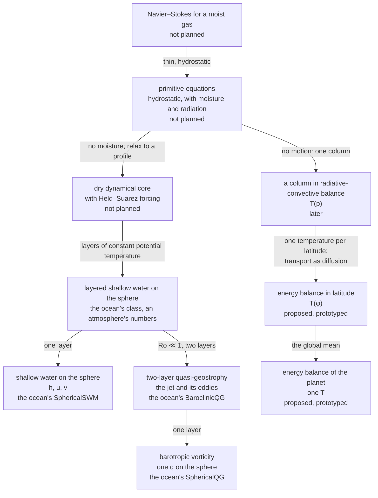

28 Nov 2026 · J. Emmanuel Johnson (drafted with Claude Code)

## Decision

Proposed, for review: `sesmax-atmos` is the atmosphere component of sesmax. It holds two kinds of model. The first is thermodynamic, an energy balance in zero and in one dimension, which is the smallest model that has a climate. The second is dynamic, and it is the ocean's family again: shallow water and quasi-geostrophy on a sphere or a channel, with an atmosphere's depth, stratification and forcing.
Proposed: sunlight is not a component. The insolation at the top of the atmosphere is a known field, a covariate, and what the atmosphere does with it is a term of the model.
Recommended for what is open: the rotating-fluid models that the ocean and the atmosphere share move to one package below both, and each component keeps its numbers, its forcing, its scenarios and what it shows.
Alternative: copy the classes into `sesmax-atmos`, which needs no new package and gives two copies of every stencil choice to keep in step.
Status: proposed. Nothing is built. The numbers are from a scratch prototype of 28 November. It is step P2 of geostack's plan for the workspace, and sesmax#232 is its epic.

## Motivation

The ocean package answers a question about the sea surface. The first question that needs an atmosphere is different: what does the ocean feel? The wind over a gyre and the heat through the surface are prescribed today, as a pattern with an amplitude. The next step is a wind that comes from a model, so that it can be estimated with the ocean and not only given to it.

The second question is the oldest in climate. How warm is a planet, given its sunlight, its albedo and its greenhouse? An energy balance model answers it in one line, and its answer has the property that makes climate hard: two stable states for the same sunlight, one with ice and one without. A model of that kind costs nothing to run, and it is where to test anything that estimates a parameter of a climate.

Neither question needs a weather model. A dry dynamical core is thousands of lines and a time step of minutes over the globe, and what an assimilation window needs from the atmosphere is usually a balanced flow and a heat budget. So the package starts at the bottom of the family and goes up only as far as a question asks.

## User stories

- As someone **coupling** an ocean, I want a wind and a heat flux that respond to the sea surface, from a model small enough to sit inside an optimiser.
- As someone **estimating a climate parameter**, I want a model with a known sensitivity, so that I can check an estimate against a formula.
- As someone **studying a tipping point**, I want the two states of an ice-covered and an ice-free planet, and the gradient of one with respect to the sunlight.
- As a **modeller of the mid-latitudes**, I want the two-layer quasi-geostrophic model of the jet and its eddies, with the forcing that maintains them.
- As someone **comparing with a satellite**, I want what the model shows at the top of the atmosphere, the outgoing longwave radiation, and not only its temperature.

## Background: the maths

### The family

An atmosphere is a rotating, stratified, compressible gas, heated from below and cooled to space. Its equations are the same Navier–Stokes equations the ocean starts from, with two differences that matter: the gas is compressible, so density follows pressure, and its heating is internal, by radiation and by the condensation of water. The family below has two branches, one that keeps the motion and one that keeps the heat.



**The dynamic branch is the ocean's.** A layer of air of constant potential temperature obeys the shallow-water equations, with the depth of the layer for $H$ and a reduced gravity $g' = g \Delta\theta / \theta$ between two layers. Nothing in the equations of [the ocean design](sesmax_ocean.md) changes. What changes is the numbers:

| | Upper ocean | Troposphere |
| --- | --- | --- |
| depth of a layer | 500 m | 5 km |
| reduced gravity | 0.02 m/s² | 1.3 m/s² |
| deformation radius | 30 km | 570 km |
| speed of the internal wave | 3 m/s | 80 m/s |
| speed of the external wave | 200 m/s | 313 m/s |
| speed of the flow | 0.1 to 1 m/s | 10 to 50 m/s |
| what drives it | wind stress, at the top | heating, through the depth |
| what damps it | drag at the bottom | drag at the surface, cooling to space |

The deformation radius is why an atmosphere is cheap where an ocean is not: a grid of 200 km resolves its eddies. The flow is why it is dear: the step is set by speeds a hundred times the ocean's.

**The forcing is what makes it an atmosphere.** A dry model of the jet is kept going by relaxing its temperature towards a profile that is warm at the equator and cold at the poles, and by a drag near the surface ([Held and Suarez, 1994](https://hdl.handle.net/10.1175/1520-0477(1994)075<1825:APFTIO>2.0.CO;2)). In the two-layer quasi-geostrophic model of [Phillips (1956)](https://doi.org/10.1002/qj.49708235202) the same two terms are a relaxation of the thickness between the layers and a drag on the lower one:

```math
\partial_t q_k + J(\psi_k, q_k + \beta y) = -\frac{(-1)^k}{\tau_r} \frac{f_0^2}{g' H_k} \left( \psi_1 - \psi_2 - \psi_e(y) \right) - \delta_{k2} \kappa \nabla^2 \psi_2
```

where $\psi_ e(y)$ is the thermal wind of the profile the model is relaxed to, $\tau_ r$ the time of the relaxation and $\kappa$ the drag. Both are terms in the sense of [the param design](sesmax_param.md), with a prior on $\tau_ r$ and on $\kappa$.

### The energy balance of a planet

The thermodynamic branch ends at one number. A planet absorbs sunlight and emits as a grey body,

```math
C \frac{\mathrm{d} T}{\mathrm{d} t} = \frac{S_0}{4} (1 - \alpha) - \epsilon \sigma T^4
```

where $T$ is the surface temperature, $C$ the heat capacity of a column, $S_ 0$ the solar constant, $\alpha$ the albedo, $\sigma$ the Stefan–Boltzmann constant and $\epsilon$ an effective emissivity, the one number that stands for the greenhouse. The equilibrium and the time to reach it are

```math
T^\star = \left( \frac{S_0 (1 - \alpha)}{4 \epsilon \sigma} \right)^{1/4}
```

and $\tau = C / (4 \epsilon \sigma T^{\star 3})$. With $\epsilon = 0.612$ and $\alpha = 0.3$, $T^\star$ is 287.8 K.

### The energy balance in latitude

One temperature per latitude adds the two things the planet's mean hides: the poles get less sunlight, and heat moves towards them. With $x = \sin \phi$ the sine of latitude, the model of [Budyko (1969)](https://doi.org/10.3402/tellusa.v21i5.10109) and [Sellers (1969)](https://hdl.handle.net/10.1175/1520-0450(1969)008<0392:AGCMBO>2.0.CO;2), in the form of [North (1975)](https://hdl.handle.net/10.1175/1520-0469(1975)032<2033:TOEBCM>2.0.CO;2), is

```math
C \partial_t T = Q s(x) \left( 1 - \alpha(T) \right) - (A + B T) + \partial_x \left( D (1 - x^2) \partial_x T \right)
```

where $Q = S_ 0 / 4$, $s(x)$ is the share of the sunlight at each latitude, with mean 1, $A + B T$ a linear fit of the outgoing longwave radiation, and $D$ a diffusivity that stands for all transport by the atmosphere and the ocean. The albedo is higher where there is ice, $\alpha = \alpha_ i$ for $T < T_ i$ and $\alpha_ o$ otherwise.

Three results follow, and each is a test.

- **The mean without feedback.** The diffusion integrates to zero and $s$ to one, so with a fixed albedo the mean obeys the zero-dimensional balance, with $\bar{T}^\star = (Q (1 - \alpha) - A) / B$.
- **The sensitivity.** Without ice, $\partial \bar{T}^\star / \partial Q = (1 - \alpha) / B$. With an ice edge that moves, it is larger, because warming removes ice and ice reflects.
- **Two states.** For a range of $Q$ there is a stable state with little ice and a stable state covered in it. Which one a run reaches depends on where it starts.

### What a model shows

| Observable | Energy balance | Shallow water | Quasi-geostrophy |
| --- | --- | --- | --- |
| surface temperature | $T$ | — | — |
| outgoing longwave radiation | $A + B T$, or $\epsilon \sigma T^4$ | — | — |
| absorbed sunlight | $Q s (1 - \alpha(T))$ | — | — |
| geopotential height | — | $g h$ | $f_ 0 \psi_ k$ |
| wind | — | $(u, v)$ | $(-\partial_ y \psi_ k, \partial_ x \psi_ k)$ |
| wind stress on what is below | — | from the lowest layer, by a bulk formula | the same |

The last row is the atmosphere's side of a coupling. The formula itself belongs to the coupler, and the atmosphere shows the wind it needs.

### Which one to use

| The question is about | Use | Because | It cannot show |
| --- | --- | --- | --- |
| a parameter of the climate, with a formula to check against | the balance of the planet | one equation, an exact equilibrium | where anything happens |
| ice-albedo feedback, two states, a tipping point | the balance in latitude | the smallest model with an ice edge | weather, a seasonal cycle of the flow |
| Rossby waves, blocking, a wind for a barotropic ocean | barotropic vorticity on the sphere | one scalar, the step of the flow | eddies that grow by themselves |
| the jet, its eddies, a storm track | two-layer quasi-geostrophy with relaxation and drag | baroclinic instability needs two layers | the tropics, fronts |
| waves, adjustment, the tropics | shallow water on the sphere | gravity and Kelvin waves, $f$ through zero | vertical structure, heating |
| an ocean that needs only a responsive heat flux | the balance in latitude over a slab | it closes the heat budget with no dynamics | a wind |

- **Start from the heat.** If the question is about temperature, an energy balance model answers it a thousand times cheaper than a flow.
- **Check the numbers, as in the ocean.** Quasi-geostrophy needs $Ro \ll 1$, which holds in the mid-latitudes and fails in the tropics.
- **A relaxation is a prior in disguise.** The profile $\psi_ e$ says what climate the model has. It is the first thing to estimate, and the last to believe.

## Background: the numerics

- **The step of a flow.** The external wave travels at $\sqrt{g H} = 313$ m/s for a depth of 10 km, so a shallow-water atmosphere on a grid of 100 km steps at about 160 s at a Courant number of 0.5. A quasi-geostrophic one steps with the wind, about ten times longer.
- **The step of an energy balance.** The diffusion sets it, $\Delta t \leq \Delta x^2 C / (2 D)$, and on 90 cells it is about two days. The time to equilibrium is years, so a run to equilibrium is a few thousand steps. An implicit diffusion removes the limit.
- **The pole.** The factor $1 - x^2$ takes the flux to zero at both poles, so the equation in $x$ needs no boundary condition. On a latitude grid the same equation has a metric that vanishes at the pole, and the ocean's spherical models stop short of it.
- **A switch is not differentiable.** The albedo jumps at $T_ i$. A gradient through the jump is zero almost everywhere and undefined at the edge, so the prototype uses a smooth step over one degree. The width is a parameter of the numerics that changes the sensitivity near a tipping point.
- **Two states and a gradient.** Near the edge of the range with two states the sensitivity grows without bound, and a gradient-based estimate that crosses it lands on the other state. A monitor of the ice edge is the watch for it.
- **Precision.** Temperatures in kelvin and balances of a few W/m² lose digits in float32. The linear form in degrees Celsius is better conditioned than $\sigma T^4$.

## What it builds on

| Need | Upstream, by its public name | State |
| --- | --- | --- |
| the model contract, terms, parameters with constraints | `sesmax_core`: `Model`, `TermModel`, `positive`, `interval` | exists |
| shallow water and quasi-geostrophy, on a plane and a sphere | `sesmax_ocean`: `SphericalSWM`, `SphericalQG`, `BaroclinicQG`, `MultilayerShallowWater2D` | exist, in a component the atmosphere may not import |
| relaxation and damping as terms | `sesmax_core`: `RayleighDamping2D`, `RayleighDamping3D`, `LinearDrag2D` | exist |
| diffusion on a grid, with a metric | gridax | exists for the C-grid; the equation in $x = \sin \phi$ is one line |
| an implicit term for a stiff diffusion | integrix: `imex_solver`, through `implicit` of the core | exists |
| dry air: gas constant, heat capacity, potential temperature | `geophysix.thermo`, `geophysix.constants` | exist |
| the Earth: radius, rotation, Coriolis | `geophysix.earth`, `geophysix.rotation` | exist |
| the Stefan–Boltzmann constant, the solar constant | geophysix | missing |
| the insolation at a latitude and a day | geophysix | missing |
| moist air: saturation vapour pressure, latent heat | geophysix | missing |
| a known field in time, read by a term | `Covariates`, sesmax#238 | open |
| a named field that a model shows | `Observable`, proposed in [the core design](sesmax_core.md) | proposed |
| radiances from a profile, for an instrument | radtrax | exists, as an observation operator; it is not a heating rate |
| winds for a tracer | plumax's transport reads them | exists, in its own repository |

Gaps, each with the package that should own it. None is filed.

- **Radiation constants and the geometry of sunlight**, in geophysix. The Stefan–Boltzmann constant, the solar constant, and the daily mean insolation as a function of latitude and day of year, from the declination and the hour angle of sunset. Every component reads the same sunlight, so it belongs below all of them.
- **Moist thermodynamics**, in geophysix, beside the dry-air functions: saturation vapour pressure and the latent heats. The land and the ice designs need the latent heats too.
- **The shared rotating-fluid models.** The ocean's classes run with an atmosphere's numbers (measured below). The tiers forbid one component importing another, so the classes have to sit below both. This page recommends a package for them (open question SA-1).

What stays here: the energy balance models, the atmosphere's forcing terms and their priors, its scenarios, its checks, and what it shows.

## Proposal: the API

| Rung | Name | Job |
| --- | --- | --- |
| structure | `EnergyBalanceState`, `EnergyBalanceParams` | a temperature per latitude; the five numbers of the balance |
| model | `EnergyBalance0D`, `EnergyBalance1D` | the two thermodynamic models |
| model | `two_layer_qg`, `shallow_water_sphere`, `barotropic_vorticity` | the shared fluid models, built with an atmosphere's numbers |
| primitive | `AbsorbedSolar`, `LinearLongwave`, `GreyLongwave`, `MeridionalDiffusion` | the terms of an energy balance |
| primitive | `ThermalRelaxation`, `SurfaceDrag` | the forcing of a dry atmosphere, as terms with priors |
| strategy | `Albedo`: `ConstantAlbedo`, `IceAlbedo(width=)` | how the surface reflects |
| recipe | scenarios `earth_like`, `snowball`, `held_suarez`, `phillips_channel` | named set-ups for a run spec |

```python
# Shapes: Nφ latitudes; the fluid models as in the ocean design

# proposed (sesmax-atmos)
# C ∂ₜT = Q s(x)(1 − α(T)) − (A + B T) + ∂ₓ(D(1 − x²)∂ₓT)
class EnergyBalance1D(TermModel):
    @classmethod
    def create(
        cls,
        n_lat: int = 90,
        *,
        Q: float = 334.4,              # W m⁻², S₀ / 4
        A: float = 203.3,              # W m⁻²
        B: float = 2.09,               # W m⁻² K⁻¹
        D: float = 0.649,              # W m⁻² K⁻¹
        heat_capacity: float = 3.07e8, # J m⁻² K⁻¹, a mixed layer of 75 m
        albedo: Albedo = IceAlbedo(ice=0.62, ocean=0.30, threshold=-10.0, width=1.0),
    ) -> EnergyBalance1D: ...


# proposed (sesmax-atmos): the model is a sum of terms, each with its parameters as leaves
model = AbsorbedSolar(insolation, albedo) + LinearLongwave(A, B) + implicit(MeridionalDiffusion(D))

# proposed (sesmax-atmos): the sunlight is a covariate, not a parameter of the model
# Q(φ, day) from the declination and the length of the day; geophysix (proposed)
insolation = Covariates.from_function(geophysix.radiation.daily_insolation, latitudes)

# proposed (sesmax-atmos): the ocean's two-layer model, with an atmosphere's numbers and forcing
jet = sxa.two_layer_qg(
    nx=128, ny=64, Lx=2.8e7, Ly=1.0e7, H=(5000.0, 5000.0), g_prime=1.3,
    terms=ThermalRelaxation(psi_e, timescale=30 * 86400.0) + SurfaceDrag(timescale=5 * 86400.0),
)

# proposed (sesmax-atmos): what it registers, read by sesmax-experiment
COMPONENT = Component(
    name="atmos",
    models={"ebm0": ..., "ebm1": ..., "two_layer_qg": ..., "shallow_water_sphere": ...},
    observables={"t_surface": ..., "olr": ..., "absorbed_solar": ..., "wind": ..., "geopotential": ...},
    checks={"courant_external": ..., "diffusive_step": ..., "rossby_small": ...},
)
```

- **Terms, from the first model.** The ocean's models have their physics inside `vector_field` and become sums of terms later. The atmosphere starts as sums, so each piece of the balance has its own parameters and its own prior.
- **The albedo is a strategy.** A constant, a step, a smooth step, and later a field from the ice component through the coupler. The model does not know which.
- **Alone before coupled.** Every flux through the surface is a covariate until `sesmax-couple` exists. The coupler then puts another component's output in its place, and the model does not change.

### What it does not own

| Concern | Owner |
| --- | --- |
| Stencils, grids, the sphere | gridax |
| Constants, the geometry of sunlight, thermodynamics of air | geophysix |
| The rotating-fluid models themselves | the package they move to (SA-1) |
| Bulk formulae for the fluxes at the surface | `sesmax-couple` |
| Sea ice and snow, and their albedo as a field | [`sesmax-ice`](sesmax_ice.md) |
| Radiances for an instrument | radtrax |
| Transport of a tracer in the wind | plumax, tracerax |
| A weather model, moisture, clouds, a full radiation scheme | not planned |

## Examples

Each was run as written, in float64, as models of the core through `run_chunks`.

### The balance of a planet

```python
from sesmax_core import Model, Params, State, as_parameter
from sesmax_experiment.run import Timeline, run_chunks

SIGMA = 5.670374419e-8
YEAR = 3.15576e7


class TState(State):
    T: Array


class EBM0Params(Params):
    S0: Array
    albedo: Array
    emissivity: Array
    C: Array


# the prototype of EnergyBalance0D
class EBM0(Model):
    params: EBM0Params

    def vector_field(self, t, state, args=None):
        p = self.params
        # C dT/dt = S₀(1 − α)/4 − εσT⁴
        return TState(T=(p.S0 * (1 - p.albedo) / 4 - p.emissivity * SIGMA * state.T**4) / p.C)

    def apply_boundary_conditions(self, state):
        return state


run = run_chunks(model, TState(T=jnp.asarray(270.0)), Timeline.build(0.0, 60 * YEAR, chunk=YEAR), dt=YEAR / 100)
# run.state.T → 287.8281 K, the analytic equilibrium to seven digits
```

### An ice edge, and the gradient through it

```python
# the prototype of EnergyBalance1D: 90 cells in x = sin(latitude), a smooth ice albedo
def mean_temperature(Q):
    model = ebm(Q)                                  # the model above, with Q as a leaf
    state = run_chunks(model, TState(T=15.0 * jnp.ones(90)), Timeline.build(0.0, 40.0, chunk=5.0), dt=0.005).state
    return jnp.mean(state.T)

# ∂T̄/∂Q through 8,000 steps
jax.grad(mean_temperature)(334.4)    # 0.3349 K per W m⁻², with no ice: (1 − α)/B = 0.3349
jax.grad(mean_temperature)(312.0)    # 1.117, with an ice edge at 50°: a finite difference gives 1.139
```

### The ocean's model as an atmosphere

```python
import sesmax_ocean.qg as qg

# today (sesmax-ocean): two layers of 5 km, g′ = 1.3 m s⁻², a channel of 28,000 by 10,000 km
jet = qg.BaroclinicQG.create(
    nx=64, ny=32, Lx=2.8e7, Ly=1.0e7, f0=1.0e-4, beta=1.6e-11,
    n_layers=2, H=(5000.0, 5000.0), g_prime=(9.81, 1.3), lateral_viscosity=1.0e5,
)
run = run_chunks(jet, state, Timeline.build(0.0, 86400.0, chunk=21600.0), dt=600.0)
# one day in 144 steps, finite; deformation radius √(g′H₁H₂/(H₁+H₂))/f₀ = 570 km
```

## The prototype

Scratch runs on 28 November 2026, in float64 on one CPU, with the packages of sesmax `a34e46c`. The energy balance in latitude has 90 cells, the heat capacity of a mixed layer of 75 m, $A = 203.3$, $B = 2.09$, $D = 0.649$, an ice albedo of 0.62 below $-10$ °C and 0.30 above, smoothed over one degree, and $s(x) = 1 - 0.482 P_ 2(x)$. These are the prototype's choices, of the kind [North (1975)](https://hdl.handle.net/10.1175/1520-0469(1975)032<2033:TOEBCM>2.0.CO;2) uses.

| Check | Result |
| --- | --- |
| balance of the planet after 60 years | 287.8281 K; the analytic equilibrium is 287.8281 K |
| a 1 K anomaly after one e-folding time, 2.94 years | 0.3667 K; $1/e$ is 0.3679 |
| balance in latitude, 80 years from a warm start | mean 14.73 °C, equator 24.2, pole −3.5, no ice; 1.9 s |
| the same from a cold start | mean −36.5 °C, ice to the equator |
| the mean with a fixed albedo, against $(Q (1 - \alpha) - A) / B$ | 14.7306 against 14.7273 |
| $\partial \bar{T} / \partial Q$ with no ice, by reverse mode through 8,000 steps | 0.334877; the formula gives 0.334867 |
| the same with an ice edge at 50°, at $Q = 312$ | 1.117; a finite difference gives 1.139 |
| the ocean's `BaroclinicQG` with an atmosphere's numbers | runs a day in 144 steps, finite |

**Two states.** The mean temperature after 80 years, from a warm and from a cold start.

| $Q$, W/m² | Warm start | Cold start |
| --- | --- | --- |
| 300 | −42.7 °C, ice to the equator | −42.7 °C, ice to the equator |
| 305 | −39.4 °C, ice to the equator | −41.8 °C, ice to the equator |
| 310 | −3.4 °C, ice edge at 44° | −40.9 °C, ice to the equator |
| 315 | 3.7 °C, ice edge at 59° | −40.0 °C, ice to the equator |
| 320 | 9.9 °C, no ice | −39.1 °C, ice to the equator |
| 334.4 | 14.7 °C, no ice | −36.5 °C, ice to the equator |
| 400 | 36.7 °C, no ice | −24.5 °C, ice to the equator |
| 450 | 53.5 °C, no ice | 53.5 °C, no ice |

So the model has two states from 310 to 400 W/m², and the sensitivity with an ice edge is 3.3 times the one without. With these numbers the present-day sunlight leaves no ice, since the pole is at −3.5 °C and the threshold at −10 °C. A model with a small ice cap needs a lower diffusivity or a warmer threshold, which is the kind of choice a prior should carry.

Not covered: the models as sums of terms, an implicit diffusion, a seasonal cycle, the insolation from orbital geometry, the two-layer model with relaxation and drag, shallow water on the sphere with an atmosphere's numbers, any coupling, and any comparison with data.

## Steps and gates

| Step | Pull request | Gate |
| --- | --- | --- |
| A0 | radiation constants and the daily insolation, in geophysix | the annual mean at each latitude against its closed form |
| A1 | the package; `EnergyBalance0D`, `EnergyBalance1D` as sums of terms; the component | the prototype's table, as tests |
| A2 | `IceAlbedo`, a seasonal cycle, the scenarios `earth_like` and `snowball` | the two states, and the gradient against a finite difference away from the edge |
| A3 | the shared fluid models reachable from the atmosphere (after SA-1) | the ocean's equality tests still pass; a two-layer channel runs with an atmosphere's numbers |
| A4 | `ThermalRelaxation`, `SurfaceDrag`, the scenario `phillips_channel` | a jet that goes unstable, with eddies at the deformation radius |
| A5 | the observables, and the atmosphere's side of the surface | waits for `Observable` and for `sesmax-couple` |

A0 to A2 depend on no decision that is open. A3 waits for SA-1.

## Open questions

| ID | Question | Recommended | Alternative |
| --- | --- | --- | --- |
| SA-1 | Where do the fluid models that the ocean and the atmosphere share live? | a package below both, `sesmax-fluid`, with shallow water and quasi-geostrophy on a plane and a sphere | copies in each component; or in the core, which is meant to shrink |
| SA-2 | Is the heat capacity under an energy balance the atmosphere's, or a slab ocean? | a slab that the model owns until the coupler exists, then the ocean's | always the atmosphere's |
| SA-3 | The form of the longwave | linear, $A + B T$, by default; $\epsilon \sigma T^4$ as another term | the grey body only |
| SA-4 | How smooth is the ice albedo? | a width of one degree, stated in the manifest | a hard step, with no gradient at the edge |
| SA-5 | Does the package go up to a dry dynamical core? | no: the two-layer model is the top until a question needs more | yes, as the last step |
| SA-6 | Moisture | not at first; a latent-heat term in the energy balance when the land design needs evaporation | a moist energy balance from the start |

## References

- Budyko, M. I. (1969). [The effect of solar radiation variations on the climate of the Earth](https://doi.org/10.3402/tellusa.v21i5.10109). *Tellus* 21, 611–619.
- Frierson, D. M. W., Held, I. M. and Zurita-Gotor, P. (2006). [A gray-radiation aquaplanet moist GCM. Part I: static stability and eddy scale](https://doi.org/10.1175/JAS3753.1). *Journal of the Atmospheric Sciences* 63, 2548–2566.
- Held, I. M. and Suarez, M. J. (1994). [A proposal for the intercomparison of the dynamical cores of atmospheric general circulation models](https://hdl.handle.net/10.1175/1520-0477(1994)075<1825:APFTIO>2.0.CO;2). *Bulletin of the American Meteorological Society* 75, 1825–1830.
- North, G. R. (1975). [Theory of energy-balance climate models](https://hdl.handle.net/10.1175/1520-0469(1975)032<2033:TOEBCM>2.0.CO;2). *Journal of the Atmospheric Sciences* 32, 2033–2043.
- Phillips, N. A. (1956). [The general circulation of the atmosphere: a numerical experiment](https://doi.org/10.1002/qj.49708235202). *Quarterly Journal of the Royal Meteorological Society* 82, 123–164.
- Sellers, W. D. (1969). [A global climatic model based on the energy balance of the Earth-atmosphere system](https://hdl.handle.net/10.1175/1520-0450(1969)008<0392:AGCMBO>2.0.CO;2). *Journal of Applied Meteorology* 8, 392–400.
- Vallis, G. K. (2017). [Atmospheric and Oceanic Fluid Dynamics](https://doi.org/10.1017/9781107588417). Cambridge University Press.

## Relationships

- Part of: [the workspace overview](sesmax_workspace.md), a component beside the ocean
- Next to: [sesmax-land](sesmax_land.md) and [sesmax-ice](sesmax_ice.md), which share its sunlight and its surface
- Builds on: `sesmax-core`, gridax, geophysix, integrix, and the ocean's fluid models
- Feeds: `sesmax-couple`, later
- Issues: sesmax#232, sesmax#238
