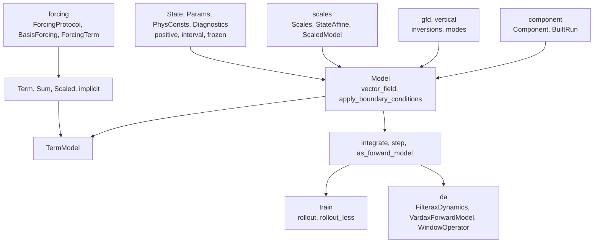

26 Nov 2026 · J. Emmanuel Johnson (drafted with Claude Code)

## Decision

Decided on 30 October 2026, and built: `sesmax-core` is the bottom package of sesmax. It holds the contract that makes a model usable by an integrator, an optimiser, a filter and a run loop at once, and the pieces that every component of the Earth system shares.
Decided by the owner on 26 November: the core composes the machinery of the stack and writes none. Time stepping is diffrax and integrix, stencils and grids are gridax, linear algebra is lineax and gaussx, bases are functax, constants are geophysix.
Proposed, for review: the core shrinks to the contract. The toys move to [`sesmax-testing`](sesmax_testing.md), drag, forcing and bases to [`sesmax-param`](sesmax_param.md), and the known fields stay as `Covariates`.
Alternative: keep one core and add modules to it, which is fewer releases, but then everyone who wants the model contract installs 75 toy names and eight basis constructors.
Status: released at 0.3.1, at sesmax `a34e46c`. [The workspace and core plan](workspace_and_core.md) has the history of the move from somax and what changed since. This page is the design of the package.

## Motivation

A forecast, a gradient, an ensemble and a year-long run are four uses of one function: the map from a state now to a state later.
Most model codes are written for the first use, and the other three are added around them.
The adjoint is then a second code that drifts from the first, the ensemble is a loop over processes, and the parameters are numbers in a namelist that no optimiser can reach.

sesmax is for short-window data assimilation, where all four uses happen in the same hour.
So the model has to be one object that serves them all, and the question for the core is what such an object must promise.

- **To an integrator:** a tendency, and where the boundaries are.
- **To an optimiser:** which numbers are parameters, which of those are free, and which are positive.
- **To a filter or a variational method:** a step from one time to the next, on a flat vector, with a known time.
- **To a run loop:** a way to build it from a file, and something to check and to report.
- **To the next person:** a place to add a term without rewriting the model.

A second reason is that these promises do not depend on the fluid.
An ocean, an atmosphere and a land surface differ in their equations and share the rest: non-dimensional scales, layered vertical structure, elliptic inversions, forcing by a field in time.
What two components share goes here, so that they never import each other.

## User stories

- As a **model author**, I want to write a tendency and boundary conditions and get integration, stepping, gradients and batching, so that I write physics and not plumbing.
- As someone **composing physics**, I want to add and scale terms, and mark one as stiff, so that a different closure is a different sum and an IMEX solver gets the right split.
- As someone **calibrating**, I want a parameter declared positive once, so that an optimiser cannot make a viscosity negative and I never write a softplus.
- As someone **assimilating**, I want any model handed to filterax or vardax through one adapter, so that a new model needs no new assimilation code.
- As someone **scaling a problem**, I want to run in dimensionless units and read results in SI, so that a network or an optimiser sees numbers of order one.
- As a **component author**, I want to register my models under a name, so that a run loop finds them without importing my package.
- As a **reviewer**, I want each promise to be a test.

## Background: the maths

### A model is a vector field

Let $\mathbf{x}(t)$ be the state, a pytree with $D_ x$ values in all, and $\boldsymbol{\theta}$ the parameters.
A model is a tendency $f$ and a boundary operator $B$:

```math
\frac{\mathrm{d}\mathbf{x}}{\mathrm{d}t} = f(t, B[\mathbf{x}]; \boldsymbol{\theta})
```

$B$ fills what the interior does not determine (ghost cells, wall faces) and is a projection, $B[B[\mathbf{x}]] = B[\mathbf{x}]$.
The flow over a step $\Delta t$ is the map

```math
\mathbf{x}_{k+1} = \mathcal{M}_{\Delta t}(\mathbf{x}_k; \boldsymbol{\theta})
```

and everything else is built from $\mathcal{M}$: a trajectory is its composition, a forecast ensemble its vectorisation, and a gradient its transpose.
The tangent-linear model is $\mathbf{M} = \partial \mathcal{M} / \partial \mathbf{x}$ and the adjoint is $\mathbf{M}^\top$, which automatic differentiation gives from the same code ([Griewank and Walther, 2008](https://doi.org/10.1137/1.9780898717761); [Kidger, 2022](https://arxiv.org/abs/2202.02435)).

### A tendency is a sum of terms

```math
f(t, \mathbf{x}) = \sum_i c_i f_i(t, \mathbf{x})
```

with coefficients $c_ i$ that are leaves, so a gradient reaches them.
Each term is explicit or implicit. With $f = f_ \text{E} + f_ \text{I}$, an implicit-explicit scheme takes the non-stiff part explicitly and the stiff part (a diffusion, a fast wave) implicitly ([Ascher et al., 1997](https://hdl.handle.net/10.1016/S0168-9274(97)00056-1)):

```math
\mathbf{x}_{k+1} = \mathbf{x}_k + \Delta t f_\text{E}(\mathbf{x}_k) + \Delta t f_\text{I}(\mathbf{x}_{k+1})
```

in its first-order form, so the step is bound by the advection and not by the diffusion.

### Constrained parameters

A positive parameter $\theta > 0$ is stored as $\rho \in \mathbb{R}$ with $\theta = \log(1 + e^\rho)$, and one in an interval $(a, b)$ as $\theta = a + (b - a) \sigma(\rho)$ with $\sigma$ the logistic function.
An optimiser moves $\rho$ freely and the model always sees a valid $\theta$.

### Scales

With a length $L$, a velocity $U$, a depth $H$ and a Coriolis parameter $f_ 0$, a state is non-dimensionalised leaf by leaf by an affine map

```math
\mathbf{x}' = (\mathbf{x} - \boldsymbol{\mu}) / \boldsymbol{\sigma}
```

and time by $t = T t'$.
The time scale depends on the regime: $T = L / U$ for the advective set, $T = 1 / f_ 0$ for the inertial one.
The same map with a sample mean and standard deviation standardises a state for a network or a filter, so the two compose.
The numbers that say which regime a run is in are $Ro = U / (f_ 0 L)$, $Bu = g H / (f_ 0 L)^2$ and $Fr = U / \sqrt{g H}$.

### Layers and inversions

Two pieces of geophysical fluid dynamics are shared by an ocean and an atmosphere.

A layered fluid has a coupling matrix $\mathbf{A} \in \mathbb{R}^{N_ l \times N_ l}$, built from the thicknesses and the reduced gravities, whose eigenvectors are the vertical modes and whose eigenvalues $\lambda_ m$ give the deformation radii $R_ m = 1 / (f_ 0 \sqrt{\lambda_ m})$.
$\mathbf{A}$ is not symmetric unless the layers are equal, so it is diagonalised through its symmetric similarity $\mathbf{D}^{1/2} \mathbf{A} \mathbf{D}^{-1/2}$.

A balanced flow is recovered from its vorticity by an elliptic problem,

```math
(\nabla^2 - \lambda) \psi = q
```

with $\lambda = 0$ for a streamfunction and $\lambda = 1 / R_ m^2$ for the potential vorticity of mode $m$.

### Forcing by a field in time

A forcing is a field $u(\mathbf{s}, t)$ added to one component of the tendency.
The estimated ones are an expansion in a fixed dictionary,

```math
u(\mathbf{s}, t) = \sum_{a=1}^{D_w} w_a b_a(t) \phi_a(\mathbf{s})
```

where the coefficients $\mathbf{w}$ are the only unknowns and each mode carries a prior standard deviation.
[The param design](sesmax_param.md) has the theory, and takes this over.

### What an assimilation method needs

A filter needs $\mathcal{M}$ on a flat vector, and its ensemble.
A strong-constraint variational method minimises

```math
\mathcal{J}(\mathbf{x}_0) = \frac{1}{2} \Vert \mathbf{x}_0 - \boldsymbol{\mu}_x \Vert^2_{\boldsymbol{\Sigma}_x^{-1}} + \frac{1}{2} \sum_{t \leq T} \Vert \mathbf{y}_t - h(\mathbf{x}_t) \Vert^2_{\boldsymbol{\Sigma}_\varepsilon^{-1}}
```

where $\mathbf{y}_ t$ are observations, $h$ the observation operator, and $\boldsymbol{\Sigma}_ x$, $\boldsymbol{\Sigma}_ \varepsilon$ the background and observation covariances ([Le Dimet and Talagrand, 1986](https://doi.org/10.3402/tellusa.v38i2.11706)).
For a control that is not the state (a forcing, a parameter), the model maps the control through the whole window to the stacked observations, $G(\boldsymbol{\theta}) = \mathrm{vec}[h(\mathbf{x}_ t(\boldsymbol{\theta}))]$, and the cost is that of 3D-Var over $\boldsymbol{\theta}$.
The core supplies $\mathcal{M}$ and $G$; the methods are filterax's and vardax's.

## Background: the numerics

**Leaves and static fields.**
A model is an Equinox module, which is a pytree. An array field is a leaf: `jax.grad` differentiates it, `vmap` batches it, and changing its value does not recompile. A field marked static (a grid size, a boundary type, a scheme) is part of the structure: changing it compiles again, and no gradient reaches it. Putting a number on the wrong side is the commonest mistake, so the rule is in the contract: physical parameters are leaves, shapes and flags are static.

**Compile once.**
A solve compiles for a given structure and set of shapes. `Model.integrate` reuses the compiled solve across calls at other times and other parameter values (sesmax#196), so an optimiser or an ensemble pays for compilation once. The library itself never calls `jit`: the caller does, once, at the top.

**Where the boundary conditions act.**
`integrate` applies $B$ to the initial state, to the input of every tendency evaluation, and to every state it saves (sesmax#201). Between two stages the integrator does not, so a tendency that is non-zero on a wall face accumulates there. A term may fill its own ghosts when advection and diffusion need different values at the same wall.

**Time stepping.**
`integrate` is `diffrax.diffeqsolve`, by default with the pair of [Tsitouras (2011)](https://doi.org/10.1016/j.camwa.2011.06.002) at a fixed step. `step` advances one increment and returns a bare state, and the adapters and `rollout` call only `step`, so a model changes how it integrates by overriding `build_terms`. `imex_solver` and `stable_step` are integrix's, re-exported.

**Adjoints.**
Reverse mode through a solve stores the trajectory. diffrax's default checkpoints it, and supports reverse mode only; forward mode, which Gauss–Newton and Hessian-vector products need, takes `DirectAdjoint`. `rollout` checkpoints a scan of $n$ steps in blocks, storing about $2\sqrt{n}$ states. `rollout` passes no adjoint to the model today, which [the experiment design](sesmax_experiment.md) fixes.

**Located fields.**
A field is an array or a `gridax.CField`, which knows its point on the C-grid. The helpers `each`, `values` and `placed` let one formula serve both, and fields on different points raise instead of adding silently.

**Flattening.**
filterax and vardax work on vectors and sesmax on pytrees. An adapter keeps a template state and flattens on each call, so it stays a clean pytree under `jit` and `vmap`. A transform used to build an ensemble must be given to the adapter too, or the model receives standardised values as if they were physical.

**Time in a step.**
`VardaxForwardModel` passes the same start time to every substep, so it is exact only for an autonomous model. `WindowOperator` lets the model integrate the window with its own clock, which a forcing that depends on time needs.

**Guards.**
A blow-up inside a jitted solve is caught where it happens by `guard_finite`, `guard_positive` and `guard_ceiling` in the tendency. A check between chunks of a run is a monitor of `sesmax-experiment`.

**Optional dependencies.**
`import sesmax_core` loads no assimilation library, no xarray and no flowjax. Each sits behind an extra, and importing its module without the extra raises an `ImportError` that names it.

## What it is built on

| Need | From | Name |
| --- | --- | --- |
| modules as pytrees | equinox | `eqx.Module`, `eqx.field(static=True)` |
| integration, adjoints | diffrax | `diffeqsolve`, `ODETerm`, `MultiTerm`, the solvers |
| the IMEX solver, the stable step, a forward model, sampled paths | integrix | `march.imex_solver`, `march.stable_step`, `march.DiffraxForwardModel`, `SampledPath` |
| constrained parameters | paramax | `Parameterize`, `unwrap` |
| grids, masks, located fields, stencils, ghost fills | gridax | `CartesianCGrid2D`, `Mask2D`, `CField`, `GridOps`, `fill_ghosts` |
| the conjugate-gradient inversions | gaussx | `linear_solve_with_info` |
| interpolation of a record in time | functax | `functax.interp` schemes |
| the dictionaries of the spatial bases | geonnax | `geonnax.basis` |
| constants, the Coriolis parameter | geophysix | `constants.STANDARD`, `rotation` |
| operators and cycles | pipekit | `pipekit_ops.Operator`, `pipekit_cycle.ForwardModel` |
| filters and variational methods, behind `[da]` | filterax, vardax | the adapters' targets |

Four places hold what another library has or will have.

- **The bases** go through `geonnax.basis`; functax has them now, and sesmax#114 moves the core onto it.
- **`SubsampleObs`** is an observation operator of our own, where vardax has `GridPointObs`, `InterpObs` and `MaskedIdentity` (sesmax#27).
- **The toys** move to `sesmax-testing`, with checks built on pipekit-array's `testing` module, which the core does not import today.
- **Drag, wind stress and relaxation** are parameterizations and forcing terms, and move to `sesmax-param`.

## The API



| Rung | Name | Job |
| --- | --- | --- |
| structure | `State`, `Params`, `PhysConsts`, `Diagnostics`, `Domain`, `Scales` | what a model carries |
| primitive | `Term`, the inversions, the vertical modes, the guards | one operation each |
| strategy | `positive`, `interval`, `frozen`, `explicit`, `implicit`, a solver | how a parameter or a term is treated |
| model | `Model`, `TermModel`, `ScaledModel` | a tendency with boundaries |
| step | `integrate`, `step`, `rollout` | the flow |
| recipe | `Component`, the adapters | a model offered to a run or to a method |

### The model contract

```python
# Shapes: the state is a pytree with D_x values

# today (sesmax-core)
class Model(eqx.Module):
    # f(t, x; θ), a tendency with the structure of the state
    @abc.abstractmethod
    def vector_field(self, t: float, state: PyTree, args: PyTree | None = None) -> PyTree: ...

    # B[x]
    @abc.abstractmethod
    def apply_boundary_conditions(self, state: PyTree) -> PyTree: ...

    # optional: energy, invariants, derived fields
    def diagnose(self, state: PyTree) -> Diagnostics: ...

    # x(t₁) from x(t₀), a diffrax Solution whose saved states have B applied
    def integrate(self, state0: PyTree, t0: float, t1: float, dt: float, **kw) -> dfx.Solution: ...

    # x_{k+1} = ℳ(x_k), a bare state
    def step(self, state: PyTree, dt: float, *, t0: float = 0.0, **kw) -> PyTree: ...

    # what a pipekit cycle or a filter drives
    def as_forward_model(self, *, dt: float, dt0: float, **settings) -> DiffraxForwardModel: ...

    # override for an SDE or an IMEX split; never override step
    def build_terms(self) -> dfx.AbstractTerm: ...
```

Two methods are the whole obligation of an author. The rest is derived, and is the same for every model.

### Parameters

```python
# today (sesmax-core)
# θ = softplus(ρ) > 0
def positive(value: ArrayLike) -> Array: ...
# θ = a + (b − a) σ(ρ)
def interval(value: ArrayLike, lower: float, upper: float) -> Array: ...
# a leaf no gradient reaches
def frozen(value: ArrayLike) -> Array: ...
# True at the leaves an optimiser may move
def trainable_mask(tree: PyTree) -> PyTree: ...
```

`Model` unwraps a constrained parameter on the way into `vector_field` and `diagnose`, so a model reads it as a plain array and a gradient lands on the stored value.

### Terms

```python
# today (sesmax-core)
class Term(eqx.Module):
    # fᵢ(t, x), zero in the fields it does not touch
    def __call__(self, t: float, state: PyTree, args: PyTree | None = None) -> PyTree: ...

# f = f₁ + c f₂ − f₃, and f_I marked for the implicit stage
tree = advection + 2.0 * drag - damping + implicit(diffusion)
# (f_E, f_I)
explicit_part, implicit_part = partition(tree)

# today (sesmax-core): a model that is its term tree
model = TermModel(terms=tree)
```

`TermFn` wraps a plain function, and `OperatorTerm` lifts a pipekit operator.

### Scales, forcing, shared physics

```python
# today (sesmax-core)
scales = Scales.advective(L=1e6, U=0.1, f0=1e-4, H=1000.0)   # T = L/U
transform = StateAffine.from_scales(StateClass, scales)      # x' = (x − μ)/σ
scaled = ScaledModel.from_scales(model, scales, StateClass)   # the model in dimensionless units

# today (sesmax-core): u(s, t) = ∑ₐ wₐ bₐ(t) φₐ(s), lifted onto one field
forcing = BasisForcing(coeffs=w, spatial=spatial_from_fourier(...), temporal=HatInTime(knots), grid_shape=shape)
term = ForcingTerm(forcing, place=add_to("q"), grid=grid)

# today (sesmax-core): (∇² − λ) ψ = q
psi = streamfunction_from_vorticity(zeta, dx, dy, bc="dst")
psi = pv_inversion(pv, dx, dy, lambda_=1.0 / radii**2)
# today (sesmax-core): the modes of a layered fluid
modes = decompose_vertical_modes(build_coupling_matrix(H, g_prime), f0)
```

### Adapters and components

```python
# today (sesmax-core), behind [da]
dynamics = FilteraxDynamics(model=model, template=state)              # for filterax
forward = VardaxForwardModel(model=model, template=state, dt=0.05)    # for vardax, autonomous models
window = WindowOperator(build_model=..., ...)                         # G(θ), for a forcing or a parameter

# today (sesmax-core): what a package of models registers,
# under the entry-point group "sesmax.components"
COMPONENT = Component(name="ocean", models={...}, scenarios={...}, checks={...}, evaluate=...)
```

### Proposed

```python
# proposed (sesmax-core): the known fields from outside the model, by name
# c(s, t), in their own units, outside the trainable leaves
covariates = Covariates({"tau_x": InterpolatedField.from_data(ts, tau_x), "depth": depth})


# proposed (sesmax-core): one more field of Component
# the priors of a model's state and of its own parameters, by path
priors: Callable[[Model, PyTree], Mapping[str, Any]] | None = None


# proposed (sesmax-core): rollout takes the adjoint of the solve
def rollout(model, state0, *, dt, n_steps, adjoint=None, ...) -> PyTree: ...
```

- **Covariates.** [The param design](sesmax_param.md) separates a known field from a forcing term. The reader of records (`InterpolatedForcing` today) stays in the core under that name, since a component, a term and an experiment all read it.
- **Priors.** [The experiment design](sesmax_experiment.md) reads a component's priors through this field, so it names no component.
- **Adjoints.** Recommended: a spec that integrix resolves to a diffrax adjoint. Alternative: a diffrax object, which ties every caller to diffrax.
- **What leaves.** The toys (75 names) to `sesmax-testing`; drag, wind, relaxation, the bases and `BasisForcing` (most of the 48 names of `forcing`) to `sesmax-param`; `SubsampleObs` to vardax's operators. Recommended: move with the spelling kept, so a caller changes one import.

## Examples

Each block ran on 26 November 2026 at sesmax `a34e46c`, in float64; the printed values are in the comments.

### A model in ten lines

```python
import diffrax as dfx
import jax
import jax.numpy as jnp
from sesmax_core import Model, positive

# Shapes: D_x = 3


# dx/dt = −r x, with r > 0
class Decay(Model):
    rate: jax.Array

    def vector_field(self, t, state, args=None):
        return -self.rate * state

    def apply_boundary_conditions(self, state):
        return state


# today (sesmax-core): r is stored in softplus space
model = Decay(rate=positive(0.5))

# x₁ = ℳ(x₀)
model.step(jnp.ones(3), 0.1)                       # [0.9512, 0.9512, 0.9512], and exp(−0.05) = 0.9512

# x(t) at three times
solution = model.integrate(
    jnp.ones(3), 0.0, 1.0, 0.1, saveat=dfx.SaveAt(ts=jnp.linspace(0.0, 1.0, 3))
)
solution.ys.shape                                  # (3, 3), and ys[-1, 0] = 0.60653 = exp(−0.5)
```

### A model as a sum of terms

```python
from sesmax_core import TermModel
from sesmax_core.terms import Term, implicit, partition


# −r x
class Relax(Term):
    rate: jax.Array

    def __call__(self, t, state, args=None):
        return -self.rate * state


# a constant push
class Push(Term):
    amplitude: jax.Array

    def __call__(self, t, state, args=None):
        return self.amplitude * jnp.ones_like(state)


# today (sesmax-core): f = 1 − 2 · 0.5 x
model = TermModel(terms=Push(jnp.asarray(1.0)) + 2.0 * Relax(jnp.asarray(0.5)))
model.vector_field(0.0, jnp.ones(2))               # [0., 0.]

# a stiff relaxation goes to the implicit stage of an IMEX solver
explicit_part, implicit_part = partition(Push(jnp.asarray(1.0)) + implicit(Relax(jnp.asarray(50.0))))
```

### The gradient of a trajectory with respect to a parameter

```python
import equinox as eqx
from sesmax_core.testing import L96State, Lorenz96
from sesmax_core.train import rollout, rollout_loss

# Shapes: D_x = 40; T = 20 steps of 0.01

# today (sesmax-core)
# dx_k/dt = (x_{k+1} − x_{k−2}) x_{k−1} − x_k + F
truth = Lorenz96.create(F=8.0)
state0 = L96State.init_state(ndim=40, key=jax.random.key(0))
# → (T, D_x)
reference = rollout(truth, state0, dt=0.01, n_steps=20)

# ℒ(F) = (1/T) ∑ₜ ‖xₜ(F) − xₜʳᵉᶠ‖², at F = 7
gradient = eqx.filter_grad(rollout_loss)(Lorenz96.create(F=7.0), state0, reference, dt=0.01)
# dℒ/dF = −0.0247: the loss falls as F rises towards 8
```

### One model, two assimilation libraries

```python
# today (sesmax-core), behind [da]; not run for this page
from sesmax_core.da import FilteraxDynamics, VardaxForwardModel, make_ensemble

# N_E = 32 members around the background
ensemble = make_ensemble(state0, jax.random.key(1), size=32, std=0.1)
# for a filterax filter
dynamics = FilteraxDynamics(model=truth, template=state0)
# for a vardax 4D-Var
forward = VardaxForwardModel(model=truth, template=state0, dt=0.05)
```

The twin experiments in `packages/sesmax-core/tests/da/` run both, and the notebooks `data_assimilation_etkf` and `data_assimilation_4dvar` show them.

## What is available

Counted at sesmax `a34e46c`: 15,612 lines of source, 1,026 test functions in 60 files, 89 names at the top level, and 30 executed notebooks in the docs.

| Module | Holds | State |
| --- | --- | --- |
| top level | `Model`, `TermModel`, `State`, `Params`, `PhysConsts`, `Diagnostics`, `positive`, `interval`, `frozen`, `trainable_mask` | released |
| `terms` | `Term`, `TermFn`, `Sum`, `Scaled`, `Compose`, `explicit`, `implicit`, `partition`, `build_diffrax_terms`, `OperatorTerm` | released |
| `scales` | `Scales`, `StateAffine`, `ScaledModel` | released |
| `domain` | `Domain`, `TimeDomain` | released |
| `fields` | `each`, `map_fields`, `placed`, `values`, `is_field` | released |
| `solvers` | `imex_solver`, `imex_stepsize_controller`, `stable_step`, from integrix | released |
| `train` | `rollout`, `rollout_loss`, `state_mse`, `ModelStep` | released |
| `guards` | `guard_finite`, `guard_positive`, `guard_ceiling` | released |
| `validation` | `require_positive`, `require_non_negative`, `reject_derived_kwargs` | released |
| `gfd` | `streamfunction_from_vorticity`, `pressure_from_divergence`, `pv_inversion`, `ModalTransform`, `StratificationProfile`, the Burger-number helpers | released |
| `vertical` | `multilayer`, `build_coupling_matrix`, `decompose_vertical_modes`, `layer_to_mode`, `mode_to_layer`, `barotropic_filter` | released |
| `operators` | `ModelOp`, `OperatorTerm` | released |
| `component` | `Component`, `Builder`, `BuiltRun`, `Check` | merged, after 0.3.1 |
| `da`, behind `[da]` | `FilteraxDynamics`, `VardaxForwardModel`, `WindowOperator`, `SubsampleObs`, `state_to_vector`, `make_ensemble` | released |
| `io`, behind `[xarray]` | states to and from xarray and Zarr, with scale metadata | released |
| `flows`, behind `[flows]` | `StateAffineBijection`, `to_flowjax`, `learned_prior` | released |
| `forcing` | 48 names: fields in time, `BasisForcing`, `ForcingTerm`, eight spatial and four temporal bases, drag, wind stress, relaxation | released; most of it moves to `sesmax-param` |
| `testing` | 75 names: Lorenz-63, Lorenz-96 and its two-scale form, the 1-D and 2-D PDE problems, linear shallow water | released; moves to `sesmax-testing` |
| monitors, checkpoints, the run loop | — | moved to `sesmax-experiment` (sesmax#197) |
| `Covariates`, `Component.priors`, an adjoint in `rollout` | — | proposed here |
| gradient checks against finite differences | — | open, sesmax#105 |
| the levels L1 to L3 (`_src/array.py`, `Step`, `simulate`) | — | open, sesmax#29 |
| the walls of the linear shallow-water toys | defect | sesmax#202 |

The tutorial series, steps 1 to 16, follows the twelve steps to Navier–Stokes of [Barba and Forsyth (2018)](https://doi.org/10.21105/jose.00021) and continues to gravity waves and geostrophic adjustment.

## Open questions

| ID | Question | Recommended | Alternative |
| --- | --- | --- | --- |
| SC-1 | What stays in the core after the split? | the contract, terms, scales, fields, the shared physics, the adapters, `Component`, `Covariates` | the core as it is |
| SC-2 | Do `gfd` and `vertical` belong here? | yes, while two components need them | gridax for the inversions, as they are built from the grid |
| SC-3 | The adjoint of `rollout` | an integrix spec | a diffrax adjoint |
| SC-4 | The adapters, here or in `sesmax-experiment`? | here: they are the contract seen from a method | there, with the problem that uses them |
| SC-5 | The moved names | keep the spelling, no alias left behind | deprecated aliases for one release |

## References

- Ascher, U. M., Ruuth, S. J. and Spiteri, R. J. (1997). [Implicit-explicit Runge–Kutta methods for time-dependent partial differential equations](https://hdl.handle.net/10.1016/S0168-9274(97)00056-1). *Applied Numerical Mathematics* 25, 151–167.
- Barba, L. A. and Forsyth, G. F. (2018). [CFD Python: the 12 steps to Navier–Stokes equations](https://doi.org/10.21105/jose.00021). *Journal of Open Source Education* 1, 21.
- Griewank, A. and Walther, A. (2008). [Evaluating Derivatives](https://doi.org/10.1137/1.9780898717761). SIAM.
- Kidger, P. (2022). [On neural differential equations](https://arxiv.org/abs/2202.02435). DPhil thesis, University of Oxford.
- Le Dimet, F.-X. and Talagrand, O. (1986). [Variational algorithms for analysis and assimilation of meteorological observations: theoretical aspects](https://doi.org/10.3402/tellusa.v38i2.11706). *Tellus A* 38, 97–110.
- Lorenz, E. N. (1963). [Deterministic nonperiodic flow](https://hdl.handle.net/10.1175/1520-0469(1963)020<0130:DNF>2.0.CO;2). *Journal of the Atmospheric Sciences* 20, 130–141.
- Tsitouras, C. (2011). [Runge–Kutta pairs of order 5(4) satisfying only the first column simplifying assumption](https://doi.org/10.1016/j.camwa.2011.06.002). *Computers & Mathematics with Applications* 62, 770–775.
- Vallis, G. K. (2017). [Atmospheric and Oceanic Fluid Dynamics](https://doi.org/10.1017/9781107588417), 2nd ed. Cambridge University Press.

## Relationships

- Part of: [the workspace packages](workspace_packages.md), tier 0
- History: [the workspace and core plan](workspace_and_core.md), and [the shared-core design](shared_core.md)
- Builds on: equinox, diffrax, integrix, paramax, gridax, gaussx, functax, geonnax, geophysix, pipekit
- Used by: [sesmax-ocean](sesmax_ocean.md), [sesmax-testing](sesmax_testing.md), [sesmax-param](sesmax_param.md), [sesmax-experiment](sesmax_experiment.md)
- Issues: sesmax#27, sesmax#29, sesmax#105, sesmax#114, sesmax#202
