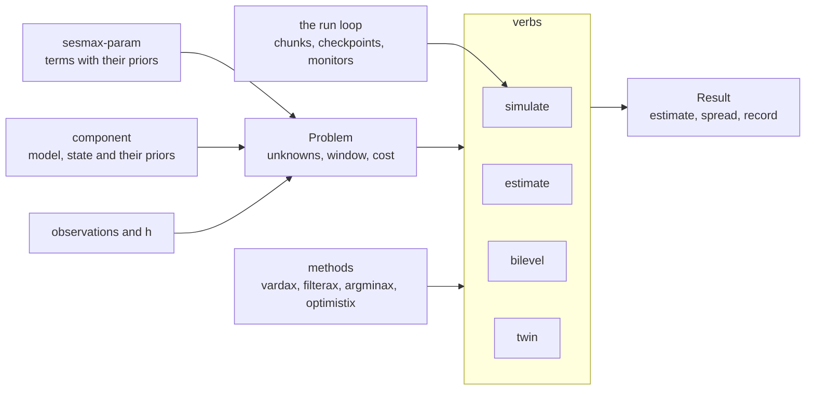

25 Nov 2026 · J. Emmanuel Johnson (drafted with Claude Code)

## Decision

Proposed: one package, `sesmax-experiment`, is where a model is used. It has two halves. The run (chunks, checkpoints, monitors, run specs, a command line) is [the design of the run](sesmax_experiment_run.md) and epic sesmax#186, and this page does not repeat it. The work (a problem, and a thin verb for each thing we do with it) is what this page designs.
Decided by the owner: the package covers simulation, parameter estimation, state estimation, bilevel problems and monitoring, and the monitors move to it.
Recommended for what is open: the problem says what is unknown, and one verb, `estimate`, covers states, parameters and forcing.
Alternative: one function per kind of estimation, which reads well until someone wants two unknowns at once.
Also decided, on 25 November: an experiment holds no default priors. Those of a parameterization sit in `sesmax-param`, and those of a model in its component.
Decided by the owner on 26 November: sesmax composes the machinery of the stack and does not write its own. A piece that is missing is added first to the package that owns the concept, and the section on what this package builds on says which piece goes where.
Proposed on 26 November, for review: a control is a role in one experiment and not a kind of input. The covariates of [the param design](sesmax_param.md), the known fields from outside the model, are never in it.
Proposed on 27 November, for review: an observation operator is a composition of three maps, what the model can show, a reading at places and times, and the instrument, and this package writes none of them. A control may be in other coordinates than the unknowns, through a basis or a decoder, with whitening as the first case.
Status: proposed, for review. The numbers are from a scratch prototype. The run half (W3) is under way: the package, the monitors and the runs in chunks are merged (sesmax#197, sesmax#198). The work half is step W6 of [the workspace packages](sesmax_workspace.md) and waits for `sesmax-param`.

## Motivation

We have a model of the sea surface, a week of altimeter tracks, and a wrong guess of everything: the state at the start of the week, the wind, the drag. What we do next depends on which of these we believe. Believing the wind, we estimate the state. Believing the state, we estimate the drag. Usually we believe none of them entirely.

Each of these is a different script today, and the scripts do not share much.

- `control_filter` says which leaf of a forcing is unknown, `trainable_mask` which leaf of a model, and the state is unknown by being the argument of a function.
- The prior of a forcing is `SpatialBasis.prior_std`, that of an ensemble is the `std` of `make_ensemble`, and a parameter has none.
- `WindowOperator` estimates a forcing or a parameter, "not an initial state", as its docstring says. `VardaxForwardModel` is for a state, and is exact only for an autonomous model.
- `rollout` integrates with the model's clock but takes no diffrax adjoint, which rules out Gauss–Newton, second derivatives and bilevel problems (measured below).

So the joint problem, in which the state and the drag are both unknown, has no home, although it is the one in the motivating example. The methods exist, in vardax, filterax, argminax and pipekit-cycle. What is missing is the problem that they all solve.

## User stories

- As a **modeller**, I want to simulate a scenario from a file, get restarts and a health record, and never hold a year of snapshots in memory.
- As someone **assimilating** altimetry, I want to say "the state and the drag are unknown, with these priors" and get an estimate with an uncertainty.
- As someone **comparing methods**, I want one problem and three methods (4D-Var, an ensemble Kalman inversion, a filter), so that a difference in the answer is a difference in the method.
- As someone **tuning a prior**, I want the gradient of the validation error with respect to the prior scale, so that I do not grid search it.
- As someone **planning an observing system**, I want a twin experiment, in which the truth is mine and the answer is known.
- As the person **on call** for a long run, I want it to stop with a reason when the state, the mass or the innovations go wrong, and to restart from the last good point.

## Background: the maths

### One control

Collect what might be unknown in one vector: the initial state $\mathbf{x}_ 0 \in \mathbb{R}^{D_ x}$, parameters $\boldsymbol{\theta} \in \mathbb{R}^{D_ \theta}$, forcing or model-error coefficients $\mathbf{w} \in \mathbb{R}^{D_ w}$. An experiment picks the rows it treats as unknown and stacks them in $\mathbf{z} \in \mathbb{R}^{D_ z}$, with prior $\mathcal{N}(\boldsymbol{\mu}_ z, \boldsymbol{\Sigma}_ z)$, $\boldsymbol{\mu}_ z \in \mathbb{R}^{D_ z}$ and $\boldsymbol{\Sigma}_ z \in \mathbb{R}^{D_ z \times D_ z}$. The rest is fixed. The trajectory $\mathbf{x}_ t(\mathbf{z}) \in \mathbb{R}^{D_ x}$, for $t = 1, \dots, T$, is a deterministic function of $\mathbf{z}$.

The covariates, the known fields that the terms read ([the param design](sesmax_param.md) defines them), are not in this list. They are known by definition and sit outside the trainable leaves. An uncertain covariate is first promoted to a parameter with a prior, and then it is a row of $\mathbf{z}$ like any other. Which rows are unknown is the experiment's choice alone: no component or term records it. Today's `control_filter` and `trainable_mask` are two early forms of that choice.

```math
\mathcal{J}(\mathbf{z}; \boldsymbol{\nu}) = \frac{1}{2} \Vert \mathbf{z} - \boldsymbol{\mu}_z \Vert^2_{\boldsymbol{\Sigma}_z^{-1}} + \frac{1}{2} \sum_{t \leq T} \Vert \mathbf{y}_t - h_t(\mathbf{x}_t(\mathbf{z})) \Vert^2_{\boldsymbol{\Sigma}_\varepsilon^{-1}}
```

where $\mathbf{y}_ t \in \mathbb{R}^{D_ y}$ are the observations, $h_ t: \mathbb{R}^{D_ x} \to \mathbb{R}^{D_ y}$ the observation operator, $\boldsymbol{\Sigma}_ \varepsilon \in \mathbb{R}^{D_ y \times D_ y}$ the observation error, and $\boldsymbol{\nu} \in \mathbb{R}^{D_ \nu}$ whatever the cost itself depends on (a prior scale, an error variance). It is the cost of variational assimilation ([Le Dimet and Talagrand, 1986](https://doi.org/10.3402/tellusa.v38i2.11706); [Bannister, 2017](https://doi.org/10.1002/qj.2982)), of Bayesian calibration, and of a retrieval, depending on $\mathbf{z}$.

| Work | $\mathbf{z}$ | Answer | Method from |
| --- | --- | --- | --- |
| Simulation | nothing | $\mathbf{x}_ t(\boldsymbol{\mu}_ z)$ | diffrax, the run loop |
| State estimation | $\mathbf{x}_ 0$ | $\hat{\mathbf{z}} = \mathrm{argmin} \ \mathcal{J}$ | vardax |
| Sequential state | $\mathbf{x}_ t$ in cycles | $p(\mathbf{x}_ t \mid \mathbf{y}_ {1:t})$ | filterax, `pipekit_cycle.DACycle` |
| Parameter estimation | $\boldsymbol{\theta}$ | $\hat{\mathbf{z}}$, or an ensemble | optimistix, argminax, `filterax.EKI` |
| Forcing, model error | $\mathbf{w}$ | $\hat{\mathbf{z}}$ | vardax, with `sesmax-param` |
| Joint | any of these together | $\hat{\mathbf{z}}$ | any gradient method |
| Bilevel | $\boldsymbol{\nu}$ | $\hat{\boldsymbol{\nu}}$ | the adjoints of argminax |
| Monitoring | nothing | a verdict | monitors |

### Whitening

With $\mathbf{z} = \boldsymbol{\mu}_ z + \boldsymbol{\Sigma}_ z^{1/2} \boldsymbol{\omega}$ and $\boldsymbol{\omega} \in \mathbb{R}^{D_ z}$, the prior term is $\frac{1}{2} \Vert \boldsymbol{\omega} \Vert^2$. Stack the misfits $(\mathbf{y}_ t - h_ t(\mathbf{x}_ t)) / \sigma_ \varepsilon$ in $\mathbf{r} \in \mathbb{R}^{N_ y}$, for $\boldsymbol{\Sigma}_ \varepsilon = \sigma_ \varepsilon^2 \mathbf{I}$ and $N_ y = T D_ y$ observations. Then $\mathcal{J} = \frac{1}{2} \Vert \boldsymbol{\omega} \Vert^2 + \frac{1}{2} \Vert \mathbf{r}(\boldsymbol{\omega}) \Vert^2$ and the Gauss–Newton Hessian is

```math
\mathbf{P}^{-1} = \mathbf{I} + \mathbf{J}_r^\top \mathbf{J}_r
```

with $\mathbf{J}_ r = \partial \mathbf{r} / \partial \boldsymbol{\omega} \in \mathbb{R}^{N_ y \times D_ z}$. Its inverse $\mathbf{P} \in \mathbb{R}^{D_ z \times D_ z}$ is the posterior covariance of $\boldsymbol{\omega}$ in the linear-Gaussian case, and an approximation elsewhere. The degrees of freedom for signal, the number of directions which the observations determine and not the prior, are

```math
d_s = D_z - \mathrm{tr}(\mathbf{P})
```

([Rodgers, 2000](https://doi.org/10.1142/3171)). These are the summaries a record should keep, and argminax computes both.

### The control in other coordinates

Whitening is one case of a map from the numbers a method moves to the unknowns. Write the map $g_ \text{dec}: \mathbb{R}^{D_ \omega} \to \mathbb{R}^{D_ z}$, so that $\mathbf{z} = g_ \text{dec}(\boldsymbol{\omega})$, and give $\boldsymbol{\omega}$ a penalty $\mathcal{R}(\boldsymbol{\omega})$ in place of the prior term:

```math
\mathcal{J}(\boldsymbol{\omega}) = \mathcal{R}(\boldsymbol{\omega}) + \frac{1}{2} \sum_{t \leq T} \Vert \mathbf{y}_t - h_t(\mathbf{x}_t(g_\text{dec}(\boldsymbol{\omega}))) \Vert^2_{\boldsymbol{\Sigma}_\varepsilon^{-1}}
```

| Map | $g_ \text{dec}(\boldsymbol{\omega})$ | $\mathcal{R}(\boldsymbol{\omega})$ | $D_ \omega$ |
| --- | --- | --- | --- |
| whitening | $\boldsymbol{\mu}_ z + \boldsymbol{\Sigma}_ z^{1/2} \boldsymbol{\omega}$ | $\frac{1}{2} \Vert \boldsymbol{\omega} \Vert^2$ | $D_ z$ |
| a reduced basis | $\boldsymbol{\mu}_ z + \boldsymbol{\Phi} \boldsymbol{\omega}$ | $\frac{1}{2} \boldsymbol{\omega}^\top \boldsymbol{\Sigma}_ \omega^{-1} \boldsymbol{\omega}$ | the number of modes |
| a learned decoder | a network | a weight decay, or $\frac{1}{2} \Vert \boldsymbol{\omega} \Vert^2$ | the latent size |

where $\boldsymbol{\Phi} \in \mathbb{R}^{D_ z \times D_ \omega}$ holds the modes (empirical orthogonal functions, Fourier modes, wavelets) and $\boldsymbol{\Sigma}_ \omega \in \mathbb{R}^{D_ \omega \times D_ \omega}$ is the prior covariance of their coefficients. The map is chosen per unknown: the state may be in a basis while a drag is whitened.

Three consequences follow.

- A gradient method needs only $g_ \text{dec}$ and $\mathcal{R}$. An ensemble method that starts from members in $\mathbf{z}$ also needs the way back, an encoder $g_ \text{enc}: \mathbb{R}^{D_ z} \to \mathbb{R}^{D_ \omega}$, and it sees the observations through the lifted operator $h \circ g_ \text{dec}$ ([Peyron et al., 2021](https://doi.org/10.1002/qj.4153)).
- With a basis the estimate stays in the span of $\boldsymbol{\Phi}$, so $d_ s \leq D_ \omega$, and the posterior covariance of the unknowns is $\boldsymbol{\Phi} \mathbf{P} \boldsymbol{\Phi}^\top$. The part of the truth outside the span, $(\mathbf{I} - \boldsymbol{\Phi} \boldsymbol{\Phi}^\top)(\mathbf{z} - \boldsymbol{\mu}_ z)$ for orthonormal modes, is an error the cost cannot see. A twin measures it.
- The map changes the unknowns and not the model. The trajectory $\mathbf{x}_ t$ is still that of the full model. A model whose own state is reduced is a different thing: it is a model, so it is `sesmax-core`'s, and a `Problem` takes it like any other.

### The observation operator

An observation is rarely a component of the state. An altimeter measures the height of the sea surface at a point of its track, at the time it passes, and the model carries vorticity at the corners of a grid, at its own steps. So $h$ is a composition of three maps, each owned by a different package:

```math
h = m \circ \mathbf{L} \circ o
```

| Map | From, to | What it knows | Owner |
| --- | --- | --- | --- |
| the observable $o$ | the state, to a field on the grid | the model: height from a streamfunction, a velocity from a thickness flux | the component |
| the reading $\mathbf{L}$ | a field, to values at $N_ y$ places and times | the grid, its points and its land | functax, with gridax |
| the instrument $m$ | those values, to what is measured | a footprint, an averaging kernel, a radiative transfer | vardax, radtrax |

The reading is linear in the field. With $N$ grid values, $\mathbf{L} \in \mathbb{R}^{N_ y \times N}$ has a few non-zeros per row, so $\mathbf{L}$ and $\mathbf{L}^\top$ both cost their number of non-zeros, and the Jacobian of the whole operator is $\mathbf{H} = \mathbf{J}_ m \mathbf{L} \mathbf{J}_ o$. Four things decide its rows.

- **The point of the field.** On a C-grid the height is at cell centres, the eastward velocity on the east faces and the northward velocity on the north faces, half a cell apart. Row $i$ takes its corners from the coordinates of the field's own point. Reading a face field with the centre coordinates is an error of half a cell times its gradient.
- **Land.** A corner on land holds no value. With $m_ k \in \lbrace 0, 1 \rbrace$ the wet flag of corner $k$ and $w_ {ik}$ its weight,

```math
\hat{y}_i = \frac{\sum_k w_{ik} m_k x_k}{\sum_k w_{ik} m_k}
```

and an observation with no wet corner is dropped.
- **Time.** An observation at $t_ i$ falls between two steps, $t_ n \leq t_ i \leq t_ {n+1}$. With $\alpha_ i = (t_ i - t_ n) / \Delta t$,

```math
\hat{y}_i = (1 - \alpha_i) (\mathbf{L} \mathbf{x}_n)_i + \alpha_i (\mathbf{L} \mathbf{x}_{n+1})_i
```

which is second order in $\Delta t$. Taking the nearest step is first order, and for a signal moving at speed $c$ it displaces the observation by up to $c \Delta t / 2$.
- **The footprint.** A pixel is an average over an area, so its row is a set of area weights and not four corners. It is still a sparse row.

What no reading can give is the part of the signal that the grid does not resolve. That is the representation error, and it belongs in $\boldsymbol{\Sigma}_ \varepsilon$ with the error of the instrument ([Janjić et al., 2018](https://doi.org/10.1002/qj.3130)).

### Two families of methods

Gradient methods minimise $\mathcal{J}$ with $\nabla_ {\mathbf{z}} \mathcal{J}$ through the window. Ensemble methods approximate it with the spread of $N_ {\mathcal{E}}$ runs. The ensemble Kalman inversion ([Iglesias et al., 2013](https://doi.org/10.1088/0266-5611/29/4/045001)) moves members $\mathbf{z}^{(e)}$ with

```math
\mathbf{z}^{(e)} \leftarrow \mathbf{z}^{(e)} + \boldsymbol{\Sigma}_{zg} \left( \boldsymbol{\Sigma}_{gg} + \alpha^{-1} \boldsymbol{\Sigma}_\varepsilon \right)^{-1} \left( \mathbf{y} + \boldsymbol{\varepsilon}^{(e)} - g(\mathbf{z}^{(e)}) \right)
```

where $g(\mathbf{z})$ stacks $h_ t(\mathbf{x}_ t(\mathbf{z}))$, $\boldsymbol{\Sigma}_ {zg}, \boldsymbol{\Sigma}_ {gg}$ are ensemble covariances, $\boldsymbol{\varepsilon}^{(e)} \sim \mathcal{N}(\mathbf{0}, \alpha^{-1} \boldsymbol{\Sigma}_ \varepsilon)$, and $\alpha$ is a step in pseudo-time. It needs no gradient, so it works where the model has none, and its answer stays in the span of the ensemble. Filters are sequential in time instead ([Evensen, 1994](https://doi.org/10.1029/94JC00572); [Carrassi et al., 2018](https://doi.org/10.1002/wcc.535) for an overview of both families). The problem does not depend on the choice.

### Bilevel

The scales in $\boldsymbol{\nu}$ are set by how well the estimate serves a second purpose: an outer loss $\mathcal{L}$, for example the misfit on observations kept out of the window, or the error against the truth in a twin.

```math
\hat{\boldsymbol{\nu}} = \mathrm{argmin}_{\boldsymbol{\nu}} \ \mathcal{L}(\hat{\mathbf{z}}(\boldsymbol{\nu}))
```

```math
\hat{\mathbf{z}}(\boldsymbol{\nu}) = \mathrm{argmin}_{\mathbf{z}} \ \mathcal{J}(\mathbf{z}; \boldsymbol{\nu})
```

At the inner minimum $\nabla_ {\mathbf{z}} \mathcal{J} = \mathbf{0}$, so by the implicit function theorem ([Blondel et al., 2021](https://arxiv.org/abs/2105.15183); [Franceschi et al., 2018](https://arxiv.org/abs/1806.04910))

```math
\frac{\mathrm{d}\mathcal{L}}{\mathrm{d}\boldsymbol{\nu}} = \nabla_{\boldsymbol{\nu}} \mathcal{L} - \left( \nabla^2_{\boldsymbol{\nu} \mathbf{z}} \mathcal{J} \right) \left( \nabla^2_{\mathbf{z}} \mathcal{J} \right)^{-1} \nabla_{\mathbf{z}} \mathcal{L}
```

with $\nabla^2_ {\boldsymbol{\nu} \mathbf{z}} \mathcal{J} \in \mathbb{R}^{D_ \nu \times D_ z}$ and $\nabla^2_ {\mathbf{z}} \mathcal{J} \in \mathbb{R}^{D_ z \times D_ z}$. It costs one linear solve with the Hessian, of any accuracy, and no memory of the iterations. In learned variational assimilation the inner solver is learned as well ([Fablet et al., 2021](https://doi.org/10.1029/2021MS002572)), which vardax owns.

### Monitoring an analysis

A run has its monitors. An analysis has statistics that say whether its error model is right. With the innovation $\mathbf{d}_ t = \mathbf{y}_ t - h_ t(\mathbf{x}^\text{f}_ t)$ of a forecast, a consistent system has $\mathbb{E}[\mathbf{d} \mathbf{d}^\top] = \mathbf{H} \boldsymbol{\Sigma}_ x \mathbf{H}^\top + \boldsymbol{\Sigma}_ \varepsilon$, so

```math
\chi^2_t = \frac{1}{D_y} \mathbf{d}_t^\top \left( \mathbf{H} \boldsymbol{\Sigma}_x \mathbf{H}^\top + \boldsymbol{\Sigma}_\varepsilon \right)^{-1} \mathbf{d}_t
```

averages to 1, where $\mathbf{H} \in \mathbb{R}^{D_ y \times D_ x}$ is the linearised observation operator and $\boldsymbol{\Sigma}_ x$ the forecast covariance. [Desroziers et al. (2005)](https://doi.org/10.1256/qj.05.108) give the matching diagnosis of $\boldsymbol{\Sigma}_ \varepsilon$. For a deterministic window, the cost at the minimum has expectation $\frac{1}{2} N_ y$ when the priors are right, which the prototype uses.

### Twin experiments

Truth from a model, observations from the truth, an estimate, and the error against the truth ([Hoffman and Atlas, 2016](https://doi.org/10.1175/bams-d-15-00200.1)). It is the only place where the estimate can be wrong in a way we can see. Two choices matter: the model that makes the truth must not be the one that assimilates it, or the experiment shows the method in its best case, and the truth has to lie on the attractor of its model, which we get by spinning it up.

## Background: the numerics

**Which adjoint.**
A gradient through a diffrax solve has an `adjoint` ([Kidger, 2022](https://arxiv.org/abs/2202.02435)), and they do not support the same things:

| diffrax adjoint | Reverse | Forward | Used for |
| --- | --- | --- | --- |
| `RecursiveCheckpointAdjoint` (default) | yes | no | gradients of $\mathcal{J}$, low memory |
| `DirectAdjoint` | yes | yes | Gauss–Newton, Hessian-vector products, the implicit gradient |

A bilevel problem differentiates the gradient once more and needs Hessian-vector products, so it needs the second. The prototype measured both: the first fails with a `TypeError`. `rollout` and `rollout_loss` pass no adjoint to the model, so they have to grow one, and the problem decides which.

**Memory.**
Reverse mode stores the window. Checkpointing a scan of $n$ steps in blocks of $k$ stores $n/k + k$ states, so $k = \sqrt{n}$, at about one more forward pass. `rollout` already takes `checkpoint` and `save_every`.

**Scaling.**
Whitening does two jobs: it makes the prior the identity, and it removes units. A Krylov solver sees the second, because its rate depends on the conditioning. A quasi-Newton method, such as the BFGS of optimistix ([Rader et al., 2024](https://arxiv.org/abs/2402.09983)), builds its own scaling, so it may not (see the prototype).

**Window length.**
On a chaotic model the gradient is useful only within the horizon, so a window is chosen from the horizon table of [sesmax-testing](sesmax_testing.md), for the size of the increment. A window longer than that can leave the minimiser far above the cost at the truth, and the twin experiment shows it.

**Time.**
A forcing or an error that depends on time needs the model's clock in every step. `rollout` carries `(t, state)`, and `VardaxForwardModel` does not. The problem always goes through a rollout that carries time.

**Reading a field at a point.**
A functax plan is built once, on the host, from the coordinates of the field's point and the places of the observations. Applying it traces, and its adjoint is written by hand. The policy `missing="renormalise"` is the land rule above, for a field that holds NaN on land. Measured on 27 November on a 10 by 8 grid with land in the east (see the prototype): the adjoint passes the dot-product test to rounding, a point beside the coast reads 13.8 without the rule and 13.0 with it, and a face field read with centre coordinates is off by 1.0, half a cell of a gradient of 2.

**Between two steps.**
There are two ways to blend in time. The first saves the window and reads it with one plan over time and space, which is exact for the formula above and stores $T$ fields. The second reads inside the rollout, where each step adds its share $(1 - \alpha_ i)$ or $\alpha_ i$ to the observations it brackets, and stores nothing. The first is the one to build, because `rollout` already saves the window for the reverse pass. Observations are padded to a fixed count with a validity flag, as vardax's `PointObsBatch` does, so that a new pass of a satellite does not compile again.

**A reduced control.**
With $D_ \omega$ in the tens, the Gauss–Newton Hessian is a small dense matrix, so its inverse, $d_ s$ and the posterior covariance are exact and cheap. An ensemble of more than $D_ \omega$ members spans the whole control.

**Compile once.**
Until sesmax#196, `Model.integrate` compiled again on every call. A problem builds one function of the control and reuses it, so an optimiser or an ensemble compiles once.

**Precision.**
4D-Var on a chaotic model loses significant digits, so the default of the package is float64, and a float32 run is opt-in.

## What it builds on

A method, a diagnostic and a score are already in the stack, so this package writes none. What it adds is the problem that every method solves, and the verbs that hand a problem to one.

| Need | Built on | On `main` |
| --- | --- | --- |
| BFGS, Levenberg–Marquardt, the implicit gradient of a minimum | optimistix: `BFGS`, `LevenbergMarquardt`, `ImplicitAdjoint` | exists |
| Gauss–Newton with matrix-free CG, its dual form, solvers stopped early | argminax: `GaussNewtonCG`, `dual_solve`, `KStep`, `OneStep` | exists |
| the Laplace posterior, the Gauss–Newton Hessian, variances, samples | `argminax.curvature`: `Laplace`, `gauss_newton`, `marginal_variance`, `sample_by_perturbation` | exists |
| $d_ s$, the information content, the evidence, a prior precision from the evidence | `argminax.diagnose`: `degrees_of_freedom`, `information_content`, `evidence`, `optimize_prior_precision` | exists |
| ensemble filters and inversion | filterax: `EKI`, `ETKF` and the rest | exists |
| $\chi^2$, Desroziers, spread against skill, rank histograms | `filterax.utils`: `chi2_consistency`, `desroziers_R_estimate`, `spread_skill_ratio`, `rank_histogram` | exists |
| 4D-Var, strong, weak and incremental | vardax: `StrongFourDVar`, `WeakFourDVar`, `IncrementalFourDVar` | exists |
| reading a field at points, with its adjoint and the rules for land and for the outside | `functax.interp`: `Linear`, `Plan`, `Policies`; `functax.geometry`: `RectilinearGrid`, `Points` | exists |
| the coordinates of each point of a C-grid, and its wet cells | gridax: `grid.coords(axis, at=)`, `Mask2D.wet(at=)` | exists |
| footprints and area averages | `functax.interp`: `Conservative`, `Binning` | exists |
| padded point observations and their cost | vardax: `PointObsBatch`, `point_obs_cost`, `GridPointObs`, `MaskedIdentity` | exists, at the step of an index |
| an observation operator around a plan | vardax: `InterpObs` has its own bilinear stencil, clamps at the edge and takes a bare array | vardax#277, open |
| averaging kernels, several instruments | vardax: `AveragingKernel`, `MultiInstrumentFusion` | exists |
| a control in a basis or in a network | vardax: `ReducedBasis`, `StateParameterization`, `LinearParameterization`, `NeuralFieldParameterization`, `eof_basis` | exists |
| filtering in a latent space | filterax: `LatentETKF`, `LatentLETKF`, `LiftedObs`, `EncodedDynamics`, `latent_ensemble` | exists |
| the blend in time between two steps | a functax plan over time and space does it, and `GridPointObs` does not | vardax#319, open |
| the scores of a twin | `diagnostix.skill`: `rmse`, `bias`, `crps`, `spread_skill` | exists |
| cycling windows | pipekit-cycle: `DACycle`, `WindowedCycle` | exists |
| the adjoint of a solve, checkpointing | integrix: `adjoint.Checkpointed`, `adjoint.to_diffrax_adjoint` | exists |
| the condition number of a whitened Hessian | nothing | missing |
| the gradient of an outer loss through a minimum | nothing, by name | missing |

What is missing goes upstream, before the step here that needs it. The issues are argminax#102 and argminax#103, under geostack#327.

- **A bilevel gradient**, in argminax, which owns the adjoints of a minimiser: the gradient of an outer loss through $\hat{\mathbf{z}}(\boldsymbol{\nu})$ by the implicit function theorem, with Hessian-vector products. Today every caller writes `jax.grad` through `optx.minimise` with `ImplicitAdjoint`. `bilevel` here calls it.
- **The condition number of a whitened Gauss–Newton Hessian**, in `argminax.diagnose`, next to `degrees_of_freedom`.

- **An observation operator built from a functax plan**, in vardax, which owns observation operators. vardax#277 asks for it already. It should take the plan as given, so that the point of the field, the land rule and the blend in time arrive with the plan and vardax learns nothing about C-grids. Until it lands, `sesmax-experiment` applies the plan itself, which is one call.
- **A blend in time in the point operator**, in vardax. `GridPointObs` compares an observation with the state at one step, and vardax#319 asks for the blend of the two saved states around its time. On a field that grows by 10 per unit of time and is saved every 0.5, a time rounded to a step reads 2.0 and 2.5 off, and the blend is exact. `sesmax-experiment` does not wait for it, because the plan over time and space already blends.

Two needs are met by choosing the right piece. `rollout` passes no adjoint today (step E1), and the choice of one is integrix's `to_diffrax_adjoint`, which already resolves to `DirectAdjoint`. The synthetic observations of a twin are a draw from an observation operator and its noise, which is a few lines here.

What stays here: `Problem`, which joins a model, the priors and the observations into one function of the control; the verbs; `Result`, which collects what the libraries above return; and the run loop.

## Proposal: the API



| Rung | Name | Job |
| --- | --- | --- |
| structure | `Window`, `Observations`, `Result` | when, what was seen, what came out |
| structure | `Problem` | the model, what is unknown, and the cost |
| step | `simulate`, `estimate`, `bilevel`, `twin` | one verb per kind of work |
| strategy | `Method` | how the unknown is found, from another library |
| recipe | a run spec and the command line | [the run](sesmax_experiment_run.md) |

### The problem

Here $\mathbf{z}$ is the control, $\boldsymbol{\omega}$ the whitened control, $\mathbf{r}$ the stacked misfit.

```python
# Shapes: D_z control; D_x state; T steps; D_y observations per time; N_y = T · D_y

# proposed (sesmax-experiment)
class Window(eqx.Module):
    """The assimilation window: T steps of dt from t0."""

    dt: float = eqx.field(static=True)
    n_steps: int = eqx.field(static=True)
    t0: float = eqx.field(static=True, default=0.0)


# proposed (sesmax-experiment)
class Observations(eqx.Module):
    """y_t with a diagonal error; a masked value carries no weight."""

    values: Float[Array, "time obs"]
    std: Float[Array, "*broadcast"]
    operator: Callable[[PyTree], Float[Array, " obs"]]
    mask: Bool[Array, "time obs"] | None = None


# proposed (sesmax-experiment)
class Problem(eqx.Module):
    """What is known, what is unknown and how well.

    𝒥(z; ν) = ½ ‖z − μ_z‖²_(Σ_z⁻¹) + ½ ∑ₜ ‖y_t − h(x_t(z))‖²_(Σ_ε⁻¹)

    ``unknowns`` maps a path to its prior: "state", "params.F", a path in the
    terms of the model. What is not listed is fixed. Where ``unknowns`` is None,
    it is ``priors(model, state)``, all that the packages below declare.
    """

    model: Model
    state: PyTree
    window: Window
    observations: Observations
    unknowns: Mapping[str, Gaussian] | None = None
    adjoint: dfx.AbstractAdjoint = eqx.field(default_factory=dfx.RecursiveCheckpointAdjoint)

    # z = μ_z + Σ_z^½ ω
    def unwhiten(self, white: Float[Array, " control"]) -> dict[str, PyTree]: ...

    # x_t(z), through a rollout that carries the time
    def run(self, white: Float[Array, " control"]) -> PyTree: ...

    # ω ↦ (ω, r): the least-squares form, for Gauss–Newton
    def residual(self, white: Float[Array, " control"]) -> Float[Array, " stacked"]: ...

    # 𝒥(ω)
    def cost(self, white: Float[Array, " control"]) -> Float[Array, ""]: ...
```

The default priors come from the packages that own them, and this function only merges them.

```python
# proposed (sesmax-core): one more field of Component, which is today (sesmax-core)
# the priors of a model's state and of its own parameters, by path
priors: Callable[[Model, PyTree], Mapping[str, Any]] | None = None


# proposed (sesmax-ocean): what its Component registers
# x_0 ~ 𝒩(μ_x, σ_x²) per field, and the layer depths
def ocean_priors(model: Model, background: PyTree) -> dict[str, Gaussian]: ...


# proposed (sesmax-experiment)
# the component's priors, and those of the terms from sesmax_param.priors
def priors(model: Model, state: PyTree) -> dict[str, Gaussian]: ...
```

An entry of `unknowns` replaces the default of the same path, for one run.

The control of a `Problem` is a flat vector, and that is what every method in the stack takes. `unwhiten` gives it back as named pieces.

### Observations at places and times

`Observations` above is the simple case: the same $D_ y$ values at every step, through one function of the state. Observations from an instrument are scattered in space and time, and they get their own structure. It holds the data and names the three maps, and the `Problem` builds the reading from them.

```python
# Shapes: N_y observations, padded; D_s space coordinates

# proposed (sesmax-core): what a model can show, and where it lives
class Observable(eqx.Module):
    """A field of the model on its grid: the map o, with what a reading needs."""

    # o(x), a located field, so its point is known
    read: Callable[[PyTree], CField]
    # coords(axis, at=), today (gridax)
    grid: Any
    # wet(at=), today (gridax); None for no land
    mask: Any | None = None


# proposed (sesmax-experiment)
class PointObservations(eqx.Module):
    """y_i at (s_i, t_i); a row with ``valid`` False carries no weight."""

    values: Float[Array, " obs"]
    std: Float[Array, " obs"]
    coords: Float[Array, "obs space"]
    times: Float[Array, " obs"]
    valid: Bool[Array, " obs"]
    # the map o: a name the component registers, such as "ssh", or an Observable
    observable: str | Observable = eqx.field(static=True)
    # the map L: a functax scheme, and how to blend in time
    scheme: Scheme = eqx.field(static=True, default_factory=Linear)
    in_time: Literal["linear", "nearest"] = eqx.field(static=True, default="linear")
    # the map m: from the values read to what is measured; None is the identity
    instrument: Callable[[Float[Array, " obs"]], Float[Array, " obs"]] | None = None


# proposed (sesmax-experiment)
# h = m ∘ L ∘ o, on a saved window: (T, ...) in each field → (N_y,)
def observation_operator(
    observations: PointObservations, model: Model, window: Window
) -> Callable[[PyTree], Float[Array, " obs"]]: ...
```

A `Problem` takes one set of observations or several, one per instrument, and their misfits stack in $\mathbf{r}$. A velocity from a drifter is two sets, one of `"u"` and one of `"v"`, at the same places.

### The control in other coordinates

An entry of `unknowns` is a `Gaussian`, which is whitened, or any map that satisfies vardax's `StateParameterization`: a `decode`, a `penalty` and an `init_control`. So a basis and a network need no code here.

```python
# today (vardax): the protocol
class StateParameterization(Protocol):
    # z = g_dec(ω)
    def decode(self, theta: Any, t: float | None = None) -> Float[Array, "..."]: ...

    # ℛ(ω)
    def penalty(self, theta: Any) -> Float[Array, ""]: ...

    def init_control(self, *, key: PRNGKeyArray | None = None) -> Any: ...


# today (vardax): z = μ_z + Φ ω, ℛ = ½ ωᵀ Σ_ω⁻¹ ω
state_in_modes = vdx.LinearParameterization(vdx.linear_basis(modes, variance=1.0), background=mean)

# proposed (sesmax-experiment): Gaussian satisfies the same protocol, as the whitening map
unknowns = {"state": state_in_modes, "params.F": sxe.Gaussian(7.0, 1.0)}
```

An ensemble method that works in the latent space takes the encoder as well, and that is filterax's `LatentETKF` with its `LiftedObs`. `Ensemble` hands them the problem's maps.

### The methods

```python
# proposed (sesmax-experiment)
class Method(Protocol):
    """How a problem is solved. Nothing in here is an algorithm of ours."""

    def __call__(self, problem: Problem) -> Result: ...


# today (optimistix)
method = sxe.Minimise(optx.BFGS(rtol=1e-8, atol=1e-8))
# today (optimistix), needs adjoint=DirectAdjoint()
method = sxe.LeastSquares(optx.LevenbergMarquardt(rtol=1e-8, atol=1e-8))
# today (argminax), matrix-free
method = sxe.LeastSquares(amx.GaussNewtonCG(rtol=1e-8, atol=1e-8))
# today (filterax)
method = sxe.Ensemble(fx.EKI, n_members=50)
# today (vardax), state and model error only
method = sxe.Variational(vdx.WeakFourDVar)
```

### The verbs

```python
# proposed (sesmax-experiment)
# x_t(μ_z), no unknowns used
def simulate(problem: Problem, *, at: Float[Array, " control"] | None = None) -> PyTree: ...


# proposed (sesmax-experiment)
# ẑ = argmin 𝒥(z), or an ensemble of z
def estimate(problem: Problem, *, method: Method) -> Result: ...


# proposed (sesmax-experiment)
# ν̂ = argmin ℒ(ẑ(ν)), by the implicit gradient
# the gradient is argminax's (proposed); this verb calls it
def bilevel(
    problem: Problem,
    *,
    outer: Callable[[Result], Float[Array, ""]],
    over: Callable[[Problem, Float[Array, " nu"]], Problem],
    nu0: Float[Array, " nu"],
    method: Method,
    optimiser: optax.GradientTransformation,
) -> BilevelResult: ...


# proposed (sesmax-experiment)
# truth, observations of it, and an estimate with its error against it
def twin(
    truth: Model,
    problem: Problem,
    *,
    method: Method,
    key: PRNGKeyArray,
) -> TwinResult: ...
```

`Gaussian` is gaussx's, re-exported by [`sesmax-param`](sesmax_param.md). Two helpers serve the bilevel problems:

```python
# proposed (sesmax-experiment)
# σ of one unknown replaced, for an outer problem over prior scales
def with_prior_std(problem: Problem, path: str, std: Float[Array, "*shape"]) -> Problem: ...


# proposed (sesmax-experiment)
# mean of (y_t − h(x_t(ẑ)))² over the observations that ``mask`` selects
# diagnostix.skill.rmse, squared (today)
def misfit(result: Result, mask: Bool[Array, "time obs"]) -> Float[Array, ""]: ...
```

### The result

```python
# proposed (sesmax-experiment)
class Result(eqx.Module):
    """An estimate, with what is needed to judge it."""

    # ẑ, by path
    estimate: dict[str, PyTree]
    # ω̂, the same in whitened coordinates
    white: Float[Array, " control"]
    # P, the whitened posterior covariance, or None where a method gives an ensemble
    covariance: Float[Array, "control control"] | None
    # d_s = D_z − tr P, from argminax.diagnose.degrees_of_freedom
    dof_signal: Float[Array, ""] | None
    cost_start: Float[Array, ""]
    cost_end: Float[Array, ""]
    # E[𝒥] = ½ N_y when the priors are right
    expected_cost: Float[Array, ""]
    converged: Bool[Array, ""]
    n_evaluations: int

    # predictions against observations: innovations, χ², spread, from filterax.utils
    def diagnose(self) -> Mapping[str, Float[Array, ""]]: ...


# proposed (sesmax-experiment)
class TwinResult(eqx.Module):
    """An estimate next to the truth it was made from."""

    result: Result
    # RMS error of the estimate and of the prior, by path, from diagnostix.skill.rmse
    rmse: dict[str, Float[Array, ""]]
    prior_rmse: dict[str, Float[Array, ""]]
```

### The run half

[The design of the run](sesmax_experiment_run.md) holds `run_chunks`, `RunSpec`, `simulate`, `spinup`, `restart`, checkpoints, the health record and the command line, all merged, and proposes what a run needs next: means, ensembles, an early end, and a fit watched with the same monitors and record. This page adds two things for this half: `simulate` of a spec and `simulate` of a `Problem` are the same verb on different inputs, and a `Result` writes the same record as a run, so a cost history and a health record share a reader.

### What it does not own

| Concern | Owner |
| --- | --- |
| Minimisers, curvature, evidence | argminax, optimistix |
| Variational costs, their adjoints | vardax |
| Filters, smoothers, ensemble processes | filterax |
| Cycles, protocols | pipekit-cycle |
| Priors of parameterizations, forcing, model error | `sesmax-param` |
| Priors of a model's state and own parameters | the component |
| Interpolation, its adjoint, area weights | functax |
| Observation operators, averaging kernels | vardax |
| What a model can show as a field | the component |
| A radiance from a state | radtrax, through sesmax#240 |
| Bases, decoders, filters in a latent space | vardax, filterax |
| A model in reduced coordinates | `sesmax-core` |
| Training an emulator, an encoder or an amortised map | pipekit-train, with the networks of geonnax |
| Scores against other methods | geobench |

## Examples

### Simulate

```python
import sesmax_experiment as sxe
from sesmax_core.testing import L96State, Lorenz96

# Shapes: D_x = 40; T = 20 steps of 0.05

# today (sesmax-core)
# dx_k/dt = (x_{k+1} − x_{k−2}) x_{k−1} − x_k + F
model = Lorenz96.create(F=8.0)
# proposed (sesmax-experiment)
window = sxe.Window(dt=0.05, n_steps=20)
# proposed (sesmax-experiment)
# → (T, D_x) in each field
trajectory = sxe.simulate(sxe.Problem(model=model, state=state, window=window, observations=None))
```

### Estimate a state

```python
# y_t = x_t[::2] + ε_t, with σ_ε = 0.5
observations = sxe.Observations(values=y, std=0.5, operator=lambda s: s.x[::2])
# proposed (sesmax-experiment)
problem = sxe.Problem(
    model=model,
    state=state,
    window=window,
    observations=observations,
    unknowns={"state": sxe.Gaussian(background, 1.0)},
)
# proposed (sesmax-experiment)
# ẑ = argmin 𝒥(z)
result = sxe.estimate(problem, method=sxe.Minimise(optx.BFGS(rtol=1e-8, atol=1e-8)))
```

### Read a field along a track

The reading runs today, with gridax and functax alone. The grid has 8 by 6 cells and a ghost ring, with land east of $x = 5.5$.

```python
import gridax
import jax.numpy as jnp
from functax.geometry import Axis, Points, RectilinearGrid
from functax.interp import Linear, Policies

# Shapes: Ny = 8, Nx = 10 with the ghost ring; N_y = 3

# today (gridax)
grid = gridax.CartesianCGrid2D.from_interior(8, 6, 8.0, 6.0)
mask = gridax.Mask2D.from_mask(jnp.ones(grid.shape, bool).at[:, 6:].set(False))
y_T, x_T = jnp.meshgrid(grid.coords("y", at="T"), grid.coords("x", at="T"), indexing="ij")

# today (functax): L for a field at point ``at``
def reading(at, places):
    source = RectilinearGrid((Axis(grid.coords("y", at=at)), Axis(grid.coords("x", at=at))))
    return Linear().plan(source, Points(places), policies=Policies(missing="renormalise"))

# (y, x): open sea, beside the coast, on land
places = jnp.array([[3.0, 2.5], [3.0, 5.4], [3.0, 7.5]])
# η = 2x + y at the centres, NaN on land
eta = jnp.where(mask.wet(at="T"), 2.0 * x_T + y_T, jnp.nan)
# ŷ = L η → [8.0, 13.0, nan]
reading("T", places)(eta.reshape(-1))
# Lᵀ r → (Ny · Nx,), a residual sent back to the grid
reading("T", places).adjoint(jnp.array([1.0, 2.0, 0.0]))
```

The same along a track, as observations of a problem.

```python
# proposed (sesmax-experiment): sea-surface height where and when the altimeter saw it
track = sxe.PointObservations(
    values=ssh, std=0.03, coords=places, times=times, valid=valid, observable="ssh"
)
# proposed (sesmax-experiment)
problem = sxe.Problem(
    model=model,
    state=state,
    window=window,
    observations=track,
    unknowns={"state": sxe.Gaussian(background, 1.0)},
)
```

### Estimate a state in a few modes

```python
# today (vardax): z = μ_z + Φ ω, with D_ω = 20 modes of a long run
modes = vdx.linear_basis(Phi, variance=1.0)
# proposed (sesmax-experiment): the same problem, with the state in the basis
reduced = dataclasses.replace(
    problem, unknowns={"state": vdx.LinearParameterization(modes, background=mean)}
)
# proposed (sesmax-experiment)
# ω̂ = argmin 𝒥(ω), with 20 unknowns
result = sxe.estimate(reduced, method=sxe.LeastSquares(amx.GaussNewtonCG(rtol=1e-8, atol=1e-8)))
```

### Estimate the state and a parameter together

```python
# proposed (sesmax-experiment): one more key
joint = dataclasses.replace(
    problem,
    unknowns={"state": sxe.Gaussian(background, 1.0), "params.F": sxe.Gaussian(7.0, 1.0)},
)
# proposed (sesmax-experiment)
result = sxe.estimate(joint, method=sxe.Minimise(optx.BFGS(rtol=1e-8, atol=1e-8)))
print(result.estimate["params.F"], result.dof_signal)
```

### Compare methods on the same problem

```python
# proposed (sesmax-experiment)
for method in (sxe.Minimise(optx.BFGS(rtol=1e-8, atol=1e-8)), sxe.Ensemble(fx.EKI, n_members=50)):
    result = sxe.estimate(joint, method=method)
```

### Learn a prior scale

Here $\boldsymbol{\nu}$ is the logarithm of the prior standard deviation of the state, and the outer loss is the misfit on observations kept out of the inner cost.

```python
# proposed (sesmax-experiment)
def with_scale(problem: sxe.Problem, log_std: Float[Array, " nu"]) -> sxe.Problem:
    # σ_x = e^ν
    return sxe.with_prior_std(problem, "state", jnp.exp(log_std))


# proposed (sesmax-experiment); held_out is a mask of the observations
tuned = sxe.bilevel(
    problem,
    outer=lambda result: sxe.misfit(result, held_out),
    over=with_scale,
    nu0=jnp.zeros(1),
    method=sxe.Minimise(optx.BFGS(rtol=1e-10, atol=1e-10)),
    optimiser=optax.adam(0.1),
)
```

### A twin

```python
# proposed (sesmax-experiment): truth F = 8, assimilated with F = 7
report = sxe.twin(Lorenz96.create(F=8.0), joint, method=method, key=jax.random.key(0))
print(report.rmse, report.prior_rmse)
```

### Watch a run

```python
from sesmax_experiment.monitor import ConservationDriftMonitor, NonFiniteMonitor
from sesmax_experiment.run import Timeline, run_chunks

# today (sesmax-experiment)
monitors = [NonFiniteMonitor(), ConservationDriftMonitor(rtol_fail=1e-6)]
# today (sesmax-experiment)
# chunks of 0.25 to t = 1, a snapshot every 0.5
timeline = Timeline.build(0.0, 1.0, chunk=0.25, snapshot=0.5)
# today (sesmax-experiment)
run = run_chunks(model, state, timeline, dt=0.01, monitors=monitors)
```

## The prototype

Scratch runs on 25 November 2026, in float64, at sesmax `5c998e6`, with diffrax 0.7.2, optimistix 0.1.0, filterax 0.0.6 and vardax 0.3.5. Lorenz-96, 40 variables, 20 steps of 0.05, observations of every second variable with standard deviation 0.5 (400 of them), a prior of standard deviation 1.0 on the state, and the prior on the forcing $F \sim \mathcal{N}(7, 1)$ where the truth is 8.

**One problem, four unknowns.** Only the `unknowns` differ.

| Unknown | $D_ z$ | Cost at the start | Cost at the end | Estimate of $F$ | State error at the start (RMS) |
| --- | --- | --- | --- | --- | --- |
| state, with $F = 7$ fixed | 40 | 4626 | 225.5 | 7 (wrong) | 0.495 |
| state, with $F = 8$ fixed | 40 | 4138 | 197.1 | 8 (right) | 0.263 |
| $F$, with the background state | 1 | 4626 | 4128.4 | 7.883 | 0.855 (prior) |
| state and $F$ | 41 | 4626 | 197.0 | 7.874 | 0.264 |

The cost at the end says which problem is well posed: 197 where $F$ is right or unknown, and 225.5 where it is wrong and fixed, against an expected $\frac{1}{2} N_ y = 200$. In the third row $F$ lands near 8 although the state is wrong, and the cost of 4128 says that this fit failed. The joint problem recovers the state as well as knowing $F$ does, and $F$ with a posterior spread of 0.115 and an actual error of 0.126.

**The information.** Of 41 controls, 37.7 degrees of freedom for signal. The whitened Gauss–Newton Hessian has condition number 3.9e+03. If $F$ is carried in units a thousand times smaller, without whitening, the number is 1.4e+08.

**BFGS does not care.** The same cost with the forcing control scaled by 1 and by 1,000: 455 and 448 steps, both to 197.0 and to $F = 7.874$. So the scaling above is a statement about Krylov solvers, and the whitened control keeps its other jobs. Levenberg–Marquardt took 31 steps, to the same answer.

**Adjoints.** Levenberg–Marquardt and the implicit gradient need forward mode.

| Adjoint | Levenberg–Marquardt | Implicit gradient of the outer loss |
| --- | --- | --- |
| `RecursiveCheckpointAdjoint` (default) | `TypeError` | `TypeError` |
| `DirectAdjoint` | 31 steps | 8.289e-04 |

The gradient agrees with a central difference of the outer loss, 8.287e-04 at a step of 1e-2 and 8.288e-04 at 1e-3, in the logarithm of the prior scale at 1. It cost 59 s, most of it compilation.

**An ensemble on the same problem.** `filterax.EKI` with 50 members estimates $F = 7.973 \pm 0.056$ when it is given the true initial state. That is not the problem of the third row, which starts from the background, so the two numbers are not a comparison. One problem object for both methods is what would make them one.

**Reading a field.** A second scratch run on 27 November 2026, at `aee04fb`, with functax 0.0.13 and gridax 0.3.3, on the grid of the track example, for fields that are linear in space.

| Check | Result |
| --- | --- |
| a centre field read at three places, no land | 8.0, 13.8, 18.0, exact |
| the same with land east of $x = 5.5$ and `missing="renormalise"` | 8.0, 13.0, NaN |
| an east-face field read with its own coordinates | 8.0, 13.8, 18.0, exact |
| the same field read with the centre coordinates | 9.0, 14.8, 19.0 |
| the dot-product test of the adjoint | 0.0 |
| three places at three times, on four saved steps, one plan | exact, with a gradient on 10 of 320 values |

**A basis on Lorenz-96.** The same run took the modes of a long Lorenz-96 trajectory. Twenty of the forty hold 90 % of the variance and leave an error of 1.5 in the state, three times the observation error. Lorenz-96 does not reduce, so a reduced control is not tested on it. It needs a model with a red spectrum, which is the ocean's.

Not covered: `Problem` itself (the prototype is a 30-line class), model error as an unknown, `twin`, filters, the three maps composed on a model, a footprint, an estimate in a basis, and any model with a spatial grid.

## Steps and gates

| Step | Pull request | Gate |
| --- | --- | --- |
| E0 | the rest of the run half: epic sesmax#186, merged | [the design of the run](sesmax_experiment_run.md) |
| E1 | `rollout` and `rollout_loss` take an integrix adjoint | Levenberg–Marquardt and the implicit gradient run, as tests |
| E2 | `Component.priors`, `priors`, `Window`, `Observations`, `Problem`, `Result`, `simulate`, `estimate` with `Minimise` | the four-row table, as tests; the README quickstart of the core gives the same numbers |
| E2a | `Observable` in the core, `PointObservations`, `observation_operator` | the six checks of the reading table as tests, on a model with land; the dot-product test of the whole operator |
| E3 | `LeastSquares`, `Ensemble`, `Variational` | one problem, three methods, a documented difference |
| E3a | a `StateParameterization` as an unknown, and `LatentETKF` through `Ensemble` | on a double gyre, a basis that holds 99 % of the variance gives the full estimate to within the stated spread |
| E4 | `twin`, and the diagnostics of a `Result` | the truth lies within the stated spread on a seeded twin |
| E5 | `bilevel`, over argminax's bilevel gradient | that gradient released in argminax; the gradient against a finite difference, to 1 % |
| E6 | the analysis monitors and their record | a run and an estimate write the same record |

## Open questions

| ID | Question | Recommended | Alternative |
| --- | --- | --- | --- |
| SE-1 | One verb for estimation? | yes, `estimate` | `estimate_state`, `estimate_params` |
| SE-2 | Are unknowns named by path? | yes, a dictionary of paths | a mask over the model's pytree |
| SE-3 | The default method | `Minimise(BFGS)`, as in the prototype | `LeastSquares` with `DirectAdjoint` |
| SE-4 | Non-Gaussian priors | later, as a transform of a Gaussian | a `Prior` protocol with a log density |
| SE-5 | Correlated observation errors | diagonal first | a lineax operator |
| SE-6 | Window with a moving start (cycling) | `pipekit_cycle.DACycle` around the problem | a `Cycle` of problems here |
| SE-7 | Does the command line expose `estimate`? | not at first, only `simulate` | yes, with a spec |
| SE-8 | One structure for observations, or two? | two: `Observations` for every step, `PointObservations` for places and times | one, with the simple case as a full set of places |
| SE-9 | The default in time | the linear blend of two steps | the nearest step, which is cheaper and first order |
| SE-10 | Who names the observables? | the component, as `Component.observables` | each experiment writes its own function of the state |
| SE-11 | Is `unwhiten` renamed `decode`, now that whitening is one map of several? | yes | keep the name |

## References

- Bannister, R. N. (2017). [A review of operational methods of variational and ensemble-variational data assimilation](https://doi.org/10.1002/qj.2982). *Quarterly Journal of the Royal Meteorological Society* 143, 607–633.
- Blondel, M. et al. (2021). [Efficient and modular implicit differentiation](https://arxiv.org/abs/2105.15183). arXiv:2105.15183.
- Carrassi, A., Bocquet, M., Bertino, L. and Evensen, G. (2018). [Data assimilation in the geosciences](https://doi.org/10.1002/wcc.535). *WIREs Climate Change* 9.
- Desroziers, G., Berre, L., Chapnik, B. and Poli, P. (2005). [Diagnosis of observation, background and analysis-error statistics in observation space](https://doi.org/10.1256/qj.05.108). *Quarterly Journal of the Royal Meteorological Society* 131, 3385–3396.
- Evensen, G. (1994). [Sequential data assimilation with a nonlinear quasi-geostrophic model using Monte Carlo methods to forecast error statistics](https://doi.org/10.1029/94JC00572). *Journal of Geophysical Research: Oceans* 99, 10143–10162.
- Fablet, R. et al. (2021). [Learning variational data assimilation models and solvers](https://doi.org/10.1029/2021MS002572). *Journal of Advances in Modeling Earth Systems* 13.
- Franceschi, L. et al. (2018). [Bilevel programming for hyperparameter optimization and meta-learning](https://arxiv.org/abs/1806.04910). arXiv:1806.04910.
- Hoffman, R. N. and Atlas, R. (2016). [Future observing system simulation experiments](https://doi.org/10.1175/bams-d-15-00200.1). *Bulletin of the American Meteorological Society* 97, 1601–1616.
- Iglesias, M. A., Law, K. J. H. and Stuart, A. M. (2013). [Ensemble Kalman methods for inverse problems](https://doi.org/10.1088/0266-5611/29/4/045001). *Inverse Problems* 29, 045001.
- Janjić, T. et al. (2018). [On the representation error in data assimilation](https://doi.org/10.1002/qj.3130). *Quarterly Journal of the Royal Meteorological Society* 144, 1257–1278.
- Kidger, P. (2022). [On neural differential equations](https://arxiv.org/abs/2202.02435). arXiv:2202.02435.
- Le Dimet, F.-X. and Talagrand, O. (1986). [Variational algorithms for analysis and assimilation of meteorological observations: theoretical aspects](https://doi.org/10.3402/tellusa.v38i2.11706). *Tellus A* 38, 97.
- Peyron, M. et al. (2021). [Latent space data assimilation by using deep learning](https://doi.org/10.1002/qj.4153). *Quarterly Journal of the Royal Meteorological Society* 147, 3759–3777.
- Rader, J., Lyons, T. and Kidger, P. (2024). [Optimistix: modular optimisation in JAX and Equinox](https://arxiv.org/abs/2402.09983). arXiv:2402.09983.
- Rodgers, C. D. (2000). [Inverse Methods for Atmospheric Sounding](https://doi.org/10.1142/3171). World Scientific.

## Relationships

- Part of: [the workspace packages](sesmax_workspace.md), steps W3 (run) and W6 (work)
- Builds on: optimistix, argminax, filterax, vardax, functax, gridax, integrix, diagnostix, pipekit-cycle
- Depends on: [the design of the run](sesmax_experiment_run.md), [sesmax-param](sesmax_param.md) for priors
- Uses: the horizon of [sesmax-testing](sesmax_testing.md)
- Issues: sesmax#186, sesmax#15
