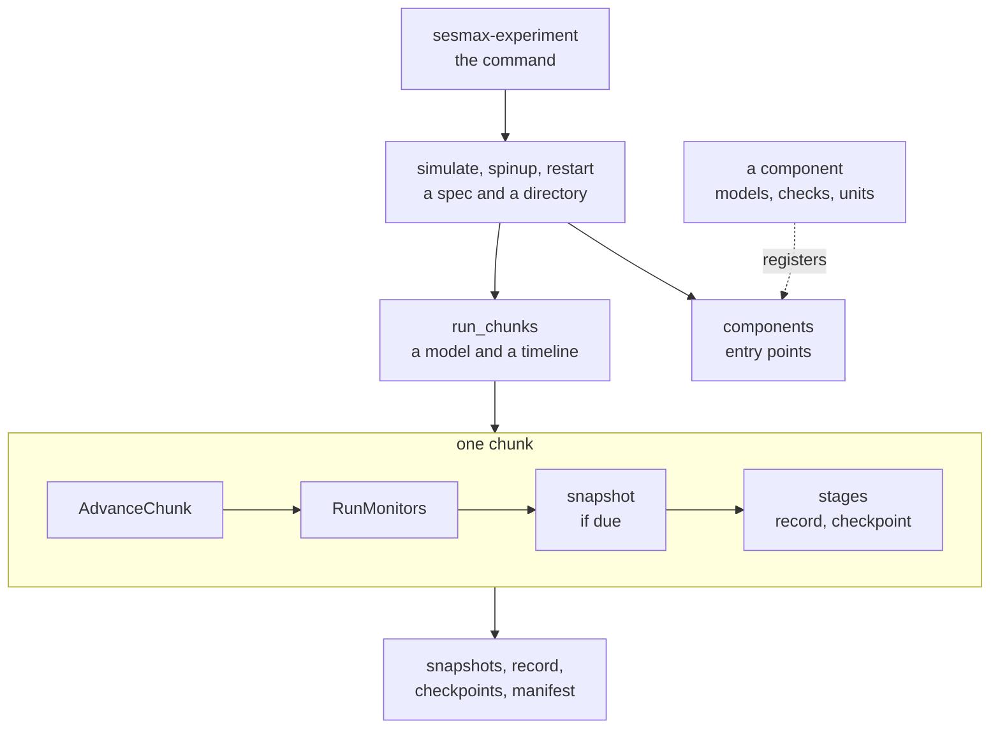

28 Nov 2026 · J. Emmanuel Johnson (drafted with Claude Code)

## Decision

Decided on 25 November 2026, and built: the run lives in `sesmax-experiment`, in two levels. `run_chunks` takes a built model and runs it in chunks, with monitors and stages between them, and writes nothing. `simulate`, `spinup` and `restart` take a run spec and a directory, and write the snapshots, the record, the checkpoints and the manifest. Both are merged (sesmax#197 to sesmax#208, under epic sesmax#186).
Asked by the owner on 28 November: this page is the expansion of [the experiment design](sesmax_experiment.md) for its run half. It plays the part that the fit loop and its callbacks play in a training library: the loop, what watches it, what it records, and how it stops and starts again.
Proposed, for review: nine additions, each in the section on the API. In order of what they unblock, they are a solver block in the spec, an end that is early and is not a failure, a stop on a signal, means over an interval, snapshots of observables, an ensemble of runs, the lineage of a restart, a fit watched with the same monitors and record as a run, and one writer protocol shared with pipekit-train.
Status: the built half is at sesmax `4420115` and unreleased (version 0.0.0). The numbers on this page are from scratch runs on 28 November. The section on where it came from, near the end, keeps what the plan of 5 November found: the two defects in how the core integrated, the test of the data mount, and what was taken from other platforms.

## Motivation

A double gyre takes eight years of model time to settle, which is about 280,000 steps, and a twin experiment needs a truth that has settled. Nobody watches that run. It has to say by itself that it is healthy, stop when it is not, survive the end of a job, and leave a record that someone can read a week later.

A single call to an integrator does none of this. The whole trajectory is one compiled computation, so nothing can look at the state before the end, a NaN at step 3,000 is found at step 280,000, and every snapshot is in memory until the call returns. The run loop cuts the run into chunks so that the host can look between them.

The same is true of a fit. A 4D-Var of 380 iterations is also one compiled loop, with a cost that either goes down or does not, and today we learn which only when it returns. A training library solves this with a fit loop and callbacks. The run loop is that loop for a model, and the last proposal of this page gives a fit the same watchers.

What exists today covers the run of one model from one file. What is missing shows up as soon as the run feeds an experiment:

- The stepper is always the model's default with a fixed step, because the spec cannot name another.
- A run can end in two ways, at its last time or in a failure. A spin-up that has reached its steady state has no way to say so.
- A snapshot is the state at one instant. An altimeter map is a mean over days, and the mean of a few snapshots is a poor estimate of it (measured below).
- An ensemble is a loop of runs, each compiled and stepped alone.
- A restarted run writes its snapshots in a new directory, and nothing records which run it continues.

## User stories

- As a **modeller**, I want to run a scenario from a file for years of model time and never hold more than one state in memory.
- As the person **on call**, I want a run to stop with a reason when the state, the energy or a conserved quantity goes wrong, and to leave nothing that looks like a result.
- As a **user of a shared cluster**, I want a run to stop cleanly when its time is up or the scheduler asks, and the next job to continue it with the steps it would have taken.
- As someone **spinning up** a truth for a twin experiment, I want the run to end when the energy stops changing, and to get a final state.
- As someone **comparing with observations**, I want the mean over a day or a week as an output, and the fields an instrument sees, not only the model's own variables.
- As someone **measuring stability**, I want sixty-four members of one run on one device, and the fraction that survive.
- As someone **fitting** a state or a parameter, I want the cost and the gradient at each iteration in the same file a run writes, and a fit that I can stop and continue.
- As a **reader of an old run**, I want to know which code, which numerics and which earlier run produced the numbers in front of me.

## Background: the maths

### A run in chunks

A model is $\partial_ t \mathbf{x} = f(\mathbf{x}, t; \boldsymbol{\theta})$ with state $\mathbf{x} \in \mathbb{R}^{D_ x}$. Its flow map $\Phi_ {s \to t}$ takes the state at time $s$ to the state at $t$. A timeline is a list of times $t_ 0 < t_ 1 < \dots < t_ N$, and a run is the composition, for $k = 1, \dots, N$, of

```math
\mathbf{x}_k = \Phi_{t_{k-1} \to t_k}(\mathbf{x}_{k-1})
```

Each factor is one chunk, and the host sees $\mathbf{x}_ k$ between two of them. The exact flow does not care where the cuts are, since $\Phi_ {s \to t} \circ \Phi_ {r \to s} = \Phi_ {r \to t}$. A discrete solver cares, in two ways.

**The grid of steps.** A one-step method $\Psi_ h$ ([Hairer, Nørsett and Wanner, 1993](https://doi.org/10.1007/978-3-540-78862-1)) with a requested step $\Delta t$ takes $n_ k$ equal steps of $h_ k = (t_ k - t_ {k-1}) / n_ k$ in chunk $k$, so that $\tilde{\mathbf{x}}_ k = \Psi_ {h_ k}^{n_ k}(\tilde{\mathbf{x}}_ {k-1})$, and the number is

```math
n_k = \max \left( 1, \left\lceil \frac{t_k - t_{k-1}}{\Delta t} - \epsilon \right\rceil \right)
```

with $\epsilon = 10^{-9}$, so that a ratio which is a whole number but for rounding stays that number. When every chunk is a multiple of $\Delta t$, the steps fall at the same times whatever the cuts, and the run is the same map. When one is not, its steps are shorter than $\Delta t$ and the discretisation depends on the timeline. Stating $n_ k$ is what keeps this choice out of the hands of floating point: without it, 24 of 40 chunks took one step more (measured in the section on where it came from).

**The memory of the stepper.** A restart from $\tilde{\mathbf{x}}_ k$ alone reproduces the run only if the stepper carries nothing else from one step to the next. A one-step method with stated steps carries nothing. An adaptive controller carries its last step size and its error history ([Söderlind, 2002](https://doi.org/10.1023/A:1021160023092)), and a multistep method carries past tendencies. The run loop starts each chunk from the state alone, so the first kind of stepper is exact across a cut and a restart, and the second is restarted at every cut.

### The timeline

Two series start at $t_ 0$: the looks at the state, every $\tau_ c$, and the snapshots, every $\tau_ s$. The timeline is their union, closed by the end,

```math
\{ t_k \} = \{ t_0 + j \tau_c \} \cup \{ t_0 + j \tau_s \} \cup \{ t_N \}
```

where two times closer than $10^{-9}$ relative to the run are one, and a snapshot wins the tie. The times are float64 on the host whatever the precision of the model, so a long run in single precision does not collect rounding in its clock. The rest of a timeline after a time $t$ keeps the same numbers, which is what makes a continued run take the steps of the whole one.

### What is watched

A monitor is a function of the state at an edge and of what is known about the chunk. It returns numbers, messages, and possibly a request to stop. There are four moments at which a run can be looked at, and each has its tool.

| When | Tool | Example | Cost of being late |
| --- | --- | --- | --- |
| before the first step | a check of the spec | the step against the stable one | none |
| inside a step | a guard in the tendency | a thickness that goes negative | none, it halts the step |
| between chunks | a monitor | energy growth, drift, wall time | at most one chunk |
| after the last step | a check of the metrics | the energy of the final state is positive | the whole run |

The check before a run is the Courant condition ([Courant, Friedrichs and Lewy, 1928](https://doi.org/10.1007/BF01448839)): with the fastest speed $c$ and the narrowest cell $\Delta x_ \text{min}$, a run passes if

```math
\Delta t \leq C_\text{max} \frac{\Delta x_\text{min}}{c}
```

The monitors that ship are these, where $E_ k$ is an energy of $\mathbf{x}_ k$, $I_ k$ a conserved quantity, $n^\text{acc}_ k$ and $n^\text{rej}_ k$ the accepted and rejected steps of chunk $k$, and $w_ k$ its wall time.

| Monitor | Statistic | Warns | Stops |
| --- | --- | --- | --- |
| `NonFiniteMonitor` | any value that is not finite | — | always |
| `EnergyGrowthMonitor` | $g_ k = \lvert E_ k \rvert / \lvert E_ {k-1} \rvert$ | $g_ k > 10$ | above `hard_factor`, if set |
| `ConservationDriftMonitor` | $\delta_ k = \lvert I_ k - I_ 0 \rvert / \lvert I_ 0 \rvert$ | $\delta_ k > 10^{-2}$ | above `rtol_fail`, if set |
| `SolverHealthMonitor` | $r_ k = n^\text{rej}_ k / (n^\text{acc}_ k + n^\text{rej}_ k)$ | $r_ k > 0.5$ | never |
| `ThroughputMonitor` | $(t_ k - t_ {k-1}) / w_ k$ | — | never |
| `WatchdogMonitor` | $\sum_ {j \leq k} w_ j$ | — | above a budget, resumably |

**How late a monitor is.** A monitor sees the state once per chunk, so an instability that grows as $e^{\lambda t}$ is seen at most $\tau_ c$ after it could have been, by which time it has grown by $e^{\lambda \tau_ c}$. The growth factor gives the rate back, $\lambda \approx \ln g_ k / \tau_ c$. A halt that cannot wait a chunk belongs in the tendency, as a guard.

**How verdicts combine.** Every monitor is asked, so the numbers of a stopped chunk are complete. The run stops if any monitor asks. The stop is resumable only if every monitor that asks says the state is good, and the first reason is the one reported.

### The record

Each chunk leaves one line of numbers. With $W_ k$ the wall clock at the end of chunk $k$, the time left is estimated from the speed since the end of the first chunk, because the first holds the compilation:

```math
\eta_k = (W_k - W_1) \frac{t_N - t_k}{t_k - t_1}
```

The line also holds the wall time of the integration, the wall time of everything else on the host, the steps per second, the solver's counts and what each monitor measured.

### A snapshot and a mean

A snapshot is $g(\mathbf{x}(t_ k))$, one instant. What an observation product holds is often a mean over an interval,

```math
\bar{g} = \frac{1}{t_b - t_a} \int_{t_a}^{t_b} g(\mathbf{x}(t)) \mathrm{d}t
```

and the mean of $M$ snapshots is a quadrature of this integral with $M$ points, with no control of its error for a signal that moves between two of them. The integral can instead be carried by the solve. Add to the state an accumulator $\mathbf{a}$ that starts at $\mathbf{a}(t_ a) = \mathbf{0}$ and obeys

```math
\partial_t \mathbf{a} = g(\mathbf{x})
```

beside the model's own equation. Then $\bar{g} = \mathbf{a}(t_ b) / (t_ b - t_ a)$.

The accumulator does not enter $f$, so the state is unchanged, and the quadrature has the order and the step of the solver. The measured difference on Lorenz-96 is five to seven digits (the prototype table).

### An ensemble of runs

$B$ members $\mathbf{x}^{(b)}$ of one model take the same steps, so a chunk of the ensemble is one compiled call over a leading axis. What an ensemble adds to the record is the survival fraction, the share of members that are still finite and inside their guards at $t_ k$,

```math
S_k = \frac{1}{B} \left\lvert \left\{ b : \mathbf{x}^{(b)}_j \text{ is good for all } j \leq k \right\} \right\rvert
```

which is the measure of stability that sesmax#108 asks for.

### Watching a fit

A minimiser of a cost $\mathcal{J}(\mathbf{z})$ is also a loop with a state, $(\mathbf{z}_ i, \mathbf{s}_ i) \mapsto (\mathbf{z}_ {i+1}, \mathbf{s}_ {i+1})$, where $\mathbf{s}_ i$ is the memory of the method: a quasi-Newton approximation of the Hessian, a trust-region radius. What plays the part of the chunk is an iteration, and the statistics of [the experiment design](sesmax_experiment.md) play the part of the energy:

| Statistic | Says |
| --- | --- |
| $\mathcal{J}(\mathbf{z}_ i)$ and $\lVert \nabla \mathcal{J}(\mathbf{z}_ i) \rVert$ | whether the fit moves |
| $\mathcal{J}(\mathbf{z}_ i) / (N_ y / 2)$ | whether the error model is right, since $\mathbb{E}[\mathcal{J}_ \text{min}] = N_ y / 2$ |
| $\chi^2$ of the innovations ([Desroziers et al., 2005](https://doi.org/10.1256/qj.05.108)) | the same, per time |

The parallel with the stepper holds too. The memory $\mathbf{s}_ i$ is to a fit what the controller's state is to an adaptive solve: a fit continued from $\mathbf{z}_ i$ alone is another fit (measured below).

### The identity of a run

Two runs are the same experiment if they share the spec, the code and the numerics. The manifest records a hash of the spec, the versions of the libraries, the commit, the precision, the device and a block of numerics from the component. It does not record the options that are given beside the spec (the chunks per snapshot, the checkpoint cadence), and for a stepper with memory those change the numbers.

## Background: the numerics

### The host and the device

A chunk is one compiled integration, and everything between two chunks is Python on the host. The split decides what a run costs and what it can see.

| | On the device | On the host |
| --- | --- | --- |
| What | the steps of a chunk | monitors, the log line, the record, snapshots, checkpoints |
| Compiled | once per distinct number of steps | never |
| May hold Python state | no | yes |
| May stop the run | through a guard | through a verdict |

**One compile per number of steps.** The step times of a chunk are an array of length $n_ k + 1$, so a chunk with another $n_ k$ compiles again. On Lorenz-96 the first chunk of a run took 1.16 s and each later one 1.8 ms. A timeline of chunks of 4 with snapshots every 5 has chunks of 400, 100, 300 and 200 steps, and each new count cost 1.2 s. A timeline whose chunk divides its snapshot interval, which is what a spec gives, compiles once.

**What a chunk costs on the host.** With a monitor and nothing written, a chunk cost 2.1 to 2.5 ms on the host whatever its length, so one step per chunk ran at 2.3 ms per step and 1,000 per chunk at 3.7 µs. On a 64 × 64 shallow-water model the integration of an hour took 71 ms and the host 27 ms, most of it the diagnostics of the log line. A chunk is long enough when the host's share is a few percent.

**The clock.** Times are Python floats and float64 arrays on the host, converted at the call. Nothing in a chunk depends on the wall clock, so two machines give the same states, and only the schedules of checkpoints and of the record may read wall time.

### What a cut changes

For a fixed step, 40 chunks against one chunk on Lorenz-96 to $t = 4$ differ by $9.6 \times 10^{-12}$, on a state of size 10, which is the rounding of the step times grown by the chaos of the model. The error of the solve itself is $1.5 \times 10^{-4}$. A restart from an edge is exact, with a difference of 0.

For an adaptive stepper the cut is part of the numerics. With `Tsit5` and a PID controller at a relative tolerance of $10^{-6}$:

| Chunks to $t = 4$ | Steps | Difference from one chunk | Error against a fine solve |
| --- | --- | --- | --- |
| 1 | 232 | 0 | $2.8 \times 10^{-2}$ |
| 8 | 235 | $2.4 \times 10^{-4}$ | $2.8 \times 10^{-2}$ |
| 40 | 260 | $5.3 \times 10^{-3}$ | $2.2 \times 10^{-2}$ |

The differences stay below the error of the solve, so the answer is as good. It is not the same answer, and 40 cuts cost 12 % more steps, because the controller begins each chunk from the requested step.

### Writing

- **A new name, never an old one.** A checkpoint is written as `<step>.partial.zarr` and renamed to `<step>.zarr`. The snapshots are streamed to `snapshots.partial.zarr` and renamed when the run ends. Nothing is renamed onto an existing store, because the mount the long runs write to refuses it (measured in the section on where it came from).
- **A write may fail.** A checkpoint that fails with an `OSError` is tried once more, and if that fails the run goes on without it. A checkpoint is not a result, so it never stops a run.
- **A failed run leaves no result.** It leaves `run.log`, `metrics.jsonl` and the partial snapshots, and none of the names a reader takes for a finished run.
- **A state that is not finite is never written**, whatever the monitors are.

### What the loop is not

- **It is differentiable, and not meant to be.** The gradient of a final state through two chunks matched a finite difference to nine digits. A monitor under that trace sees nothing: `NonFiniteMonitor` reads the state with NumPy, fails on a tracer, and passes. The loop cannot be compiled as a whole either, since its times are Python floats. A short differentiable window is `rollout`, and the run loop is for the long run that makes its truth.
- **A batch is not a state.** A stack of eight Lorenz-96 states given as one state ran without an error and gave a member that differed from its own run by 0.21, because the model's stencil ran along the wrong axis. An ensemble needs the chunk mapped over the members (proposed below).

## What it is built on

The loop, the cadence, the sinks and the retry are pipekit's. The steps are diffrax's ([Kidger, 2021](https://arxiv.org/abs/2202.02435)), through the model. What is written here is the advance of one chunk, the monitors and the artifacts of a run.

| Need | Upstream, by its public name | State |
| --- | --- | --- |
| repeat a stage with a carried index | `pipekit_cycle.Cycle` | used |
| stages in order, a cadence, a write, a look | `pipekit_ops`: `Sequential`, `Branch`, `Sink`, `Tap`, `Identity` | used |
| try a write again, then go on | `pipekit_ops`: `Retry`, `Try` | used |
| the hash of a spec | `pipekit_ops.hashing`: `stable_json`, `sha256_hex` | used |
| stated steps, the last state only, solver counts | diffrax: `StepTo`, `SaveAt(t1=True)`, `Solution.stats` | used, through `Model.integrate` |
| the stable step of a check | `integrix.march.stable_step`, re-exported by the core | used |
| a state to a store and back | `sesmax_core.io`, on xarray and zarr | used |
| what a component offers a run | `sesmax_core.component`: `Component`, `BuiltRun` | used |
| halts inside a step | `sesmax_core`: `guard_finite`, `guard_positive`, `guard_ceiling` | exist; a model places them |
| conserved quantities | `Diagnostics.invariants` of a model | exist where a model defines them |
| a tracker of experiments | `pipekit_experiment.ExperimentTracker`: `start_run`, `log_metrics`, `log_artifact`, `end_run` | exists, not used |
| a writer of metrics | `pipekit_train`: `MetricWriter`, `JSONLWriter` | exists, and written again here |
| early stopping on a metric | `pipekit_train.EarlyStopping` | exists, for a training loop |
| a forecast and an analysis in turn | `pipekit_cycle.DACycle` | exists, not used |
| an ensemble through a cycle | `pipekit_cycle.EnsembleCycle` | exists; it loops over the members in Python |
| a minimiser that can be stepped | optimistix: `init`, `step`, `terminate` of a solver | exist |
| the statistics of an analysis | `filterax`: `innovation`, `chi2_consistency`, `spread_skill_ratio`, `rank_histogram` | exist |
| a readable name for what a model shows | `Observable`, proposed in [the core design](sesmax_core.md) | proposed |
| known fields from outside, by chunk | `Covariates`, sesmax#238 | open |

Three pieces of pipekit were looked at and left: `Until`, which loops to a predicate but has no carried index; `Profile`, which reports after a run, where a monitor needs each chunk's time during it; and `pipekit_jax.ScanCycle`, one compiled scan, which cannot write or stop between chunks.

Gaps, each with the package that should own it. None is filed.

- **One writer of metrics.** `pipekit_train.MetricWriter` has `write(step, metrics)` and `close`, and the one here has `write_scalars(step, scalars)`, `flush` and `close`. Their lines differ too: pipekit-train nests the numbers under `metrics` with a timestamp, and this package writes them flat, with `null` for a number that is not finite. Two loops of one stack should share one protocol, and its home is pipekit-experiment, beside the tracker it stands in for.
- **A running integral along a solve.** The accumulator of the section on means is a model in more variables, so its home is the core, beside `ScaledModel` and the proposed `TransformedModel`. Nothing upstream is missing for it.
- **The next step of an adaptive solve.** diffrax does not hand back the controller's state, so a chunk cannot continue the controller of the one before. Carrying it would be a change to integrix's `DiffraxForwardModel`. This page recommends not asking for it (open question SR-3).

What stays here: `run_chunks`, `Timeline`, the schedules, `AdvanceChunk`, `RunMonitors`, the monitors, `RunSpec` and its three verbs, the checkpoint store, the record, the manifest and the command.

## The API



| Rung | Name | Job |
| --- | --- | --- |
| structure | `Timeline`, `ChunkFrame`, `ChunkInfo` | when, and what travels between stages |
| structure | `RunSpec`, `SimulationResult` | a run as a file, and what it wrote |
| primitive | `AdvanceChunk`, `RunMonitors` | one chunk of the model, one round of questions |
| strategy | `Monitor`, `Due`, `Checkpointing`, `MetricWriter` | what to watch, when to act, what to keep, where numbers go |
| step | `run_chunks` | a model in chunks, with stages |
| recipe | `simulate`, `spinup`, `restart`, the command | a spec to artifacts |

### The times

```python
# Shapes: N chunks; the state is the model's pytree

# today (sesmax-experiment)
# {t_k} = {t₀ + j τ_c} ∪ {t₀ + j τ_s} ∪ {t_N}
timeline = Timeline.build(0.0, 10.0, chunk=2.0, snapshot=4.0)
# → edges (N + 1,) = [0, 2, 4, 6, 8, 10], snapshots at edges {0, 2, 4, 5}

# today (sesmax-experiment): the rest of a run, with the same numbers
rest = timeline.after(6.0)
# today (sesmax-experiment): n looks per chunk, the same snapshots
finer = timeline.subdivided(3)
```

### One chunk

```python
# today (sesmax-experiment): what travels through the stages
class ChunkFrame:
    state: PyTree          # x_k
    info: ChunkInfo        # index, n_chunks, t0, t1, wall_seconds, is_snapshot, stats
    metrics: dict[str, float]     # "monitor.metric" → value
    messages: tuple[str, ...]


# today (sesmax-experiment)
# x_k = Ψ_h^n(x_{k−1}), n = ⌈(t_k − t_{k−1}) / Δt − ε⌉
advance = AdvanceChunk(model, timeline, dt, integrate_kwargs)
# today (sesmax-experiment): asks every monitor, then raises RunStopped if one asked
ask = RunMonitors(model, monitors)

# today (sesmax-experiment)
run = run_chunks(
    model, state0, timeline, dt=0.01,
    monitors=[NonFiniteMonitor()],
    on_snapshot=None,      # without it the snapshots are kept and returned
    stages=[Branch(every_chunks(5), Sink(write))],
    solver=dfx.Tsit5(),    # passed to Model.integrate
)
# → ChunkedRun: .state, .frame, .snapshots
```

A stage is any pipekit operator on a frame, and it may return another frame. One that replaced the state after the first chunk gave the run that starts from the new state, with a difference of 0. That is the hook for an analysis between two forecasts, and the monitors do not see the replaced state until the next chunk.

### Watching

```python
# today (sesmax-experiment)
class Monitor(Protocol):
    name: str
    def on_run_start(self, model, state0, *, spec) -> None: ...
    def on_chunk_end(self, model, state, info: ChunkInfo) -> MonitorVerdict: ...
    def on_run_end(self, model, final_state, *, ok: bool) -> None: ...


# today (sesmax-experiment)
class MonitorVerdict:
    metrics: dict[str, float] = {}
    messages: tuple[str, ...] = ()
    terminate: bool = False
    reason: str | None = None      # required with terminate
    resumable: bool = False        # the state is good, only the time is up


# today (sesmax-experiment): when a stage is due; they combine with | and &
checkpoint_due = every_chunks(20) | every_wall_seconds(1800.0)
snapshot_due = at_snapshots()
physics_due = every_sim_seconds(86400.0)
```

A snapshot is a result, so it is scheduled in model time only. A checkpoint and a line of the record are not results and may follow the wall clock.

The fit loop of pipekit-train and this loop are the same design at two places:

| Part | pipekit-train | Here |
| --- | --- | --- |
| the loop | `TrainingLoop` | `run_chunks` |
| its unit | a step, an epoch, an evaluation | a chunk |
| a watcher | `Callback`, five hooks | `Monitor`, three hooks |
| a stop | `EarlyStopping.should_stop` | `MonitorVerdict.terminate`, with `resumable` |
| a cadence | `every_n_steps` | `Due`, in chunks, model time or wall time |
| the numbers | `MetricWriter`, `JSONLWriter` | `MetricWriter`, `JsonLinesWriter` |
| a tracker | `LogToExperiment` | proposed, a writer over `ExperimentTracker` |
| a checkpoint | `Checkpoint`, with orbax | `CheckpointStore`, with zarr and a rename |

### A run from a file

```python
# today (sesmax-experiment), needs the [sim] extra
spec = load_yaml("doublegyre_bt_qg.yaml")     # scenario, model, timestepping, output, assertions
result = simulate(
    spec, "runs/gyre",
    diagnostics_per_save=6,                  # chunks between two snapshots
    monitors=[*default_monitors(), WatchdogMonitor(max_wall_s=3600.0)],
    checkpointing=Checkpointing(every_chunks(20), keep_last=3, keep_every=100),
)
# → SimulationResult: status, the paths, n_steps, state

# today (sesmax-experiment): the final state alone, for a restart
spinup(spec, "runs/spin")
# today (sesmax-experiment): from a state, a directory of checkpoints, or a run
restart(spec, "runs/gyre-2", restart_from="runs/gyre")
```

A model is found by its name among the installed components, so the loop imports none. The builder of the component gets the `scenario` and `model` blocks of the spec and returns a `BuiltRun`, and the loop reads nothing else of them.

| Outcome | Written | Not written | Exit code |
| --- | --- | --- | --- |
| finished | `snapshots.zarr`, `final_state.zarr`, `metrics.json`, `resolved.yaml`, `manifest.json`, `run.log`, `metrics.jsonl` | — | 0 |
| stopped, resumably | `snapshots.zarr` so far, a checkpoint, `manifest.json` with `status: "stopped"`, the two logs | `final_state.zarr`, `metrics.json` | 75 |
| failed | `run.log`, `metrics.jsonl`, `snapshots.partial.zarr` | every name of a result | 1 |

```bash
# today (sesmax-experiment)
sesmax-experiment simulate --config gyre.yaml --output-dir runs/gyre --checkpoint-every-n-chunks 20 --keep-last 3 --max-wall-seconds 3600
sesmax-experiment restart --config gyre.yaml --from runs/gyre --output-dir runs/gyre-2
sesmax-experiment list-models
```

### Proposed

Each of these is for review. None is built.

```python
# proposed (sesmax-experiment), R1: the stepper is part of the spec
# timestepping: {t0, t1, dt, save_interval, solver: tsit5, controller: {kind: pid, rtol: 1e-6, atol: 1e-9}}
# the block is handed to Model.integrate, and recorded in the manifest's numerics
class TimesteppingSpec:
    solver: str | None = None            # the model's own by default, as today
    controller: dict[str, Any] | None = None


# proposed (sesmax-experiment), R2: an end that is early and is not a failure
class MonitorVerdict:
    complete: bool = False   # with terminate: the run has reached what it was for

# |E_k − E_{k−1}| / |E_k| < rtol for `patience` chunks in a row
SteadyStateMonitor(metric="energy", rtol=1e-4, patience=10)
# → the run writes its final state and metrics, with status "finished" and the reason


# proposed (sesmax-experiment), R3: a stop from outside
# SIGTERM or SIGINT → a resumable stop at the next edge
SignalMonitor(signals=(signal.SIGTERM, signal.SIGINT))


# proposed (sesmax-core), R4: means carried by the solve
# ∂ₜa = g(x), ḡ = a(t_b) / (t_b − t_a); x is unchanged
model_bar = Accumulated(model, {"ssh": observable, "ke": kinetic_energy})
# proposed (sesmax-experiment): written at each snapshot, then set to zero
# output: {means: [ssh, ke]}


# proposed (sesmax-experiment), R5: what a snapshot holds
# output: {fields: [h], observables: [ssh, u_surface], every: 86400.0}
# o(x) from Component.observables, read by the same store as the state


# proposed (sesmax-experiment), R6: an ensemble as one run
# x^{(b)}_k = Ψ_h^n(x^{(b)}_{k−1}), b = 1..B, in one compiled call
run = run_chunks(model, states, timeline, dt=dt, members=64)
# monitors are asked per member; a member that fails is masked, and S_k is recorded


# proposed (sesmax-experiment), R7: where a run came from
# manifest.json: {parent: {path, config_sha256, step, t}, options: {diagnostics_per_save, checkpointing}}
snapshots = open_run("runs/gyre-2")     # the snapshots of a run and of the runs it continues


# proposed (sesmax-experiment), R8: a fit watched as a run is
# (z_i, s_i) ↦ (z_{i+1}, s_{i+1}), with a frame per iteration
method = sxe.Minimise(
    optx.BFGS(rtol=1e-8, atol=1e-8),
    monitors=[CostMonitor(), ExpectedCostMonitor(n_obs)],
    record=JsonLinesWriter("fit.jsonl"),
    checkpointing=Checkpointing(every_chunks(50)),   # z_i and s_i
)


# proposed (sesmax-experiment), R9: any tracker behind the record
writer = TrackerWriter(tracker, run_name="gyre")     # pipekit_experiment.ExperimentTracker
```

- **R1, a solver block.** The loop already passes any keyword to `Model.integrate`. What is missing is its spelling in a file and its place in the manifest, since two runs that differ in a tolerance are different runs.
- **R2, an early end.** A verdict today is a failure or a resumable stop. A spin-up that has converged is neither: its state is the result. `complete` gives the third case, and `SteadyStateMonitor` is `EarlyStopping` for a model.
- **R3, a signal.** A scheduler that takes a node back sends a signal, not a wall-time budget. The prototype stopped at the edge after the signal and the rest of the run matched the uninterrupted one exactly.
- **R4, means.** The accumulator is a model in more variables, so it sits in the core and the loop only resets it and writes it. It doubles the memory of the fields it averages and adds one evaluation of $g$ per stage.
- **R5, observables.** A year of full states is large and mostly unread. A run for a twin experiment needs the surface height on its own cadence. This uses the `Observable` of [the core design](sesmax_core.md), and the self-describing output of sesmax#224.
- **R6, an ensemble.** The chunk is mapped over a leading axis with `eqx.filter_vmap`, and the stages see a frame of members. sesmax#108 is its first user.
- **R7, lineage.** A restart writes in a new directory, by design, since it must not replace what it reads. The link back is then the only way to read a run of three jobs as one.
- **R8, a watched fit.** optimistix solvers ([Rader, Lyons and Kidger, 2024](https://arxiv.org/abs/2402.09983)) can be stepped from the host, which turns an iteration into a chunk. The cost is the host's time per iteration, which is nothing beside a model run and doubled the time of a toy (measured below). A fit that is not watched stays one compiled call.
- **R9, a tracker.** `MetricWriter` is the seam. A writer over `ExperimentTracker` sends the same lines to MLflow or to Weights & Biases, as `LogToExperiment` does for a fit.

### What it does not own

| Concern | Owner |
| --- | --- |
| The steps, the adjoint, the stable step | diffrax, integrix |
| The loop, the cadence, the retry, the hash | pipekit-ops, pipekit-cycle |
| A tracker, and the writer protocol | pipekit-experiment |
| What a model conserves, shows and guards | the component, with the core's types |
| Scenarios, configs, units of fields | the component |
| A differentiable window | `rollout` in the core |
| The problem, the methods, the result of a fit | [the experiment design](sesmax_experiment.md) |
| The statistics of an analysis | filterax |
| Scores of a run against a reference | diagnostix, through the component's `evaluate` |
| More than one device, or a domain in pieces | [the scaling design](sesmax_scaling.md) |

## Examples

Every example of this section was run as written, in float64.

### Run in chunks and watch

```python
import jax.numpy as jnp
from sesmax_core.testing import L96State, Lorenz96
from sesmax_experiment.monitor import ConservationDriftMonitor, NonFiniteMonitor
from sesmax_experiment.run import Timeline, run_chunks

# Shapes: D_x = 40; N = 40 chunks of 0.1, a snapshot every 2

# today (sesmax-core)
# dx_j/dt = (x_{j+1} − x_{j−2}) x_{j−1} − x_j + F
model = Lorenz96.create(F=8.0)
state = L96State(x=jnp.linspace(-2.0, 2.0, 40))

# today (sesmax-experiment)
timeline = Timeline.build(0.0, 4.0, chunk=0.1, snapshot=2.0)
run = run_chunks(model, state, timeline, dt=0.01, monitors=[NonFiniteMonitor(), ConservationDriftMonitor()])
# run.snapshots → 3 frames, at t = 0, 2, 4; run.frame.info.stats["num_steps"] → 10
```

### Stop, and take the rest

```python
from sesmax_experiment.run import RunStopped

# today (sesmax-experiment): a monitor asks for a resumable stop
try:
    run_chunks(model, state, timeline, dt=0.01, monitors=[budget])
except RunStopped as stop:
    # stop.frame is the last good frame; the rest keeps the timeline's numbers
    rest = run_chunks(model, stop.frame.state, timeline.after(stop.frame.info.t1), dt=0.01)
# rest.state equals the state of the uninterrupted run, with a difference of 0
```

### A checkpoint that may fail

```python
from pipekit_ops import Branch, Identity, Retry, Sink, Try
from sesmax_experiment.run import every_chunks, every_wall_seconds

# today (pipekit-ops): try twice, then go on
sturdy = Try(Retry(Sink(write), attempts=2, base_delay=1.0, on=(OSError,)), Identity(), on=(OSError,))
# today (sesmax-experiment)
due = every_chunks(20) | every_wall_seconds(1800.0)
run = run_chunks(model, state, timeline, dt=0.01, stages=[Branch(due, sturdy)])
```

### A run from a file, stopped and continued

```yaml
# adjustment.yaml: a step of height adjusting under rotation, 64 × 64 cells
scenario:
  name: adjustment
  grid: {nx: 64, ny: 64, Lx: 1.0e6, Ly: 1.0e6}
  consts: {f0: 1.0e-4}
  initial_condition: {type: step, params: {amplitude: 1.0}}
model:
  name: linear_swm
  params: {H0: 100.0}
timestepping: {t0: 0.0, t1: 86400.0, dt: 100.0, save_interval: 21600.0}
assertions:
  cfl: {wave_speed_m_per_s: 31.3, max_cfl: 0.5}
  bounded_metric: {name: energy, min: 0.0}
```

```python
# today (sesmax-experiment)
whole = simulate(spec, "runs/whole", diagnostics_per_save=6)
# 864 steps in 24 chunks; status "finished"

# a monitor stops the run after chunk 10, with checkpoints every 4 chunks, two kept
part = simulate(spec, "runs/part1", diagnostics_per_save=6, monitors=[*default_monitors(), budget],
                checkpointing=Checkpointing(every_chunks(4), keep_last=2))
# status "stopped"; checkpoints/00000008.zarr and 00000010.zarr; no final_state.zarr

rest = restart(spec, "runs/part2", restart_from="runs/part1", diagnostics_per_save=6)
# 360 + 504 steps; the final state equals that of runs/whole, with a difference of 0
```

One line of `metrics.jsonl`, and the keys of `manifest.json`:

```text
{"step": 2, "t": 7200.0, "wall_seconds": 0.0718, "host_seconds": 0.0273, "steps_per_second": 501.4, "eta_seconds": 2.18, "num_steps": 36.0, "num_accepted_steps": 36.0, "num_rejected_steps": 0.0, "result_successful": 1.0, "solver_health.rejected_step_rate": 0.0, "throughput.sim_s_per_wall_s": 50140.1}

config_sha256, device_count, dt, git_commit, git_dirty, mode, numerics, platform, python, reason, status, t0, t1, versions, wallclock_seconds, x64_enabled
```

### A monitor of one's own

```python
import signal
from sesmax_experiment.monitor import BaseMonitor, MonitorVerdict


# the prototype of R3, run as written
class SignalMonitor(BaseMonitor):
    name = "signal"

    def __init__(self):
        self.got = None

    def on_run_start(self, model, state0, *, spec):
        signal.signal(signal.SIGTERM, lambda number, frame: setattr(self, "got", number))

    def on_chunk_end(self, model, state, info):
        if self.got is None:
            return MonitorVerdict()
        return MonitorVerdict(terminate=True, reason="SIGTERM", resumable=True)
```

### A fit, an iteration at a time

```python
import optimistix as optx

# Shapes: D_z = 40 whitened unknowns; N_y = 400 observations

# today (optimistix): the same solver, stepped from the host
solver = optx.BFGS(rtol=1e-8, atol=1e-8)
state = solver.init(cost, z0, None, {}, f_struct, None, frozenset())
writer = JsonLinesWriter("fit.jsonl")       # today (sesmax-experiment), the writer of a run
i = 0
while True:
    # (z_i, s_i) ↦ (z_{i+1}, s_{i+1})
    z, state, _ = step(z, state)
    i += 1
    writer.write_scalars(i, {"cost": float(value(z)), "grad_norm": float(norm(grad(z)))})
    if bool(done(z, state)):
        break
# 380 iterations; z equals the result of one optx.minimise call, with a difference of 0
```

## The prototype

Scratch runs on 28 November 2026, in float64 on one CPU, with the packages of sesmax `a34e46c`, diffrax 0.7.2, jax 0.12.0, pipekit-ops 0.3.0, pipekit-cycle 0.2.0 and optimistix 0.1.0. Lorenz-96 has 40 variables and a step of 0.01, and the shallow-water model is the linear one of the testing component on 64 × 64 cells.

**The loop as built.**

| Check | Result |
| --- | --- |
| 40 and 134 chunks against one chunk, to $t = 4$ | $9.6 \times 10^{-12}$ and $1.5 \times 10^{-11}$, on a state of size 10 |
| a restart from the edge at $t = 2$ | 0 |
| first chunk, then each later one | 1.16 s, then 1.8 ms |
| chunks of 400, 100, 300, 200 steps in one run | 1.26 s, 3 ms (compiled earlier), 1.18 s, 1.25 s |
| host cost of a chunk with one monitor | 2.1 to 2.5 ms, for 1 to 100 steps per chunk |
| a stage that replaces the state | the run from the new state, 0 |
| gradient of the final state through two chunks | 114.2799707, finite difference 114.2799706 |
| the same with `NonFiniteMonitor` | the same number; the monitor reads nothing under the trace |
| a spec of 864 steps, stopped after chunk 10 and restarted | 360 + 504 steps, final state equal, 0 |
| the snapshots of the restarted run | 3 of the 5, in the new directory |
| a stop that is not resumable, with a good state | `IntegrationDivergedError`, and no result |
| shallow water, an hour per chunk | 71 ms on the device, 27 ms on the host; first chunk 2.8 s |

**Means (R4).** The mean of $x_ 0$ and of the energy $\frac{1}{2} \langle x^2 \rangle$ over a window, against a solve with a step 16 times smaller. The first number of each cell is for $x_ 0$, the second for the energy.

| Estimate | Window of 1 | Window of 5 |
| --- | --- | --- |
| accumulated in the solve | $7 \times 10^{-9}$, $2 \times 10^{-8}$ | $5 \times 10^{-8}$, $3 \times 10^{-7}$ |
| mean of snapshots every 0.05 | 0.037, 0.0095 | 0.024, 0.0028 |
| mean of snapshots every 0.25 | 0.17, 0.053 | 0.14, 0.011 |
| mean of snapshots every 1 | 0.063, 0.015 | 0.96, 0.024 |
| the last snapshot alone | 0.063, 0.015 | 4.3, 0.23 |

The state with the accumulator equals the state without it, with a difference of 0. The mean of $x_ 0$ over five time units is 2.67, so five snapshots miss it by a third and one snapshot is no estimate of it.

**An ensemble (R6).** 64 members, 50 steps: one mapped chunk took 13 ms and a loop of 64 runs 176 ms, and a member of the mapped chunk equals its own run, with a difference of 0.

**A signal (R3).** A SIGTERM sent during chunk 13 stopped the run at the end of chunk 14, resumably, and the rest gave the uninterrupted state, with a difference of 0.

**A fit (R8).** The initial state of Lorenz-96 from 400 observations of half the variables over 20 steps of 0.05, with a background, by BFGS on the whitened control.

| Check | Result |
| --- | --- |
| one compiled call | 380 iterations, cost 5,791 to 219.9, 213 ms |
| the expected cost, $N_ y / 2$ | 200, with a standard deviation of 14 |
| stepped from the host | the same control, 0; 437 ms in the steps |
| continued after 190 with the minimiser's state | 380 iterations in all, 0 |
| continued after 190 from the control alone | not converged after 500 iterations; the control differs by $1.5 \times 10^{-4}$ |

Not covered: the accumulator as a model of the core (the prototype wrote the two equations for diffrax), an ensemble through `run_chunks`, a watched fit through a `Method`, the solver block, the early end, lineage, the tracker writer, and any model of the ocean.

## What is available

| Piece | State | Where |
| --- | --- | --- |
| `Model.integrate` compiles once across calls | merged, sesmax#196 | `sesmax-core` |
| the package, the monitors, `Component` and `BuiltRun` | merged, sesmax#197 | `sesmax_experiment.monitor`, `sesmax_core.component` |
| `run_chunks`, `Timeline`, the schedules, the two stages | merged, sesmax#198 | `sesmax_experiment.run` |
| states of a run have their boundary conditions | merged, sesmax#201 | `sesmax-core` |
| `RunSpec`, `simulate`, `spinup`, `restart`, the registry, the command | merged, sesmax#203 | `sesmax_experiment.sim`, `.components` |
| versioned checkpoints, the resumable stop, `metrics.jsonl` | merged, sesmax#207 | `sesmax_experiment.sim` |
| the checks `cfl` and `bounded_metric`, `model_op` | merged, sesmax#208 | `sesmax_experiment.sim` |
| the ocean and the testing models registered as components | merged, sesmax#210 | `sesmax-ocean`, `sesmax_core.testing` |
| `SimulationCheckpointer`, on orbax | merged, and unused by the runner | `sesmax_experiment.checkpoint` |
| R1 to R9 | proposed | this page |

## Steps and gates

| Step | Pull request | Gate |
| --- | --- | --- |
| R0 | a monitor under a trace raises, in place of passing | `NonFiniteMonitor` on a traced state is an error with the reason |
| R1 | the solver block of the spec, and its record | a spec with `tsit5` and a PID controller runs; the manifest names both; a restart of it is refused across a change of the block |
| R2 | `complete`, `SteadyStateMonitor` | a damped model ends early with a final state and `status: "finished"` |
| R3 | `SignalMonitor`, and the command installs it | the prototype's check, as a test |
| R4 | `Accumulated` in the core, `output.means` here | the table of means, as a test; the state is unchanged, bit for bit |
| R5 | `output.fields`, `output.observables` and their cadence | waits for `Observable` (step E2a of the experiment design) |
| R6 | `members=` in `run_chunks`, a masked member, $S_ k$ in the record | a member equals its own run; a member that blows up does not stop the others |
| R7 | `parent` and `options` in the manifest, `open_run` | three jobs of one run read as one store, equal to the uninterrupted run |
| R8 | monitors, record and checkpoints of a `Minimise` | the fit table, as a test; this is step E6 of the experiment design |
| R9 | one writer protocol in pipekit-experiment, `TrackerWriter` here | waits for the protocol upstream |

R0 to R3 depend on nothing and are small. R4 and R6 are the two that change what a run can produce. R5, R8 and R9 wait for another page or another package.

## Open questions

| ID | Question | Recommended | Alternative |
| --- | --- | --- | --- |
| SR-1 | Is `simulate` of a spec and `simulate` of a `Problem` one verb? | yes, as [the experiment design](sesmax_experiment.md) says, with the spec building the problem | two names, `simulate` and `run` |
| SR-2 | Where does the accumulator live? | the core, as a model in more variables | integrix, as a quadrature along a solve |
| SR-3 | Does a chunk continue the controller of the one before? | no: a cut is part of the numerics, and the manifest records the cuts (R7) | carry the next step, which needs a change in integrix |
| SR-4 | Is an early end a flag on the verdict, or a third kind of exception? | a flag, `complete` | `RunComplete` beside `RunStopped` |
| SR-5 | An ensemble as an argument of `run_chunks`, or its own function? | an argument, since the stages are the same | `run_members` |
| SR-6 | Does a restart append to the store it continues? | no, a new directory and a link back | append in place, which a failed job could corrupt |
| SR-7 | Whose `MetricWriter`? | one protocol in pipekit-experiment, used by pipekit-train and here | keep two, with an adapter |
| SR-8 | Does `SimulationCheckpointer` stay? | remove it: the runner never used it, and `[checkpoint]` installs orbax for nothing | keep it for users who call it directly |
| SR-9 | On a failure, does the command offer to replay the last chunk a step at a time? | yes, later, from the newest checkpoint with `Timeline.subdivided` | leave it to the user |
| SR-10 | A different number of steps per chunk compiles again. Do we pad? | no, a spec gives equal chunks; document it for `Timeline.build` | pad the step times to one length |
| SR-11 | Does the command line expose a fit? | not before R8 | yes, with a spec of the problem |

## Where it came from

The loop was planned on 5 November 2026 as `sesmax_core.sim`, a move of somax's runner (`somax/_src/cli/`, 5,662 lines at `9cb19b3`) onto pipekit. On 25 November it became its own package, so that the core carries no run loop and a second component does not have to copy one. The plan's prototype, on Lorenz-96 with 40 variables in float64, found two defects in how the core integrated. Both are fixed, and both explain choices on this page.

**Every chunk compiled again** (fixed by sesmax#196). `build_terms` made a new closure per call, and Python-float times were static arguments of the compiled solve. Either one defeated the compile cache.

| `build_terms` returns | Times | ms per call after the first |
| --- | --- | --- |
| a closure (before) | floats | 710 to 760 |
| a module | floats, the same each call | 1 |
| a module | arrays, new each call (after) | 1 |

**A chunk could take a different number of steps** (fixed by `AdvanceChunk`). From $t = 0.2$ to $0.30000000000000004$ with $\Delta t = 0.01$, diffrax took 11 steps of about 0.0091 where 10 of 0.01 were meant, and 24 of 40 chunks did this.

| Run to $t = 4$ | Largest difference from one solve |
| --- | --- |
| chunks of 0.1 with `dt = 0.01`, before | $1.2 \times 10^{-3}$ |
| chunks of $2^{-3}$ with $\Delta t = 2^{-7}$, which divides exactly | 0 |
| chunks of 0.1 with stated steps, 10 each | $3.8 \times 10^{-11}$ |

**The data mount refuses a rename onto a store.** The mount the long runs write to is CIFS, and a test on a store of 50 files is why a checkpoint is always given a new name.

| Operation | Result |
| --- | --- |
| rename to a new name | works, 184 ms |
| rename onto an existing store | `PermissionError` |
| move the old store aside, rename, delete the old one | works, 1.0 s, with a gap in which neither name holds a checkpoint |

We tested that these renames succeed, and not that they are atomic under a crash.

**What was taken from other platforms.** These come from reading their documentation.

| Idea | Source | Here |
| --- | --- | --- |
| schedules by iteration, model time or wall time, combined with and and or | [Oceananigans](https://clima.github.io/OceananigansDocumentation/dev/simulations/schedules) | `Due` and the four schedules |
| a wall-time limit, and a checkpoint at the end | [Oceananigans](https://clima.github.io/OceananigansDocumentation/dev/simulations/simulations_overview) | `WatchdogMonitor` and the resumable stop |
| a rename to finish a write | [Orbax](https://orbax.readthedocs.io/en/latest/api_reference/checkpoint.path.atomicity.html) | versioned checkpoints |
| retention by count and by period | [Orbax](https://orbax.readthedocs.io/en/latest/guides/checkpoint/api_refactor.html) | `keep_last` and `keep_every` |
| steps per second, time left, a metric writer | [CLU](https://github.com/google/CommonLoopUtils/blob/main/clu/periodic_actions.py) | the record and `MetricWriter` |

**What a user of somax's runner sees changed.**

| | somax | Here |
| --- | --- | --- |
| compiles per run | one per chunk | one |
| snapshots during a run | all in memory until the end | streamed, and renamed when the run succeeds |
| a stop on a wall-time limit | an error, with no artifacts | a checkpoint and a resumable exit |
| crash-recovery checkpoints | one store, overwritten | versioned stores, each finished by a rename |
| the record per chunk | text in `run.log` | `metrics.jsonl` as well |
| the Courant check | its own formula | `stable_step` |

The YAML schema, the artifact names, the names of the checks and `run.log` did not change, and a store written by somax still loads.

## References

- Courant, R., Friedrichs, K. and Lewy, H. (1928). [Über die partiellen Differenzengleichungen der mathematischen Physik](https://doi.org/10.1007/BF01448839). *Mathematische Annalen* 100, 32–74.
- Desroziers, G. et al. (2005). [Diagnosis of observation, background and analysis-error statistics in observation space](https://doi.org/10.1256/qj.05.108). *Quarterly Journal of the Royal Meteorological Society* 131, 3385–3396.
- Hairer, E., Nørsett, S. P. and Wanner, G. (1993). [Solving Ordinary Differential Equations I](https://doi.org/10.1007/978-3-540-78862-1). Springer.
- Kidger, P. (2021). [On Neural Differential Equations](https://arxiv.org/abs/2202.02435). arXiv:2202.02435.
- Rader, J., Lyons, T. and Kidger, P. (2024). [Optimistix: modular optimisation in JAX and Equinox](https://arxiv.org/abs/2402.09983). arXiv:2402.09983.
- Ramadhan, A. et al. (2020). [Oceananigans.jl: fast and friendly geophysical fluid dynamics on GPUs](https://doi.org/10.21105/joss.02018). *Journal of Open Source Software* 5, 2018.
- Söderlind, G. (2002). [Automatic control and adaptive time-stepping](https://doi.org/10.1023/A:1021160023092). *Numerical Algorithms* 31, 281–310.

The schedules, the wall-time limit and the checkpoint that holds a stepper's state are ideas from Oceananigans ([Ramadhan et al., 2020](https://doi.org/10.21105/joss.02018)), the rename and the retention from Orbax, and the record from CLU.

## Relationships

- Part of: [the experiment design](sesmax_experiment.md), its run half; step W3 of [the workspace packages](workspace_packages.md)
- Builds on: pipekit-ops, pipekit-cycle, diffrax, integrix, `sesmax-core`
- Next to: [the scaling design](sesmax_scaling.md), for more than one device and for a domain in pieces
- Issues: sesmax#186 (closed children sesmax#187 to sesmax#193), sesmax#108, sesmax#224, sesmax#238
