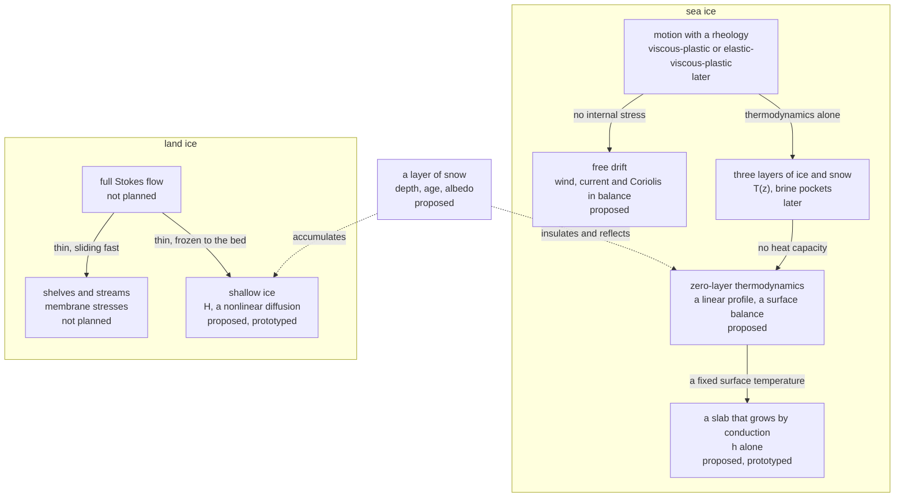

28 Nov 2026 · J. Emmanuel Johnson (drafted with Claude Code)

## Decision

Proposed, for review: `sesmax-ice` is the cryosphere component of sesmax. It holds three kinds of frozen water. Sea ice starts as a thermodynamic slab, which grows by conduction and melts by the balance of energy at its surface. Snow is a layer on ice or on land, which insulates and reflects. Land ice starts as the shallow ice approximation, a nonlinear diffusion of thickness.
Proposed: the first models are chosen because each has an exact solution. The slab has Stefan's law and the ice sheet has Halfar's dome, so the package is tested against formulae from its first day.
Recommended for what is open: the motion of sea ice starts as free drift, and a rheology comes only when a question needs ridging or a coast.
Alternative: start from a dynamic and thermodynamic sea-ice model with a viscous-plastic rheology, which is what a climate model has and is most of the work of one.
Status: proposed. Nothing is built. The numbers are from a scratch prototype of 28 November. It is part of step P4 of geostack's plan for the workspace.

## Motivation

Ice changes a climate in two ways that no other component does. It reflects: snow and ice send back most of the sunlight that open water or bare ground would absorb, so a little more ice makes it colder, which makes more ice. And it insulates: a metre of sea ice cuts the heat the ocean gives to a winter atmosphere by an order of magnitude. Both are thresholds, on or off with the presence of ice, and both are why [the energy balance of the atmosphere design](sesmax_atmos.md) has two states.

For this stack the ice matters to the observations too. An altimeter over the polar oceans measures the top of the ice and not the sea, a thermal imager sees its skin, and a retrieval over snow needs its albedo. A prior for any of them is a model of how thick the ice is and how fresh the snow.

The cryosphere is also where time scales are widest. A skin of new ice forms in an hour, a floe lives a year or five, and an ice sheet answers over ten thousand. One package can hold them because they share their physics, the freezing of water and the conduction of heat through what froze, and little else. That is the reason to design them together and build them apart.

## User stories

- As someone **coupling** an ocean and an atmosphere at high latitude, I want a surface that knows whether it is water or ice, with the albedo and the heat flux of each.
- As someone **estimating a climate parameter**, I want the ice-albedo feedback from a model of ice and not from a switch on temperature.
- As a **modeller of sea ice**, I want a thickness that grows as the square root of time when it should, and a model that says so in a test.
- As a **glaciologist with a dome**, I want the shallow-ice equation with its exact solution as a gate, and a mass that is conserved to rounding.
- As someone **assimilating thickness or extent**, I want the gradient of a thickness with respect to a conductivity or an air temperature.
- As someone **reading a snow-covered scene**, I want the age and depth of the snow, since they set what a satellite sees.

## Background: the maths

### The family

Frozen water has two families, one that floats and one that rests on land. They meet at the bottom, in a column of ice that conducts heat.



### A slab that grows

Ice of thickness $h$ floats on water at its freezing point $T_ f$, under a surface at $T_ s < T_ f$. Heat is conducted up through the ice, and the water at its base freezes to supply it. With a linear profile of temperature in the ice,

```math
\rho_i L_f \frac{\mathrm{d} h}{\mathrm{d} t} = \frac{k_i (T_f - T_s)}{h} - F_w
```

where $\rho_ i$ is the density of ice, $L_ f$ the latent heat of fusion, $k_ i$ its conductivity and $F_ w$ the heat from the ocean below. With $F_ w = 0$ and a fixed $T_ s$ this is Stefan's law, and it has a closed form:

```math
h(t) = \sqrt{h_0^2 + \frac{2 k_i (T_f - T_s)}{\rho_i L_f} t}
```

Thin ice grows fast and thick ice slowly, since the ice is its own insulation. Twenty degrees of cold make 83 cm in a month from a skin of 10 cm, and the second month adds only 34 cm more.

### The surface sets its own temperature

A fixed $T_ s$ is a test, not a climate. The zero-layer model of [Semtner (1976)](https://hdl.handle.net/10.1175/1520-0485(1976)006<0379:AMFTTG>2.0.CO;2) finds $T_ s$ from the balance of energy at the top of the ice,

```math
S (1 - \alpha) + L_\downarrow - \epsilon \sigma T_s^4 - H - \lambda E + \frac{k_i (T_f - T_s)}{h} = 0
```

with the terms of the land's surface balance and the conduction from below. If the balance gives $T_ s$ above the melting point, $T_ s$ is held there and the excess melts ice from the top. A layer of snow of depth $h_ s$ and conductivity $k_ s$ adds its resistance to the ice's, so the conduction becomes $(T_ f - T_ s) / (h / k_ i + h_ s / k_ s)$. Snow conducts about a seventh as well as ice, so ten centimetres of it insulate like sixty-five of ice.

### Ice that moves

A floe is pushed by the wind and the current and turned by the Coriolis force. With no stress between floes, the balance is

```math
m \partial_t \mathbf{u} = \boldsymbol{\tau}_a + \boldsymbol{\tau}_w - m f \hat{\mathbf{z}} \times \mathbf{u} - m g \nabla \eta + \nabla \cdot \boldsymbol{\sigma}
```

where $m = \rho_ i h$ is the mass per area, $\boldsymbol{\tau}_ a$ and $\boldsymbol{\tau}_ w$ the stresses of the air and the water, $\eta$ the height of the sea surface and $\boldsymbol{\sigma}$ the internal stress. Free drift drops $\boldsymbol{\sigma}$, and the thickness is then carried by the velocity: $\partial_ t h + \nabla \cdot (h \mathbf{u})$ equals the growth of the slab. The stress is what stops ice piling against a coast, and it is a rheology: viscous-plastic in [Hibler (1979)](https://hdl.handle.net/10.1175/1520-0485(1979)009<0815:ADTSIM>2.0.CO;2), made explicit by an elastic term in [Hunke and Dukowicz (1997)](https://hdl.handle.net/10.1175/1520-0485(1997)027<1849:AEVPMF>2.0.CO;2). It is stiff, nonlinear and most of a sea-ice model, which is why it is later.

### Ice that flows

An ice sheet creeps under its own weight. Where it is thin and frozen to its bed, the flow at a point depends only on the thickness $H$ and the slope of the surface $s$ there, and the thickness obeys a diffusion whose diffusivity depends on itself:

```math
\partial_t H = \nabla \cdot \left( \Gamma H^{n+2} \vert \nabla s \vert^{n-1} \nabla s \right) + \dot{a}
```

where $\Gamma = 2 A (\rho_ i g)^n / (n + 2)$, $A$ is the softness of ice, $n = 3$ the exponent of Glen's law and $\dot{a}$ the accumulation of snow less the melt. On a flat bed with no accumulation it has a similarity solution, a dome that spreads and thins ([Halfar, 1983](https://doi.org/10.1029/JC088iC10p06043)):

```math
H(r, t) = H_0 \left( \frac{t_0}{t} \right)^{1/9} \left[ 1 - \left( \left( \frac{t_0}{t} \right)^{1/18} \frac{r}{R_0} \right)^{4/3} \right]^{3/7}
```

with $t_ 0 = (7/4)^3 R_ 0^4 / (18 \Gamma H_ 0^7)$. It is the standard test of an ice-sheet model ([Bueler et al., 2005](https://doi.org/10.3189/172756505781829449)), and it is hard in the place that matters: at the margin the thickness goes to zero with an infinite slope.

### What a model shows

| Observable | From | Seen by |
| --- | --- | --- |
| ice thickness | $h$, $H$ | an altimeter, through the freeboard |
| freeboard | $h (1 - \rho_ i / \rho_ w)$, less the load of snow | a radar or laser altimeter |
| ice concentration, or extent | the share of a cell with $h > 0$ | a microwave radiometer |
| surface temperature | $T_ s$ | a thermal infrared imager |
| albedo | from the snow's depth and age, and the ice below | every optical retrieval, and the atmosphere above |
| surface height of an ice sheet | $s = b + H$ | an altimeter |
| drift | $\mathbf{u}$ | feature tracking between two images |

### Which one to use

| The question is about | Use | Because | It cannot show |
| --- | --- | --- | --- |
| a test of anything that handles ice | the slab with a fixed surface temperature | Stefan's law is exact | a climate |
| the ice-albedo feedback, a seasonal cycle of thickness | zero-layer thermodynamics with snow | the surface finds its own temperature, and melts | the lag from the heat stored in thick ice |
| an ocean's surface under ice, cheaply | the same, as the ocean's lid | it gives the albedo and the conducted heat | where the ice goes |
| where the ice goes in the open pack | free drift over the thermodynamics | the wind explains most of the drift away from coasts | ridging, a land-fast edge, an arch in a strait |
| ice against a coast, thickness from deformation | a rheology, later | internal stress is the physics there | — |
| the shape and the volume of an ice sheet, over millennia | shallow ice | one diffusion, with an exact test | ice streams, shelves, a grounding line |
| what a satellite sees over ice | the snow layer on either | depth and age set the albedo and the emission | the grain of the snow |

- **Sea ice and land ice share a name and little else.** One is a metre thick and lives a year, the other is kilometres thick and lives an age. They are two models in one package, not two cases of one model.
- **Thin ice is the hard part.** Growth goes as $1 / h$, so the first centimetre is the fastest and the stiffest. A model has to say what happens at $h = 0$, and that choice is its treatment of open water.
- **The margin is the hard part on land.** The error of a shallow-ice model sits in the one cell where the ice ends.

## Background: the numerics

- **Growth at small thickness is stiff.** From a skin of 1 mm, a fixed step of an hour sent the prototype's thickness to minus 85 cm. A step of ten minutes gave three digits, and an adaptive step gave ten digits in 99 steps. The cure in a model is to treat ice thinner than a minimum as a fraction of a cell covered by ice of that minimum, which is also what makes concentration a variable.
- **Presence is a switch.** Albedo, insulation and drag change when ice appears. As on land, the switch is smooth by default, with a width in thickness that is a parameter of the numerics.
- **A surface temperature is a root.** The zero-layer balance is nonlinear in $T_ s$ through $\sigma T_ s^4$. One Newton step from the last value is what the literature does, and an implicit function gives its gradient.
- **Shallow ice is a stiff nonlinear diffusion.** Its diffusivity is $\Gamma H^5 \vert \nabla s \vert^2$, of the order of 10 m²/s under a dome of 3,600 m and larger where the surface is steep. The prototype was stable with a step of a fortieth of a year on a grid of 20 km, and the step falls by four each time the grid halves. Two thousand years on 20 km took 80,000 steps. An implicit or a semi-implicit step is the first thing to add.
- **Mass is conserved by the form.** Written as the divergence of a flux, with the flux zero where there is no ice, the prototype kept its volume to $10^{-15}$.
- **Thickness is not negative.** A projection onto $H \geq 0$ after each step is the usual free-boundary treatment, and it is where the margin moves.
- **Two clocks.** A year of sea ice is thousands of steps of an hour, and an age of an ice sheet is thousands of steps of a year. They are separate runs, joined by a coupler if ever.

## What it builds on

| Need | Upstream, by its public name | State |
| --- | --- | --- |
| the model contract, terms, constrained parameters | `sesmax_core`: `Model`, `TermModel`, `positive` | exists |
| a guard on a thickness | `sesmax_core`: `guard_positive` | exists |
| a root inside a tendency, with its gradient | optimistix, lineax | exist |
| an implicit term for a stiff diffusion | integrix: `imex_solver`, through `implicit` of the core | exists |
| the divergence of a flux on a C-grid, a mask | gridax: `GridOps`, `Mask2D`, `fill_ghosts` | exist |
| advection of a thickness by a velocity | gridax's advection schemes | exist |
| the wind, the current and the sea-surface height under the ice | `Covariates`, sesmax#238; later the atmosphere and the ocean through the coupler | open |
| an integral carried by the solve, for a mass budget | `Accumulated`, proposed in [the design of the run](sesmax_experiment_run.md) | proposed |
| densities, the latent heat of fusion, conductivities of ice and snow, the freezing point of sea water | geophysix | missing; `geophysix.seawater` has a linear equation of state only |
| the Stefan–Boltzmann constant | geophysix | missing |
| a rheology for sea ice | nothing in the stack | missing, and not asked for yet |

Gaps, each with the package that should own it. None is filed.

- **The constants of ice and snow**, in geophysix: the densities of ice and snow, the latent heat of fusion, the conductivities, the freezing point of sea water as a function of salinity, Glen's softness as a function of temperature. They are the cryosphere's part of the radiation and moist constants that [the atmosphere](sesmax_atmos.md) and [the land](sesmax_land.md) designs ask for.
- **A nonlinear diffusion with a free boundary**, in gridax or integrix. The shallow-ice step is a flux of the form $D(H, \nabla s) \nabla s$ with a projection onto $H \geq 0$. gridax has the divergence and the gradient, and the positivity-preserving step is the piece to look for before writing one.

What stays here: the slab, the zero-layer model, the snow layer, free drift, shallow ice, their priors, their checks and what they show.

## Proposal: the API

| Rung | Name | Job |
| --- | --- | --- |
| structure | `SeaIceState`, `SnowState`, `IceSheetState` | thickness and concentration; depth and age; thickness on a bed |
| model | `SlabIce`, `ZeroLayerIce`, `FreeDriftIce`, `ShallowIce` | one model per box of the family |
| primitive | `Conduction`, `SurfaceMelt`, `BasalFlux`, `Snowfall`, `SnowAging`, `ShallowIceFlux` | the terms |
| strategy | `Albedo`: `SnowAndIce(fresh=, old=, bare=, width=)` | what the surface reflects |
| strategy | `ThinIce`: `Minimum(h_min=)`, `Regularised(width=)` | what happens near $h = 0$ |
| check | `mass_budget`, `non_negative`, `diffusive_step`, `stefan`, `halfar` | what a run must pass |
| recipe | scenarios `stefan_growth`, `seasonal_slab`, `halfar_dome` | named set-ups, each with a closed form or a known cycle |

```python
# Shapes: Ny Nx cells; ice sheets on a C-grid with the ghost ring

# proposed (sesmax-ice)
# ρ_i L_f dh/dt = (T_f − T_s) / (h / k_i + h_s / k_s) − F_w, with T_s from the surface balance
class ZeroLayerIce(TermModel):
    @classmethod
    def create(
        cls,
        shape: tuple[int, int],
        *,
        conductivity: float = 2.03,        # W m⁻¹ K⁻¹, a leaf with a positive constraint
        snow_conductivity: float = 0.31,
        albedo: Albedo = SnowAndIce(fresh=0.85, old=0.70, bare=0.60, width=0.05),
        thin_ice: ThinIce = Minimum(h_min=0.05),
        mask: Mask2D | None = None,
    ) -> ZeroLayerIce: ...


# proposed (sesmax-ice): the model as a sum of terms; the air and the ocean are covariates
model = Conduction(conductivity) + SurfaceMelt(covariates, albedo) - BasalFlux(covariates["ocean_heat"]) + Snowfall(covariates["snowfall"])

# proposed (sesmax-ice)
# ∂ₜH = ∇·(Γ H^{n+2} |∇s|^{n−1} ∇s) + ȧ, with H ≥ 0
sheet = ShallowIce.create(grid, bed=bed, softness=1e-16, exponent=3, accumulation=covariates["accumulation"])

# proposed (sesmax-ice): what it registers
COMPONENT = Component(
    name="ice",
    models={"slab": ..., "zero_layer": ..., "free_drift": ..., "shallow_ice": ...},
    observables={"thickness": ..., "freeboard": ..., "concentration": ..., "t_surface": ..., "albedo": ..., "surface_height": ...},
    checks={"mass_budget": ..., "non_negative": ..., "diffusive_step": ...},
)
```

- **A closed form is a scenario.** `stefan_growth` and `halfar_dome` are named set-ups with their exact answers, so a new solver or a new grid is checked by a run from a file.
- **The albedo is the ice's to give.** The atmosphere and the land designs take an albedo as a strategy. Here it is a function of the state, and the coupler carries it to whoever reflects.
- **The ocean and the air are covariates.** The heat from below, the wind and the snowfall are known fields until a coupler supplies them.

### What it does not own

| Concern | Owner |
| --- | --- |
| The sunlight and the air above | the atmosphere, or a product read as a covariate |
| The heat, the current and the sea-surface height below | the ocean |
| The exchange between ice, ocean and air | `sesmax-couple` |
| Constants of ice, snow and sea water | geophysix |
| Stencils, advection, masks | gridax |
| A rheology, ridging, an ice-thickness distribution | later, here |
| Ice shelves, ice streams, a grounding line, calving | not planned |
| Permafrost | [`sesmax-land`](sesmax_land.md), as freezing in its soil column |

## Examples

Each was run as written, in float64, as models of the core through `run_chunks`.

### Stefan's law

```python
K_I, RHO_I, L_F = 2.03, 917.0, 3.34e5


class IceState(State):
    h: Array


# the prototype of SlabIce
class StefanIce(Model):
    dT: Array     # T_f − T_s, a leaf

    def vector_field(self, t, state, args=None):
        # dh/dt = k_i (T_f − T_s) / (ρ_i L_f h)
        return IceState(h=K_I * self.dT / (RHO_I * L_F * state.h))


run = run_chunks(StefanIce(dT=jnp.asarray(20.0)), IceState(h=jnp.asarray(0.1)), Timeline.build(0.0, 30 * DAY, chunk=DAY), dt=3600.0)
# run.state.h → 0.83498 m; √(h₀² + 2 k ΔT t / (ρ L)) = 0.83498 m, to 1e-13

# ∂h/∂ΔT through the run, by reverse mode: 0.020575 m/K; the closed form gives 0.020575
```

### Halfar's dome

```python
# the prototype of ShallowIce, in the radial coordinate
class SIA(Model):
    r: Array        # cell centres
    gamma: Array    # Γ = 2A(ρg)³/5

    def vector_field(self, t, state, args=None):
        H, r = state.h, self.r
        dr = r[1] - r[0]
        r_face = 0.5 * (r[1:] + r[:-1])
        H_face = 0.5 * (H[1:] + H[:-1])
        slope = (H[1:] - H[:-1]) / dr
        # r Γ H⁵ |∂H/∂r|² ∂H/∂r at the faces, and zero at both ends
        flux = r_face * self.gamma * H_face**5 * slope**2 * slope
        divergence = jnp.concatenate([flux[:1], flux[1:] - flux[:-1], -flux[-1:]]) / (r * dr)
        return IceState(h=divergence)

    def apply_boundary_conditions(self, state):
        return IceState(h=jnp.maximum(state.h, 0.0))

# a dome of 3,600 m and 750 km, 2,000 years on from t₀ = 422 years
```

## The prototype

Scratch runs on 28 November 2026, in float64 on one CPU, with the packages of sesmax `a34e46c`. The slab has $k_ i = 2.03$ W/(m K), $\rho_ i = 917$ kg/m³, $L_ f = 3.34 \times 10^5$ J/kg and a surface 20 K below freezing. The dome has $A = 10^{-16}$ Pa⁻³ per year, $\rho_ i = 910$ kg/m³ and Heun's method.

**The slab.**

| Check | Result |
| --- | --- |
| growth from 10 cm in 30 days, a step of an hour | 0.83498 m; the closed form to $10^{-13}$ |
| growth from 1 mm, a step of an hour | −0.85 m, which is no thickness |
| the same, a step of ten minutes | 0.8293 m; the closed form is 0.8290 |
| the same, an adaptive step | the closed form to $2 \times 10^{-10}$, in 99 steps |
| $\partial h / \partial (T_ f - T_ s)$ by reverse mode | 0.020575 m/K; the closed form gives 0.020575 |

**The dome**, 2,000 years after $t_ 0$, when it is 2,960 m high at its centre.

| Cells | Step | Error at the centre | Largest error | Change of volume |
| --- | --- | --- | --- | --- |
| 30, of 40 km | 0.1 yr | 4.7 m | 121 m | $1 \times 10^{-15}$ |
| 60, of 20 km | 0.025 yr | 0.59 m | 24 m | $1 \times 10^{-15}$ |
| 120, of 10 km | 0.00625 yr | 0.53 m | 94 m | $2 \times 10^{-15}$ |

The centre is right to two parts in ten thousand from 60 cells. The largest error is at the margin, in the cell where the exact thickness falls to zero with an infinite slope, and it does not fall with the grid. A fixed grid at a moving margin behaves this way, which is why the gates below ask for the centre and the margin apart ([Bueler et al., 2005](https://doi.org/10.3189/172756505781829449) have the exact solutions and what to expect of each). The first attempt, with a step of ten years, went to infinity in the first chunk, and the monitor of the run loop stopped it there.

The two states of an ice-covered and an ice-free planet are in the prototype of [the atmosphere design](sesmax_atmos.md), where the ice is a switch on temperature. Replacing that switch by the slab of this page is the first coupling of the two.

Not covered: the zero-layer surface balance, snow, melt, concentration, free drift, an implicit step for shallow ice, a bed that is not flat, accumulation, two dimensions on a C-grid, and any comparison with data.

## Steps and gates

| Step | Pull request | Gate |
| --- | --- | --- |
| I0 | the constants of ice and snow in geophysix (with steps A0 and L0) | each constant against its reference value |
| I1 | the package; `SlabIce` and its thin-ice strategies; the scenario `stefan_growth` | Stefan's law from 1 mm and from 10 cm, with a fixed and an adaptive step |
| I2 | `ZeroLayerIce` with snow, the `SnowAndIce` albedo, `mass_budget` | a seasonal cycle of thickness that repeats; the mass and the energy budgets to rounding |
| I3 | `ShallowIce` on a C-grid with an implicit step; the scenario `halfar_dome` | the table above in two dimensions; the centre to one part in a thousand; the volume to rounding |
| I4 | `FreeDriftIce`, with the thickness advected | a floe at the angle to the wind that the balance gives; mass conserved under advection |
| I5 | the observables, and the ice's side of the surface | waits for `Observable` and for `sesmax-couple` |
| I6 | the energy balance of the atmosphere over the slab | the two states again, with ice of a thickness and not a switch |

I1 and I3 depend on nothing that is open, and each ends in an exact test.

## Open questions

| ID | Question | Recommended | Alternative |
| --- | --- | --- | --- |
| SI-1 | One package for sea ice and land ice, or two? | one, `sesmax-ice`, with two families: they share constants, snow and the conduction of heat | `sesmax-seaice` and `sesmax-landice` |
| SI-2 | What happens at $h = 0$? | a minimum thickness and a concentration, so that thin ice is a share of a cell | a regularised $1 / h$, which keeps one variable |
| SI-3 | Where does snow live? | here, as a layer that ice and land both carry; the land sees it through the coupler | a copy in `sesmax-land` |
| SI-4 | Does sea ice get a rheology? | not until a question needs a coast or ridging | elastic-viscous-plastic from the start |
| SI-5 | The step of shallow ice | implicit in the diffusivity of the last step, which removes the limit | explicit with sub-steps |
| SI-6 | How is the margin of an ice sheet treated? | a projection onto $H \geq 0$, with the margin's error reported apart | a moving grid, or a level set |
| SI-7 | Does the package start before there is a user for it? | the design now, the code with the first coupling, as geostack's plan says | build I1 and I3 now, since each is small and has an exact test |

## References

- Bueler, E., Lingle, C. S., Kallen-Brown, J. A., Covey, D. N. and Bowman, L. N. (2005). [Exact solutions and verification of numerical models for isothermal ice sheets](https://doi.org/10.3189/172756505781829449). *Journal of Glaciology* 51, 291–306.
- Halfar, P. (1983). [On the dynamics of the ice sheets 2](https://doi.org/10.1029/JC088iC10p06043). *Journal of Geophysical Research* 88, 6043–6051.
- Hibler, W. D. (1979). [A dynamic thermodynamic sea ice model](https://hdl.handle.net/10.1175/1520-0485(1979)009<0815:ADTSIM>2.0.CO;2). *Journal of Physical Oceanography* 9, 815–846.
- Hunke, E. C. and Dukowicz, J. K. (1997). [An elastic–viscous–plastic model for sea ice dynamics](https://hdl.handle.net/10.1175/1520-0485(1997)027<1849:AEVPMF>2.0.CO;2). *Journal of Physical Oceanography* 27, 1849–1867.
- Semtner, A. J. (1976). [A model for the thermodynamic growth of sea ice in numerical investigations of climate](https://hdl.handle.net/10.1175/1520-0485(1976)006<0379:AMFTTG>2.0.CO;2). *Journal of Physical Oceanography* 6, 379–389.

## Relationships

- Part of: [the workspace overview](sesmax_workspace.md), a component beside the ocean
- Next to: [sesmax-atmos](sesmax_atmos.md), whose energy balance it gives an albedo to, and [sesmax-land](sesmax_land.md), which it covers with snow
- Builds on: `sesmax-core`, gridax, integrix, optimistix, geophysix
- Feeds: `sesmax-couple`, later
- Issues: sesmax#232, sesmax#238
