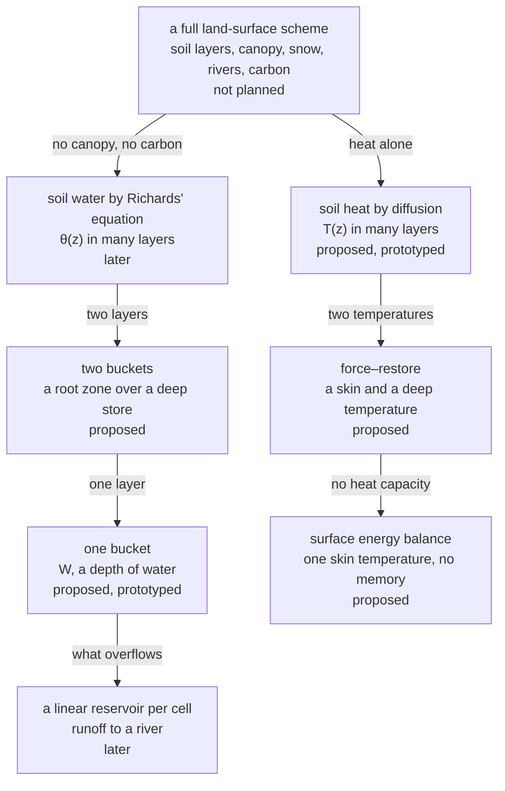

28 Nov 2026 · J. Emmanuel Johnson (drafted with Claude Code)

## Decision

Proposed, for review: `sesmax-land` is the land component of sesmax. Its models are columns: each cell of the grid has a store of water and a profile of heat, and no cell reads its neighbour. The package starts with the two smallest that are useful, a bucket for soil water and a diffusive column for soil heat, and the surface energy balance that sets the boundary of both.
Proposed: a land model runs alone, with rain, sunlight and air temperature as known fields, and the coupler later puts an atmosphere's output in their place.
Recommended for what is open: the switches of a bucket (full, dry, frozen) are smooth by default, so that a gradient passes through them.
Alternative: wait for real code before designing, as geostack's plan says of land and ice. This page is the design that the first code would follow, and it changes nothing until it is accepted.
Status: proposed. Nothing is built. The numbers are from a scratch prototype of 28 November. It is part of step P4 of geostack's plan for the workspace.

## Motivation

The ground is the slow part of the weather over land. A wet soil spends the sun's energy on evaporation and stays cool, and a dry one heats the air above it. Which of the two a place is depends on the rain of the last weeks, so the soil is a memory, and an atmosphere over land that lacks it gets the temperature of the afternoon wrong.

For this stack the land matters in a second way. A methane retrieval, a surface temperature product and a soil-moisture mission all see the ground, and each needs a prior for it. A prior that is a model, with rain in and evaporation out, can be estimated with the observations, where a climatology cannot.

A land model is also the easiest kind to make differentiable and cheap. It has no advection and no elliptic solve, only a few ordinary differential equations per cell. Its difficulty is elsewhere: thresholds. A bucket overflows, a soil dries out, water freezes. Each is a switch, and a model built of switches has gradients that are zero or missing where they matter.

## User stories

- As someone **coupling** an atmosphere, I want a surface that returns evaporation and sensible heat for the rain and the sunlight it is given, with a memory of weeks.
- As someone **assimilating soil moisture**, I want a model whose state is the thing a satellite sees, and whose parameters (the capacity of the soil, the time of drainage) I can estimate.
- As a **hydrologist with a catchment**, I want the water budget to close to rounding, so that a difference from a gauge is a difference of physics.
- As someone **running a continent**, I want a million columns in one compiled call, since no column reads another.
- As someone **estimating a parameter**, I want a gradient through a year of hourly steps that agrees with a finite difference.

## Background: the maths

### The family

A land-surface scheme of a climate model has a dozen layers of soil, a canopy, snow, rivers and vegetation that grows. Each step down the family removes one of them.



### A bucket of water

The soil holds a depth of water $W$, filled by rain $P$ and emptied by evaporation $E$ and runoff $R$ ([Manabe, 1969](https://hdl.handle.net/10.1175/1520-0493(1969)097<0739:CATOC>2.3.CO;2)):

```math
\frac{\mathrm{d} W}{\mathrm{d} t} = P - E - R
```

```math
E = \beta(W) E_p
```

where $E_ p$ is the potential evaporation, what a wet surface would lose, and $\beta$ rises from 0 for a dry soil to 1 at three quarters of the field capacity $W_ c$, $\beta = \min(1, W / (0.75 W_ c))$. Manabe's bucket overflows at once, $R = P - E$ when $W = W_ c$. The form used here drains the excess over a time $\tau_ r$,

```math
R = \frac{\max(0, W - W_c)}{\tau_r}
```

which is the same in the limit of a short $\tau_ r$ and has a slope. The budget is the test: over any interval, $W(t_ b) - W(t_ a) = \int (P - E - R) \mathrm{d}t$, and each of the three integrals is a number someone measures.

The bucket has two regimes. Where rain exceeds what the air can take, the soil stays near $W_ c$, evaporation is $E_ p$ and the rest runs off. Where it does not, the soil dries until $\beta E_ p$ equals the rain, and nothing runs off. The memory is $0.75 W_ c / E_ p$, about a month for 15 cm of capacity and 3 mm/day.

### A column of heat

Heat moves down into the soil by conduction,

```math
\partial_t T = \kappa_s \partial_z^2 T
```

where $T(z, t)$ is the temperature at depth $z$ and $\kappa_ s$ the thermal diffusivity of the soil. For a surface temperature that swings as $A \sin(\omega t)$, the solution is a damped wave that travels down:

```math
T(z, t) = A e^{-z / d} \sin \left( \omega t - \frac{z}{d} \right)
```

with the damping depth $d = \sqrt{2 \kappa_ s / \omega}$. It is 12 cm for a day and 2.2 m for a year, at $\kappa_ s = 5 \times 10^{-7}$ m²/s. This one formula says how deep a column must be and how thin its top layer, and it is the test of the numerics.

The force–restore method ([Deardorff, 1978](https://doi.org/10.1029/JC083iC04p01889)) replaces the column by two temperatures, a skin $T_ g$ forced by the flux $G$ into the ground and restored towards a deep value $T_ d$:

```math
\frac{\mathrm{d} T_g}{\mathrm{d} t} = \frac{2 G}{c_s d} - \omega (T_g - T_d)
```

where $c_ s$ is the volumetric heat capacity of the soil. It is exact for one frequency and cheap for all.

### The surface energy balance

What ties water and heat is the balance of energy at the surface,

```math
R_n = H + \lambda E + G
```

where $R_ n = S (1 - \alpha) + L_ \downarrow - \epsilon \sigma T_ g^4$ is the net radiation, with $S$ the sunlight at the surface, $L_ \downarrow$ the longwave from the sky, $H$ the sensible heat to the air, $\lambda E$ the latent heat of the evaporation and $G$ the flux into the ground. $H$ and $E$ follow bulk formulae in the difference between the surface and the air. The evaporation of the bucket and the $\lambda E$ of this balance are the same quantity, which is where the water budget and the energy budget meet. A wet soil puts $R_ n$ into $\lambda E$, and a dry one into $H$.

### What a model shows

| Observable | From | Seen by |
| --- | --- | --- |
| soil moisture of the top layer | $W / W_ c$, or the top bucket of two | a microwave radiometer |
| land surface temperature | $T_ g$ | a thermal infrared imager |
| evaporation and sensible heat | $E$, $H$ | a flux tower, and the atmosphere above |
| runoff | $R$, summed over a catchment | a river gauge |
| albedo, emissivity | parameters, or a field from outside | every optical retrieval |

### Which one to use

| The question is about | Use | Because | It cannot show |
| --- | --- | --- | --- |
| the memory of soil water, over weeks | one bucket | one number per cell, a budget that closes | fast drying of the top centimetres |
| what a soil-moisture satellite sees | two buckets | the satellite sees the top few centimetres, and the roots drink below | a profile |
| the daily cycle of surface temperature | force–restore | two numbers, exact for the daily wave | a seasonal wave at the same time |
| heat storage over seasons, frozen ground | the diffusive column | every frequency, and a place for latent heat of freezing | lateral flow |
| a lower boundary for an atmosphere, cheaply | the surface energy balance alone | no state at all | any memory |
| a river's flow | a bucket and a linear reservoir | the smallest rainfall–runoff model | routing along a network |

- **Choose by the time scale.** The bucket remembers a month, the skin an afternoon, the deep soil a year. A model has to hold the scale of the question and may ignore the others.
- **Close the budget first.** A land model that does not conserve water cannot be compared with a gauge, and one that does not conserve energy cannot be coupled.
- **Mind the switches.** A parameter behind a threshold has a gradient only on one side of it. A smooth threshold has a width, and the width is a choice that shows in the answer.

## Background: the numerics

- **Columns are independent.** A tendency is elementwise over the grid, so a field of buckets is one array and a grid of soil columns is one more axis. Nothing needs a stencil in the horizontal, a halo or a solve, and the scaling is the free one of [the scaling design](sesmax_scaling.md): replicate.
- **Diffusion in thin layers is stiff.** The explicit step is $\Delta z^2 / (2 \kappa_ s)$, which is 100 s for a layer of 1 cm and 25 s for half that. A column that resolves the daily wave therefore wants its diffusion implicit, which for one dimension is a tridiagonal solve per column.
- **A stretched grid.** The daily wave needs centimetres at the top and the annual one metres at the bottom, so the layers grow with depth. The damping depth of each frequency sets both ends.
- **A switch has three forms.** A hard `max` has no gradient on one side, a smooth one has a width, and a relaxation (the excess drains over $\tau_ r$) has a time. The prototype uses the last for runoff and a clip for $\beta$, and its gradient agrees with a finite difference to four digits.
- **A store must stay positive.** $W \geq 0$ and $W \leq W_ c$ plus a little hold by the physics for a small step and fail for a large one. A guard in the tendency is the place to catch it.
- **A budget is an accumulator.** The integrals of $P$, $E$ and $R$ are carried by the solve beside $W$, as [the design of the run](sesmax_experiment_run.md) proposes for means, so the closure has the solver's own accuracy.

## What it builds on

| Need | Upstream, by its public name | State |
| --- | --- | --- |
| the model contract, terms, constrained parameters | `sesmax_core`: `Model`, `TermModel`, `positive`, `interval` | exists |
| a guard on a store | `sesmax_core`: `guard_positive`, `guard_ceiling` | exist |
| an implicit term, and the stable step of an explicit one | integrix: `imex_solver`, `stable_step`, through the core | exist |
| a tridiagonal solve per column | lineax, gaussx | exist |
| rain, sunlight and air temperature as known fields in time | `Covariates`, sesmax#238 | open |
| an integral carried by the solve | `Accumulated`, proposed in [the design of the run](sesmax_experiment_run.md) | proposed |
| a function per column | `equinox.filter_vmap` | exists |
| a land mask, cell areas | gridax: `Mask2D`, `area_weights` | exist |
| the Stefan–Boltzmann constant, latent heats, the psychrometric constant | geophysix | missing |
| saturation vapour pressure | geophysix | missing |
| bulk formulae for $H$ and $E$ | `sesmax-couple` | later |
| a named field that a model shows | `Observable`, proposed in [the core design](sesmax_core.md) | proposed |
| scores against a gauge or a tower | diagnostix | exists |

Gaps, each with the package that should own it. None is filed.

- **Radiation and moist constants**, in geophysix, as [the atmosphere design](sesmax_atmos.md) asks: the Stefan–Boltzmann constant, the latent heats of vaporisation and of fusion, saturation vapour pressure.
- **Soil properties**, in geophysix or here: heat capacity, conductivity and field capacity by soil type are a table of numbers with uncertainties, which is to say a set of priors. This page recommends they sit here, as the priors of a model sit in its component.

What stays here: the buckets, the soil column, the surface energy balance, their priors, their checks and what they show.

## Proposal: the API

| Rung | Name | Job |
| --- | --- | --- |
| structure | `BucketState`, `SoilState`, `LandParams` | water per cell; temperature per layer and cell; capacities and time scales |
| model | `Bucket`, `TwoBuckets`, `SoilColumn`, `ForceRestore` | one model per box of the family |
| primitive | `Evaporation`, `Runoff`, `SoilDiffusion`, `SurfaceEnergyBalance` | the terms |
| strategy | `Threshold`: `Hard`, `Smooth(width=)`, `Relaxed(time=)` | how a switch is written |
| check | `water_budget`, `energy_budget`, `diffusive_step`, `resolves_damping_depth` | what a run must pass |
| recipe | scenarios `wet_and_dry`, `diurnal_soil`, `one_catchment` | named set-ups |

```python
# Shapes: Ny Nx columns; Nz soil layers

# proposed (sesmax-land)
# dW/dt = P − β(W) E_p − R, elementwise over the grid
class Bucket(TermModel):
    @classmethod
    def create(
        cls,
        shape: tuple[int, int],
        *,
        capacity: float = 0.15,           # m, a leaf with a positive constraint
        drainage_time: float = 86400.0,   # s
        threshold: Threshold = Relaxed(),
        mask: Mask2D | None = None,
    ) -> Bucket: ...


# proposed (sesmax-land): the model as a sum of terms, each reading a covariate
model = Rain(covariates["precipitation"]) - Evaporation(covariates["potential_evaporation"], capacity) - Runoff(capacity, drainage_time)

# proposed (sesmax-land)
# ∂ₜT = κ_s ∂²T/∂z², with the flux G of the surface balance at the top and no flux below
column = SoilColumn.create(shape, depths=stretched(0.01, 3.0, n=12), diffusivity=5e-7)
# the diffusion is implicit, so the step is the forcing's and not the top layer's
model = implicit(SoilDiffusion(...)) + SurfaceEnergyBalance(covariates, albedo=0.2)

# proposed (sesmax-land): what it registers
COMPONENT = Component(
    name="land",
    models={"bucket": ..., "two_buckets": ..., "soil_column": ..., "force_restore": ...},
    observables={"soil_moisture": ..., "t_surface": ..., "evaporation": ..., "sensible_heat": ..., "runoff": ...},
    checks={"water_budget": ..., "energy_budget": ..., "resolves_damping_depth": ...},
)
```

- **One model per cell, written once.** A model is written for arrays of any leading shape, and the grid is that shape. A mask says which cells are land.
- **The atmosphere is a covariate.** Rain, sunlight, air temperature and wind arrive as known fields in time, from a reanalysis today and from `sesmax-atmos` through the coupler later.
- **A budget is a check, not a hope.** `water_budget` reads the accumulators and fails a run whose residual is above rounding.

### What it does not own

| Concern | Owner |
| --- | --- |
| Rain, sunlight, air temperature | the atmosphere, or a product read as a covariate |
| Bulk formulae for the turbulent fluxes | `sesmax-couple` |
| Snow on the ground, frozen water | [`sesmax-ice`](sesmax_ice.md), through the coupler (open question SL-3) |
| Constants and thermodynamics | geophysix |
| Reading a reanalysis or a soil map | xr_toolz, geotoolz |
| Vegetation that grows, carbon, a river network | not planned |

## Examples

Each was run as written, in float64, as models of the core through `run_chunks`.

### A field of buckets, from dry to wet

```python
class BucketState(State):
    W: Array
    evap: Array      # ∫E dt, carried by the solve
    runoff: Array    # ∫R dt
    rain: Array      # ∫P dt


# the prototype of Bucket
class Bucket(Model):
    params: BucketParams      # W_fc, tau_r
    wet: Array                # a factor on the rain, from 0.2 to 2 across the grid

    def vector_field(self, t, state, args=None):
        p = self.params
        P = precip(t) * self.wet                       # 3 mm/day in the mean, with a season
        # E = β(W) E_p, β = clip(W / (0.75 W_c), 0, 1)
        E = jnp.clip(state.W / (0.75 * p.W_fc), 0.0, 1.0) * pot_evap(t)
        # R = max(0, W − W_c) / τ_r
        R = jax.nn.relu(state.W - p.W_fc) / p.tau_r
        return BucketState(W=P - E - R, evap=E, runoff=R, rain=P)


state = run_chunks(model, state0, Timeline.build(0.0, 3 * 365 * DAY, chunk=30 * DAY), dt=3600.0).state
# 64 × 64 columns, three years of hourly steps
# W(end) − W(0) − (∫P − ∫E − ∫R): at most 1.6e-13 m in any column
```

### A soil column against the damped wave

```python
# the prototype of SoilColumn: 1 cm layers to 1.2 m, a surface that swings by 10 K each day
class Soil(Model):
    def vector_field(self, t, state, args=None):
        T = state.T
        surface = self.amp * jnp.sin(self.omega * t)
        above = jnp.concatenate([jnp.array([2 * surface - T[0]]), T[:-1]])   # the surface, as a ghost
        below = jnp.concatenate([T[1:], T[-1:]])                             # no flux at the bottom
        # ∂ₜT = κ_s ∂²T/∂z²
        return SoilState(T=self.kappa * (above - 2 * T + below) / self.dz**2)

# after 20 days the profile is within 0.034 K of A e^{−z/d} sin(ωt − z/d), with d = 11.7 cm
```

## The prototype

Scratch runs on 28 November 2026, in float64 on one CPU, with the packages of sesmax `a34e46c`. The bucket has a capacity of 15 cm, a drainage time of a day, and rain and potential evaporation of 3 mm/day in the mean with opposite seasons. The soil has $\kappa_ s = 5 \times 10^{-7}$ m²/s.

| Check | Result |
| --- | --- |
| 4,096 buckets, three years of hourly steps | 27.5 s, with the first chunk's compilation |
| the water budget, the worst column | $1.6 \times 10^{-13}$ m |
| the range of the store across the grid | 1.8 cm in the driest column, 15.5 cm in the wettest |
| the share of rain that runs off | 0 in the driest column, 0.57 in the wettest |
| $\partial \bar{W} / \partial W_ c$ through a year, by reverse mode | 0.30297; a finite difference gives 0.30285 |
| soil column, layers of 2 cm, step 320 s | 0.064 K from the damped wave, of 10 K |
| the same with layers of 1 cm, step 80 s | 0.034 K |
| the same with layers of 0.5 cm, step 20 s | 0.034 K |

The error of the soil column stops falling below 1 cm because what is left is the start from a uniform profile, which has not died out in 20 days at depth. The step falls by four each time the layer halves, which is the case for an implicit diffusion.

Not covered: two buckets, force–restore, the surface energy balance, an implicit column, a stretched grid, freezing, real forcing, and any comparison with data.

## Steps and gates

| Step | Pull request | Gate |
| --- | --- | --- |
| L0 | radiation and moist constants in geophysix (with step A0 of the atmosphere) | each constant against its reference value |
| L1 | the package; `Bucket` and `TwoBuckets` as sums of terms; `water_budget` | the budget to rounding; the two regimes of the bucket |
| L2 | `SoilColumn` with an implicit diffusion on a stretched grid; `ForceRestore` | the damped wave for a day and for a year; force–restore equals the column for one frequency |
| L3 | `SurfaceEnergyBalance`, `energy_budget` | the energy budget to rounding; a wet soil and a dry one partition $R_ n$ as expected |
| L4 | the thresholds as strategies, and the gradient through each | each gradient against a finite difference, away from and at the threshold |
| L5 | the observables and the land's side of the surface | waits for `Observable` and for `sesmax-couple` |

L1 and L2 depend on nothing that is open except `Covariates`.

## Open questions

| ID | Question | Recommended | Alternative |
| --- | --- | --- | --- |
| SL-1 | The default threshold | relaxed for runoff, smooth for $\beta$, with the widths in the manifest | hard switches, as in the literature |
| SL-2 | Where do soil properties and their priors live? | here, with the models they parameterise | geophysix, as constants |
| SL-3 | Where does snow on the ground live? | in `sesmax-ice`, which owns frozen water; land sees it through the coupler as an albedo and an insulating layer | a snow model here as well |
| SL-4 | Is the surface energy balance a model, or the coupler's? | a term here that takes the air as a covariate; the coupler supplies the air | all of it in `sesmax-couple` |
| SL-5 | Rivers | a linear reservoir per cell at first, with no network | a routing scheme on a river network |
| SL-6 | Does the package start before there is a user for it? | the design now, the code when a coupling or a retrieval needs it, as geostack's plan says | build L1 and L2 now, since they are small |

## References

- Deardorff, J. W. (1978). [Efficient prediction of ground surface temperature and moisture, with inclusion of a layer of vegetation](https://doi.org/10.1029/JC083iC04p01889). *Journal of Geophysical Research* 83, 1889–1903.
- Manabe, S. (1969). [Climate and the ocean circulation: I. The atmospheric circulation and the hydrology of the Earth's surface](https://hdl.handle.net/10.1175/1520-0493(1969)097<0739:CATOC>2.3.CO;2). *Monthly Weather Review* 97, 739–774.

## Relationships

- Part of: [the workspace overview](sesmax_workspace.md), a component beside the ocean
- Next to: [sesmax-atmos](sesmax_atmos.md), which gives it rain and sunlight, and [sesmax-ice](sesmax_ice.md), which covers it in winter
- Builds on: `sesmax-core`, integrix, lineax, gridax, geophysix
- Feeds: `sesmax-couple`, later
- Issues: sesmax#232, sesmax#238
