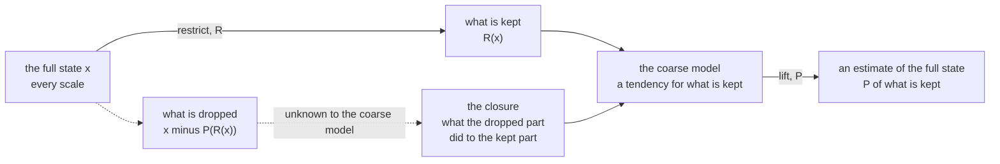
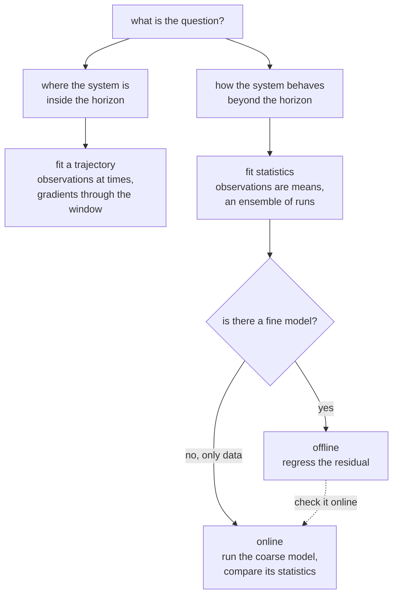

28 Nov 2026 · J. Emmanuel Johnson (drafted with Claude Code)

## Decision

Proposed, for review: a model with more than one scale is handled by the same three things everywhere. A map restricts the full state to what the model keeps, a map lifts it back, and a closure stands for what the dropped part did to the kept part. Space, time and spectrum are three choices of the first map. Climate is the case where the dropped part is the trajectory itself and only its statistics are kept, and it needs a different kind of problem.

| Face | What we would add | Where | State |
| --- | --- | --- | --- |
| space | a coarsening pair for a staggered grid, and the residual as a named quantity | gridax, `sesmax-param` | proposed |
| time | means carried by the solve, and the choice between dropping, sub-cycling and averaging a fast scale | `sesmax-core`, integrix | means proposed in [the design of the run](sesmax_experiment_run.md) |
| spectrum | a truncation as the two maps of `TransformedModel` | `sesmax-core` | the slot is proposed in [the core design](sesmax_core.md) |
| climate | a problem whose observations are statistics, solved by an ensemble | `sesmax-experiment` | proposed |

Recommended: no package. The three additions are small and each has a home: the pair of maps in the core, the residual in `sesmax-param`, the statistics in `sesmax-experiment`. This page is where they are designed together, as [the scaling design](sesmax_scaling.md) is for devices.
Alternative: a `sesmax-multiscale` package that owns coarse-graining and closures. It would sit between the core and `sesmax-param` and take from both, for a few hundred lines.
Status: nothing on this page is built. The numbers are from scratch runs on 28 November on the two-tier Lorenz-96 model, a ring of 36 slow variables with 10 fast ones each. They show that the frame gives the right quantities on a toy. They say nothing about a model on a grid, and no closure here was learned by a network.

## Motivation

The ocean has motions from a metre to a basin and from a minute to a century, and a sesmax model keeps a small part of that range on purpose. Every page of this design already makes a choice about scales, each in its own words:

- [The ocean design](sesmax_ocean.md) orders its models by which fast wave each one removes.
- [The param design](sesmax_param.md) holds the closures, which stand for what a grid cell does not resolve.
- [The experiment design](sesmax_experiment.md) reduces a control to a few modes, and reads its window from the horizon table.
- [The core design](sesmax_core.md) proposes a model seen through an encoder and a decoder.

What is missing is the sentence that connects them, and three things that follow from it:

- **Nothing computes what a coarse model is missing.** A closure is fitted to the difference between a fine tendency and a coarse one, and a diagnostic should report it. Today each user writes it by hand.
- **A long run cannot be fitted the way a short one is.** Beyond the horizon a gradient through the run is a number of no use, and the quantity of interest is a mean or a spectrum. The experiment design has no observation of that kind.
- **Nothing says which of these to reach for.** Dropping a wave, averaging it, sub-cycling it and closing it are four answers to "this scale is too fast or too small", with different costs.

## User stories

- As someone **fitting a closure**, I want the residual of my coarse model against a fine one as one call, so that the target of the fit is the same quantity for every closure I try.
- As someone **calibrating for climate**, I want to give a model the means and variances it should reproduce, and get parameters with a spread, without a gradient through ten thousand steps.
- As someone **choosing a model**, I want to know whether a fast scale should be dropped, sub-cycled or closed, from two numbers I can measure.
- As someone **reducing a model**, I want to run it in a few modes and see what the truncation cost, before trusting the reduced run.

## How to think about scales

A model with state $\mathbf{x} \in \mathbb{R}^{D_ x}$ and tendency $f$ is too large or too stiff. We keep $\bar{\mathbf{x}} = \mathcal{R}(\mathbf{x}) \in \mathbb{R}^{D_ c}$ with $D_ c < D_ x$, and we drop the rest.



The three moves are these.

- **Restrict.** $\mathcal{R}$ takes the full state to what is kept: a mean over a block of cells, a mean over a window of time, or the first coefficients in a basis.
- **Lift.** $\mathcal{P}$ takes what is kept back to a full state, with $\mathcal{R}(\mathcal{P}(\bar{\mathbf{x}})) = \bar{\mathbf{x}}$. It fills the dropped part with a guess, usually zero.
- **Close.** The kept part obeys an equation in which the dropped part appears. A closure replaces that appearance with a function of what is kept.

| Face | Restrict | Lift | The closure stands for |
| --- | --- | --- | --- |
| space | the mean over a block of cells | a constant or an interpolant per block | fluxes by eddies smaller than a cell |
| time | the mean over a window | the mean held over the window | the mean effect of fluctuations within the window |
| spectrum | the first $M$ coefficients in a basis | a synthesis with the others at zero | the exchange with the modes left out |
| climate | the statistics of a long run | none | the trajectory, which is not predicted at all |

## What every face shares

### The exact equation, and its three leftovers

For a linear $\mathcal{R}$, what is kept obeys $\mathrm{d}\bar{\mathbf{x}} / \mathrm{d}t = \mathcal{R} f(\mathbf{x})$, which still needs the full state. Let $f_ c$ be a coarse model, either one written for the coarse variables or $\mathcal{R} f \mathcal{P}$. Then, exactly,

```math
\frac{\mathrm{d}\bar{\mathbf{x}}}{\mathrm{d}t} = f_c(\bar{\mathbf{x}}) + \mathbf{s}(\mathbf{x})
```

with the residual

```math
\mathbf{s}(\mathbf{x}) = \mathcal{R} f(\mathbf{x}) - f_c(\mathcal{R} \mathbf{x})
```

where $\mathbf{s} \in \mathbb{R}^{D_ c}$ has the units of a tendency of the kept state. In fluid mechanics it is the subgrid tendency of a filtered equation ([Germano, 1992](https://doi.org/10.1017/S0022112092001733)). The residual is a function of the full state. Written as a function of the kept state alone, it has three parts ([Chorin et al., 2000](https://doi.org/10.1073/pnas.97.7.2968)):

```math
\mathbf{s}(t) = \mathbf{c}(\bar{\mathbf{x}}(t)) + \int_0^t \mathbf{k}(\bar{\mathbf{x}}(t - s), s) \mathrm{d}s + \mathbf{n}(t)
```

where $\mathbf{c}$ is a function of the present kept state, $\mathbf{k}$ a memory kernel over its past, and $\mathbf{n}$ a term that depends on the dropped part of the initial state, which is unknown and is treated as noise. Which of the three matters is set by the separation of scales. When the dropped part is much faster than the kept one, the memory shrinks to nothing and the noise turns white ([Hasselmann, 1976](https://doi.org/10.1111/j.2153-3490.1976.tb00696.x); [Pavliotis and Stuart, 2008](https://doi.org/10.1007/978-0-387-73829-1)). When it is not, a deterministic closure leaves a remainder that is as slow as the model itself.

This maps onto names that the design already has.

| Part | Name in the design | Page |
| --- | --- | --- |
| $f_ c = \mathcal{R} f \mathcal{P}$ | `TransformedModel`, with $\mathcal{R}$ as its encoder and $\mathcal{P}$ as its decoder | [core](sesmax_core.md) |
| $\mathbf{c}(\bar{\mathbf{x}})$ | a parameterization, which is a `Term` | [param](sesmax_param.md) |
| $\mathbf{n}$, constant or smooth in time | a `ModelError`, as a bias or a coloured forcing | [param](sesmax_param.md) |
| $\mathbf{n}$, white in time | the diffusion of a model with noise | [param](sesmax_param.md) |
| $\mathbf{k}$ | nothing; a memory is a closure with a state of its own | this page, SM-6 |

### The test model

The core ships the two-tier Lorenz-96 model as `Lorenz96t` ([Lorenz, 2006](https://doi.org/10.1017/CBO9780511617652.004)), and no page of the design uses it yet. It has $K$ slow variables $X_ k$ on a ring, each coupled to $J$ fast variables $Y_ {j,k}$:

```math
\frac{\mathrm{d}X_k}{\mathrm{d}t} = X_{k-1}(X_{k+1} - X_{k-2}) - X_k + F - \frac{hc}{b} \sum_{j=1}^{J} Y_{j,k}
```

```math
\frac{\mathrm{d}Y_{j,k}}{\mathrm{d}t} = c b Y_{j+1,k}(Y_{j-1,k} - Y_{j+2,k}) - c Y_{j,k} + \frac{hc}{b} X_k
```

where $F$ is the forcing, $h$ the coupling, $b$ the ratio of amplitudes and $c$ the ratio of time scales. Keeping $X$ and dropping $Y$ is the standard test of a closure ([Wilks, 2005](https://doi.org/10.1256/qj.04.03); [Arnold et al., 2013](https://doi.org/10.1098/rsta.2011.0479)), and of a fit to statistics ([Schneider et al., 2017](https://doi.org/10.1002/2017GL076101)). The coarse model is the one-tier `Lorenz96`, and the residual is the last term of the first equation, so it is known in closed form.

Every number on this page is for $K = 36$, $J = 10$, $h = 1$, $b = c = 10$ and $F = 20$, after a spin-up of 1,000 time units, unless a line says otherwise.

- **The regime was chosen after a first attempt failed.** With $F = 10$ the system is close to regular. The leading wavenumber was 6 for 84 % of a run of 3,200 time units, in stretches of up to 375. The variance of blocks of 400 time units fell from 11.6 in the first block to 8.7 in the last. A coarse model with a fitted linear or cubic closure settled on a regular wave, with no variation between blocks of 250 time units. In the one with the cubic closure a small difference shrank at a rate of 0.18 per time unit, and the same closure with noise blew up. With $F = 20$ the eight block means lie between 3.53 and 3.58, and a small difference in the coarse model grows at 3.6 per time unit.
- **The fast variables are stored with the fast index first.** The sum over $j$ for sector $k$ is over `y.reshape(J, K)[:, k]`. With that layout the closed form equals $\mathcal{R} f(\mathbf{x}) - f_ c(\mathcal{R} \mathbf{x})$ to 3e-14, and with the other it is off by 8.

### Steps and questions for all of them

| Step | Pull request | Gate |
| --- | --- | --- |
| M0 | a two-tier case in `sesmax-testing`, in a regime that is chaotic, with its growth rate in the case | the growth rate of the case is positive and is in the record; the layout of the fast variables is in the docstring |
| M1 | `TransformedModel` in the core, as [the core design](sesmax_core.md) proposes | with an invertible pair, a run equals the model's own (4.9e-14 in the prototype) |

| | Question | Recommended | Alternative |
| --- | --- | --- | --- |
| SM-1 | A package for this? | no, three small additions with a home each | `sesmax-multiscale` |
| SM-2 | What is a pair of maps? | the two callables of `TransformedModel`; the pairs come from gridax, spectraldiffx and vardax | a class hierarchy of coarsenings here |
| SM-5 | The regime of the test case | $F = 20$, which is chaotic with and without a closure | $F = 10$ as in [Schneider et al. (2017)](https://doi.org/10.1002/2017GL076101), which was close to regular here |

## Face 1: the space

### Space: motivation

A model at 10 km does not hold the eddies of 2 km, and they move heat and momentum all the same. The closures of [the param design](sesmax_param.md) are the answer, and their coefficients are tuned by hand or fitted. A fit needs a target, and the target is the residual.

- As someone **fitting a closure**, I want the residual of a coarse model against a fine one.
- As someone **comparing closures**, I want to know how much of the residual a function of the coarse state can explain at all, before I try a larger function.

### Space: the maths

On a grid, $\mathcal{R}$ is a weighted mean over blocks of $r \times r$ cells. For a quantity that is conserved, the weights are the cell areas, so that the total is the same on both grids:

```math
\bar{q}_I = \frac{1}{A_I} \sum_{i \in I} A_i q_i
```

where $I$ is a block, $A_ i$ the area of cell $i$ and $A_ I$ their sum. The lift is a constant per block or an interpolant, and $\mathcal{R} \mathcal{P}$ is the identity for both. For an advected quantity the residual is the divergence of a flux, $\mathbf{s} = - \nabla \cdot (\overline{\mathbf{u} q} - \bar{\mathbf{u}} \bar{q})$, which is the form that the eddy closures of the param design take.

In the two-tier model the block is a sector, the restriction keeps $X_ k$, and the residual is $- (hc/b) \sum_ j Y_ {j,k}$. A closure in the kept state is a polynomial, $c(X_ k) = \sum_ p a_ p X_ k^p$ ([Wilks, 2005](https://doi.org/10.1256/qj.04.03)).

There are two ways to fit it, and they need different things.

- **Offline.** Regress the residual on the coarse state. It needs runs of the fine model, and it is a linear least-squares problem.
- **Online.** Run the coarse model with the closure and compare what it produces with data. It needs no fine model, and it is the climate problem of this page.

They do not always agree: a closure that fits the residual well can still behave badly once it runs inside the model ([Ross et al., 2023](https://doi.org/10.1029/2022MS003258); [Rasp, 2020](https://doi.org/10.5194/gmd-13-2185-2020)).

### Space: the numerics

- **A staggered grid restricts each point in its own way.** A block of cell centres is centred on the block, so a centred field stays centred. A block of faces is centred on no face of the coarse grid, so a velocity needs a mean over the faces that lie on a coarse face, and not over the block.
- **The mask is part of the weights.** A coarse cell that is half land takes the mean over its wet cells, and its wet fraction is a field of the coarse grid.
- **The adjoint of a restriction is not its lift.** A fit through a restriction needs $\mathcal{R}^\top$, which spreads a coarse value over its block with the weights of the mean.
- **A closure can be unstable outside its data.** The cubic fitted at $F = 10$ had a positive coefficient on $X^3$, and the run with noise added blew up.

### Space: what it builds on

| Need | Upstream | State |
| --- | --- | --- |
| a block mean of a centred field | `pipekit_array.coarsen`, through gridax's adapter for a located field | exists; a staggered axis comes back without its location |
| a conservative regridding between two grids | functax, the `Conservative` scheme | exists |
| restriction and prolongation between two levels | gridax's multigrid solver | exist, and are private to the solver |
| a closure as a term | `sesmax-param` | proposed |
| a learned closure | geonnax for the network, pipekit-train for the training | exist |
| a block mean of a face field onto a coarse face, with its transpose | none | **gap, gridax** |

### Space: the API and an example

```python
# Shapes: D_x = K (1 + J) = 396 full; D_c = K = 36 kept; N samples

# proposed (sesmax-param), M2
# s(x) = R f(x) − f_c(R x), in the tendency units of the kept state
def residual(fine: Model, coarse: Model, restrict: Callable[[PyTree], PyTree]) -> Callable[[PyTree], PyTree]: ...

# proposed (gridax), M3: the pair for a C-grid, each field at its own point
# q̄_I = (1 / A_I) ∑_{i ∈ I} A_i q_i
restrict, lift = gx.coarsening(grid_fine, grid_coarse, mask=mask)

# run as written, today (sesmax-core, jax): the residual of the two-tier model
fine, F = Lorenz96t.create(F=20.0, h=1.0, b=10.0, c=10.0), 20.0
# f_c(x̄): the one-tier tendency
coarse = lambda x: jnp.roll(x, 1) * (jnp.roll(x, -1) - jnp.roll(x, 2)) - x + F
# s = R f(x) − f_c(R x), with R: (x, y) ↦ x                                  (N, K)
s = jax.vmap(lambda x, y: fine.vector_field(0.0, L96TState(x=x, y=y)).x - coarse(x))(xs, ys)
# a = argmin ‖s − ∑_p a_p X^p‖², on the first half of the samples
a = np.linalg.lstsq(np.stack([X.ravel() ** p for p in range(4)], 1), S.ravel(), rcond=None)[0]
```

### Space: what was measured

The truth is a run of 2,000 time units of the two-tier model. Its mean of $X$ is 3.551 and its variance 48.80, and over eight blocks of 250 time units these vary by 0.021 and 0.21.

**How much a function of the kept state explains.** The fit is on the first half of the run, and the score on the second.

| Closure | Share of the residual's variance explained | What is left: standard deviation | What is left: correlation after 0.05 |
| --- | --- | --- | --- |
| a constant | 0 | 1.77 | 0.52 |
| linear | 0.50 | 1.25 | 0.17 |
| cubic | 0.56 | 1.17 | 0.08 |

So a function of the present coarse state explains about half of the residual here, and a larger function of the same input cannot do much better. What is left of the cubic is nearly white at the sampling interval, against a decorrelation time of 0.20 for $X$, so in this regime the remainder is noise and not memory. At $F = 10$ the same remainder had a correlation of 0.88 after 0.05 and decayed more slowly than $X$ itself, so there it is memory.

**The climate of the coarse model**, over 2,000 time units each.

| Model | Mean of $X$ | Variance of $X$ | Error of the spectrum |
| --- | --- | --- | --- |
| the two-tier model | 3.551 | 48.80 | |
| coarse, no closure | 3.326 | 55.45 | 0.139 |
| coarse, a constant | 3.308 | 54.37 | 0.117 |
| coarse, linear | 3.523 | 48.48 | 0.019 |
| coarse, cubic | 3.541 | 48.68 | 0.017 |
| coarse, cubic and red noise | 3.530 | 48.59 | 0.011 |

The error of the spectrum is the sum over wavenumbers of the absolute difference in power, over the total power. The linear closure removes most of the error of the mean and the variance, and the cubic brings both within the truth's own variation between blocks of 250.

**A forecast from the truth's slow state**, over 390 starts. The error of the coarse model reaches the climatological standard deviation, 6.99, after 0.85 time units without a closure, 1.15 with the linear one and 1.20 with the cubic.

### Space: steps and questions

| Step | Pull request | Gate |
| --- | --- | --- |
| M2 | `residual` in `sesmax-param` | on the two-tier case it equals the closed form to round-off |
| M3 | a coarsening pair for a C-grid, in gridax | $\mathcal{R} \mathcal{P}$ is the identity; the total of a conserved field is the same on both grids; the transpose passes a dot-product test |

| | Question | Recommended | Alternative |
| --- | --- | --- | --- |
| SM-3 | Fit offline or online? | both; offline first, since it is one pure function | online only, which needs no fine model |
| SM-7 | A fine patch inside a coarse model | later, since it needs an open boundary and a two-way exchange | with the split of space in [the scaling design](sesmax_scaling.md) |

## Face 2: the time

### Time: motivation

A fast scale costs twice. It sets the step, and it makes a long run sensitive to everything. There are four answers, and the design uses the first two without naming the choice.

- As someone **choosing a model**, I want to know whether to drop, sub-cycle, average or close a fast scale.
- As someone **reading a mean**, I want to know how long a window has to be before its mean is worth comparing.

### Time: the maths

The restriction is a mean over a window, $\langle \mathbf{x} \rangle_ \tau (t) = \frac{1}{\tau} \int_ {t - \tau}^{t} \mathbf{x}(s) \mathrm{d}s$. Averaging the equation gives

```math
\frac{\mathrm{d}\langle \mathbf{x} \rangle_\tau}{\mathrm{d}t} = f(\langle \mathbf{x} \rangle_\tau) + \left( \langle f(\mathbf{x}) \rangle_\tau - f(\langle \mathbf{x} \rangle_\tau) \right)
```

and the bracket is the residual. For a quadratic $f$ it is the mean of products of the fluctuations, which is why a mean flow feels its eddies.

A system with a slow part and a fast part, with a ratio of time scales $c$, has four treatments.

| Treatment | What it does | When |
| --- | --- | --- |
| drop | choose a model without the fast part | the fast part does not feed back ([the ocean family](sesmax_ocean.md)) |
| implicit | step the fast part implicitly | it is linear and stiff, and its detail does not matter |
| sub-cycle | several short steps of the fast part per long step | it feeds back, and is cheap |
| average, and close | replace the fast part by its mean effect | $c$ is large, so that the mean is all that is felt ([Fatkullin and Vanden-Eijnden, 2004](https://doi.org/10.1016/j.jcp.2004.04.013)) |

The mean of a quantity $\phi$ over a window of length $T$ is itself uncertain. For $T$ much longer than the decorrelation time $\tau_ \phi$ of $\phi$,

```math
\mathrm{var}(\langle \phi \rangle_T) \approx \frac{2 \tau_\phi}{T} \mathrm{var}(\phi)
```

so the standard deviation of a mean falls as $T^{-1/2}$. This number is the error bar of a climate observation.

### Time: the numerics

- **A gradient through a window grows with the window.** In a chaotic model the gradient of a mean over $T$ grows like $e^{\lambda T}$, and beyond the horizon it has no relation to how the mean responds ([Lea et al., 2000](https://doi.org/10.3402/tellusa.v52i5.12283)). The horizon check of [sesmax-testing](sesmax_testing.md) measures where that starts.
- **A short window is not a small climate.** The gradient of a short mean is exact, and it measures the response of a transient, which is a different number from the response of the long-term mean.
- **A mean is carried by the solve.** A mean computed from snapshots is biased by the sampling. Step R4 of [the design of the run](sesmax_experiment_run.md) carries it as one more variable.
- **Components have different clocks.** An ice sheet steps in years and an atmosphere in minutes. Their exchange over a coupling interval is a mean, which is this restriction, and it belongs to the coupler.

### Time: what it builds on

| Need | Upstream | State |
| --- | --- | --- |
| an implicit term | `implicit`, `imex_solver` of the core | exist |
| sub-cycling of a fast part | integrix: `split_explicit_step`, `SplitExplicitRKSolver` | exist |
| a mean carried by the solve | `Accumulated`, step R4 of the run design | proposed |
| a running mean and a climatology of a record | diagnostix: `running_mean`, `climatology` | exist |
| the horizon of a gradient | `horizon` of `sesmax-testing` | proposed |

Nothing is missing upstream.

### Time: the API and an example

```python
# Shapes: K = 36; T the length of the window; B = 32 starts

# proposed (sesmax-core), step R4 of the run design
# x̄ = (1 / T) ∫ φ(x_t) dt, as one more variable of the solve
model_bar = Accumulated(model, {"mean_x": lambda s: s.x.mean()})

# run as written, today (jax): the gradient of a window mean with respect to the forcing
# g_T = ∂ ⟨X⟩_T / ∂F, by reverse mode through the steps                      (B,)
g = jax.vmap(jax.grad(lambda F, x0: mean_x(F, x0, T)), in_axes=(None, 0))(20.0, x_starts)
```

### Time: what was measured

**The step.** With a fourth-order Runge–Kutta step, the two-tier model stayed finite over 20 time units at a step of 0.01 and not at 0.02. The coarse model with the cubic closure stayed finite at 0.05 and not at 0.1. Together with 36 numbers in place of 396, that is 55 times fewer number-steps.

**The gradient of a mean.** The gradient of the mean of $X$ over a window with respect to $F$, in the coarse model with the cubic closure, from 32 states on the attractor.

| Window | Median size of the gradient | Spread over the starts |
| --- | --- | --- |
| 0.5 | 0.105 | 0.034 |
| 1 | 0.134 | 0.24 |
| 2 | 2.8 | 27 |
| 5 | 5.3e5 | 4.4e9 |
| 10 | 7.6e13 | 1.6e17 |
| 20 | 7.6e31 | 1.3e36 |
| 50 | 8.4e84 | 1.4e89 |

The response of the long-term mean, from the difference of two ensembles of 32 runs of 200 time units at $F = 20.5$ and $F = 19.5$, is 0.0585 ± 0.0080. A small difference in this model grows at 3.6 per time unit, so it doubles every 0.19. So the gradient is steady only for a window of about half a time unit, and there it is 0.105, which is not the response of the climate either.

**The noise of a mean.** From a run of 3,200 time units of the two-tier model.

| Window | Windows | Standard deviation of the mean of $X$ | of the mean of $X^2$ |
| --- | --- | --- | --- |
| 5 | 640 | 0.175 | 3.00 |
| 20 | 160 | 0.077 | 1.37 |
| 50 | 64 | 0.051 | 0.92 |
| 80 | 40 | 0.040 | 0.70 |
| 200 | 16 | 0.031 | 0.56 |

A window 16 times longer gave a mean 4.4 times less noisy, against the 4 of the formula.

### Time: steps and questions

The step is R4 of the run design, and the horizon is a step of `sesmax-testing`. This face adds none.

| | Question | Recommended | Alternative |
| --- | --- | --- | --- |
| SM-6 | A closure with memory or with noise | a closure with a state of its own, carried beside the model's as `Accumulated` carries a mean | wait for a model with noise in the core |

## Face 3: the spectrum

### Spectrum: motivation

A few patterns often hold most of the variance: the first vertical modes of an ocean, the leading EOFs of a basin, the long waves of a ring. Two different things are called a reduction, and only one of them is safe without more work.

- As someone **reducing a control**, I want the unknown in a few modes and the model in full.
- As someone **reducing a model**, I want the model itself in a few modes, and a measure of what that cost.

### Spectrum: the maths

With a basis $\boldsymbol{\Phi} \in \mathbb{R}^{D_ x \times M}$ of orthonormal columns, the restriction is $\mathcal{R} = \boldsymbol{\Phi}^\top$ and the lift is $\mathcal{P} = \boldsymbol{\Phi}$. The model in the kept modes is the projection

```math
\frac{\mathrm{d}\mathbf{z}}{\mathrm{d}t} = \boldsymbol{\Phi}^\top f(\boldsymbol{\Phi} \mathbf{z})
```

where $\mathbf{z} \in \mathbb{R}^{M}$. This is the `TransformedModel` of the core design with a pair that loses information. Its residual is $\boldsymbol{\Phi}^\top f(\mathbf{x}) - \boldsymbol{\Phi}^\top f(\boldsymbol{\Phi} \boldsymbol{\Phi}^\top \mathbf{x})$, the exchange between the kept modes and the others.

A reduced control is a different object. There the unknown is $\mathbf{x}_ 0 = \boldsymbol{\Phi} \mathbf{z}$ and the model runs in full, so nothing is closed ([the experiment design](sesmax_experiment.md), the control in other coordinates). The first reduces the search, and the second reduces the physics.

How well a truncation does depends on whether the spectrum has a gap. A nonlinear term moves energy between modes, and a truncated model has nowhere to send what should leave the kept ones.

### Spectrum: the numerics

- **A product in physical space aliases.** With $M$ modes kept on $N$ points, a quadratic term is free of aliasing only for $3M < N$. Otherwise the projection folds the high products back onto kept modes.
- **Energy piles up at the cut.** Without a closure, the kept modes end up with more variance than they have in the full model, and the usual remedy is a damping that acts near the cut, which is a closure by another name.
- **A real basis keeps real numbers.** A Fourier truncation is stored as cosines and sines, so the kept state is a real vector of $2M + 1$ numbers and every method of the stack can take it.

### Spectrum: what it builds on

| Need | Upstream | State |
| --- | --- | --- |
| a model through a pair of maps | `TransformedModel` | proposed in the core design |
| vertical modes | `ModalTransform` of the core | exists |
| a basis from data | vardax, `eof_basis` | exists |
| a filter near the cut | spectraldiffx: `SpectralFilter1D` and its 2-D and 3-D forms | exist |
| a spectrum and a flux across a wavenumber | diagnostix: `power_spectrum`, `isotropic_spectrum`, `kinetic_energy_flux`, `enstrophy_flux` | exist; not run here, since diagnostix is not installed in the workspace |

Nothing is missing upstream beyond `TransformedModel`.

### Spectrum: the API and an example

```python
# Shapes: N = 36 points; M wavenumbers kept; D_c = 2M + 1 real numbers

# proposed (sesmax-core), M1: the model in the kept modes
# dz/dt = J_enc(x) f(x), x = g_dec(z)
reduced = TransformedModel(inner=model, encode=encode, decode=decode)

# run as written, today (jax): a Fourier truncation as the pair
# z = (Re c_0..M, Im c_1..M), with c = rfft(x)                               (2M + 1,)
encode = lambda x: (lambda c: jnp.concatenate([c[: M + 1].real, c[1 : M + 1].imag]))(jnp.fft.rfft(x))
# x = irfft(c), with the modes above M at zero                               (N,)
decode = lambda z: jnp.fft.irfft(jnp.zeros(N // 2 + 1, complex).at[: M + 1].set(z[: M + 1]).at[1 : M + 1].add(1j * z[M + 1 :]), n=N)
# dz/dt = J_enc(x) f(x), one forward-mode product, as in the core design
tendency = lambda z: jax.jvp(encode, (decode(z),), (f(decode(z)),))[1]
```

### Spectrum: what was measured

The model is the one-tier Lorenz-96 with $F = 10$ on 36 points, whose variance is spread over wavenumbers 1 to 18 with a broad peak at 7 and 8. Its mean is 2.573. Each row is a run of 2,000 time units of the truncated model, with no closure.

| Wavenumbers kept | Share of the full model's variance in them | Mean of the truncated model | Variance in the kept modes: truncated, full | Residual over tendency |
| --- | --- | --- | --- | --- |
| 17 | 0.988 | 2.376 | 17.9, 18.6 | 0.17 |
| 14 | 0.903 | 1.547 | 12.9, 17.0 | 0.46 |
| 12 | 0.817 | 1.353 | 11.6, 15.4 | 0.58 |
| 10 | 0.690 | 1.263 | 10.9, 13.0 | 0.67 |
| 8 | 0.514 | 1.374 | 11.6, 9.7 | 0.73 |
| 6 | 0.299 | 1.812 | 14.3, 5.6 | 0.89 |

The last column is the root-mean-square size of the residual over that of the tendency of the kept modes, on states of the full model.

- **The pair works as the core design says.** With every mode kept, a run of the transformed model equals the model's own to 4.9e-14 after one time unit, and encoding a decoded state returns it to 1e-14.
- **This model has no gap, and it shows.** Dropping the one highest wavenumber, which holds 1.2 % of the variance, moves the mean from 2.57 to 2.38. With 12 of 18 kept, the mean is 1.35.
- **Energy piles up.** With 8 or 6 wavenumbers, the kept modes hold more variance than in the full model, 14.3 against 5.6 at the smallest.

So on a model without a gap, a truncation is not a cheaper version of the model. It is a different model until it has a closure. A reduced control does not have this problem.

### Spectrum: steps and questions

The step is M1, shared with the core design. Its gate gains one line: a pair that loses information runs, and the residual of the truncation is reported with it.

| | Question | Recommended | Alternative |
| --- | --- | --- | --- |
| SM-8 | Is a spectrum an observable? | yes, as a statistic of the climate problem below, read with diagnostix | a diagnostic only, computed after a run |

## Climate: when the question is a statistic

### Climate: motivation

A forecast asks where the system will be, and a climate asks how it behaves. Beyond the horizon the first question has no answer, and the second still does. The experiment design fits a trajectory inside a window. A long run needs the other kind of fit, and this is the face with the most consequence for the design.

- As someone **calibrating a closure**, I want to fit its coefficients to observed means, variances and spectra, with no fine model.
- As someone **reporting a calibration**, I want a spread on each coefficient, and to see which combinations the data do not constrain.

### Climate: the maths

A statistic is a mean over a long window of a function $\phi$ of the state. The forward map takes parameters to statistics:

```math
\mathcal{G}_T(\boldsymbol{\theta}) = \frac{1}{T} \int_{t_0}^{t_0 + T} \phi(\mathbf{x}_t(\boldsymbol{\theta})) \mathrm{d}t
```

where $\boldsymbol{\theta} \in \mathbb{R}^{D_ \theta}$ and $\mathcal{G}_ T \in \mathbb{R}^{D_ s}$. The observation is the same mean of the data, $\mathbf{y} = \langle \phi \rangle_ T + \boldsymbol{\varepsilon}$, and the cost is the usual one,

```math
\mathcal{J}(\boldsymbol{\theta}) = \frac{1}{2} \lVert \boldsymbol{\theta} - \boldsymbol{\mu}_\theta \rVert^2_{\boldsymbol{\Sigma}_\theta^{-1}} + \frac{1}{2} \lVert \mathbf{y} - \mathcal{G}_T(\boldsymbol{\theta}) \rVert^2_{\boldsymbol{\Gamma}^{-1}}
```

Two things differ from a trajectory fit.

- **The noise is the system's own.** $\boldsymbol{\Gamma} \in \mathbb{R}^{D_ s \times D_ s}$ is the covariance of the statistic between windows of length $T$, which the time face measured. It comes from the variability of the system and not from an instrument ([Schneider et al., 2017](https://doi.org/10.1002/2017GL076101)).
- **The map is noisy and has no useful gradient.** $\mathcal{G}_ T$ depends on the initial state through chaos, so two evaluations at the same $\boldsymbol{\theta}$ differ, and its gradient through the run is the diverging one of the time face.

An ensemble method needs neither. The ensemble Kalman inversion ([Iglesias et al., 2013](https://doi.org/10.1088/0266-5611/29/4/045001)) moves an ensemble of parameters with the covariance between the parameters and the statistics they produce, as [the experiment design](sesmax_experiment.md) writes it, and the noise of each evaluation is averaged over the members. Where a posterior is wanted and not only an estimate, the runs of the inversion train an emulator of $\mathcal{G}_ T$, and a sampler runs on the emulator ([Cleary et al., 2021](https://doi.org/10.1016/j.jcp.2020.109716)).



### Climate: the numerics

- **A window has to be long enough to be a climate.** The spin-up is discarded, and the window is several decorrelation times. With $F = 10$ the first 400 time units after a spin-up of 10 gave a variance of 11.6 where the following 2,800 gave about 9, so a statistic from that window would have been a fit to a transient.
- **The members are one compiled call.** The forward runs of an inversion are the replication of [the scaling design](sesmax_scaling.md), with the parameters carrying the leading axis.
- **Statistics constrain combinations.** A mean and a variance can be matched by more than one pair of coefficients, and the ensemble's spread shows it. A prior decides between them.
- **The same seed for every member is a choice.** With one initial state for all members, the differences between them are due to the parameters and to chaos. With different initial states, the noise of the map is part of the ensemble covariance.

### Climate: what it builds on

| Need | Upstream | State |
| --- | --- | --- |
| an ensemble inversion | filterax: `EKI`, `EKS`, `UKI`, with `DataMisfitController` | exist |
| the problem, its priors and its methods | `Problem`, `Ensemble` of the experiment design | proposed |
| a mean carried by the solve | `Accumulated`, step R4 of the run design | proposed |
| a spectrum as a statistic | diagnostix, `power_spectrum` | exists; whether it runs inside a compiled window was not checked |
| the members across devices | step S1 of the scaling design | proposed |
| a sampler on an emulator | pipekit-train for the emulator, with the networks of geonnax | exists; not tried |

Nothing is missing upstream.

### Climate: the API and an example

```python
# Shapes: D_θ = 2 coefficients; D_s = 4 statistics; B = 40 members; T = 50 after a spin-up of 5

# proposed (sesmax-experiment), M4: observations that are means over the window
class Statistics(eqx.Module):
    """y = ⟨φ(x)⟩_T, with the covariance Γ of that mean between windows."""

    # φ, by name: what is averaged
    observables: Mapping[str, Callable[[PyTree], Array]]
    # y                                                                       (D_s,)
    values: Float[Array, " stat"]
    # Γ, from the data's own windows                                          (D_s, D_s)
    covariance: lx.AbstractLinearOperator
    # what is discarded before the mean starts
    spinup: float = eqx.field(static=True, default=0.0)

# proposed (sesmax-experiment), M5: the same problem and the same verb
problem = sxe.Problem(model, state, window, observations=statistics, unknowns={"closure.coeffs": prior})
result = sxe.estimate(problem, sxe.Ensemble(fx.EKI, n_members=40))

# run as written, today (filterax, lineax): a linear closure fitted to four statistics
# G_T(θ) = ⟨(X, X², X_k X_{k+1}, X_k X_{k+2})⟩_T of the coarse model with c(X) = θ_0 + θ_1 X
ensemble = jnp.array([1.0, 0.5]) * jax.random.normal(key, (40, 2))
result = fx.EKI(forward_fn=G, obs=y, noise_cov=lx.DiagonalLinearOperator(gamma)).run(ensemble)
```

### Climate: what was measured

The data are four statistics of the two-tier run: the means of $X$, of $X^2$, of $X_ k X_ {k+1}$ and of $X_ k X_ {k+2}$. Over 40 windows of 50 time units they are 3.551, 61.41, 15.44 and −0.748, with standard deviations between windows of 0.045, 0.80, 0.45 and 0.48, and the squares of those are $\boldsymbol{\Gamma}$. The unknowns are the two coefficients of a linear closure of the coarse model. The inversion starts from 40 members drawn around zero with standard deviations 1 and 0.5, and it was run without a prior term.

| Fit | $a_ 0$ | $a_ 1$ | Misfit | Climate: mean, variance |
| --- | --- | --- | --- | --- |
| no closure | 0 | 0 | 87.4 | 3.326, 55.45 |
| offline, on the residual | 0.378 | −0.179 | 2.4 | 3.523, 48.48 |
| online, the inversion on statistics | 0.431 ± 0.210 | −0.178 ± 0.020 | 4.1 | 3.541, 48.85 |
| online, a quasi-Newton method with the gradient | 0 | 0 | 87.4 | not moved |
| the two-tier model | | | | 3.551, 48.80 |

The misfit is $\lVert \mathbf{y} - \mathcal{G}_ T \rVert^2_ {\boldsymbol{\Gamma}^{-1}}$ over one window, which is itself noisy, and four statistics give an expected value near 4.

- **The inversion found the closure with no fine model.** It converged in 14 iterations of 40 runs, and its coefficients agree with the regression on the residual within their spread. The slope is well determined and the constant is not, which the spread shows.
- **The gradient was of no use.** The gradient of the same misfit through the window had components of 1e110 and 1e111, where differences of ±0.5 and ±0.1 in the coefficients gave slopes between 18 and 2,800. BFGS made 100 iterations and did not leave the starting point.
- **Both closures give the climate.** The mean and the variance of the online one are within the truth's own variation between blocks of 250. Those of the offline one are off by 0.03 and 0.3.

### Climate: steps and questions

| Step | Pull request | Gate |
| --- | --- | --- |
| M4 | `Statistics`, on `Accumulated` | a statistic from the accumulator equals the mean of a fine record; its covariance from windows follows $T^{-1/2}$ |
| M5 | a climate problem through `Ensemble` | on the two-tier case, the coefficients of the offline fit lie within the spread of the online one |
| M6 | the members of M5 through step S1 of the scaling design | the same estimate from one device and from four |

| | Question | Recommended | Alternative |
| --- | --- | --- | --- |
| SM-4 | Where does $\boldsymbol{\Gamma}$ come from? | the data's own windows | a long control run of the model, which is all there is when the data are one window |
| SM-9 | A kind of `Observations`, or a kind of `Problem`? | `Statistics` as observations, so that the verbs and the result are unchanged | a `ClimateProblem` of its own |
| SM-10 | A posterior, or an estimate with a spread? | the inversion's spread first | an emulator and a sampler, after [Cleary et al. (2021)](https://doi.org/10.1016/j.jcp.2020.109716) |

## Which approach for which problem

| The situation | Face | What to do |
| --- | --- | --- |
| a forecast inside the horizon, and the model is affordable | none | run it, and fit a trajectory with gradients |
| a fast wave sets the step and does not feed back | time | drop it, by the choice of model |
| a fast part is stiff and linear | time | step it implicitly |
| a fast part feeds back and is cheap | time | sub-cycle it |
| scales below the grid feed back, and a fine model exists | space | fit a closure to the residual, then check it inside the model |
| scales below the grid feed back, and there are only data | space, climate | fit the closure to statistics, with an ensemble |
| the unknown lives in a few patterns | spectrum | reduce the control, and keep the model in full |
| the model itself has to be small | spectrum | truncate it, measure the residual, and expect to need a closure |
| the question is a mean, a variance or a spectrum of a long run | climate | statistics as observations, and an ensemble |

Three habits go with the table.

- **Measure the separation before choosing.** The correlation of what a closure leaves, against the decorrelation time of the kept state, says whether the remainder is noise or memory. It changed from one to the other here with the forcing alone.
- **Check the regime of a test.** A toy can be regular at one setting and chaotic at the next, and a fit that works on a regular run says nothing about a turbulent one.
- **A closure is judged inside the model.** The residual it explains is the first check and the climate it gives is the second.

## What it does not own

| Thing | Owner |
| --- | --- |
| The closures themselves, and their priors | [sesmax-param](sesmax_param.md) |
| The model through a pair of maps | [sesmax-core](sesmax_core.md) |
| The problem, the verbs and the methods | [sesmax-experiment](sesmax_experiment.md) |
| Means, chunks and the record of a long run | [the design of the run](sesmax_experiment_run.md) |
| Members across devices, and a domain in patches | [the scaling design](sesmax_scaling.md) |
| Coarsening on a grid, spectra, filters, bases | gridax, diagnostix, spectraldiffx, vardax |
| The inversion | filterax |
| Training a learned closure or an emulator | pipekit-train, with the networks of geonnax |
| Exchange between components with different clocks | `sesmax-couple`, later |

## The order of the work

M0 and M2 depend on nothing. M1 is the core's own step. M3 is gridax's, and only a model on a grid needs it. M4 waits for step R4 of the run design, M5 for the `Problem` of the experiment design, and M6 for step S1 of the scaling design.

The scratch runs are of 28 November 2026, in float64, with the packages of sesmax `06de57b`, on one CPU. The time step is a fourth-order Runge–Kutta step written in the script, of 0.002 for the two-tier model and 0.005 for the coarse one, and not the model's own `integrate`. The red noise of the closure was added by hand, as a value held over each step. Not covered anywhere on this page: a model on a grid, a coarsening of a staggered field, a learned closure, a closure with memory, a spectrum as a statistic, an emulator, and more than one device.

## References

- Arnold, H. M., Moroz, I. M. and Palmer, T. N. (2013). [Stochastic parametrizations and model uncertainty in the Lorenz '96 system](https://doi.org/10.1098/rsta.2011.0479). *Philosophical Transactions of the Royal Society A* 371, 20110479.
- Chorin, A. J., Hald, O. H. and Kupferman, R. (2000). [Optimal prediction and the Mori–Zwanzig representation of irreversible processes](https://doi.org/10.1073/pnas.97.7.2968). *Proceedings of the National Academy of Sciences* 97, 2968–2973.
- Cleary, E., Garbuno-Inigo, A., Lan, S., Schneider, T. and Stuart, A. M. (2021). [Calibrate, emulate, sample](https://doi.org/10.1016/j.jcp.2020.109716). *Journal of Computational Physics* 424, 109716.
- Fatkullin, I. and Vanden-Eijnden, E. (2004). [A computational strategy for multiscale systems with applications to Lorenz 96 model](https://doi.org/10.1016/j.jcp.2004.04.013). *Journal of Computational Physics* 200, 605–638.
- Germano, M. (1992). [Turbulence: the filtering approach](https://doi.org/10.1017/S0022112092001733). *Journal of Fluid Mechanics* 238, 325–336.
- Hasselmann, K. (1976). [Stochastic climate models, part I: theory](https://doi.org/10.1111/j.2153-3490.1976.tb00696.x). *Tellus* 28, 473–485.
- Iglesias, M. A., Law, K. J. H. and Stuart, A. M. (2013). [Ensemble Kalman methods for inverse problems](https://doi.org/10.1088/0266-5611/29/4/045001). *Inverse Problems* 29, 045001.
- Lea, D. J., Allen, M. R. and Haine, T. W. N. (2000). [Sensitivity analysis of the climate of a chaotic system](https://doi.org/10.3402/tellusa.v52i5.12283). *Tellus A* 52, 523.
- Lorenz, E. N. (2006). [Predictability: a problem partly solved](https://doi.org/10.1017/CBO9780511617652.004). In *Predictability of Weather and Climate*, Cambridge University Press, 40–58.
- Pavliotis, G. A. and Stuart, A. M. (2008). [Multiscale Methods: Averaging and Homogenization](https://doi.org/10.1007/978-0-387-73829-1). Springer.
- Rasp, S. (2020). [Coupled online learning as a way to tackle instabilities and biases in neural network parameterizations](https://doi.org/10.5194/gmd-13-2185-2020). *Geoscientific Model Development* 13, 2185–2196.
- Ross, A., Li, Z., Perezhogin, P., Fernandez-Granda, C. and Zanna, L. (2023). [Benchmarking of machine learning ocean subgrid parameterizations in an idealized model](https://doi.org/10.1029/2022MS003258). *Journal of Advances in Modeling Earth Systems* 15, e2022MS003258.
- Schneider, T., Lan, S., Stuart, A. and Teixeira, J. (2017). [Earth system modeling 2.0: a blueprint for models that learn from observations and targeted high-resolution simulations](https://doi.org/10.1002/2017GL076101). *Geophysical Research Letters* 44, 12396–12417.
- Wilks, D. S. (2005). [Effects of stochastic parametrizations in the Lorenz '96 system](https://doi.org/10.1256/qj.04.03). *Quarterly Journal of the Royal Meteorological Society* 131, 389–407.

## Relationships

- Next to: [the scaling design](sesmax_scaling.md), which splits the work of a run where this page splits its scales
- Part of: [the core design](sesmax_core.md) for a model through a pair of maps; [the param design](sesmax_param.md) for the closures and the residual; [the experiment design](sesmax_experiment.md) for the problem and its methods
- Uses: the horizon of [sesmax-testing](sesmax_testing.md), and the means of [the design of the run](sesmax_experiment_run.md)
- Builds on: gridax, functax, spectraldiffx, diagnostix, vardax, filterax, integrix, pipekit-train, geonnax
