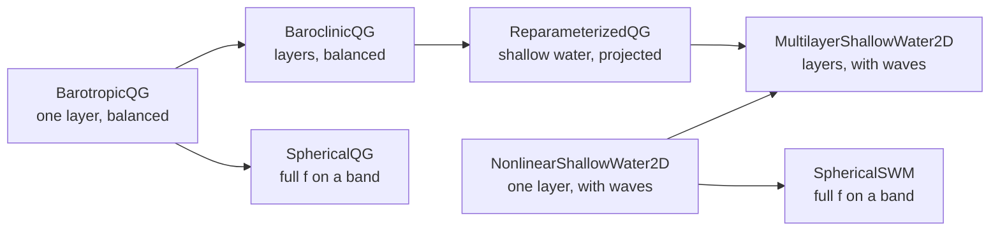
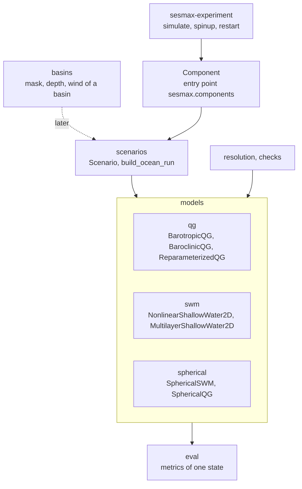

26 Nov 2026 · J. Emmanuel Johnson (drafted with Claude Code)

## Decision

Decided on 25 November 2026, and built: `sesmax-ocean` is the ocean component of sesmax. It holds seven models of the upper ocean on an Arakawa C-grid (three quasi-geostrophic, two shallow-water, two on the sphere), their scenarios and run configs, and the checks that say whether a grid resolves what a model needs.
Decided by the owner on 26 November: the package composes the machinery of the stack and writes none. Stencils come from gridax, solves from `sesmax-core` and gaussx, constants from geophysix, and scores from diagnostix.
Proposed, for review: the three changes of the section on the API, which are wind, drag and viscosity as terms of `sesmax-param`, the priors of a model registered through `Component`, and the metrics moved onto gridax and diagnostix.
Proposed on 27 November, for review: a fourth, the observables of each model (sea-surface height and surface velocity) registered through `Component`, so that an experiment can read them along a track.
Alternative to the first: keep the terms inside each `vector_field`, which is what runs today and needs no new package, but makes a different drag law a different model.
Status: the models, scenarios and configs are merged at sesmax `a34e46c` and unreleased (version 0.0.0). The section on where it came from has the history of the move from somax, the equality gate and the defects it found. This page is the design of the package.

## Motivation

A week of altimeter tracks sees the sea surface along lines a hundred kilometres apart.
To map the surface between the tracks, and to say where it goes next, we need a model of how the surface moves, and we need it inside an optimiser or an ensemble.
That sets what the model has to be.

- **Cheap.** An assimilation window runs the model hundreds of times, and its adjoint as often. A primitive-equation model with fifty levels does not fit.
- **Differentiable.** The gradient of a misfit with respect to the initial state, the wind and the drag has to come from the same code as the forecast.
- **Good where the observations look.** Altimetry sees the balanced flow at scales above the deformation radius, and that flow is what quasi-geostrophy describes.
- **Wrong in a way we can state.** A quasi-geostrophic model has no gravity waves and no outcropping. A shallow-water model has both and costs a time step twenty times shorter. Having both lets us measure what the cheaper one misses.

So the package is a ladder of models and not one model.
Each rung adds a piece of physics and a cost, and a user picks the lowest rung that explains the data.



These models existed in somax, written against finitevolX.
What the move to sesmax adds is that they share one contract with every other component, so the same estimation code runs on an ocean, a Lorenz system and, later, an atmosphere.

## User stories

- As someone **mapping sea-surface height**, I want a quasi-geostrophic model that takes a mask and a wind, so that the prior of my 4D-Var is a dynamical model and not a covariance alone.
- As a **modeller**, I want to state a double gyre by its boundary-layer widths and not by a viscosity, so that a run is resolved by construction.
- As someone **calibrating**, I want the drag, the viscosity and the wind amplitude as differentiable leaves, so that a gradient method can estimate them from a trajectory.
- As someone **comparing models**, I want the same scenario built for a QG model and a shallow-water model, so that a difference in the answer is a difference in the physics.
- As someone **on call** for a long run, I want the run to refuse a grid that does not resolve the Munk layer, before it spends a day producing noise.
- As someone **writing a tutorial**, I want one config per classic experiment (double gyre, spin-up, jet), each with a small version that runs in a minute.
- As a **reviewer**, I want to know which defects of the old code were fixed, with a test for each.

## Background: the maths

Throughout, $(x, y)$ are the eastward and northward coordinates, $t$ is time, $f = f_ 0 + \beta y$ is the Coriolis parameter, $g$ gravity, $\nu$ a lateral viscosity, $\kappa$ a linear bottom drag and $\tau_ 0$ the amplitude of the wind.

### Barotropic quasi-geostrophy

One layer of constant depth, in geostrophic balance.
The state is the relative vorticity $q(x, y, t)$, and the streamfunction $\psi$ follows from it:

```math
\nabla^2 \psi = q
```

```math
\partial_t q + J(\psi, q + \beta y) = \tau_0 F(y) - \kappa \nabla^2 \psi + \nu \nabla^2 q
```

where $J(a, b) = \partial_ x a \partial_ y b - \partial_ y a \partial_ x b$ is the Jacobian, $(u, v) = (-\partial_ y \psi, \partial_ x \psi)$ the velocity, and $F(y)$ the pattern of the wind-stress curl: $\sin(\pi y / L_ y)$ for one gyre and $-\sin(2 \pi y / L_ y)$ for two.
Without forcing and friction the flow conserves the energy $\frac{1}{2} \int \vert \nabla \psi \vert^2$ and the enstrophy $\frac{1}{2} \int q^2$.
This is the model of Stommel and of Munk, and the double gyre of [Holland (1978)](https://hdl.handle.net/10.1175/1520-0485(1978)008<0363:TROMEI>2.0.CO;2) is its layered form.

### Layered quasi-geostrophy

$N_ l$ layers of resting thickness $H_ k$, separated by interfaces of reduced gravity $g'_ k$.
Each layer has a potential vorticity $q_ k$ and a streamfunction $\psi_ k$, coupled by the stretching of the interfaces:

```math
q_k = \nabla^2 \psi_k - f_0^2 \sum_j A_{kj} \psi_j
```

where $\mathbf{A} \in \mathbb{R}^{N_ l \times N_ l}$ is the tridiagonal coupling matrix built from $H_ k$ and $g'_ k$.
Its eigenvectors are the vertical modes.
With $\mathbf{C}_ {l \to m}$ the matrix that takes layers to modes and $\lambda_ m \geq 0$ the eigenvalues, the inversion decouples into one Helmholtz problem per mode:

```math
\left( \nabla^2 - f_0^2 \lambda_m \right) \tilde\psi_m = \tilde q_m
```

with $\tilde{\mathbf{q}} = \mathbf{C}_ {l \to m} \mathbf{q}$ and $\boldsymbol{\psi} = \mathbf{C}_ {m \to l} \tilde{\boldsymbol{\psi}}$.
The deformation radius of mode $m$ is $R_ m = 1 / (f_ 0 \sqrt{\lambda_ m})$, and the barotropic mode has $\lambda = 0$ under a rigid lid.
Each layer is then advected as in the barotropic model, with the wind on the top layer divided by $H_ 1$ and the drag on the bottom layer:

```math
\partial_t q_k + J(\psi_k, q_k + \beta y) = \delta_{k1} \frac{\tau_0 F}{H_1} - \delta_{k N_l} \kappa \nabla^2 \psi_{N_l} + \nu \nabla^2 q_k
```

The formulation follows MQGeometry ([Thiry et al., 2024a](https://doi.org/10.5194/gmd-17-1749-2024)).

### Shallow water

One layer of thickness $h$ and velocity $\mathbf{u} = (u, v)$, in vector-invariant form:

```math
\partial_t h + \nabla \cdot (h \mathbf{u}) = 0
```

```math
\partial_t u = q \overline{h v} - \partial_x P + \tau_0 F_x + \nu \nabla^2 u - \kappa u
```

```math
\partial_t v = -q \overline{h u} - \partial_y P + \tau_0 F_y + \nu \nabla^2 v - \kappa v
```

where $q = (\zeta + f) / h$ is the potential vorticity, $\zeta = \partial_ x v - \partial_ y u$ the relative vorticity, $P = \frac{1}{2} \vert \mathbf{u} \vert^2 + g h$ the Bernoulli potential, and the bar an average to the velocity point.
Without forcing and friction the flow conserves the mass $\int h$, the energy $\int \frac{1}{2} h \vert \mathbf{u} \vert^2 + \frac{1}{2} g h^2$, and the potential enstrophy $\int \frac{1}{2} h q^2$; $q$ is conserved along the flow.
Gravity waves travel at $c = \sqrt{g H}$, which sets the time step.

The layered model has one such system per layer, with the Bernoulli potential $P_ k = \frac{1}{2} \vert \mathbf{u}_ k \vert^2 + p_ k$ and the hydrostatic pressure $p_ k = \sum_ {j \leq k} g'_ j h_ j$.
The wind acts on the top layer and the drag on the bottom one.

### Quasi-geostrophy as a projection

A quasi-geostrophic state is a shallow-water state on the balanced manifold.
[Thiry et al. (2024b)](https://doi.org/10.1029/2024MS004510) write the projection onto it as three operators:

```math
\mathcal{P} = \mathcal{G} \left( \mathcal{Q} \mathcal{G} \right)^{-1} \mathcal{Q}
```

where $\mathcal{Q}$ takes a shallow-water state to its quasi-geostrophic potential vorticity, $\nabla \times \mathbf{u} - f_ 0 \eta / H$ with $\eta$ the thickness anomaly; $(\mathcal{Q}\mathcal{G})^{-1}$ is the Helmholtz inversion above; and $\mathcal{G}$ builds the geostrophic velocity and thickness from the pressure.
$\mathcal{P}$ is idempotent.
`ReparameterizedQG` steps the layered shallow-water equations and applies $\mathcal{P}$ to the state, so the two models differ by one operator and can be compared term by term.

### On the sphere

On a band of latitudes $\phi$ and longitudes $\lambda$ of a sphere of radius $R$ rotating at $\Omega$, the Coriolis parameter is the full $f = 2 \Omega \sin \phi$, and every derivative carries the metric: $\partial_ x \to (R \cos \phi)^{-1} \partial_ \lambda$ and $\partial_ y \to R^{-1} \partial_ \phi$.
The planetary gradient $\beta = 2 \Omega \cos \phi / R$ is then implicit, and it goes to zero at the poles as it should.
`SphericalSWM` is the shallow-water system above with these metrics, and `SphericalQG` advects the absolute vorticity $q + f$ with the flow of $\psi$, where $\nabla^2_ \text{sphere} \psi = q$.
[Williamson et al. (1992)](https://hdl.handle.net/10.1016/S0021-9991(05)80016-6) is the standard set of test cases.

### What a model shows

An instrument does not see a state. It sees a field that the state implies, and which field depends on the model.

| Observable | Quasi-geostrophy | Shallow water |
| --- | --- | --- |
| sea-surface height $\eta$ | $f_ 0 \psi_ 1 / g$, after the inversion | $h - H$, or $\sum_ k h_ k - \sum_ k H_ k$ for layers |
| surface velocity | $(-\partial_ y \psi_ 1, \partial_ x \psi_ 1)$ | $(u_ 1, v_ 1)$ |
| relative vorticity | $\nabla^2 \psi_ 1$ | $\zeta_ 1$ |

where the subscript 1 is the top layer. Two consequences follow for an assimilation.

In quasi-geostrophy the height is not local in the state. One altimeter point constrains $q$ over a deformation radius through the inversion, and the adjoint of the observation is the adjoint of that elliptic solve. In shallow water the height is the state itself at the centres, and the dynamics carry the information.

No model here carries a tracer, so none shows a sea-surface temperature or salinity. An altimeter product is also an anomaly about a mean surface that these models do not have, so the mean dynamic topography enters as a known field, a covariate.

### The numbers that say what a run is

A run is defined by a few dimensionless numbers, with $L$ a length, $U$ a velocity and $H$ a depth.

| Number | Definition | Says |
| --- | --- | --- |
| Rossby | $Ro = U / (f_ 0 L)$ | rotation against advection |
| Burger | $Bu = g H / (f_ 0 L)^2 = (R_ d / L)^2$ | stratification against rotation |
| Froude | $Fr = U / \sqrt{g H}$ | flow against waves |
| Planetary gradient | $\hat\beta = \beta L^2 / U$ | Rossby waves against advection |
| Munk width | $\delta_ M = (\nu / \beta)^{1/3}$ | the viscous western boundary layer ([Munk, 1950](https://hdl.handle.net/10.1175/1520-0469(1950)007<0080:OTWDOC>2.0.CO;2)) |
| Stommel width | $\delta_ S = \kappa / \beta$ | the frictional western boundary layer ([Stommel, 1948](https://doi.org/10.1029/TR029i002p00202)) |
| Inertial width | $\delta_ I = (U / \beta)^{1/2}$ | the inertial boundary layer |
| Deformation radius | $R_ d = \sqrt{g' H} / f_ 0$ | the scale of the eddies |

The western boundary current returns the whole Sverdrup transport of the interior in a layer of width $\delta_ M$ or $\delta_ S$.
A grid that does not span that layer with a few cells puts the return flow in the wrong place, and the run looks plausible all the same.
[Vallis (2017)](https://doi.org/10.1017/9781107588417) and [Pedlosky (1987)](https://doi.org/10.1007/978-1-4612-4650-3) derive each of these.

## Background: the numerics

**The grid.**
All seven models are on an Arakawa C-grid with one ring of ghost cells: thickness and vorticity anomaly at the centres (T), $u$ on the east faces (U), $v$ on the north faces (V), and the potential vorticity of shallow water on the corners (X).
A model of `nx` by `ny` cells holds arrays of `ny + 2` by `nx + 2`.
A field is a plain array or a `gridax.CField`, which knows its point, so that adding a field at U to one at V raises.

**Advection of vorticity.**
The QG models use the Jacobian of [Arakawa (1966)](https://hdl.handle.net/10.1016/0021-9991(66)90015-5), which conserves energy and enstrophy in the discrete sum. That is what keeps a long inviscid run from piling energy at the grid scale.
`SphericalQG` advects in flux form with an upwind scheme instead, because the metric breaks the symmetry the Jacobian relies on.

**The Coriolis term of shallow water.**
The momentum equations take the potential vorticity averaged to the velocity point times the mass flux averaged to it, the averaging of [Sadourny (1975)](https://hdl.handle.net/10.1175/1520-0469(1975)032<0680:TDOFDM>2.0.CO;2). [Arakawa and Lamb (1981)](https://hdl.handle.net/10.1175/1520-0493(1981)109<0018:APEAEC>2.0.CO;2) conserve energy as well, at a wider stencil, and are not implemented.

**The mass equation.**
The thickness is advected in flux form, so the sum of the tendencies telescopes and mass is conserved to round-off. The face values come from a gridax scheme, first-order upwind by default, with WENO as an option ([Jiang and Shu, 1996](https://doi.org/10.1006/jcph.1996.0130)).
An upwind or WENO flux switches on the sign of the velocity, so its gradient is one-sided at a switch (the slope of the Taylor test falls to 1.84 there, as [sesmax-testing](sesmax_testing.md) measures).

**The inversions.**
On a rectangle the Poisson and Helmholtz problems are solved directly by a sine transform, with $\psi = 0$ on the wall nodes. With a mask the solve is conjugate gradients preconditioned by the spectral solve, or a capacitance-matrix correction; all are `sesmax_core.gfd.streamfunction_from_vorticity` and `pv_inversion`.
On the sphere the Laplacian is not diagonal in a transform a latitude–longitude grid affords, so `SphericalQG` solves by conjugate gradients from gaussx, to a tolerance of 1e-6 by default, chosen for float32.

**Walls and coasts.**
For QG the walls lie on the corners and $q = 0$ there, which is free slip.
For shallow water a wall has no normal flow and free slip: the normal velocity is zero on the wall faces, the tangential one has a zero gradient, and the potential vorticity on a wall or a coast is $f / h$, so no friction acts along it.
The integrator applies the boundary conditions to the input of a tendency and not to its output, so the tendency itself is held at zero on the wall faces; without that a flow builds up there (sesmax#183).
gridax reads no dry cell, so beside land the Laplacian takes no flux through the coast.

**The time step.**
`Model.integrate` uses diffrax, by default the fifth-order pair of [Tsitouras (2011)](https://doi.org/10.1016/j.camwa.2011.06.002) at a fixed step.
For shallow water the step is bound by the gravity wave, $\Delta t \leq \Delta x / \sqrt{g H}$ up to the constant of the scheme; for QG by the advective speed and by the viscosity, $\Delta t \leq \Delta x^2 / (4 \nu)$. `sesmax_core.solvers.stable_step` gives the summed bound, and a run config can assert a Courant number.

**Resolution.**
`check_munk_width` and `check_stommel_width` fail a model whose boundary layer spans fewer than 2 and 1 cells, and warn below 4 and 2. `check_deformation_radius` does the same for $R_ d$, and `check_equatorial_deformation_radius` for the sphere, where the mid-latitude radius diverges at the equator.
The nondimensional factories run them by default.

**Precision and gradients.**
The equality with somax is tested in float64 at 1e-12. The models run in float32 too, which is why the tolerance of the spherical solve is loose.
Physical parameters are leaves of the model, so `jax.grad` reaches them through a whole rollout; grid sizes, boundary types and schemes are static.

## What it is built on

| Need | From | Name |
| --- | --- | --- |
| the model contract, states, parameters | `sesmax-core` | `Model`, `State`, `Params`, `PhysConsts`, `Diagnostics` |
| maths on arrays or located fields | `sesmax-core` | `each`, `values`, `placed` of `sesmax_core.fields` |
| the elliptic inversions | `sesmax-core` | `streamfunction_from_vorticity`, `pv_inversion` of `sesmax_core.gfd` |
| vertical modes, layer coupling | `sesmax-core` | `ModalTransform`, `StratificationProfile`, `multilayer` |
| scales and dimensionless numbers | `sesmax-core` | `Scales`, `resolve_burger`, `burger_to_g_prime` |
| grids, masks, stencils, schemes | gridax | `CartesianCGrid2D`, `SphericalCGrid2D`, `Mask2D`, `GridOps`, `arakawa_jacobian`, `Upwind` |
| ghost cells and boundary conditions | gridax | `fill_ghosts`, `BC`, `Dirichlet`, `Neumann`, `Periodic` |
| area sums and kinetic energy | gridax | `area_sum`, `area_weights`, `kinetic_energy` |
| conjugate gradients on the sphere | gaussx | `linear_solve_with_info` |
| the Earth, the β-plane | geophysix | `earth.SPHERE`, `rotation.beta_plane` |
| running a config | `sesmax-experiment` | finds the package through the entry point `sesmax.components` |

Three things are written here today that another layer should hold.

- **Wind, drag and viscosity** are inside each `vector_field`. They become terms of [`sesmax-param`](sesmax_param.md) (its step P6).
- **The metrics** of `sesmax_ocean.eval` repeat gridax's `kinetic_energy` and enstrophy and overlap with `diagnostix.skill`. sesmax#166 takes the spectra from diagnostix, and the rest should follow.
- **The conservation, translation and boundary tests** are written for three models by name. [`sesmax-testing`](sesmax_testing.md) makes them one check for any model.

## The API



| Rung | Name | Job |
| --- | --- | --- |
| structure | `…State`, `…Params`, `…PhysConsts`, `…Diagnostics` | what a model carries and reports |
| structure | `Scenario`, `Geometry`, `Constants`, `ForcingFields`, `InitialCondition` | what is simulated, apart from the model |
| model | the seven models | a tendency, boundary conditions, diagnostics |
| primitive | the checks and the metrics | one number or one verdict each |
| recipe | `create`, `from_nondimensional`, `build_ocean_run` | a model from numbers, or from a file |

### A model

Every model has the same four pieces.
Here $\mathbf{x}$ is the state and $\boldsymbol{\theta}$ the parameters.

```python
# Shapes: Ny Nx cells with the ghost ring; Nl layers

# today (sesmax-ocean)
class BarotropicQGState(State):
    q: Float[Array, "Ny Nx"] | CField


# today (sesmax-ocean): leaves, so jax.grad reaches them
class BarotropicQGParams(Params):
    lateral_viscosity: Array
    bottom_drag: Array
    wind_amplitude: Array


# today (sesmax-ocean): static, fixed for a run
class BarotropicQGPhysConsts(PhysConsts):
    f0: float = eqx.field(static=True, default=1e-4)
    beta: float = eqx.field(static=True, default=1.6e-11)


# today (sesmax-ocean)
class BarotropicQG(Model):
    # ∂ₜq = −J(ψ, q + βy) + τ₀ F − κ ∇²ψ + ν ∇²q
    def vector_field(self, t: float, state: PyTree, args: PyTree | None = None) -> BarotropicQGState: ...

    # q = 0 on the four walls
    def apply_boundary_conditions(self, state: PyTree) -> BarotropicQGState: ...

    # energy, enstrophy, ψ, u, v
    def diagnose(self, state: PyTree) -> BarotropicQGDiagnostics: ...
```

The shallow-water states hold `h`, `u` and `v`, with a leading layer axis in the layered models.

### Two ways to build one

```python
# today (sesmax-ocean): SI numbers
model = BarotropicQG.create(
    nx=64, ny=64, Lx=1e6, Ly=1e6, f0=1e-4, beta=1.6e-11,
    lateral_viscosity=500.0, bottom_drag=1e-7, wind_amplitude=1e-11,
    wind_profile="doublegyre", mask=None,
)

# today (sesmax-ocean): dimensionless numbers, and the scales it runs in
# ν from δ_M, κ from δ_S, f₀ = 1/Ro; the resolution checks run
model, scales = BarotropicQG.from_nondimensional(
    nx=64, ny=64, rossby=0.01, beta_hat=100.0, delta_M=0.05,
)
```

`create` is for a user with a basin in mind. `from_nondimensional` is for one with a regime in mind: the boundary-layer widths are what has to be resolved, and choosing them directly replaces tuning two coefficients until a run is both stable and resolved.
The layered models take `H` and `g_prime`, or a `StratificationProfile`; the shallow-water ones take `bc="periodic"` or `"wall"` and a `scheme`; the spherical ones take `lat_range` and `lon_range`.

### A scenario and a run

```python
# today (sesmax-ocean)
class Scenario(eqx.Module):
    name: str
    geometry: Geometry                  # a box, a basin with coasts, a band of the sphere
    constants: Constants                # f0, beta, rho0, g
    forcing: ForcingFields              # wind stress and heat flux, computed ahead
    initial_condition: InitialCondition
    forcing_params: Mapping[str, Any]


# today (sesmax-ocean): a run spec names a scenario and a model
def build_ocean_run(spec: Mapping[str, Any]) -> BuiltRun: ...

# today (sesmax-ocean): which pairs make sense
def check_compatible(scenario: str, model: str) -> None: ...
def compatible_models(scenario: str) -> tuple[str, ...]: ...
```

A scenario says what is simulated and a model says how.
The package registers `build_ocean_run` as a `Component` of the core, so `sesmax-experiment` runs a config without naming an ocean model in its own code.

### Checks and metrics

```python
# today (sesmax-ocean): raise below n_cells_min, warn below n_cells_warn
def check_munk_width(spec, model, *, n_cells_min: float = 2.0, n_cells_warn: float = 4.0) -> None: ...
def check_stommel_width(spec, model, *, n_cells_min: float = 1.0, n_cells_warn: float = 2.0) -> None: ...
def check_deformation_radius(spec, model, *, n_cells_min: float = 2.0, n_cells_warn: float = 4.0) -> None: ...

# today (sesmax-ocean): every metric that applies to this pair, with no truth to compare with
def compute_eval_metrics(model, state: State) -> dict[str, float]: ...
```

### Proposed

Four changes, each in step with another design page.

```python
# proposed (sesmax-ocean, with sesmax-param): the model is its resolved dynamics,
# and the rest is a sum of terms
# ∂ₜ(h, u, v) = advection + pressure + Coriolis
dynamics = sxo.ShallowWaterDynamics.create(nx=64, ny=64, bc="wall")
model = TermModel(terms=dynamics + sxp.wind_stress(...) + sxp.LinearDrag(...) + sxp.Smagorinsky(...))


# proposed (sesmax-ocean): what its Component registers, read by sesmax-experiment
# x₀ ~ 𝒩(μ_x, σ_x²) per field, and the layer depths
def ocean_priors(model: Model, background: PyTree) -> dict[str, Gaussian]: ...


# proposed (sesmax-ocean): a wind product is a covariate, read by the forcing term
wind = Covariates({"tau_x": ..., "tau_y": ...})


# proposed (sesmax-ocean): what its Component registers, read by sesmax-experiment
# "ssh", "u", "v": o(x) as a located field, with the grid and the mask of the model
def ocean_observables(model: Model) -> dict[str, Observable]: ...
```

- **Terms.** Recommended: the seven models keep their names and factories, and `create` returns the sum, so no caller changes. Alternative: new classes beside the old ones, which doubles the surface. The equality tests hold the rewrite to today's numbers.
- **Priors.** A model's state and its own parameters get their priors here, as [the experiment design](sesmax_experiment.md) describes; those of drag and wind sit in `sesmax-param`.
- **Covariates.** A wind product, a bathymetry and a mask are known fields from outside the model, in the sense of [the param design](sesmax_param.md). `ForcingFields` and the basin bundles become their source.
- **Observables.** Each model says what it shows, by the table of the maths section, as an `Observable` of [the core design](sesmax_core.md): a located field with its grid and mask. The quasi-geostrophic ones read the streamfunction that `diagnose` already computes. Interpolating to a track and the instrument are not written here: [the experiment design](sesmax_experiment.md) composes them from functax and vardax.

## Examples

Each block below ran on 26 November 2026 at sesmax `a34e46c`, in float64; the printed values are in the comments.

### A double gyre, from rest

```python
import jax.numpy as jnp
from sesmax_ocean.eval import compute_eval_metrics
from sesmax_ocean.qg import BarotropicQG, BarotropicQGState

# Shapes: Ny = Nx = 66 cells with the ghost ring

# today (sesmax-ocean)
# ∂ₜq + J(ψ, q + βy) = τ₀ F − κ ∇²ψ + ν ∇²q, with δ_M = (ν/β)^⅓ = 31.5 km on 15.6 km cells
model = BarotropicQG.create(
    nx=64, ny=64, lateral_viscosity=500.0, bottom_drag=1e-7, wind_amplitude=1e-11
)
rest = BarotropicQGState(q=jnp.zeros((model.grid.Ny, model.grid.Nx)))

# today (sesmax-core): one day of hourly steps
solution = model.integrate(rest, t0=0.0, t1=86400.0, dt=3600.0)
state = BarotropicQGState(q=solution.ys.q[-1])

# today (sesmax-ocean)
metrics = compute_eval_metrics(model, state)
# {'invariant_kinetic_energy': 2.97e+09, 'invariant_enstrophy': 0.181, 'qg_balance_residual': 5.5e-14}
```

### The same regime, by its numbers

```python
# today (sesmax-ocean)
# Ro = 0.01, β̂ = 100, δ_M = 0.05 of the basin, which is 3.2 cells
model, scales = BarotropicQG.from_nondimensional(
    nx=64, ny=64, rossby=0.01, beta_hat=100.0, delta_M=0.05
)
# ν = δ_M³ β̂ = 0.0125, f₀ = 1/Ro = 100, scales.kind = "advective"
```

### The gradient of a trajectory with respect to the physics

```python
import equinox as eqx
from sesmax_core.train import rollout, rollout_loss

# today (sesmax-core): a reference of six hourly steps
# → (6, Ny, Nx)
reference = rollout(model, rest, dt=3600.0, n_steps=6)

# the same model with the wrong viscosity
wrong = eqx.tree_at(lambda m: m.params.lateral_viscosity, model, jnp.asarray(800.0))

# today (sesmax-core)
# ℒ(θ) = (1/T) ∑ₜ ‖xₜ(θ) − xₜʳᵉᶠ‖², and ∇_θ ℒ as a model-shaped tree
gradient = eqx.filter_grad(rollout_loss)(wrong, rest, reference, dt=3600.0)
gradient.params.lateral_viscosity   # 3.1e-22
gradient.params.wind_amplitude      # −1.0e-06
```

The gradient has the structure of the model, so each parameter's sensitivity is read by name.
The two differ by sixteen orders of magnitude, which is why an estimation works on whitened unknowns ([the experiment design](sesmax_experiment.md)).

### Shallow water between walls

```python
from sesmax_ocean.swm import NonlinearShallowWater2D, NonlinearSW2DState

# today (sesmax-ocean)
# ∂ₜh + ∇·(hu) = 0, with no flow through the four walls
model = NonlinearShallowWater2D.create(nx=32, ny=32, bc="wall", beta=2e-11, wind_amplitude=1e-7)
h = jnp.full((model.grid.Ny, model.grid.Nx), 100.0)
rest = NonlinearSW2DState(h=h, u=jnp.zeros_like(h), v=jnp.zeros_like(h))

# c = √(gH) = 31 m/s on 31 km cells, so a step of 60 s
solution = model.integrate(rest, 0.0, 3600.0, 60.0)
# diagnose gives mass, energy, enstrophy, casimir_q3, and the vorticity fields
```

### A run from a file

```yaml
# packages/sesmax-ocean/configs/doublegyre_bt_qg.yaml (abridged)
scenario:
  name: double_gyre
  grid: {nx: 64, ny: 64, Lx: 1000000.0, Ly: 1000000.0}
  consts: {f0: 0.0001, beta: 1.6e-11}
  forcing: {wind_amplitude: 1.0e-12, wind_profile: doublegyre}
  initial_condition: {type: at_rest}
model:
  name: barotropic_qg
  params: {lateral_viscosity: 500.0, bottom_drag: 1.0e-07}
timestepping: {t0: 0.0, t1: 31557600.0, dt: 600.0, save_interval: 2592000.0}
assertions:
  cfl: {wave_speed_m_per_s: 2.0, max_cfl: 0.5}
```

```bash
uv run sesmax-experiment simulate --debug --config packages/sesmax-ocean/configs/doublegyre_bt_qg.yaml --output-dir runs/bt_qg
```

## What is available

Counted at sesmax `a34e46c`: 6,992 lines of source, 497 test functions in 37 files.

| Piece | State | Where |
| --- | --- | --- |
| `BarotropicQG`, `BaroclinicQG`, `ReparameterizedQG` | merged | `sesmax_ocean.qg` |
| `NonlinearShallowWater2D`, `MultilayerShallowWater2D` | merged | `sesmax_ocean.swm` |
| `SphericalSWM`, `SphericalQG` | merged | `sesmax_ocean.spherical` |
| `create` and `from_nondimensional` for each | merged | the model classes |
| masks and coasts | merged, in every model | `mask=` |
| the scenario `double_gyre`, the model registry, `build_ocean_run` | merged | `sesmax_ocean.scenarios` |
| eight run configs, each with a `debug` block | merged | `packages/sesmax-ocean/configs/` |
| five more scenarios on real basins | waits for data | sesmax#115, sesmax#225 to sesmax#227 |
| four basin bundles, with `sesmax-ocean data` and DVC | placeholders | `sesmax_ocean.basins` |
| the resolution checks, `check_pv_inversion`, `check_static_stability` | merged | `sesmax_ocean.resolution`, `sesmax_ocean.checks` |
| the metrics of one state | merged | `sesmax_ocean.eval` |
| reduced-order forcings for SSH, SST, SSS and currents | merged | `sesmax_ocean.forcing` |
| equality with somax at 1e-12, on arrays and on located fields | merged | `tests/*/test_equal_to_somax.py` |
| tutorials: step 17 (shallow-water double gyre), step 18 (QG double gyre) | merged | `docs/notebooks/` |
| the double gyre over eight years | open pull request | sesmax#214 |
| wind, drag and viscosity as terms | proposed | [sesmax-param](sesmax_param.md), P6 |
| priors of the state and the model's parameters | proposed | [sesmax-experiment](sesmax_experiment.md), E2 |
| observables: sea-surface height and surface velocity as located fields | proposed | [sesmax-experiment](sesmax_experiment.md), E2a |
| spectra and a spectral energy budget | open | sesmax#166, sesmax#104 |
| a QG prior against DUACS, as a benchmark | open | sesmax#236 |
| the spectral models | open | sesmax#215 to sesmax#221 |
| a release | not yet | release-please, with the umbrella |
| archiving somax | open | sesmax#194 |

Not available, and not planned here: a primitive-equation model, sea ice, tides, and open boundaries with relaxation (sesmax#233 asks for the last).

## Where it came from

The models were moved from somax at commit `9cb19b3` on 25 and 26 November 2026, by sesmax#163 to sesmax#213 under the epics sesmax#152 and sesmax#186. The alternative, rejected, was to keep the models on finitevolX until the move was over, which would have given one workspace two C-grid libraries. This section keeps what the move decided and what it found.

### The equality gate

The first gate of the move, "every remaining somax test passes with only import changes", could not be kept, because the core moved from finitevolX to gridax in the meantime.
What replaced it is equality by numbers.

`packages/sesmax-ocean/tests/reference/make_reference.py` runs somax at `9cb19b3` and writes the initial states, tendencies, end states and diagnostics of each model family to an `.npz` file.
The `test_equal_to_somax.py` files compare the ported models with them, on arrays and on located fields, with land in the masked cases.
A case passes at a relative 1e-12 in float64, and `SphericalQG` at 1e-9, since its streamfunction is solved to a tolerance.
The configs have the same gate: each starts where somax's does, and its first 20 steps agree to 1e-12.

Every fix below changed a number, so each is its own pull request after the port.
That pull request puts somax's numerics back in a test subclass (`packages/sesmax-ocean/tests/support/somax_numerics.py`), so the rest of the model stays under the gate.

Three differences from somax are by design and not defects.
gridax reads no dry cell, so beside land the Laplacian takes no flux through a coast.
The T rows of a spherical grid are at cell centres and the cell areas are exact, where somax's rows were half a cell too far south and its areas approximate.
The default radius and rotation rate are geophysix's.

### What the move found

The port copied somax's numerics first and fixed them afterwards, each fix with a test that fails before it.
All of these were in somax at `9cb19b3`.

| Defect | Models | Fixed by |
| --- | --- | --- |
| mass is not conserved: no flux through the edge faces | shallow water, spherical shallow water | sesmax#171 |
| the momentum tendency reads unfilled ghosts at a periodic edge | shallow water | sesmax#174 |
| the viscous term diffuses a velocity as a tracer | shallow water | sesmax#175 |
| the Coriolis parameter is half a cell too far north | `SphericalSWM` | sesmax#176 |
| the velocity and the fluxes at the edges of the band | `SphericalQG` | sesmax#177 |
| the Coriolis term is halved beside walls and coasts | shallow water | sesmax#182 |
| a tendency on two of the walls adds up there | shallow water | sesmax#184 |
| the states a run returns have unfilled ghosts | every model, in the core | sesmax#201 |
| the potential vorticity is not held on all four walls | QG | sesmax#213 |

The first two were found by the trial port below; the others by the checks written since.
The mass defect measured 1.3 % (walls) and 0.3 % (periodic) of the sum of the absolute tendencies on a random state, and 2e-18 and 8e-18 after the fix.
The same wall defect is still open in the core's linear toys (sesmax#202).
The conservation, translation and boundary tests that found them live in this package's tests today, written for three models by name; [`sesmax-testing`](sesmax_testing.md) makes them one check for any model.

One test of somax passed for the wrong reason: `pv_inversion` inverted the initial state of a run, which is zero for every barotropic model. Here it inverts a random field.

### The trial port, before the move

This section is the evidence the decision rested on, kept as it was written on 25 November.

We ran all seven models of somax `9cb19b3` through a thin adapter from the old class names onto gridax v0.3.1 and sesmax-core `566b3c7`, with array states, and compared them with somax on finitevolX `c6f3d99`.
Each case is a 32 × 24 grid with random initial fields, in float64, with and without a mask, and 20 Heun steps (5 for the spherical QG model).
The masks were all water by a mistake in the script; the equality tests of the package have land.
The numbers are the largest difference over the interior cells divided by the largest value of somax's array, over every case of a model.

| Model | Tendency | End state | Diagnostics |
| --- | --- | --- | --- |
| Barotropic QG | 6.5e-16 | 8.5e-17 | 1.6e-15 |
| Baroclinic QG | 6.5e-15 | 4.4e-16 | 9.0e-15 |
| Reparameterized QG | 2.5e-14 | 1.3e-14 | 2.4e-14 |
| Nonlinear shallow water | 2.5e-16 | 9.8e-17 | 9.8e-16 |
| Multilayer shallow water | 1.8e-16 | 2.8e-15 | 1.8e-15 |
| Spherical shallow water, shifted | 8.3e-16 | 1.9e-16 | 5.6e-4 |
| Spherical QG, shifted | 6.5e-12 | 1.3e-13 | 5.6e-4 |

The shallow-water cases cover a periodic box and walls, with `upwind1` and `weno5`.
"Shifted" means that somax runs with its latitude range moved north by half a cell, which puts its rows where gridax has them; without it the spherical tendencies differ by about 0.2.
The 5.6e-4 is in the area-weighted diagnostics only, and it is the difference between approximate and exact cell areas. The fields themselves agree, at the tolerance of the CG solve (1e-10) for the QG model.

So the move is mechanical, and equality to round-off is a gate we can ask for.
Not covered: gradients, located fields, float32, and a state with velocities on land.

### Decisions of the move

Decided on 25 November 2026, and kept.

| ID | Question | Decision | What happened |
| --- | --- | --- | --- |
| OC-1 | The C2 gate | equality by numbers | the `test_equal_to_somax.py` files |
| OC-2 | Located fields in the ocean states | from the first port: arrays and `CField`s | both are tested |
| OC-3 | The defects | copy, then fix in the same stack, with the numbers before and after | nine fixes, each its own pull request |
| OC-4 | Runner | after the models | W3 and W4 followed W1 |
| OC-5 | `sesmax-testing` | after the models | not started; its design is [its own page](sesmax_testing.md) |

## Open questions

| ID | Question | Recommended | Alternative |
| --- | --- | --- | --- |
| SO-1 | How do the models become sums of terms? | the same names and factories return the sum | new classes beside the old ones |
| SO-2 | Where do the metrics live? | gridax for the fields, diagnostix for the scores, a thin `compute_eval_metrics` here | keep `sesmax_ocean.eval` as it is |
| SO-3 | The Coriolis scheme | keep Sadourny's averaging, and add Arakawa–Lamb when a run needs energy conservation | switch the default |
| SO-4 | A wind product as a covariate | `ForcingFields` and the bundles feed `Covariates` | each model keeps its own wind pattern |
| SO-5 | The default time stepper of a config | a strong-stability-preserving scheme from integrix for shallow water | Tsit5 for every model |
| SO-6 | What does an altimeter compare with? | the anomaly, with the mean dynamic topography as a covariate | the absolute height, with a mean surface inside the model |

## References

- Arakawa, A. (1966). [Computational design for long-term numerical integration of the equations of fluid motion: two-dimensional incompressible flow. Part I](https://hdl.handle.net/10.1016/0021-9991(66)90015-5). *Journal of Computational Physics* 1, 119–143.
- Arakawa, A. and Lamb, V. R. (1981). [A potential enstrophy and energy conserving scheme for the shallow water equations](https://hdl.handle.net/10.1175/1520-0493(1981)109<0018:APEAEC>2.0.CO;2). *Monthly Weather Review* 109, 18–36.
- Holland, W. R. (1978). [The role of mesoscale eddies in the general circulation of the ocean: numerical experiments using a wind-driven quasi-geostrophic model](https://hdl.handle.net/10.1175/1520-0485(1978)008<0363:TROMEI>2.0.CO;2). *Journal of Physical Oceanography* 8, 363–392.
- Jiang, G.-S. and Shu, C.-W. (1996). [Efficient implementation of weighted ENO schemes](https://doi.org/10.1006/jcph.1996.0130). *Journal of Computational Physics* 126, 202–228.
- Munk, W. H. (1950). [On the wind-driven ocean circulation](https://hdl.handle.net/10.1175/1520-0469(1950)007<0080:OTWDOC>2.0.CO;2). *Journal of Meteorology* 7, 80–93.
- Pedlosky, J. (1987). [Geophysical Fluid Dynamics](https://doi.org/10.1007/978-1-4612-4650-3), 2nd ed. Springer.
- Sadourny, R. (1975). [The dynamics of finite-difference models of the shallow-water equations](https://hdl.handle.net/10.1175/1520-0469(1975)032<0680:TDOFDM>2.0.CO;2). *Journal of the Atmospheric Sciences* 32, 680–689.
- Stommel, H. (1948). [The westward intensification of wind-driven ocean currents](https://doi.org/10.1029/TR029i002p00202). *Transactions, American Geophysical Union* 29, 202–206.
- Thiry, L., Li, L., Roullet, G. and Mémin, E. (2024a). [MQGeometry-1.0: a multi-layer quasi-geostrophic solver on non-rectangular geometries](https://doi.org/10.5194/gmd-17-1749-2024). *Geoscientific Model Development* 17, 1749–1764.
- Thiry, L. et al. (2024b). [A unified formulation of quasi-geostrophic and shallow water equations via projection](https://doi.org/10.1029/2024MS004510). *Journal of Advances in Modeling Earth Systems* 16.
- Tsitouras, C. (2011). [Runge–Kutta pairs of order 5(4) satisfying only the first column simplifying assumption](https://doi.org/10.1016/j.camwa.2011.06.002). *Computers & Mathematics with Applications* 62, 770–775.
- Vallis, G. K. (2017). [Atmospheric and Oceanic Fluid Dynamics](https://doi.org/10.1017/9781107588417), 2nd ed. Cambridge University Press.
- Williamson, D. L. et al. (1992). [A standard test set for numerical approximations to the shallow water equations in spherical geometry](https://hdl.handle.net/10.1016/S0021-9991(05)80016-6). *Journal of Computational Physics* 102, 211–224.

## Relationships

- Part of: [the workspace packages](sesmax_workspace.md), a component at tier 2 of its proposal
- Builds on: `sesmax-core`, gridax, gaussx, geophysix
- Feeds: [sesmax-testing](sesmax_testing.md), [sesmax-param](sesmax_param.md), [sesmax-experiment](sesmax_experiment.md)
- Issues: sesmax#104, sesmax#115, sesmax#152, sesmax#166, sesmax#186, sesmax#214, sesmax#233, sesmax#236
