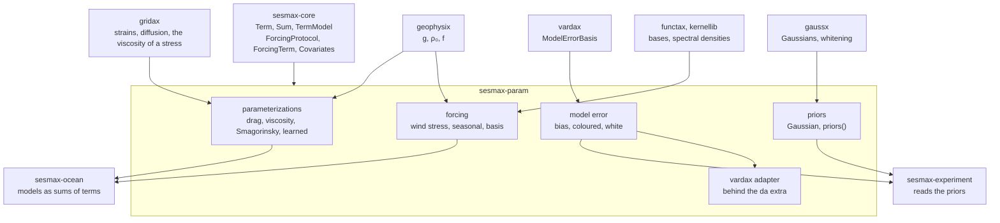

25 Nov 2026 · J. Emmanuel Johnson (drafted with Claude Code)

## Decision

Proposed: one package, `sesmax-param`, holds every term of a right-hand side whose form is ours to choose: parameterizations, forcing and model error. Each is a `Term` of the core, and each can carry a prior on what is unknown in it.
Decided by the owner on 25 November: the package exists, it is called "param", model error belongs in it as a forcing in tendency units, and it comes after the ocean models are ported.
Also decided: the prior of a parameterization sits here, with the parameterization, and the prior of a model (its state, its own parameters) sits in the model's package. An experiment holds no default priors.
Proposed on 26 November, for review: forcing, covariate and control name three different things. A covariate is a known field from outside the model, a forcing is a term that may read covariates but not the state, and a control is what an experiment treats as unknown. The section on forcing, covariates and controls below defines them, and SP-7 asks what the known fields are called.
Decided by the owner on 26 November: sesmax composes the machinery of the stack and does not write its own. A piece that is missing is added first to the package that owns the concept, and the section on what this package builds on says which piece goes where.
Recommended for what is open: a prior here is attached to its leaf (SP-4).
Alternative: a `priors()` method on each term, which leaves the leaves plain and writes each name twice.
Status: proposed, for review. The numbers below are from a scratch prototype; the package is not started. It is step W5 of [the workspace packages](workspace_packages.md).

## Motivation

Take the double gyre. The wind puts energy in, bottom drag and lateral viscosity take it out, and the eddies which the grid does not resolve move heat and momentum in between. We know the advection, the pressure gradient and the Coriolis term from first principles. We do not know the drag coefficient, the viscosity, the wind stress over the box to better than its product's error, or what the eddies do. This second list is what we calibrate, learn, or estimate from observations, and it is the same list for an ocean, an atmosphere or a land surface.

Today this second list has no home.

- **Written into the models.** All seven ocean models add wind and drag inside `vector_field` (`tau0 * self.wind_stress_x - kappa * velocity` in `NonlinearShallowWater2D`), so a different drag law is a different model.
- **Two hierarchies.** `ForcingProtocol` maps a time and a grid to a field, and `ForcingTerm` lifts it into the term algebra. `AbstractForcing`, which came from gridax, leaves its call to each subclass, has its own sum and product, and no way into the algebra. Drag and Rayleigh damping are filed under forcing although they read the state.
- **No sub-grid schemes.** There is no Smagorinsky, Leith, Gent–McWilliams or backscatter scheme in sesmax or gridax. gridax has the strain rates and the harmonic and biharmonic operators they are made of.
- **No model error.** vardax and filterax both have it, and sesmax has only hooks: a model may override `build_terms`, and `as_forward_model` takes a `diffusion`.

The methods which would use it all exist. What is missing is a term that says what is unknown in it and how unknown it is.

## User stories

- As a **modeller**, I want to write `dynamics + wind + drag + viscosity`, so that replacing one law is one line and not a new model.
- As someone **calibrating** a model, I want each coefficient to carry its prior, so that the estimation problem is built from the model and not written twice.
- As someone **inverting** for the wind, I want a field expanded in a few hundred basis functions with a spectrum I can defend, so that a week of altimetry can constrain it.
- As someone **learning a closure**, I want a network to sit in the sum next to Smagorinsky, with the same tests (does it conserve momentum, does it drain energy), so that I can compare the two.
- As someone **assimilating** with a model I do not trust, I want a model-error term whose prior means the same at a time step of 10 minutes and at 5, so that refining the run does not change the problem.
- As a **reviewer**, I want to read the unknowns of an experiment in one place.

## Background: the maths

### Where the terms come from

Let $\mathbf{x}$ be the resolved state, a coarse-grained version $\mathcal{P}[\mathbf{x}_ \text{fine}]$ of a state we cannot afford, where $\mathcal{P}$ is a linear filter that commutes with $\partial_ t$. The filtered equation is

```math
\frac{\mathrm{d}\mathbf{x}}{\mathrm{d}t} = f(\mathbf{x}) + \left( \mathcal{P}[f(\mathbf{x}_\text{fine})] - f(\mathbf{x}) \right)
```

with $\mathbf{x} \in \mathbb{R}^{D_ x}$ and the resolved dynamics $f: \mathbb{R}^{D_ x} \to \mathbb{R}^{D_ x}$. The bracket depends on what was filtered out. It has a part which the resolved state predicts and a part it doesn't, and the world adds inputs of its own. So we write

```math
\frac{\mathrm{d}\mathbf{x}}{\mathrm{d}t} = f(\mathbf{x}) + p(\mathbf{x}; \boldsymbol{\theta}) + u(t; \mathbf{w}) + \boldsymbol{\eta}(t)
```

where $p$ is a parameterization with parameters $\boldsymbol{\theta} \in \mathbb{R}^{D_ \theta}$ (its ideal is the conditional mean of the bracket given $\mathbf{x}$), $u(t; \mathbf{w}) \in \mathbb{R}^{D_ x}$ a forcing with coefficients $\mathbf{w} \in \mathbb{R}^{D_ w}$, and $\boldsymbol{\eta}(t) \in \mathbb{R}^{D_ x}$ the model error, which is the rest.

| Part | Reads the state | Unknown | Prior |
| --- | --- | --- | --- |
| Parameterization $p$ | yes | $\boldsymbol{\theta}$ | on $\boldsymbol{\theta}$ |
| Forcing $u$, known | no | none | none |
| Forcing $u$, estimated | no | $\mathbf{w}$ | on $\mathbf{w}$ |
| Model error $\boldsymbol{\eta}$ | no | $\boldsymbol{\eta}$ | on $\boldsymbol{\eta}$ |

Two questions decide where a term goes. Does it read the state? Then it is a parameterization. Is its form ours to choose? Then it is in this package. "Can it be learned" is not the question, as every parameter of $f$ is a leaf too, gravity included.

### Forcing, covariates and controls

The equation above leaves out what the terms are computed from. Let $\mathbf{c}(\mathbf{s}, t) \in \mathbb{R}^{D_ c}$ be the covariates, the known fields from outside the model: a wind product, a sea surface temperature, the bathymetry, the latitude. Then

```math
\frac{\mathrm{d}\mathbf{x}}{\mathrm{d}t} = f(\mathbf{x}) + p(\mathbf{x}, \mathbf{c}; \boldsymbol{\theta}) + u(t, \mathbf{c}; \mathbf{w}) + \boldsymbol{\eta}(t)
```

and the three words mean three different things.

- **A covariate** is data. It does not depend on the state, it is not a tendency, and it is known. It is the input of a function: a parameterization, a forcing, a prior mean, an observation operator or an emulator.
- **A forcing** is a term. It has tendency units, does not read the state, and may read covariates. Wind speed is a covariate of a bulk formula, and the stress the formula returns, divided by $\rho_ 0 h$, is a forcing. A field that is already a tendency, such as the wind curl of a QG model, is a forcing whose map is the identity.
- **A control** is neither. It is what one experiment treats as unknown, and [the experiment design](sesmax_experiment.md) owns it. Any of $\mathbf{x}_ 0$, $\boldsymbol{\theta}$, $\mathbf{w}$ and $\boldsymbol{\eta}$ can be a control in one experiment and fixed in the next, and no term knows which.

The state decides between a forcing and a parameterization, as above. A bulk formula with the relative wind, the wind minus the surface current, reads $\mathbf{u}$ and is a parameterization, with the wind as its covariate. Model error is a forcing that is unknown.

A covariate stays known. To infer an uncertain one, we promote it to a parameter with a prior, and it becomes a control like any other, as in an errors-in-variables problem. Values on an open boundary are a forcing that enters through the boundary operator instead of the tendency. Under coupling the rule holds for each component: the atmosphere's state is a covariate of the ocean, and the coupler is where one component's $\mathbf{x}$ becomes another's $\mathbf{c}$.

Today the core does not draw these lines. `ForcingProtocol`, a map `(t, grid) -> field`, holds a known record (`InterpolatedForcing`), a field with a learnable amplitude (`SeasonalWindForcing`) and an expansion with unknown coefficients (`BasisForcing`). `forcing_ops` files drag, which reads the state, next to wind stress, which turns a stress into a tendency.

### The parameterizations

With $\mathbf{u} = (u, v)$ the horizontal velocity, $\zeta$ the vorticity, $h$ a layer thickness, $\Delta$ the grid spacing and $q$ any field:

| Name | Tendency | Parameter | In the stack |
| --- | --- | --- | --- |
| Linear drag | $-r \mathbf{u}$ | $r > 0$ | `LinearDrag2D` |
| Quadratic drag | $-C_ d \Vert \mathbf{u} \Vert \mathbf{u} / h$ | $C_ d > 0$ | `QuadraticDrag2D` |
| Rayleigh relaxation | $-r (q - q_ \text{ref})$ | $r > 0$ | `RayleighDamping2D` |
| Harmonic | $\nabla \cdot (\kappa \nabla q)$ | $\kappa > 0$ | `gridax.diffuse` |
| Biharmonic | $-\kappa_ 4 \nabla^4 q$ | $\kappa_ 4 > 0$ | `gridax.biharmonic` |
| Smagorinsky | $\nabla \cdot (2 \nu_ \text{S} \mathbf{E})$ | $C_ \text{S}$ | no |
| Leith | $\nabla \cdot (\nu_ \text{L} \nabla \zeta)$ | $C_ \text{L}$ | no |
| Gent–McWilliams | an overturning from the slope of the layers | $\kappa_ \text{GM}$ | no |
| Backscatter | a negative viscosity, fed by the energy removed | a rate | no |
| Learned | $g_ \text{net}(\mathbf{x}; \boldsymbol{\theta})$ | weights | `OperatorTerm` |

Here $\mathbf{E} \in \mathbb{R}^{2 \times 2}$ is the strain-rate tensor with its trace removed. The Smagorinsky viscosity ([Smagorinsky, 1963](https://hdl.handle.net/10.1175/1520-0493(1963)091<0099:GCEWTP>2.3.CO;2)) is

```math
\nu_\text{S} = (C_\text{S} \Delta)^2 \Vert \mathbf{S} \Vert
```

```math
\Vert \mathbf{S} \Vert^2 = (\partial_x u - \partial_y v)^2 + (\partial_x v + \partial_y u)^2
```

and the Leith viscosity is $\nu_ \text{L} = (C_ \text{L} \Delta)^3 \Vert \nabla \zeta \Vert$, which targets the enstrophy cascade of quasi-geostrophic turbulence ([Leith, 1996](https://hdl.handle.net/10.1016/0167-2789(96)00107-8)). [Griffies and Hallberg (2000)](https://hdl.handle.net/10.1175/1520-0493(2000)128<2935:BFWASL>2.0.CO;2) argue for the biharmonic form with a Smagorinsky coefficient at eddy-permitting resolution, [Gent and McWilliams (1990)](https://hdl.handle.net/10.1175/1520-0485(1990)020<0150:IMIOCM>2.0.CO;2) is for grids which do not resolve the eddies at all, and [Jansen and Held (2014)](https://doi.org/10.1016/j.ocemod.2014.06.002) return part of the dissipated energy.

Two constraints are worth enforcing by construction, for a formula and for a network alike. A momentum closure is the divergence of a symmetric stress, so that it moves momentum and makes none. A dissipative closure has a non-negative viscosity, so that the energy of the resolved flow falls. [Zanna and Bolton (2020)](https://doi.org/10.1029/2020GL088376) enforce the first in a learned ocean closure, and [Ross et al. (2023)](https://doi.org/10.1029/2022MS003258) compare learned closures on a common benchmark, online as well as offline. A network inside the right-hand side, trained through the solver, is a universal differential equation ([Rackauckas et al., 2020](https://arxiv.org/abs/2001.04385)), and NeuralGCM is one at the scale of an atmosphere ([Kochkov et al., 2024](https://doi.org/10.1038/s41586-024-07744-y)).

### The forcing

A forcing is a field in space and time. The estimated ones are a basis expansion, as in the core's `BasisForcing`:

```math
u(\mathbf{s}, t) = \sum_{a=1}^{D_w} w_a b_a(t) \phi_a(\mathbf{s})
```

```math
\mathbf{w} \sim \mathcal{N}(\mathbf{0}, \boldsymbol{\Sigma}_w)
```

with spatial atoms $\phi_ a$, temporal weights $b_ a$ and a diagonal $\boldsymbol{\Sigma}_ w \in \mathbb{R}^{D_ w \times D_ w}$. When $\phi_ a$ are eigenfunctions of the Laplacian and the variances come from a spectral density, the expansion is a reduced-rank Gaussian process ([Solin and Särkkä, 2019](https://doi.org/10.1007/s11222-019-09886-w)), so a length scale and a variance define the prior instead of $D_ w$ numbers. The eight `spatial_from_*` constructors of the core build such dictionaries.

The whitened control is $\mathbf{w} = \boldsymbol{\Sigma}_ w^{1/2} \boldsymbol{\omega}$ with $\boldsymbol{\omega} \sim \mathcal{N}(\mathbf{0}, \mathbf{I})$, $\boldsymbol{\omega} \in \mathbb{R}^{D_ w}$, and the prior term of any cost becomes $\frac{1}{2} \Vert \boldsymbol{\omega} \Vert^2$.

### Model error

Three descriptions of $\boldsymbol{\eta}$ are in use ([Trémolet, 2006](https://doi.org/10.1256/qj.05.224); [Dee, 2005](https://doi.org/10.1256/qj.05.137); [Carrassi et al., 2018](https://doi.org/10.1002/wcc.535)):

| Kind | Model | Unknowns | Who uses it |
| --- | --- | --- | --- |
| Bias | constant in time over a window | $D_ w$ coefficients | weak 4D-Var, with a reduced basis |
| Coloured forcing | smooth in time | $D_ c D_ w$ coefficients | weak 4D-Var |
| White noise | $\mathrm{d}\mathbf{x} = f \mathrm{d}t + \mathbf{Q}^{1/2} \mathrm{d}\mathbf{W}$ | none, it is drawn | ensemble filters, SDE models |

where $\mathbf{Q} \in \mathbb{R}^{D_ x \times D_ x}$ is a spectral density, with the units of state squared per time, and $\mathbf{W}$ is a Wiener process. The first two are a forcing we do not know, so they have the form of $u$. vardax writes them as $\boldsymbol{\eta} = \boldsymbol{\chi} \mathbf{A} \boldsymbol{\Phi}^\top$ with temporal modes $\boldsymbol{\chi} \in \mathbb{R}^{T \times D_ c}$, spatial modes $\boldsymbol{\Phi} \in \mathbb{R}^{D_ x \times D_ w}$ and coefficients $\mathbf{A} \in \mathbb{R}^{D_ c \times D_ w}$ (`ModelErrorBasis`, whose letter for $\mathbf{A}$ is W).

**Tendency or increment.**
In vardax the error is added to the state after a step, $\mathbf{x}_ {t+1} = m(\mathbf{x}_ t) + \boldsymbol{\delta}_ t$, where $m$ is the model over one step $\Delta t$. Starting from a tendency $\boldsymbol{\eta}$, the increment over a step is

```math
\boldsymbol{\delta}_t = \int_{t}^{t + \Delta t} \mathbf{M}(t + \Delta t, s) \boldsymbol{\eta}(s) \mathrm{d}s = \Delta t \boldsymbol{\eta}(t) + \mathcal{O}(\Delta t^2)
```

to first order in $\boldsymbol{\eta}$, with $\mathbf{M}(t', s) \in \mathbb{R}^{D_ x \times D_ x}$ the tangent-linear model from $s$ to $t'$. Their priors convert as

```math
\boldsymbol{\Sigma}_\delta \approx \Delta t^2 \boldsymbol{\Sigma}_\eta
```

for an error that is constant over the step, and as

```math
\boldsymbol{\Sigma}_\delta \approx \Delta t \mathbf{Q}
```

for one that is white in time, where $\boldsymbol{\Sigma}_ \delta, \boldsymbol{\Sigma}_ \eta \in \mathbb{R}^{D_ x \times D_ x}$. The two powers of $\Delta t$ are the reason to state a prior as a tendency: an increment prior with a fixed $\boldsymbol{\Sigma}_ \delta$ describes a different error at every time step.

**What becomes of it.**
An estimated bias which repeats from window to window is a systematic misfit, and it should move into $p$, the way [Kennedy and O'Hagan (2001)](https://doi.org/10.1111/1467-9868.00294) separate a discrepancy term from the parameters of a simulator. It also says that the two can be confused: a bias in the forcing and a wrong parameter fit the same data, and only the priors tell them apart.

## Background: the numerics

**Flux form.**
The discrete closure has to be a difference of fluxes to keep the two constraints. On a C-grid the normal stress sits at T and the shear stress at X, and then summation by parts holds exactly:

```math
\sum_{i \in \text{U}} u_i \dot{u}_i + \sum_{i \in \text{V}} v_i \dot{v}_i = -\sum_{i \in \text{T}} \nu_i E_{n,i}^2 - \sum_{i \in \text{X}} \nu_i E_{s,i}^2
```

with $\dot{u}_ i, \dot{v}_ i$ the tendencies of the closure, $E_ n = \partial_ x u - \partial_ y v$ and $E_ s = \partial_ x v + \partial_ y u$ the two strains, and $\nu$ the viscosity at each point. So the energy falls for any $\nu \geq 0$, which the prototype below checks to rounding, for Smagorinsky and (by the same sum) for any network that outputs $\nu$.

**The square root at rest.**
$\Vert \mathbf{S} \Vert$ has no derivative where the strain is zero. Its gradient is NaN at rest, as measured below, and $\sqrt{\Vert \mathbf{S} \Vert^2 + \epsilon^2}$ fixes it, with $\epsilon$ far below the strains of interest. The same holds for $\Vert \mathbf{u} \Vert$ in quadratic drag, which has this guard today (`safe_speed`).

**Stable steps.**
The largest eigenvalue of the five-point Laplacian on a uniform grid is $8 / \Delta^2$, so forward Euler needs

```math
\Delta t \leq \frac{\Delta^2}{4 \kappa}
```

```math
\Delta t \leq \frac{\Delta^4}{32 \kappa_4}
```

for the harmonic and the biharmonic operators. The first is checked below. Both bounds move with the stepper, and a term whose bound is below the gravity-wave step should be implicit (`implicit(term)`), which `TermModel` already routes to an IMEX solver.

**Stages.**
A tendency is evaluated at the stages of a Runge–Kutta step, an increment once at its end. A forcing with a jump inside a step costs the order of the scheme, and `InterpolatedForcing.step_ts` gives the jump times to a controller.

**Positive parameters.**
A coefficient with a sign is stored through `positive()` and its prior is on the stored value. A Gaussian prior on $\log \kappa$ is the natural one for a coefficient known to a factor.

**Scaling.**
A forcing coefficient of $10^{-5}$ and a Smagorinsky constant of 0.1 do not belong in one vector unscaled. The estimation works on the whitened control, and [the experiment design](sesmax_experiment.md) measures what it changes.

## What it builds on

The terms here are laws: a formula for a viscosity, a drag, a map from a covariate to a tendency. The stencils, bases, densities, constants and Gaussians they are made of come from the stack.

| Need | Built on | On `main` |
| --- | --- | --- |
| strain rates; diffusion of a tracer, harmonic and biharmonic | gridax: `Strain2D`, `strain_magnitude_squared`, `Diffusion2D`, `BiharmonicDiffusion2D` | exists |
| the divergence of a stress for a field $\nu$, harmonic and biharmonic, with masks | gridax | missing |
| spatial bases: Fourier, Gabor, RBF, divergence-free, EOF, graph Laplacian | `functax.basis` | exists; the core's `spatial_from_*` still read `geonnax.basis` |
| temporal bases | `functax.basis`: `fourier_features`, `seasonal_features`, `gaussian_window_features` | exists, without a hat basis |
| the prior variance of a spectral mode | kernellib: the `spectral_density` of `RBF` and `Matern`, `LaplaceEigenfunctionFeatures` | exists |
| a record read in time | `functax.interp` (`Pchip`, `CubicSpline`) through integrix's `SampledPath` | exists, used today |
| $g$, $\rho_ 0$, $f$, $\beta$, the density of air | geophysix: `constants.STANDARD.standard_gravity`, `seawater.LINEAR_EOS.reference_density`, `rotation.coriolis`, `rotation.beta_plane`, `thermo.dry_air_density` | exists |
| a Gaussian, whitening | gaussx: `sqrt_matmul`, `whiten_covariance`; `pyrox_gauss.MultivariateNormal` with NumPyro | exists, without a prior class free of NumPyro |
| model error: a separable basis, a Kronecker prior, a whitened control | vardax: `ModelErrorBasis`, `WeakFourDVar` | exists |
| coloured model error | gaussx: `ar1_precision`, `MaternSDE` | the parts exist |
| the stable step of an explicit scheme | integrix: `march.stable_step` | harmonic only |

What is missing goes upstream, before the step here that needs it. The issues are gridax#585, gaussx#888, functax#179, integrix#113 and vardax#316, under geostack#327.

- **The viscosity of a stress**, in gridax: $\nabla \cdot (2 \nu \mathbf{E})$ and its biharmonic form, for a field $\nu$ on the C-grid, with masks. Smagorinsky, Leith and a learned viscosity are each a formula for $\nu$ on top of it, so the formulas stay here and the stencil goes there. gridax#584 already asks for the Smagorinsky formula in gridax, for plumax, and the term here would call it.
- **A Gaussian prior free of NumPyro**, in gaussx: a mean, a scale operator, `whiten`, `unwhiten` and a log density. gaussx has the operations, and its distribution classes moved to pyrox-gauss, which needs NumPyro. It takes the place of the `Gaussian` sketched below.
- **Priors by path in a pytree**, the registry that `priors` reads. No package has one. The nearest is pyrox's `Parameterized.set_prior`, which keys by name inside one module and is bound to NumPyro. SP-8 asks where it goes.
- **A hat basis in time**, in `functax.basis`.
- **The biharmonic bound** $\Delta t \leq \Delta^4 / (32 \kappa_ 4)$, in integrix's `stable_step`.
- **Coloured model error**, an AR(1) or Ornstein–Uhlenbeck prior on the temporal modes, in vardax next to `ModelErrorBasis`, from gaussx's `ar1_precision`.

What stays here: the laws (drag, the formulas for $\nu$, the maps from covariates to tendencies, the bulk formula of the stress), model error as a tendency, and the priors of all of them. geostack's page on geophysix leaves parameterizations and bulk formulas to the models, so this is their place in the stack.

## Proposal: the API



| Module | Holds | Today |
| --- | --- | --- |
| `sesmax_param.parameterizations` | drag, damping, viscosity, eddy closures, learned terms | `forcing_ops`, as `AbstractForcing`; the models |
| `sesmax_param.forcing` | forcing terms: wind stress and curl from a stress covariate, seasonal | `forcing`, `forcing_ops` |
| `sesmax_param.basis` | `BasisForcing` and its presets, over functax's bases and kernellib's densities | `basis`, `forcing_bank` |
| `sesmax_param.error` | `ModelError` and its three kinds, a tendency over vardax's `ModelErrorBasis` | nothing |
| `sesmax_param.priors` | `priors`, `with_prior`, `lognormal`, and gaussx's `Gaussian` re-exported | `SpatialBasis.prior_std`, `regularization` |
| `sesmax_param.da` | `to_vardax`, behind `[da]` | nothing |

What stays in the core is the slot: `Term` and its algebra, `ForcingProtocol`, `ForcingTerm`, `add_to` and `add_vector_to`. The covariates stay there too, as `Covariates`, a mapping from a name to a known field with `InterpolatedForcing` as its reader of records, because a component, a term and an experiment all read them.

### One hierarchy

Everything is a `Term`. `AbstractForcing`, `ForcingSum`, `ForcingProduct` and `TimeVaryingForcing` go, as the algebra of terms has the sums and products. The map `(t, grid) -> field` stays as the shape of any field in time. A covariate is one that is known, in its own units, and a term holds the covariates it reads outside its trainable leaves. `BasisForcing` and `SeasonalWindForcing` are fields in tendency units with unknowns in them, and `ForcingTerm` lifts them.

```python
# Shapes: Ny Nx cells with the ghost ring

# Today:
# du/dt = −r u, and the caller adds it to the tendency by hand
du, dv = LinearDrag2D(grid)(u, v, r=1e-6)
# After:
# proposed (sesmax-param)
# du/dt = −r u, dv/dt = −r v, a Term
drag = sxp.LinearDrag(coefficient=positive(1e-6), fields=("u", "v"))
```

### The parameterizations

```python
# proposed (sesmax-param)
class Parameterization(Term):
    """A term that reads the state. Its parameters are leaves, with priors."""


# proposed (sesmax-param)
# −r u
class LinearDrag(Parameterization):
    coefficient: Float[Array, "*field"]
    fields: tuple[str, ...] = eqx.field(static=True, default=("u", "v"))


# proposed (sesmax-param)
# −C_d ‖u‖ u / h
class QuadraticDrag(Parameterization):
    coefficient: Float[Array, "*field"]
    fields: tuple[str, str] = eqx.field(static=True, default=("u", "v"))
    thickness: str = eqx.field(static=True, default="h")


# proposed (sesmax-param)
# ν_S = (C_S Δ)² ‖S‖, and the tendency is ∇·(2 ν_S E)
class Smagorinsky(Parameterization):
    grid: CartesianCGrid2D = eqx.field(static=True)
    coefficient: Float[Array, ""]
    fields: tuple[str, str] = eqx.field(static=True, default=("u", "v"))
    floor: float = eqx.field(static=True, default=1e-10)


# proposed (sesmax-param)
# the network gives ν ≥ 0 per cell, and the stress is built from it
class LearnedViscosity(Parameterization):
    network: Callable[..., Float[Array, "Ny Nx"]]
    grid: CartesianCGrid2D = eqx.field(static=True)
    fields: tuple[str, str] = eqx.field(static=True, default=("u", "v"))
```

`LearnableDrag2D` and `NeuralForcing2D` of sesmax#144 become `LinearDrag` with a field of coefficients, and `OperatorTerm` or `LearnedViscosity`.

### The priors

Each prior is owned by the package that owns what it describes.

| Prior of | Owner | Example |
| --- | --- | --- |
| a parameterization's parameters | `sesmax-param` | a drag coefficient, a Smagorinsky constant, network weights |
| a forcing's coefficients | `sesmax-param` | the wind modes |
| a model error | `sesmax-param` | a bias pattern |
| a model's state | the component | the background of sea-surface height and its spread |
| a model's own parameters | the component | layer depths, stratification |

An experiment reads both and may replace any of them for one run. The component's priors reach it through `Component`, the registration type in the core, so `sesmax-experiment` still names no component; [its page](sesmax_experiment.md) has the sketch. `Gaussian` is gaussx's once it is there, re-exported here so that the components and the experiment use one class.

A prior is stated where the parameter is made, and `priors` collects those of the terms.

```python
# proposed (gaussx), re-exported here
class Gaussian(eqx.Module):
    """𝒩(μ, σ²), with a diagonal covariance."""

    mean: Float[Array, "*shape"]
    std: Float[Array, "*shape"]

    # z = μ + σ ω
    def unwhiten(self, white: Float[Array, "*shape"]) -> Float[Array, "*shape"]: ...


# proposed (sesmax-param)
# a leaf and its prior; a leaf without one is fixed
def with_prior(value: Float[Array, "*shape"], prior: Gaussian) -> Float[Array, "*shape"]: ...


# proposed (sesmax-param)
# a positive leaf with log z ~ 𝒩(log median, σ²)
def lognormal(median: float, std: float) -> Float[Array, ""]: ...


# proposed (sesmax-param)
# {"terms.2.coefficient": Gaussian(...)}, by path in the model
def priors(model: Model) -> dict[str, Gaussian]: ...
```

### The forcing

The wind is a `BasisForcing` on the two velocities, lifted by the core's `ForcingTerm`.

```python
# proposed (sesmax-param)
# (∂ₜu, ∂ₜv) = ∑_a w_a b_a(t) φ_a(s), constant in time unless a temporal basis is given
def wind_stress(
    grid: CartesianCGrid2D,
    spatial: VectorSpatialBasis,
    temporal: TemporalBasis | None = None,
) -> ForcingTerm: ...
```

### The model error

```python
# Shapes: D_c temporal modes; D_w spatial modes

# proposed (sesmax-param)
# η(s, t) = ∑_c ∑_d χ_c(t) A_cd φ_d(s), in tendency units
class ModelError(ForcingProtocol):
    # A, the coefficients
    coeffs: Float[Array, "c w"]
    # χ, modes in time
    temporal: TemporalBasis
    # φ, modes in space with their prior σ_d
    spatial: SpatialBasis
    # σ_c, prior of the temporal modes
    temporal_std: Float[Array, " c"]
    grid_shape: tuple[int, ...] = eqx.field(static=True)


# proposed (sesmax-param)
# one mode, constant over the window: a bias
def bias(spatial: SpatialBasis, *, grid_shape: tuple[int, ...]) -> ModelError: ...


# proposed (sesmax-param), behind [da]
# χ_kc = ∫ χ_c(t) dt over step k, so that A keeps its tendency units
def to_vardax(error: ModelError, *, dt: float, n_steps: int) -> vdx.ModelErrorBasis: ...
```

vardax's mode has the step inside the temporal matrix, so the coefficients it returns are those of `ModelError` and nothing has to be rescaled afterwards.

## Examples

### A model as a sum of terms

```python
import sesmax_param as sxp
from sesmax_core import TermModel

# Shapes: Ny Nx cells with the ghost ring; D_w = 64 wind modes

# proposed (sesmax-ocean, W5)
# ∂ₜ(h, u, v) = advection + pressure + Coriolis
dynamics = ocean.shallow_water_dynamics(grid, gravity=9.81, depth=500.0)
# proposed (sesmax-param)
# −r u, with log r ~ 𝒩(log 1e-6, 0.5²)
drag = sxp.LinearDrag(coefficient=sxp.lognormal(1e-6, 0.5), fields=("u", "v"))
# proposed (sesmax-param)
# ∇·(2 ν_S E)
closure = sxp.Smagorinsky(grid, coefficient=sxp.with_prior(0.17, sxp.Gaussian(0.17, 0.05)))
# proposed (sesmax-param); spatial_from_divfree is today* (sesmax-core)
# Φ w, with the length scale of the wind
wind = sxp.wind_stress(grid, sxp.spatial_from_divfree(domain, num_basis_per_dim=8, length_scale=2e5))
# today (sesmax-core): the algebra of terms
model = TermModel(terms=dynamics + drag + closure + wind)
```

### Swap the law, keep the rest

```python
# proposed (sesmax-param)
# −C_d ‖u‖ u / h in place of −r u
other = TermModel(terms=dynamics + sxp.QuadraticDrag(coefficient=2e-3) + closure + wind)
```

### Estimate a model bias

```python
# proposed (sesmax-param)
# one pattern in space, constant in time, σ = 1e-7 m s⁻² per mode
error = sxp.bias(sxp.spatial_from_fourier(domain, num_basis_per_dim=4, variance=1e-14), grid_shape=grid.shape)
# today (sesmax-core): the same slot as any other forcing
model = TermModel(terms=model.terms + ForcingTerm(error, place=add_to("u")))
# proposed (sesmax-param): {"…coeffs": Gaussian(...)}
unknowns = sxp.priors(model)
```

## The prototype

Scratch runs on 25 November 2026, in float64, at sesmax `5c998e6` with gridax 0.3.2, diffrax 0.7.2 and vardax 0.3.5.

**A sum of terms is the same model.** Lorenz-96 as advection + damping + a one-mode `BasisForcing`, against `Lorenz96`: the tendency differs by 0, and so does the state after 100 steps. The seven ocean models get the same check in W5, through [the reference check](sesmax_testing.md).

**The energy identity holds.** A Smagorinsky stress built from gridax's strain rates, periodic, 32 × 32 cells, $C_ \text{S} = 0.17$.

| Flow | Work of the closure | Dissipation of the viscosity | Relative difference | Net momentum |
| --- | --- | --- | --- | --- |
| Cellular, $\sin kx \cos ky$ | -10.28082 | -10.28082 | 1.4e-15 | 5e-17 |
| Random | -20260.93 | -20260.93 | 7.2e-16 | 4e-18 |

The gradient of the closure at rest is NaN with no floor, and finite with $\epsilon = 10^{-6}$.

**The explicit bound is sharp.** 400 forward Euler steps of harmonic diffusion on 32 × 32 cells: the largest value falls to 2.2e-03 and 2.8e-02 of its start at $\kappa \Delta t / \Delta^2 = 0.24$ and 0.25, and grows to 3.4e+11 at 0.26.

**A tendency is not an increment.** One step of Lorenz-96 with a random error of unit size, as a tendency inside the step and as an increment $\Delta t \boldsymbol{\eta}$ after it.

| Step | Largest difference | Relative to the effect of the error |
| --- | --- | --- |
| 0.1 | 1.4e-01 | 63 % |
| 0.05 | 3.8e-02 | 34 % |
| 0.025 | 9.5e-03 | 18 % |
| 0.0125 | 2.4e-03 | 9 % |

It falls fourfold per halving, as $\Delta t^2$ should.

**The prior depends on the step when it is an increment.** A scalar $\dot{x} = -x + \eta$ with white noise, 200,000 draws, spread at $t = 0.4$. The exact spread is 0.5247 for $q = 1$.

| Step | Increments of fixed std 0.1 | Increments of std $\sqrt{q \Delta t}$ |
| --- | --- | --- |
| 0.05 | 0.240 | 0.537 |
| 0.025 | 0.337 | 0.532 |
| 0.0125 | 0.472 | 0.528 |

A fixed increment doubles its spread between the first row and the last, and the one scaled with the step stays within 2.4 % of the exact one.

**A bias, estimated by two routes.** Lorenz-96 with 40 variables and the true forcing 8, assimilated with 7, from 400 noisy observations (the twin of [the experiment design](sesmax_experiment.md)). The bias is 1.

| Route | Estimate of the bias | Error of the state at the start (RMS) |
| --- | --- | --- |
| Our tendency, a 41-value control and BFGS | 0.874 | 0.264 |
| vardax `WeakFourDVar` with `ModelErrorBasis`, the step inside the temporal modes | 0.829 | 0.273 |

Both are within the posterior spread of 0.115 of the truth, and the two differ as an increment at the end of a step differs from a tendency within it.

Not covered: an SDE, located fields, Leith and Gent–McWilliams, masks and coasts.

## What it is not

| Not here | Where instead |
| --- | --- |
| Diffusion operators and stencils | gridax |
| The slot for a term or a forcing | `sesmax-core` |
| Bulk fluxes between components | `sesmax-couple` |
| Turbulence closures of plumes | plumax |
| The priors of a model's state and own parameters | the component, such as `sesmax-ocean` |
| Fitting any of it | [`sesmax-experiment`](sesmax_experiment.md) |
| Minimisers, filters | argminax, vardax, filterax |
| Regridding a wind product | `sesmax-ocean`, and functax |

## Steps and gates

| Step | Pull request | Gate |
| --- | --- | --- |
| P1 | the package, with the bases, the forcing terms and the basis presets moved; `Covariates` in the core; the presets on `functax.basis` in place of `geonnax.basis` | the moved tests; imports only in callers |
| P2 | drag, damping and viscosity as `Term`s; `AbstractForcing` goes | same numbers as today on every moved test |
| P3 | `with_prior`, `priors`, over gaussx's `Gaussian` | gaussx's prior class released; a model's priors round-trip through a fit on Lorenz-96 |
| P4 | `ModelError` over vardax's `ModelErrorBasis`, and `to_vardax` | the two-route table above, as a test |
| P5 | Smagorinsky and `LearnedViscosity` | gridax's viscosity of a stress released; the energy identity, the net momentum and the gradient checks |
| P6 | the ocean models as sums of terms | the reference check of every model, unchanged |
| P7 | Leith, Gent–McWilliams, backscatter | one issue each, when a user needs it |

The core's readme names forcing as one of its five uses, its quickstart inverts for a `BasisForcing`, and geostack#299 draws it. All three change with P1.

## Open questions

| ID | Question | Recommended | Alternative |
| --- | --- | --- | --- |
| SP-1 | Units of a model-error prior | a tendency, converted for vardax (agreed 25 November) | state increments, as vardax has them |
| SP-2 | White-noise error in the package | no: a filter or an SDE draws it, `Q` is a field of the method | a `WhiteNoise` term with a diffrax SDE path |
| SP-3 | Noise that scales with a parameterization | left out until a user needs it | a perturbed parameter or tendency scheme ([Berner et al., 2017](https://doi.org/10.1175/BAMS-D-15-00268.1)) |
| SP-4 | How is a prior attached here? (the owner is settled) | to the leaf, read by `priors` | a `priors()` method on each term |
| SP-5 | Basis class | functax's bases for forcing, vardax's `ModelErrorBasis` for model error | ours, with an adapter |
| SP-6 | A networks dependency | none: `LearnedViscosity` takes any callable | geonnax |
| SP-7 | What are the known fields called? | `Covariates` in the core, with `InterpolatedForcing` renamed `InterpolatedField` | `ForcingProtocol` for every field, with the known ones marked by convention |
| SP-8 | Where does the registry of priors by path go? | argminax, which has `Reparametrised` and reads prior precisions in `curvature` and `diagnose` | pyrox, next to `Parameterized.set_prior` |

SP-4 is about the mechanism only. A prior on a leaf means a parameter and its uncertainty travel together in the pytree, and it has to survive `jit`, `tree_at` and an optimiser's partition. I would try that in P3 and fall back to the method if it does not.

## References

- Berner, J. et al. (2017). [Stochastic parameterization: toward a new view of weather and climate models](https://doi.org/10.1175/BAMS-D-15-00268.1). *Bulletin of the American Meteorological Society* 98, 565–588.
- Carrassi, A., Bocquet, M., Bertino, L. and Evensen, G. (2018). [Data assimilation in the geosciences](https://doi.org/10.1002/wcc.535). *WIREs Climate Change* 9.
- Dee, D. P. (2005). [Bias and data assimilation](https://doi.org/10.1256/qj.05.137). *Quarterly Journal of the Royal Meteorological Society* 131, 3323–3343.
- Gent, P. R. and McWilliams, J. C. (1990). [Isopycnal mixing in ocean circulation models](https://hdl.handle.net/10.1175/1520-0485(1990)020<0150:IMIOCM>2.0.CO;2). *Journal of Physical Oceanography* 20, 150–155.
- Griffies, S. M. and Hallberg, R. W. (2000). [Biharmonic friction with a Smagorinsky-like viscosity for use in large-scale eddy-permitting ocean models](https://hdl.handle.net/10.1175/1520-0493(2000)128<2935:BFWASL>2.0.CO;2). *Monthly Weather Review* 128, 2935–2946.
- Jansen, M. F. and Held, I. M. (2014). [Parameterizing subgrid-scale eddy effects using energetically consistent backscatter](https://doi.org/10.1016/j.ocemod.2014.06.002). *Ocean Modelling* 80, 36–48.
- Kennedy, M. C. and O'Hagan, A. (2001). [Bayesian calibration of computer models](https://doi.org/10.1111/1467-9868.00294). *Journal of the Royal Statistical Society B* 63, 425–464.
- Kochkov, D. et al. (2024). [Neural general circulation models for weather and climate](https://doi.org/10.1038/s41586-024-07744-y). *Nature* 632, 1060–1066.
- Leith, C. E. (1996). [Stochastic models of chaotic systems](https://hdl.handle.net/10.1016/0167-2789(96)00107-8). *Physica D* 98, 481–491.
- Rackauckas, C. et al. (2020). [Universal differential equations for scientific machine learning](https://arxiv.org/abs/2001.04385). arXiv:2001.04385.
- Ross, A. et al. (2023). [Benchmarking of machine learning ocean subgrid parameterizations in an idealized model](https://doi.org/10.1029/2022MS003258). *Journal of Advances in Modeling Earth Systems* 15.
- Smagorinsky, J. (1963). [General circulation experiments with the primitive equations](https://hdl.handle.net/10.1175/1520-0493(1963)091<0099:GCEWTP>2.3.CO;2). *Monthly Weather Review* 91, 99–164.
- Solin, A. and Särkkä, S. (2019). [Hilbert space methods for reduced-rank Gaussian process regression](https://doi.org/10.1007/s11222-019-09886-w). *Statistics and Computing* 30, 419–446.
- Trémolet, Y. (2006). [Accounting for an imperfect model in 4D-Var](https://doi.org/10.1256/qj.05.224). *Quarterly Journal of the Royal Meteorological Society* 132, 2483–2504.
- Zanna, L. and Bolton, T. (2020). [Data-driven equation discovery of ocean mesoscale closures](https://doi.org/10.1029/2020GL088376). *Geophysical Research Letters* 47.

## Relationships

- Part of: [the workspace packages](workspace_packages.md), step W5
- Builds on: gridax, functax, kernellib, integrix, gaussx, geophysix, vardax
- Depends on: [sesmax-testing](sesmax_testing.md) for its checks, and the ocean models of [the ocean plan](ocean.md)
- Feeds: [sesmax-experiment](sesmax_experiment.md)
- Issues: sesmax#106, sesmax#114, sesmax#144
