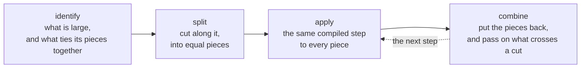
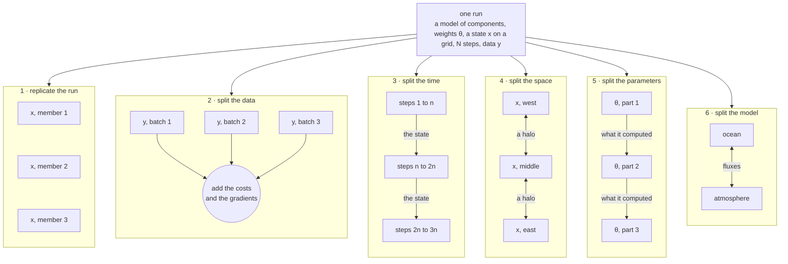
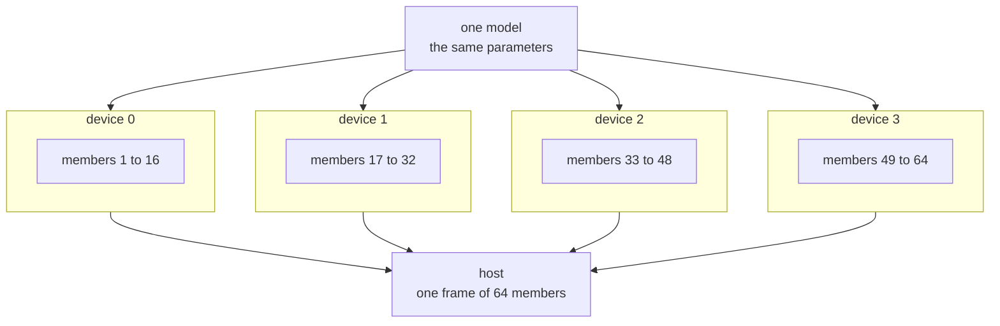
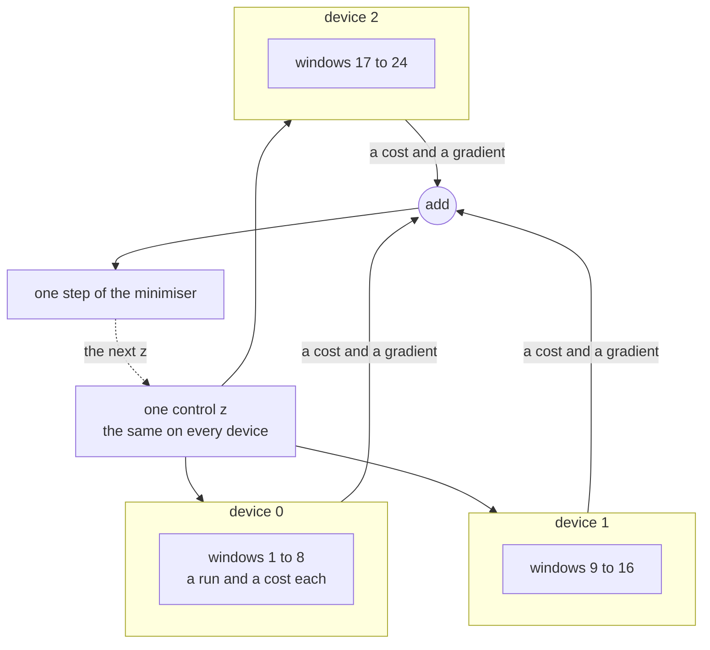
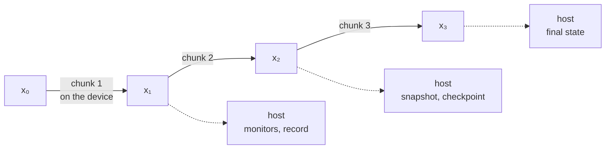
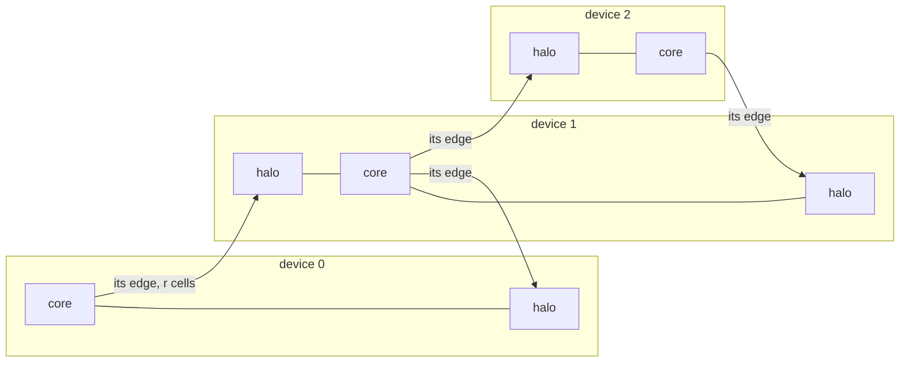
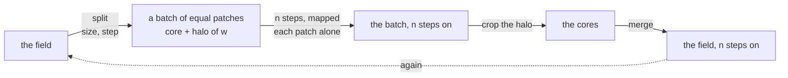
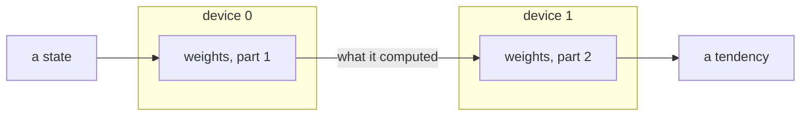
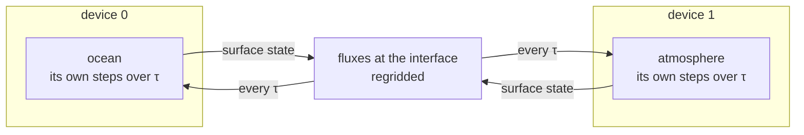
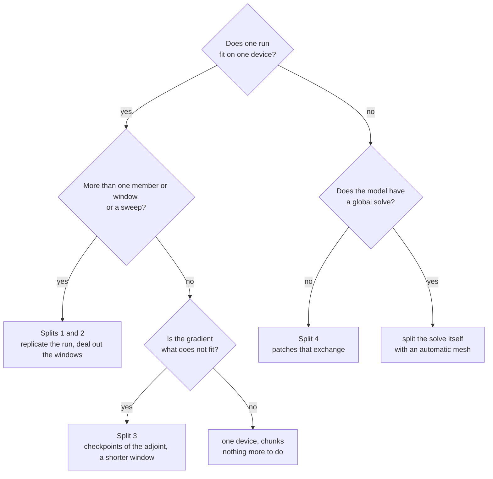

28 Nov 2026 · J. Emmanuel Johnson (drafted with Claude Code)

## Decision

Proposed, for review: every way to scale is the same four moves, identify what is large, split along it, apply the same step to each piece, and combine. There are six things to split along, and this page has one section for each, written as a small design of its own.

| Split | What we support | State |
| --- | --- | --- |
| replicate the run | the members of an ensemble as a leading axis, mapped in one compiled call and placed across devices | proposed |
| split the data | the windows of a fit dealt out to copies of the model, and their gradients added | proposed |
| split the time | chunks, with the host between them | built ([the design of the run](sesmax_experiment_run.md)) |
| split the space | patches with a halo, by an exchange at every evaluation or by a wide halo that is cropped | proposed |
| split the parameters | the weights of a learned term across devices | left to the library that trains it |
| split the model | each component of a coupled model on its own device | later, with `sesmax-couple` |

Recommended: build the replication first, because nothing in a model changes, and the split of space second, and only for a model without a global solve.
Alternative: write the models for a distributed-memory library from the start, as the large ocean models do ([Silvestri et al., 2025](https://doi.org/10.1029/2024MS004465)). That is the wrong trade for models whose purpose is a cheap, differentiable prior on one device.
Status: nothing on this page is built beyond the chunks. The numbers are from scratch runs on 28 November, on four devices that JAX was asked to make out of one CPU. They show that a split gives the right numbers. They say nothing about speed, and nothing here was run on a GPU or a TPU. The split of the data and the split of the model were not run at all.

## Motivation

A sesmax model is small on purpose. A three-layer quasi-geostrophic state on 512 × 512 cells is 6 MB in float64, and a laptop runs it. Three things make it large:

- **Many of them.** An ensemble of 64, a sweep over a viscosity, a twin experiment per observing system, a parameter fitted over a hundred windows.
- **A long window with a gradient.** Reverse mode keeps the past. With every stage of 1,000 steps of that state kept, the tape is 44 GB.
- **A real basin.** The North Atlantic at a kilometre is 5,000 cells across, and then one field is 200 MB and one step is the cost.

These are different problems, and one answer does not fit them. An ensemble wants more devices and no change to the model. A gradient wants memory traded for time. A basin wants the domain in pieces. This page says which answer goes with which problem, and what we would build for each.

## How to think about a split

Every split on this page is the same four moves. They are the split, apply and combine of xarray, which [geotoolz](https://github.com/jejjohnson/geotoolz#where-it-comes-from) draws for a scene too large for memory, with one move in front: say what is large.



A run has six things that can be large, so there are six places to cut. What differs between them is what has to cross a cut, and how often.



| Split | Identify | Split | Apply | Combine | What crosses a cut |
| --- | --- | --- | --- | --- | --- |
| 1, replicate the run | many runs of one model | a leading axis of members | a chunk, mapped over the axis | stack, and take statistics | nothing |
| 2, the data | many windows of a fit | batches of windows | the cost and its gradient, per batch | add | one number and one gradient per batch |
| 3, the time | many steps | a timeline of chunks | a chunk, one after another | compose, and join the snapshots | the state, once per chunk |
| 4, the space | a large grid | patches with a halo | the tendency, or a few steps, per patch | crop the halo and merge | a halo, at every evaluation or every few steps |
| 5, the parameters | a large network | parts of θ, each on a device | each part, in order | the output of the last part | what each part computed, at every evaluation |
| 6, the model | several components | one component per device | each component's own step | exchange, and go on | fluxes, once per coupling step |

The first two copy the model and cut nothing inside a run, so they are free. The other four cut inside a run, and each pays for what crosses: time in order, since a chunk waits for the one before; space in messages or in work on a halo; parameters in messages at every layer; the model in fluxes that are a coupling step old.

## What every split shares

### The cost of a run

A run of $N_ t$ steps of a solver with $s$ evaluations of the tendency per step, on a state of $D_ x$ values, for $B$ members, costs

```math
C = B N_t s D_x c_f
```

where $c_ f$ is the cost of the tendency per value. Its working memory is a few copies of the state per member, about $s B D_ x$ values. Each factor is something to split along, and how tightly its pieces are tied decides the price.

| Factor | Tied together | Split |
| --- | --- | --- |
| $B$, the members | not at all, between two analyses | 1, replicate the run |
| $M$, the windows of a fit | only through the sum of their costs | 2, the data |
| $N_ t$, the steps | each needs the one before | 3, the time |
| $D_ x$, the cells | each needs its neighbours | 4, the space |
| the size of $\boldsymbol{\theta}$ | through every evaluation | 5, the parameters |
| the components | through their fluxes | 6, the model |

### One program, three kinds of device

A sesmax model is a function of `jax.numpy` arrays, compiled by XLA for the device that holds its inputs. Nothing in a model names a device, so the same script runs on a CPU, a GPU and a TPU ([Bradbury et al., 2018](https://github.com/jax-ml/jax)). What changes between them is outside the model:

| | Where it shows | What to do |
| --- | --- | --- |
| Compilation | the first chunk of each number of steps, on each device | keep chunks of one length |
| Precision | float64 is opt-in (`jax_enable_x64`), and costs more on an accelerator | measure in float64, and say which precision a result used; the manifest records it |
| The host | monitors, the log line and every write pull a state off the device once per chunk | long chunks; snapshots of what is read, not of everything |
| Memory | an accelerator has less than the host | chunks for the forward run, checkpoints for the gradient |
| Indivisible shapes | a field with its ghost ring has $N + 2$ cells | choose $N + 2$ divisible by the number of devices along an axis |

Three things were not checked on an accelerator and should be at first use: the cost of float64, the spectral solves of the quasi-geostrophic models, and the linear solves of an implicit step. Everything on this page was run on a CPU.

```python
import jax

# today (jax): the devices of this machine, and where arrays go by default
jax.devices()            # [CpuDevice(id=0)] here; a GPU or a TPU on another machine
jax.default_backend()    # "cpu"

# today (sesmax-experiment): nothing in this call names a device
run = run_chunks(model, state, timeline, dt=0.01)
```

### What JAX gives

Checked in jax 0.12.0, the version sesmax is locked to.

| Need | JAX | Checked here |
| --- | --- | --- |
| the devices | `jax.devices()`, `jax.device_count()` | yes |
| a named layout of devices | `jax.make_mesh`, `jax.sharding.Mesh` | yes |
| an array in pieces across them | `jax.sharding.NamedSharding`, `PartitionSpec`, `jax.device_put` | yes |
| a compiled function that follows its inputs | `jax.jit` on arrays that are placed | yes |
| a function per device, with messages | `jax.shard_map`, with `jax.lax.ppermute` inside | yes |
| a function per member | `jax.vmap`, `equinox.filter_vmap` | yes |
| more than one process | `jax.distributed.initialize` | no |
| `jax.pmap` | "old way of doing parallel map", says its own docstring | not used |

**The mesh has two modes, and only one works with a model today.** A mesh axis is `Explicit` by default in this version, which makes the layout part of an array's type and makes each operation say what it does to it. With that default, the roll of a periodic stencil along a split axis raises, the buffer that diffrax keeps for the stages of a solver raises, and a mapped `Model.integrate` raises. With `axis_types=(AxisType.Auto,)` the compiler places the operations, and the numbers are those of one device (measured in the sections below). So an automatic mesh is the way in, and `shard_map` is the way to say exactly what crosses between devices.

**A split is by whole pieces.** A field of 66 cells cannot be split over four devices. The ghost ring makes this the common case, since an interior of 64 has 66.

### Steps and questions for all of them

| Step | Pull request | Gate |
| --- | --- | --- |
| S0 | a page of the guide: devices, precision, the automatic mesh, with the layout checks as tests | the two layout checks pass on forced CPU devices in CI |
| S6 | a measurement on a real accelerator | a table of time against members, and against patches, on one GPU and on several |

| ID | Question | Recommended | Alternative |
| --- | --- | --- | --- |
| SS-1 | Do we support the default mesh of JAX? | not yet: the automatic mode works today, and the default needs changes in diffrax and in every periodic stencil | wait for the stack to follow JAX |
| SS-4 | One process with several devices, or several processes? | one process, which is what JAX gives without a new dependency | mpi4jax ([Häfner and Vicentini, 2021](https://doi.org/10.21105/joss.03419)), when a domain exceeds one node |
| SS-6 | Does a spec choose the split, or the command line? | the spec, in a `scaling` block, so that the manifest records it | options of the command, as the checkpoint cadence is today |

## Split 1: replicate the run

### Replicate: motivation

An ensemble of 64, a sweep over a viscosity and the forward runs of an ensemble Kalman inversion are the same model run many times. Today that is a loop of runs, each stepped alone. Nothing ties the runs together between two analyses, so this is the split that costs nothing.

- As someone **running an ensemble**, I want 64 members to take the time of a few, and to use every device of the node.
- As someone **measuring stability**, I want the fraction of members that survive, in the record.

### Replicate: the maths

$B$ members $\mathbf{x}^{(b)}$ take the same steps of the same model, $\mathbf{x}^{(b)}_ k = \Psi_ h^n(\mathbf{x}^{(b)}_ {k-1})$, so a chunk of the ensemble is one compiled call over a leading axis. On $p$ devices it takes the time of $B / p$ members. What limits the gain is the part of a chunk that is not on a device. With a share $h$ of the wall time on the host, the gain from $p$ devices is at most

```math
\frac{1}{h + (1 - h) / p}
```

On a 64 × 64 shallow-water model the host took 27 ms of the 98 ms of a chunk, so $h = 0.28$ and four devices would give at most 2.2. A chunk long enough to bring $h$ to 0.03 gives 3.7. The host's share falls as the model grows, which is why this matters most for small models and large ensembles.

A sweep is the same picture with one more axis: the leading axis runs over values of a parameter, and the model's leaf carries that axis too.

### Replicate: the numerics

- **A batch is not a state.** A stack of members given to a model as one state ran without an error and gave a member that was off by 0.21, because the stencil ran along the wrong axis. The chunk has to be mapped over the members.
- **The model is not copied by hand.** Its parameters are sent to each device by the compiler.
- **The monitors see every member.** A member that fails is masked and the others go on, and the survival fraction is one more number of the record ([the design of the run](sesmax_experiment_run.md), step R6).

### Replicate: what it builds on

| Need | Upstream | State |
| --- | --- | --- |
| a chunk | `sesmax_experiment.run.AdvanceChunk` | built |
| a function per member | `equinox.filter_vmap` | exists |
| the members across devices | `jax.make_mesh` with `AxisType.Auto`, `NamedSharding`, `jax.device_put` | exist |
| an ensemble through a cycle | `pipekit_cycle.EnsembleCycle` | exists; it loops over the members in Python, so it is not used |

Nothing is missing upstream.

### Replicate: the API and an example



```python
import jax, jax.numpy as jnp
from jax.sharding import AxisType, NamedSharding, PartitionSpec as P

# Shapes: B = 64 members of D_x = 40

# proposed (sesmax-experiment), S1
# x^{(b)}_k = Ψ_h^n(x^{(b)}_{k−1}), b = 1..B, in one compiled call
run = run_chunks(model, states, timeline, dt=dt, members=64, mesh=mesh)   # states: (B, …) per field
# proposed (sesmax-experiment): the same from a file
# scaling: {members: 64, devices: 4}

# run as written, today (jax): an automatic mesh over four devices, 16 members on each
mesh = jax.make_mesh((4,), ("d",), axis_types=(AxisType.Auto,))
states = jax.device_put(states, NamedSharding(mesh, P("d", None)))
# today (sesmax-core, jax): one chunk of 50 steps, mapped over the members
advance = jax.jit(jax.vmap(chunk))
out = advance(states)
# out is on four devices, and equals the result on one device, with a difference of 0
```

### Replicate: what was measured

| Check | Result |
| --- | --- |
| 64 members over 4 devices, a mapped chunk of 50 steps, automatic mesh | on 4 devices, difference 0 from one device |
| the same on the default mesh of jax 0.12 | raises inside the solve |
| one mapped chunk against a loop of 64 runs, on one device | 13 ms against 176 ms |
| a member of the mapped chunk against its own run | 0 |
| a stack of members given as one state, without the map | off by 0.21, with no error |

### Replicate: steps and questions

| Step | Pull request | Gate |
| --- | --- | --- |
| S1 | members in `run_chunks`, with a mesh (step R6 of the run design) | a member equals its own run; the frame is on every device of the mesh; a member that blows up does not stop the others |

The open question is SR-5 of the run design: an argument of `run_chunks`, which is recommended, or a function of its own.

## Split 2: the data

### Data: motivation

A parameter is rarely fitted on one window. A drag coefficient that should hold for a season is fitted on many weeks, and a prior scale is tuned over many cases. Each window has its own run, and the runs do not know of each other.

- As someone **fitting a parameter over a season**, I want the windows spread over the devices, and one gradient back.

### Data: the maths

When a cost is a sum over $M$ windows that each have their own run,

```math
\mathcal{J}(\mathbf{z}) = \sum_{m=1}^{M} \mathcal{J}_m(\mathbf{z})
```

its gradient is the sum of the gradients, $\nabla \mathcal{J} = \sum_ m \nabla \mathcal{J}_ m$, and the windows are as independent as members are. Each device holds a copy of the model and a batch of windows, and what comes back is one number and one gradient per batch.

Inside one window this does not help. The observations of a window share one trajectory, so splitting them splits the observation operators and not the run, and the run is the cost.

### Data: the numerics

- **It is the replication with a sum at the end.** The windows are a leading axis that is split across devices, and the sum is taken over it. Reverse mode through the sum sends each gradient back to its own device.
- **A window is a unit of memory.** The tape of one window has to fit on one device, so this split and the checkpoints of the adjoint (split 3) are used together.
- **Equal windows compile once.** Windows of different lengths compile once each, as chunks do.

### Data: what it builds on

| Need | Upstream | State |
| --- | --- | --- |
| the cost of one window | `Problem` of [the experiment design](sesmax_experiment.md) | proposed |
| a function per window | `equinox.filter_vmap` | exists |
| the windows across devices | the same mesh as split 1 | exists |
| the same idea for training | pipekit-train | exists, for a training loop |

Nothing is missing upstream. It waits for `Problem`.

### Data: the API and an example



```python
# Shapes: M = 24 windows, each of T steps

# proposed (sesmax-experiment), S7: a problem over many windows
# 𝒥(z) = ∑ₘ 𝒥ₘ(z), with the windows on the leading axis
problems = sxe.stack(problem_of(window) for window in windows)
result = sxe.estimate(problems, method=method, mesh=mesh)
```

### Data: what was measured

Nothing. The section is written from the maths, and its mechanism is the one measured for split 1.

### Data: steps and questions

| Step | Pull request | Gate |
| --- | --- | --- |
| S7 | a problem over a stack of windows, after step E2 of the experiment design | the gradient over 8 windows on 4 devices equals the sum of 8 gradients on one |

| ID | Question | Recommended | Alternative |
| --- | --- | --- | --- |
| SS-8 | Is a stack of windows a `Problem`, or an argument of a `Method`? | a `Problem`, so that every method sees one cost | an option of each method |

## Split 3: the time

### Time: motivation

A double gyre takes 280,000 steps to settle, and one call to an integrator holds every snapshot until it returns. Cutting the run into chunks bounds its memory, lets the host look, and makes it restartable. This split is built, and [the design of the run](sesmax_experiment_run.md) is its page. This section adds what scaling asks of it.

- As someone **fitting over a long window**, I want the gradient to fit in memory, and to know what I pay for that.

### Time: the maths

A run is a composition of chunks, $\mathbf{x}_ k = \Phi_ {t_ {k-1} \to t_ k}(\mathbf{x}_ {k-1})$, and a cut costs nothing in accuracy for a one-step method with stated steps. Cutting does not make a run faster, because a chunk waits for the one before.

The gradient is where time costs memory. Reverse mode through $N_ t$ steps needs the states of the forward pass in reverse order. Keeping all of them costs $s N_ t D_ x$ values. Keeping $c$ checkpoints and recomputing between them costs $c D_ x$ values and more evaluations, with a logarithmic growth of the recomputation for the binomial schedule ([Griewank and Walther, 2008](https://doi.org/10.1137/1.9780898717761)). This is diffrax's default adjoint ([Kidger, 2021](https://arxiv.org/abs/2202.02435)).

Running the chunks of one trajectory at the same time, as parareal does, needs a coarse solver that predicts the fine one, and its convergence is poor for transport and for chaotic flow ([Gander and Vandewalle, 2007](https://doi.org/10.1137/05064607X)). We do not plan it.

### Time: the numerics

- **One compile per number of steps.** Chunks of one length compile once, on each device.
- **The host's share.** A chunk cost 2 ms on the host for a toy and 27 ms for a 64 × 64 model with its log line. That share is what caps the gain of every other split, so a chunk is made long enough to keep it at a few percent.
- **A chunk is the step that the other splits apply.** It is mapped over members in split 1 and over patches in split 4.

### Time: what it builds on

| Need | Upstream | State |
| --- | --- | --- |
| the loop, the monitors, checkpoints, restarts | `sesmax_experiment.run`, `sesmax_experiment.sim` | built |
| checkpoints of an adjoint | diffrax's `RecursiveCheckpointAdjoint`, through integrix's `to_diffrax_adjoint` | exist |

### Time: the API and an example



```python
# today (sesmax-experiment): chunks of 0.1, a snapshot every 2
run = run_chunks(model, state, Timeline.build(0.0, 4.0, chunk=0.1, snapshot=2.0), dt=0.01)
```

### Time: what was measured

In the design of the run: 40 chunks against one differ by $9.6 \times 10^{-12}$ on a state of size 10, a restart is exact, and the first chunk of each number of steps costs a compilation of about a second. The memory of a gradient against the number of checkpoints was not measured.

### Time: steps and questions

The steps are R0 to R9 of the design of the run. For scaling, the one that matters is step E1 of the experiment design, which lets a rollout take an adjoint and so choose its checkpoints.

## Split 4: the space

### Space: motivation

A basin at a kilometre does not fit on one device, and a learned closure trained on small tiles has to be applied to the whole of it. Both want the field in pieces. They differ in what a piece needs from its neighbours: a model needs exact values at its edge, and a network needs only enough context to hide the seam.

- As someone **running a basin**, I want the domain split over devices and the same numbers as the run on one.
- As someone **applying a learned term or an emulator** to a large field, I want it applied in patches, with no seams.

### Space: the maths

Let the tendency at a cell read cells up to $r$ away, the reach of its stencil. One step of a solver with $s$ evaluations reads up to $r s$ away, and $n$ steps up to

```math
w^\star = r s n
```

This is the domain of dependence. A patch that carries a halo of width $w \geq w^\star$ around its core gives, in its core, exactly the values of the global run after $n$ steps, whatever is in the cells beyond. Two ways to use this follow.

**Exchange at every evaluation.** With $w = r$, the halo is filled from the neighbours before each evaluation of the tendency. The result is the global run, and the cost is a message per evaluation. For a patch of $P_ x \times P_ y$ cells the cells sent per evaluation are a share

```math
\frac{2 r (P_x + P_y)}{P_x P_y}
```

of the cells computed, the surface over the volume. It is 3 % for a patch of 256 with a reach of 2.

**A wide halo, thrown away.** With $w = r s n$, each patch runs $n$ steps alone, and its halo is then cropped. There is one exchange per $n$ steps, and the price is the work on the halo, a factor

```math
\left( 1 + \frac{2w}{P_x} \right) \left( 1 + \frac{2w}{P_y} \right)
```

The bound $w^\star$ is safe and loose. The influence of a far cell decays with distance in practice, so a narrower halo is often exact to rounding (measured below).

**What cannot be cut.** A quasi-geostrophic model inverts an elliptic equation at every evaluation, $\nabla^2 \psi - \lambda^2 \psi = q$, and the stream function at one cell depends on the vorticity everywhere. Its reach is the whole domain, so $w^\star$ is the domain and a patch is no cheaper than the whole. The choices are to split the solve itself across devices, or to iterate between patches with a coarse correction ([Dolean, Jolivet and Nataf, 2015](https://doi.org/10.1137/1.9781611974065)). Shallow water has a finite speed and a finite reach, and cuts cleanly.

### Space: the numerics

- **A halo is a ghost ring.** A halo filled from a neighbour is a ghost cell whose boundary condition is "the next patch". Every field of gridax already has a ghost ring, so a patch is an ordinary grid, and the wall or the periodic wrap stays at the edge of the domain.
- **Equal patches compile once.** A batch of equal patches is one array with a leading axis, and a step mapped over it compiles once and not once per position.
- **An ordinary compiled chunk also works on a split field.** With an automatic mesh, a field in four pieces went through an unchanged chunk and through `run_chunks`, with a difference of 0. The compiler then decides what crosses, where `shard_map` lets us say it.
- **The split has to be inside the compiled step.** An exchange at every evaluation cannot cross to the host, so the split and the merge are compiled, with static indices, and a gradient passes through them.

### Space: what it builds on

GeoPatcher (`geopatcher`, in geotoolz at `543ad57`) splits a field into patches and merges them back. It is written for rasters and for inference with a network, on NumPy, and its design is four independent choices:

| Choice | Its names | What it settles |
| --- | --- | --- |
| geometry | `Rectangular(size, boundary=)`, with `drop`, `pad`, `shrink`, `raise`, `reflect` | the size of a patch, and what happens at the edge of the domain |
| sampler | `RegularStride(step)` | where patches sit; the overlap is `size − step` |
| window | `Boxcar`, `Hann`, `Tukey`, `Gaussian`, `Custom` | the weight of each cell of a patch at the merge |
| aggregation | `OverlapAdd`, $\sum_ i w_ i x_ i / \sum_ i w_ i$, and `Mean`, `Max`, `ByIndex`, … | how overlapping patches become one field |

Four of its ideas carry over to a model.

- **A batch of patches is one array with a leading axis.** `PatchBatch` is a pytree whose metadata is static, so a compiled step compiles once per patch shape.
- **An operator says how far it reads.** A pipekit operator declares a `coupling` with a reach, the reaches of the steps of a pipeline add up, and `ApplyToChips` warns (`PatchReachWarning`) when the overlap is less than twice the reach. That is the test $w \geq r s n$, already written.
- **Padding is read and never written.** With `boundary="pad"` or `"reflect"` the cells beyond the domain give context and are dropped at the merge.
- **The crossing to JAX happens once.** The split and the merge are on the host, and only the step on the batch is compiled.

Two things it does not have. There is no halo as such: a margin that is cropped is spelled as a window with zero weight there. And the split and the merge are NumPy on the host, so they cannot sit inside a compiled chunk or carry a gradient. A network that maps a field to a field can afford a crossing per call. A model that exchanges at every evaluation cannot.

| Need | Upstream | State |
| --- | --- | --- |
| a function per device with messages | `jax.shard_map`, `jax.lax.ppermute` | exist |
| a ghost ring and its fill | `gridax.fill_ghosts`, with a `BC` per side | exists, for the edges of a domain |
| the reach of a stencil | the gridax operators | not declared anywhere |
| split, window, merge on the host | `geopatcher`: `SpatialPatcher`, `Rectangular`, `RegularStride`, the windows, `OverlapAdd` | exist, on NumPy |
| a batch of patches as one pytree | `geopatcher.run.batch_split`, `PatchBatch` | exists |
| a check of overlap against reach | `geopatcher`'s `ApplyToChips(check_reach=True)`, `PatchReachWarning` | exists, for pipekit operators |
| a local analysis | `filterax.LETKF`, `gaspari_cohn` | exist |

Gaps, each with the package that should own it. None is filed.

- **The reach of an operator**, in gridax, which owns the stencils. A difference, an interpolation and an advection scheme each know how far they read, and a model's reach is the sum along its tendency. GeoPatcher's `coupling` is the same idea for a pipekit operator, so one name should serve both.
- **A ghost ring filled from a neighbour**, in gridax. `fill_ghosts` takes a boundary condition per side, and "the next patch" is one more.
- **A split and a merge that compile**, in gridax for a located field. The compiled ones need equal patches and static indices, which is the case GeoPatcher already favours.
- **A margin as a named window**, in geopatcher: one on the core and zero on a margin of $w$. It exists today as a `Custom` window, and a name would let a model and a network say the same thing.

### Space: the API and two examples

**Patches that exchange.** Each device holds a piece of the field with a halo of the stencil's reach, and before every evaluation each piece sends its edge to its neighbour's halo. The numbers are those of one device. Veros does this for a full ocean model in JAX, with MPI between the pieces ([Häfner et al., 2021](https://doi.org/10.1029/2021MS002717)).



**Patches with a wide halo, cropped.** This is GeoPatcher's split, map and merge, with a window that is one on the core and zero on the halo. The patches do not talk during the $n$ steps, so they can be mapped on one device or spread over several with no message. With a tapered window in place of the crop, the same picture is how a learned term or an emulator is applied to a large field: there the overlap hides the seam of a function that has no exact reach.



```python
# Shapes: Py × Px patches of ny × nx cells, with a halo of w; Ny Nx with the ghost ring

# proposed (gridax), S2: how far a tendency reads
reach(model.vector_field)          # → 2 for a stencil that reads two cells to one side

# proposed (gridax), S3: a grid in pieces
pieces = Decomposition(grid, patches=(2, 2), halo=2)
batch = pieces.split(state)        # (Py·Px, ny + 2w, nx + 2w) per field
state = pieces.merge(batch)        # the cores, back in place
batch = pieces.exchange(batch)     # each halo from its neighbour's core; the domain's own BCs at its edge

# proposed (sesmax-core), S4 and S5: a model on pieces, in either mode
# exchange: w = r, an exchange before each evaluation; exact
# overlap:  w ≥ r s n, an exchange every n steps; exact up to the bound
model_p = Patched(model, pieces, mode="exchange")
model_p = Patched(model, pieces, mode="overlap", steps=5)     # raises if halo < r s n, unless told to warn
# proposed (sesmax-experiment): the same from a file
# scaling: {patches: [2, 2], halo: 2, mode: exchange}
```

`Patched` is a model, so everything that takes a model takes it: `run_chunks`, a monitor, a rollout, a gradient. In the exchange mode its tendency is a `shard_map` of the inner tendency. In the overlap mode its step is a map over the batch. It refuses a model whose reach is not finite.

The two examples below were run as written, on Lorenz-96, a ring whose tendency reads two cells to one side and one to the other.

```python
# today (jax): each device holds a piece of the ring
def tendency_piece(x_piece):
    ring = lambda shift: [(i, (i + shift) % 4) for i in range(4)]
    left = jax.lax.ppermute(x_piece[-2:], "d", ring(+1))     # my right edge → my right neighbour's left halo
    right = jax.lax.ppermute(x_piece[:1], "d", ring(-1))
    ext = jnp.concatenate([left, x_piece, right])
    # dx_j/dt = (x_{j+1} − x_{j−2}) x_{j−1} − x_j + F
    return (ext[3:] - ext[:-3]) * ext[1:-2] - ext[2:-1] + 8.0

tendency = jax.jit(jax.shard_map(tendency_piece, mesh=mesh, in_specs=P("d"), out_specs=P("d")))
```

```python
# Shapes: a ring of 4096 in 8 patches; core 512, halo w

# split: equal patches, with wrap at the ends of the ring
index = (jnp.arange(8)[:, None] * 512 + jnp.arange(-w, 512 + w)[None, :]) % 4096
batch = x[index]                                   # (8, 512 + 2w)
# apply: n steps of the ordinary model on each patch alone
batch = jax.jit(jax.vmap(lambda piece: steps(piece, n)))(batch)
# combine: crop and merge
x_next = batch[:, w : w + 512].reshape(-1)         # (4096,)
```

### Space: what was measured

Float64, four devices made from one CPU, Tsit5 with a step of 0.01.

| Check | Automatic mesh | Default mesh of jax 0.12 |
| --- | --- | --- |
| a field of 4,096 over 4 devices, an ordinary compiled chunk | difference 0 | raises at the roll of the stencil |
| the same through `run_chunks` | on 4 devices, difference 0 | raises |
| a field of 66 over 4 devices | refused, 66 is not a multiple of 4 | refused |
| the exchanged tendency against the model's | $7 \times 10^{-15}$ | $7 \times 10^{-15}$ |
| ten steps on the exchanged tendency against the global solve | 0 | raises, at the solver's buffer of stages |
| the gradient through the exchange against the global one | $2 \times 10^{-13}$ | not run |

**A wide halo, cropped.** The largest difference from the global run, for 8 patches of 512 with a halo of $w$. The reach is 2 and the result of a Tsit5 step depends on six nested evaluations of the tendency, so the bound is $w^\star = 12 n$.

| Halo $w$ | 1 step | 2 steps | 5 steps |
| --- | --- | --- | --- |
| 2 | $1 \times 10^{-2}$ | $4 \times 10^{-2}$ | $3 \times 10^{-1}$ |
| 4 | $2 \times 10^{-4}$ | $2 \times 10^{-3}$ | $3 \times 10^{-2}$ |
| 8 | $8 \times 10^{-8}$ | $3 \times 10^{-6}$ | $3 \times 10^{-4}$ |
| 12 | 0 | $2 \times 10^{-9}$ | $7 \times 10^{-7}$ |
| 16 | 0 | $4 \times 10^{-13}$ | $2 \times 10^{-9}$ |
| 24 | 0 | 0 | $2 \times 10^{-15}$ |
| 32 | 0 | 0 | 0 |

One step is exact from $w = 12$ and two from $w = 24$, as the bound says. Five steps are exact from 32, well inside the bound of 60, because the far cells enter with coefficients below rounding. A halo of 16 on a core of 512 is 6 % more work, and one of 64 is 25 %.

Not covered: a two-dimensional field, a staggered grid, a wall, land, a model of the ocean, and a quasi-geostrophic solve in pieces.

### Space: steps and questions

| Step | Pull request | Gate |
| --- | --- | --- |
| S2 | the reach of the gridax operators, and of a model | the reach of each ocean model, against a measured domain of dependence |
| S3 | a ghost ring filled from a neighbour, a `Decomposition` | gridax; a split and a merge are inverse, and a gradient passes |
| S4 | `Patched`, exchange mode | linear shallow water on 2 × 2 patches equals one device to rounding, with walls and with land |
| S5 | `Patched`, overlap mode, and the halo check | the table above on a two-dimensional model; a halo below the bound is refused |

| ID | Question | Recommended | Alternative |
| --- | --- | --- | --- |
| SS-2 | Where does the split of a grid live? | gridax, which owns the ghost ring | geopatcher, with a compiled backend |
| SS-3 | A quasi-geostrophic basin too large for one device | an automatic mesh over the spectral solve, measured first on one model | Schwarz iterations between patches, with a coarse grid |
| SS-5 | Is the overlap mode exact by default? | yes: refuse a halo below $r s n$, and let the user ask for a warning instead | warn only, as GeoPatcher does |
| SS-7 | A margin in GeoPatcher: a window, or a new field of the geometry? | a window, `Core(margin)`, which fits its four choices | a `halo` on `Rectangular` |

## Split 5: the parameters

### Parameters: motivation

A physical model has a handful of parameters and fields the size of its state. Its parameters are not what is large. A learned term or an emulator can have $10^8$ weights, and then the weights are split over devices as a state is.

- As someone **using a large learned term**, I want it to compose with the physics whatever devices its weights are on.

### Parameters: the maths

A network is a composition of parts, $g_ {\boldsymbol{\theta}} = g_ L \circ \dots \circ g_ 1$, with $\boldsymbol{\theta} = (\boldsymbol{\theta}_ 1, \dots, \boldsymbol{\theta}_ L)$. With part $l$ on its own device, an evaluation passes what each part computed to the next, so $L - 1$ messages cross per evaluation, and as many again on the way back for a gradient. Nothing is saved in time: the parts run in order. What is gained is memory, since no device holds all of $\boldsymbol{\theta}$.

### Parameters: the numerics

- **A layout is a property of an array and not of a term.** A term whose weights are placed on several devices is called as any other term, and the compiler moves what crosses.
- **It multiplies with the cost of the model.** The term is evaluated $s$ times per step, so its messages are paid $s N_ t$ times in a run.

### Parameters: what it builds on

| Need | Upstream | State |
| --- | --- | --- |
| the weights of a network in pieces | `NamedSharding` on its leaves | exists |
| the training of it on many devices | pipekit-train, with the networks of geonnax | pipekit-train's concern |
| a learned term as a term | [the param design](sesmax_param.md) | proposed there |

### Parameters: the API and an example



sesmax adds no API for this. A term arrives with its weights placed, and it is a term.

### Parameters: what was measured

Nothing. sesmax has no model of that size.

### Parameters: steps and questions

None in sesmax. The one thing to check, when a term of that size exists, is that a model which holds it still runs through `run_chunks` on an automatic mesh.

## Split 6: the model

### Model: motivation

A coupled model is several components, an ocean and an atmosphere, each with its own state, its own grid and often its own step. `sesmax-couple` is where they will meet, and it is not started. Each component is a model of its own, so each can have its own device.

- As someone **running a coupled model**, I want the ocean and the atmosphere to step at the same time, each on a device.

### Model: the maths

Two components with states $\mathbf{x}_ o$ and $\mathbf{x}_ a$ are tied by the fluxes $\mathbf{F}$ at their interface,

```math
\partial_t \mathbf{x}_o = f_o(\mathbf{x}_o, \mathbf{F}(\mathbf{x}_o, \mathbf{x}_a))
```

and the same for $\mathbf{x}_ a$. With a coupling step $\tau$, each component advances over $\tau$ with the fluxes computed at its start, and the fluxes are computed again at its end. The two advances do not read each other, so they can run at the same time. The price is that the fluxes are up to $\tau$ old, an error of first order in $\tau$.

### Model: the numerics

- **What crosses is small.** The fluxes are fields on the interface, two-dimensional for three-dimensional components, and they cross once per coupling step and not once per evaluation.
- **The components need not be equal.** Unlike patches and members, two components have different shapes and different costs, so they are two compiled functions and not one mapped function, and the slower one sets the pace.
- **A regrid sits in the crossing.** The fluxes change grid on the way, which is functax's job.

### Model: what it builds on

| Need | Upstream | State |
| --- | --- | --- |
| a component | `sesmax_core.component.Component` | built |
| the fluxes between components | `sesmax-couple` | later |
| a regrid of the fluxes | functax plans | exist |
| two functions on two devices | `jax.device_put` of each component's state | exists |

### Model: the API and an example



No API is proposed here. It belongs to the design of `sesmax-couple`, which should say whether its coupling step is a chunk of the run loop.

### Model: what was measured

Nothing. There is one component today.

### Model: steps and questions

| ID | Question | Recommended | Alternative |
| --- | --- | --- | --- |
| SS-9 | Do the components of a coupled model step at the same time, or in turn? | decide in the design of `sesmax-couple`, with the error of each measured on a toy pair | fix it here |

## Which split for which problem



| Problem | Size | Split | Expect |
| --- | --- | --- | --- |
| a double gyre, eight years | one small state, many steps | 3 | one device; the time is the steps |
| an ensemble of 64, or a sweep | many small states | 1 | close to the number of devices, less the host's share |
| a twin experiment per design, hundreds of them | many independent runs | 1, or one job each | the scheduler does it as well as JAX does |
| a parameter fitted over many windows | many runs, one control | 2 | close to the number of devices; one sum per step of the minimiser |
| a 4D-Var over a long window | one state, a long tape | 3, for the gradient | memory traded for recomputation |
| a shallow-water basin at a kilometre | one large state, finite reach | 4, with an exchange | the numbers of one device; a message per evaluation |
| a quasi-geostrophic basin at a kilometre | one large state, a global solve | an automatic mesh over the solve | not designed here; open question SS-3 |
| a learned closure applied to a large field | an operator with no exact reach | 4, with a wide halo and a tapered window | no seams; not exact |
| a local ensemble filter | an analysis per neighbourhood | 4 for the analysis, 1 for the forecasts | filterax's `LETKF` has the localisation |
| training an emulator | large weights, large batches | 5 and 2 | pipekit-train's concern |
| an ocean under an atmosphere | two components | 6 | later, with `sesmax-couple` |

Three rules of thumb come out of this. Replicate before you cut: members and windows are free, and space is not. Do not split a state that fits: 512 × 512 in three layers is 6 MB. And measure the host's share before adding devices, since it caps the gain.

## What it does not own

| Concern | Owner |
| --- | --- |
| Devices, layouts, messages on one host | JAX |
| Messages between processes | mpi4jax, if we ever need it |
| Stencils, their reach, ghost rings, the split of a grid | gridax |
| Patches of rasters, windows, merges on the host | geopatcher |
| The loop, the chunks, the members of a run | `sesmax-experiment` |
| The adjoint and its checkpoints | diffrax, integrix |
| A local analysis | filterax |
| Training on many devices, and split weights | pipekit-train |
| Fluxes between components | `sesmax-couple` |

## The order of the work

S0 and S1 need nothing from another package. S7 waits for the `Problem` of the experiment design. S2 and S3 are gridax's, and S4 and S5 wait for them. S6 needs a machine this one is not. Splits 5 and 6 have no step here.

The scratch runs are of 28 November 2026, in float64, with the packages of sesmax `a34e46c`, jax 0.12.0 and diffrax 0.7.2, on four devices made from one CPU with `XLA_FLAGS=--xla_force_host_platform_device_count=4`. Lorenz-96 stands in for a model with a stencil. Not covered anywhere on this page: any speed on more than one device, a GPU, a TPU and a second process.

## References

- Bradbury, J. et al. (2018). [JAX: composable transformations of Python+NumPy programs](https://github.com/jax-ml/jax). Software.
- Dolean, V., Jolivet, P. and Nataf, F. (2015). [An Introduction to Domain Decomposition Methods](https://doi.org/10.1137/1.9781611974065). SIAM.
- Gander, M. J. and Vandewalle, S. (2007). [Analysis of the parareal time-parallel time-integration method](https://doi.org/10.1137/05064607X). *SIAM Journal on Scientific Computing* 29, 556–578.
- Griewank, A. and Walther, A. (2008). [Evaluating Derivatives](https://doi.org/10.1137/1.9780898717761). SIAM.
- Häfner, D., Nuterman, R. and Jochum, M. (2021). [Fast, cheap, and turbulent: global ocean modeling with GPU acceleration in Python](https://doi.org/10.1029/2021MS002717). *Journal of Advances in Modeling Earth Systems* 13, e2021MS002717.
- Häfner, D. and Vicentini, F. (2021). [mpi4jax: zero-copy MPI communication of JAX arrays](https://doi.org/10.21105/joss.03419). *Journal of Open Source Software* 6, 3419.
- Kidger, P. (2021). [On Neural Differential Equations](https://arxiv.org/abs/2202.02435). arXiv:2202.02435.
- Silvestri, S. et al. (2025). [A GPU-based ocean dynamical core for routine mesoscale-resolving climate simulations](https://doi.org/10.1029/2024MS004465). *Journal of Advances in Modeling Earth Systems* 17.

## Relationships

- Next to: [the design of the run](sesmax_experiment_run.md), whose chunk is the step that every split applies
- Part of: [the experiment design](sesmax_experiment.md) for members, windows and gradients; [the core design](sesmax_core.md) for a model on pieces
- Builds on: JAX, gridax, geopatcher, diffrax, integrix, filterax
- Issues: sesmax#108 (an ensemble's survival fraction)
