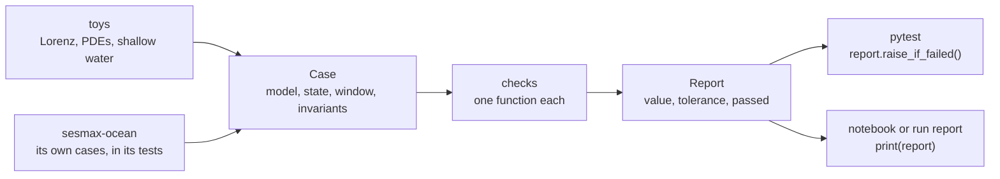

25 Nov 2026 · J. Emmanuel Johnson (drafted with Claude Code)

## Decision

Proposed: one package, `sesmax-testing`, holds the toy models and a set of checks that take any sesmax model and say whether its code does what its equations say.
Recommended: a check returns a number and a tolerance, so the same function serves a test suite, a notebook and a run report.
Alternative: pytest helpers that only raise, which are shorter but leave nothing to print or to store.
Status: proposed, for review. The checks below are prototyped in a scratch script; the package is not started. It is step W2 of [the workspace packages](workspace_packages.md), and it does not block [the run loop](run_loop.md).

## Motivation

The seven ocean models came from somax, where 30 conservation, invariant and multilayer tests passed. The port to sesmax found two defects in the shallow-water models all the same: the mass equation was wrong on the outermost ring of cells, and the Coriolis force was a quarter of its value in the first column of a periodic box. [The ocean plan](ocean.md) has the numbers.

The tests missed them for an ordinary reason. The mass test started from a nearly uniform state and allowed a drift of 1e-6, so a wrong tendency at the edge had nothing to act on. There was no test that moved the state across the edge of the box and asked for the same answer.

The two tests which do find them are now in `sesmax-ocean` (`tests/swm/test_conservation.py` and `test_shift.py`). They are written for three models by name, they know the fields `h`, `u` and `v`, and the next component would write them again. The gradient check is an open issue (sesmax#105), and the adjoint identity is checked nowhere, although every assimilation method in the stack relies on it.

So the checks exist as ideas, as copies and as issues, and what is missing is one place for them.

## User stories

- As a **model author**, I want to hand my model and a random state to a list of checks, so that I learn within a minute whether the stencils near the edges are right.
- As someone **running 4D-Var**, I want the adjoint identity and the Taylor test on my model over my window, so that I know the gradient means something before I blame the minimiser.
- As someone **choosing a window length**, I want the horizon over which the gradient agrees with finite differences, so that I do not pick a window where it says nothing.
- As a **reviewer** of a refactor, I want the numbers of a stored run as a check, so that "no change in behaviour" is a measurement.
- As a **learner**, I want Lorenz-63, Burgers and a small shallow-water model to import in one line, so that I can try a method without a dataset.
- As a **maintainer** of a component that does not exist yet, I want its whole test file to be a list of cases.

## Background: the maths

Write a model as $\mathrm{d}\mathbf{x} / \mathrm{d}t = f(\mathbf{x}, t; \boldsymbol{\theta})$, with the state $\mathbf{x} \in \mathbb{R}^{D_ x}$, parameters $\boldsymbol{\theta} \in \mathbb{R}^{D_ \theta}$ and the tendency $f: \mathbb{R}^{D_ x} \to \mathbb{R}^{D_ x}$. Write $m: \mathbb{R}^{D_ x} \to \mathbb{R}^{D_ x}$ for the map from the state at the start of a window to the state at its end. Each check is a property that $f$ or $m$ must have.

### Conservation

An invariant is a functional $\mathcal{C}[\mathbf{x}] \in \mathbb{R}$, such as the mass $\sum_ i A_ i h_ i$ where $A_ i$ is the area of cell $i$ and $h_ i$ its thickness. It is conserved when its rate of change along the flow is zero:

```math
\frac{\mathrm{d}\mathcal{C}}{\mathrm{d}t} = \nabla_{\mathbf{x}} \mathcal{C}(\mathbf{x})^\top f(\mathbf{x}) = 0
```

A run would show the same thing as a drift, but mixed with the error of the time stepper. The tendency alone does not depend on the stepper, and one evaluation is enough.

### Translation

In a periodic box with constant coefficients, no cell is special. With $\mathbf{S} \in \mathbb{R}^{D_ x \times D_ x}$ the permutation which shifts every field by some number of cells,

```math
f(\mathbf{S} \mathbf{x}) = \mathbf{S} f(\mathbf{x})
```

A wrong ghost cell breaks this, because the edge of the box moves relative to the state. It is a metamorphic test, which needs no known solution ([Claessen and Hughes, 2000](https://doi.org/10.1145/351240.351266) is the general idea). The same form covers a reflection, a rotation by 90°, or a Galilean shift, with another $\mathbf{S}$.

### Gradient

Let $\mathcal{L}: \mathbb{R}^{D_ x} \to \mathbb{R}$ be a scalar of the window, such as a sum of squares of $m(\mathbf{x})$. For a direction $\mathbf{v} \in \mathbb{R}^{D_ x}$ and a step $\epsilon$, the Taylor remainder is

```math
r(\epsilon) = \vert \mathcal{L}(\mathbf{x} + \epsilon \mathbf{v}) - \mathcal{L}(\mathbf{x}) - \epsilon \nabla_{\mathbf{x}} \mathcal{L}(\mathbf{x})^\top \mathbf{v} \vert = \mathcal{O}(\epsilon^2)
```

A wrong gradient leaves a remainder of order $\epsilon$, so the slope of $\log r$ against $\log \epsilon$ is 2 when the gradient is right and 1 when it is not ([Farrell et al., 2013](https://doi.org/10.1137/120873558)). The slope is a better test than one finite difference, because it needs no tolerance on the size of the error.

### Adjoint

The tangent-linear model $\mathbf{M} = \partial m / \partial \mathbf{x} \in \mathbb{R}^{D_ x \times D_ x}$ and its adjoint $\mathbf{M}^\top$ are never formed. Forward mode gives $\mathbf{M} \mathbf{v}$ and reverse mode gives $\mathbf{M}^\top \mathbf{w}$, and they must satisfy, for any $\mathbf{v}, \mathbf{w} \in \mathbb{R}^{D_ x}$,

```math
\langle \mathbf{M} \mathbf{v}, \mathbf{w} \rangle = \langle \mathbf{v}, \mathbf{M}^\top \mathbf{w} \rangle
```

This is the classic test of a hand-written adjoint ([Errico, 1997](https://hdl.handle.net/10.1175/1520-0477(1997)078<2577:WIAAM>2.0.CO;2)). Ours is written by JAX, and the test still earns its place, as the two sides go through different code in diffrax (see the numerics below) and through every `custom_vjp` in the stack.

### Convergence

With a step $\Delta$ (in time or in space) and the error $e(\Delta)$ against a reference, the observed order is

```math
p = \log_2 \frac{e(\Delta)}{e(\Delta / 2)}
```

and it must approach the order of the scheme. The reference is an exact solution where one exists (the standard ones on the sphere are those of [Williamson et al., 1992](https://hdl.handle.net/10.1016/S0021-9991(05)80016-6)). Where none does, a chosen field $\mathbf{x}_ \text{m}$ is made exact by adding the source $\mathrm{d}\mathbf{x}_ \text{m} / \mathrm{d}t - f(\mathbf{x}_ \text{m})$ to the right-hand side, which is the method of manufactured solutions ([Roache, 2001](https://doi.org/10.1115/1.1436090); [Oberkampf and Roy, 2010](https://doi.org/10.1017/CBO9780511760396)). In sesmax the source is a `ForcingTerm`, so the method needs no new machinery for a `TermModel`.

### Horizon

In a chaotic model a perturbation grows like $e^{\lambda t}$, with $\lambda$ the leading Lyapunov exponent. The gradient over a long window grows at the same rate, and it stops telling us how a finite change acts ([Lea et al., 2000](https://doi.org/10.3402/tellusa.v52i5.12283); [Köhl and Willebrand, 2002](https://doi.org/10.3402/tellusa.v54i4.12150)). The horizon at a step $\epsilon$ is the longest window over which the directional derivative agrees with a central difference of that size,

```math
t_\epsilon = \max \left\lbrace t : \frac{\vert \nabla \mathcal{L}_t^\top \mathbf{v} - d_\epsilon(t) \vert}{\vert \nabla \mathcal{L}_t^\top \mathbf{v} \vert} \leq \tau \right\rbrace
```

where $d_ \epsilon(t) = (\mathcal{L}_ t(\mathbf{x} + \epsilon \mathbf{v}) - \mathcal{L}_ t(\mathbf{x} - \epsilon \mathbf{v})) / (2 \epsilon)$ and $\tau$ is a tolerance. A useful $\epsilon$ has the size of the analysis increment. The horizon is a measurement of the model and does not pass or fail.

### Reference

A stored run $\mathbf{x}_ \text{ref}$ at a named commit, and the largest relative difference from it. It says nothing about the equations, and it is the check for a refactor. The equality with somax in `sesmax-ocean` is one of these.

## Background: the numerics

**What to divide by.**
An absolute tolerance on a net tendency depends on the units and on the number of cells, which is how 1e-6 came to accept the mass defect. We divide the net by the sum of the absolute contributions,

```math
\rho = \frac{\vert \sum_i g_i f_i \vert}{\sum_i \vert g_i f_i \vert}
```

where $g_ i$ and $f_ i$ are the components of $\nabla_ {\mathbf{x}} \mathcal{C}$ and of $f$. It lies between 0 and 1, it has no units, and in exact arithmetic it is 0 for an invariant. For a nonlinear invariant, such as the energy, this form needs no second formula, since `jax.grad` gives $g$.

**Round-off.**
A sum of $n$ terms of mixed sign leaves a relative error near $n^{1/2}$ times the unit round-off, so 1e-14 is a fair bound for $\rho$ in float64 on the sizes we use, and the checks switch to float64 themselves. In float32 the bound is about 1e-6 and it could not tell the defect from noise on a large grid.

**The state.**
The state has to be random in every field and in every cell. A smooth or balanced state hides a wrong stencil behind a small tendency, and a state at rest hides everything.

**Ghost cells.**
The comparison is on the interior. The ghost ring of a tendency is not defined, and the checks fill the ghosts of the state with `apply_boundary_conditions` first.

**Two adjoints.**
diffrax's default `RecursiveCheckpointAdjoint` supports reverse mode only, so the forward side of the adjoint check needs `adjoint=dfx.DirectAdjoint()`. The check therefore compares two differentiation paths, and both are used in the stack (strong 4D-Var takes the first, the incremental form takes the second).

**Non-smooth schemes.**
Upwind and WENO fluxes switch on the sign of the velocity or on a smoothness measure. At a switch the gradient is one-sided, so the slope of the Taylor test falls below 2 for directions that cross one. In the prototype it fell to 1.84 on the nonlinear shallow-water model, where the linear one stays at 2.00. So the gradient check asks for a slope of 1.7, which a wrong gradient (slope 1) does not reach.

**The finite-difference step.**
A central difference has a truncation error of order $\epsilon^2$ and a round-off error of order $u / \epsilon$, with $u$ the unit round-off, so in float64 no $\epsilon$ below about 1e-5 of the state helps ([Griewank and Walther, 2008](https://doi.org/10.1137/1.9780898717761)). The Taylor test sweeps $\epsilon$ and avoids the choice.

**Cost.**
Nearly all of it is compilation. The adjoint check took 6 s on Lorenz-96 and 40 s on a 16 × 16 nonlinear shallow-water model, 12 steps long, and the Taylor test 13 s and 59 s. A test suite which runs them on every case belongs in the `slow` tier, and the conservation and translation checks (one tendency) in the fast one.

## Proposal: the API



| Rung | Name | Job |
| --- | --- | --- |
| structure | `Case`, `Report` | what is checked, what was found |
| primitive | `conservation`, `translation`, `gradient`, `adjoint`, `convergence`, `reference`, `contract`, `horizon` | one property each |
| model | the toys | something to check, or to learn on |
| recipe | `check_all` | every check that applies to a case |

### The case

Here $\mathbf{x}$ is the state and $T$ the number of steps in the window.

```python
# Shapes: the state is the model's pytree, with D_x values; T = n_steps

# proposed (sesmax-testing)
class Case(eqx.Module):
    """A model, a state to check it at, and what is known about it."""

    name: str = eqx.field(static=True)
    model: Model
    state: PyTree
    dt: float = eqx.field(static=True)
    n_steps: int = eqx.field(static=True, default=12)
    # C[x], one functional per invariant of f
    invariants: Mapping[str, Callable[[Model, PyTree], Float[Array, ""]]] = ...
    # the axes along which the box repeats, empty with walls
    periodic: tuple[str, ...] = eqx.field(static=True, default=())
    # the order of the scheme in time, None to skip convergence
    order: int | None = eqx.field(static=True, default=None)
```

### The checks

```python
# proposed (sesmax-testing)
class Report(eqx.Module):
    """What one check measured."""

    check: str
    case: str
    value: float
    tolerance: float
    detail: Mapping[str, float]

    @property
    def passed(self) -> bool: ...

    # raises AssertionError with the numbers
    def raise_if_failed(self) -> None: ...


# proposed (sesmax-testing)
# ρ = |∑ᵢ gᵢ fᵢ| / ∑ᵢ |gᵢ fᵢ|, one report per invariant
def conservation(case: Case, *, rtol: float = 1e-14) -> tuple[Report, ...]: ...


# proposed (sesmax-testing)
# max |f(S x) − S f(x)| / max |f(x)|
def translation(case: Case, *, shift: int = 5, rtol: float = 1e-13) -> Report: ...


# proposed (sesmax-testing)
# the slope of log r(ε) over a sweep of ε
def gradient(case: Case, *, min_slope: float = 1.7, seed: int = 0) -> Report: ...


# proposed (sesmax-testing)
# |⟨M v, w⟩ − ⟨v, Mᵀ w⟩| / |⟨M v, w⟩|
def adjoint(case: Case, *, rtol: float = 1e-12, seed: int = 0) -> Report: ...


# proposed (sesmax-testing)
# p = log₂ e(Δ) / e(Δ/2), against a fine run or an exact solution
def convergence(case: Case, *, exact: Callable | None = None) -> Report: ...


# proposed (sesmax-testing)
# max |x_T − x_ref| / max |x_ref|
def reference(case: Case, stored: Path, *, rtol: float = 1e-12) -> Report: ...


# proposed (sesmax-testing)
# jit, vmap, structure of the tendency, arrays against located fields
def contract(case: Case) -> Report: ...


# proposed (sesmax-testing): a measurement, so it has no tolerance on the model
# t_ε, the longest window over which ∇ℒᵀv agrees with a central difference
def horizon(case: Case, *, sizes: tuple[float, ...], rtol: float = 0.01) -> dict[float, float]: ...
```

### The toys

The 75 public names of `sesmax_core.testing` move with their spelling, so a caller changes one import, and no alias stays behind in the core as no other repository imports it.

```python
# Today:
from sesmax_core.testing import L96State, Lorenz96
# After:
# proposed (sesmax-testing)
from sesmax_testing import L96State, Lorenz96
```

`sesmax_testing.cases()` returns one `Case` per toy, with its invariants filled in.

### The layout

```
packages/sesmax-testing/src/sesmax_testing/
├── __init__.py          the toys, 75 names
├── checks.py            Case, Report, the checks, check_all
├── cases.py             cases(), one per toy
└── _src/
    ├── toys/            from sesmax_core/_src/testing (4,487 lines)
    └── checks/          one module per check
```

## Examples

### Check one model while writing it

```python
import jax
import jax.numpy as jnp
import sesmax_testing as sxt
from gridax import area_sum
from sesmax_ocean.swm import NonlinearShallowWater2D, NonlinearSW2DState

# Shapes: Ny = 26 and Nx = 34 cells with the ghost ring

# today (sesmax-ocean)
# ∂ₜ(h, u, v), in a periodic box
model = NonlinearShallowWater2D.create(nx=32, ny=24, Lx=1e6, Ly=8e5)
# h ~ 500 + 𝒩(0, 1), u, v ~ 0.1 𝒩(0, 1), in every cell
# → (3, Ny, Nx)
noise = jax.random.normal(jax.random.key(0), (3, 26, 34))
# today (sesmax-ocean)
state = NonlinearSW2DState(h=500.0 + noise[0], u=0.1 * noise[1], v=0.1 * noise[2])

# proposed (sesmax-testing)
case = sxt.Case(
    name="nonlinear",
    model=model,
    state=state,
    dt=600.0,
    # today (gridax): C = ∑ᵢ Aᵢ hᵢ
    invariants={"mass": lambda m, x: area_sum(x.h, m.grid)},
    periodic=("y", "x"),
)
# proposed (sesmax-testing)
for report in sxt.check_all(case):
    print(report)
```

### A component's whole test file

```python
import pytest
import sesmax_testing as sxt
from sesmax_ocean_cases import CASES

# proposed (sesmax-testing)
RUNS = [(check, case) for case in CASES for check in sxt.checks_for(case)]


@pytest.mark.parametrize(("check", "case"), RUNS, ids=sxt.run_id)
def test_model(check, case) -> None:
    # proposed (sesmax-testing)
    check(case).raise_if_failed()
```

### Choose a window

```python
# proposed (sesmax-testing)
# t_ε for two sizes of the increment
limits = sxt.horizon(case, sizes=(1e-5, 1e-3))
```

## The prototype

Every number below is from a scratch run on 25 November 2026, in float64, at sesmax `5c998e6` with gridax 0.3.2 and diffrax 0.7.2. "somax" is the model with `tests/support/somax_numerics.py`, which puts back the numerics the port copied.

**Conservation and translation find both defects.** A 32 × 24 grid and one random state.

| Model | Box | Mass $\rho$, somax | Mass $\rho$, today | Shift, somax | Shift, today |
| --- | --- | --- | --- | --- | --- |
| Nonlinear shallow water | periodic | 9.8e-03 | 1.1e-17 | 0.81 | 0 |
| Nonlinear shallow water | walls | 4.1e-03 | 7.3e-18 | – | – |
| Multilayer, 3 layers | periodic | 5.6e-03 | 2.5e-18 | 0.87 | 0 |
| Multilayer, 3 layers | walls | 2.4e-03 | 5.7e-18 | – | – |
| Linear toy | periodic | – | 6.2e-18 | – | 0 |

The bound of 1e-14 sits eleven orders of magnitude below the defect and three above round-off, so nothing has to be tuned. The same formula with the energy gives 6.2e-18 on the linear toy, and 4.5e-03 once it has bottom drag, so it says when a functional is not an invariant.

**Adjoint and gradient.** Twelve steps of 600 s for shallow water on 16 × 16 cells, twenty of 0.01 for Lorenz-96 with 40 variables.

| Model | Adjoint identity | Slopes of the Taylor test |
| --- | --- | --- |
| Lorenz-96 | 2.6e-15 | 2.00 at each $\epsilon$ |
| Linear shallow water | 2.0e-15 | 2.00 at each $\epsilon$ |
| Nonlinear shallow water, upwind | 1.8e-15 | 1.84 to 2.00 |

**Convergence in time**, on Lorenz-96 to $t = 0.4$: 1.14, 1.05, 1.01 for Euler, 1.96, 1.98, 1.99 for Heun, and 5.97, 5.74, 5.29 for Tsit5, whose order is 5.

**Horizon**, on Lorenz-96 from a state on the attractor. The entries are the relative difference between the gradient and a central difference of size $\epsilon$.

| Window | Norm of the gradient | $\epsilon = 10^{-7}$ | $\epsilon = 10^{-5}$ | $\epsilon = 10^{-3}$ |
| --- | --- | --- | --- | --- |
| 1 | 7.7e-01 | 1.0e-08 | 3.4e-10 | 2.5e-06 |
| 2 | 2.7e+01 | 1.2e-08 | 1.8e-09 | 1.9e-05 |
| 4 | 1.7e+03 | 8.9e-08 | 7.8e-04 | 0.11 |
| 8 | 2.1e+06 | 4.2e-03 | 1.2 | 1.0 |
| 12 | 1.9e+09 | 0.97 | 1.0 | 1.0 |

So a gradient over a window of 4 is exact to eight digits for an infinitesimal change and wrong by 11 % for a change of 1e-3, which is already far smaller than an analysis increment. The horizon depends on the size of the change, so the check reports one per size.

Not covered: float32, located fields, a masked domain in the adjoint check, manufactured solutions, and the spherical models.

## What it is not

| Not here | Where instead |
| --- | --- |
| Is the model good against data? | geobench |
| Does a run stay healthy? | the monitors, in [`sesmax-experiment`](sesmax_experiment.md) |
| Timing of the steppers (sesmax#107) | a script in this repository |
| Stencil tests of gridax, solver tests of spectraldiffx | those repositories |
| vardax's own Lorenz models | vardax, which is below sesmax and cannot import ours |

## Steps and gates

| Step | Pull request | Gate |
| --- | --- | --- |
| T1 | the package, with the toys and their twelve test files | the moved tests and 22 notebooks change imports only |
| T2 | `Case`, `Report`, `conservation`, `translation`, `contract`, `reference` | the table above, as tests; the copies in `sesmax-ocean` are deleted |
| T3 | `adjoint`, `gradient`, `convergence`, `horizon` (closes sesmax#105) | every public term and toy has a gradient check |
| T4 | a guide page on choosing a window, from `horizon` | the table of horizons is printed by its notebook |

The core's own tests take `sesmax-testing` from the development group. 15 of its 47 test files outside `tests/testing` import the toys, counted at `5c998e6`.

## Open questions

| ID | Question | Recommended | Alternative |
| --- | --- | --- | --- |
| ST-1 | Report or raise? | a `Report`, with `raise_if_failed` | functions that only assert |
| ST-2 | Where do a component's cases live? | in its own tests | a public `sesmax_ocean.cases` |
| ST-3 | Initial conditions and topographies of sesmax#145 | ocean science, so `sesmax-ocean` | here, next to the toys |
| ST-4 | Random states by a library (Hypothesis)? | no, a seeded draw | shrinking would help on masks |

## References

- Claessen, K. and Hughes, J. (2000). [QuickCheck](https://doi.org/10.1145/351240.351266). *Proceedings of the ACM SIGPLAN International Conference on Functional Programming*, 268–279.
- Errico, R. M. (1997). [What is an adjoint model?](https://hdl.handle.net/10.1175/1520-0477(1997)078<2577:WIAAM>2.0.CO;2) *Bulletin of the American Meteorological Society* 78, 2577–2591.
- Farrell, P. E., Ham, D. A., Funke, S. W. and Rognes, M. E. (2013). [Automated derivation of the adjoint of high-level transient finite element programs](https://doi.org/10.1137/120873558). *SIAM Journal on Scientific Computing* 35, C369–C393.
- Griewank, A. and Walther, A. (2008). [Evaluating Derivatives](https://doi.org/10.1137/1.9780898717761). SIAM.
- Köhl, A. and Willebrand, J. (2002). [An adjoint method for the assimilation of statistical characteristics into eddy-resolving ocean models](https://doi.org/10.3402/tellusa.v54i4.12150). *Tellus A* 54.
- Lea, D. J., Allen, M. R. and Haine, T. W. N. (2000). [Sensitivity analysis of the climate of a chaotic system](https://doi.org/10.3402/tellusa.v52i5.12283). *Tellus A* 52, 523.
- Oberkampf, W. L. and Roy, C. J. (2010). [Verification and Validation in Scientific Computing](https://doi.org/10.1017/CBO9780511760396). Cambridge University Press.
- Roache, P. J. (2001). [Code verification by the method of manufactured solutions](https://doi.org/10.1115/1.1436090). *Journal of Fluids Engineering* 124, 4–10.
- Williamson, D. L. et al. (1992). [A standard test set for numerical approximations to the shallow water equations in spherical geometry](https://hdl.handle.net/10.1016/S0021-9991(05)80016-6). *Journal of Computational Physics* 102, 211–224.

## Relationships

- Part of: [the workspace packages](workspace_packages.md), step W2
- Uses the findings of: [the ocean plan](ocean.md)
- Used by: [sesmax-param](sesmax_param.md), [sesmax-experiment](sesmax_experiment.md)
- Issues: sesmax#105, sesmax#107, sesmax#145
